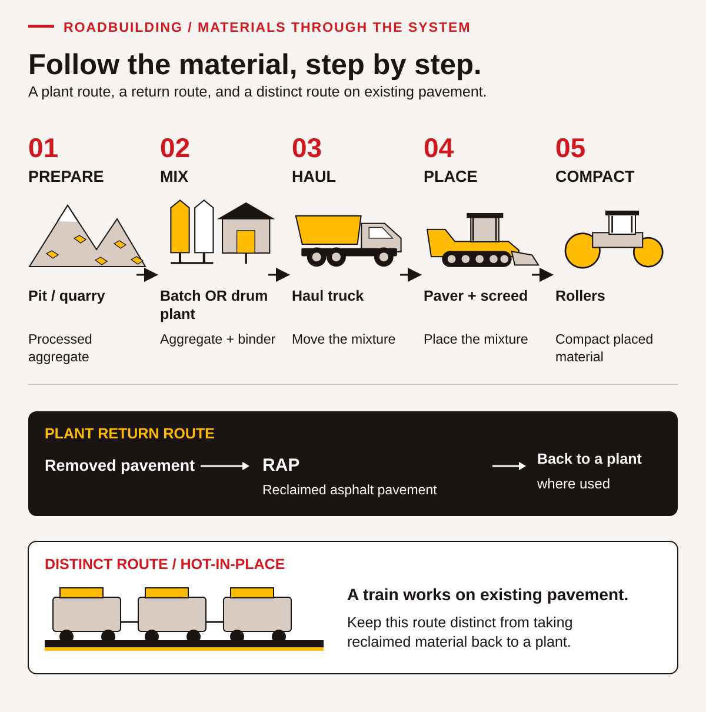
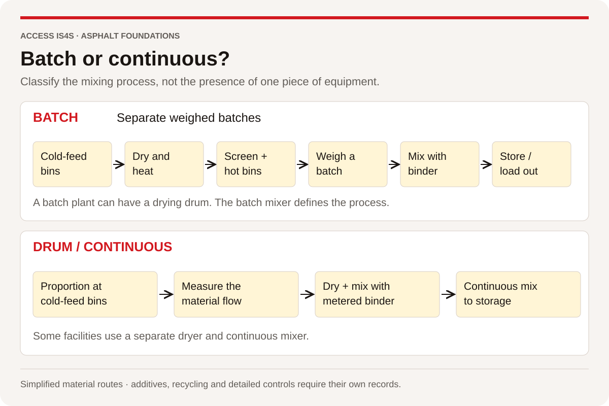
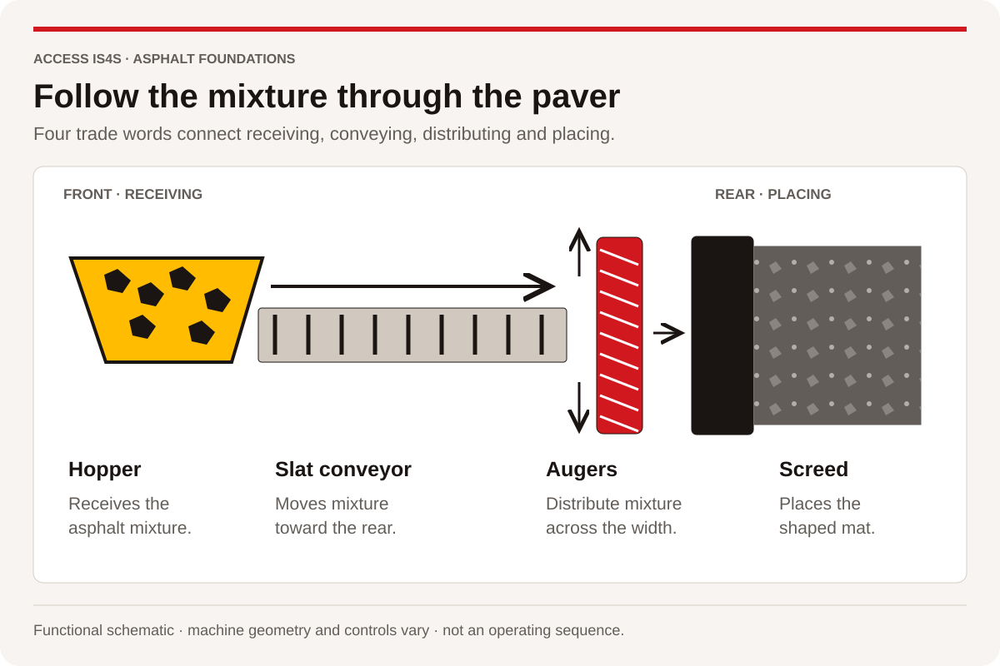
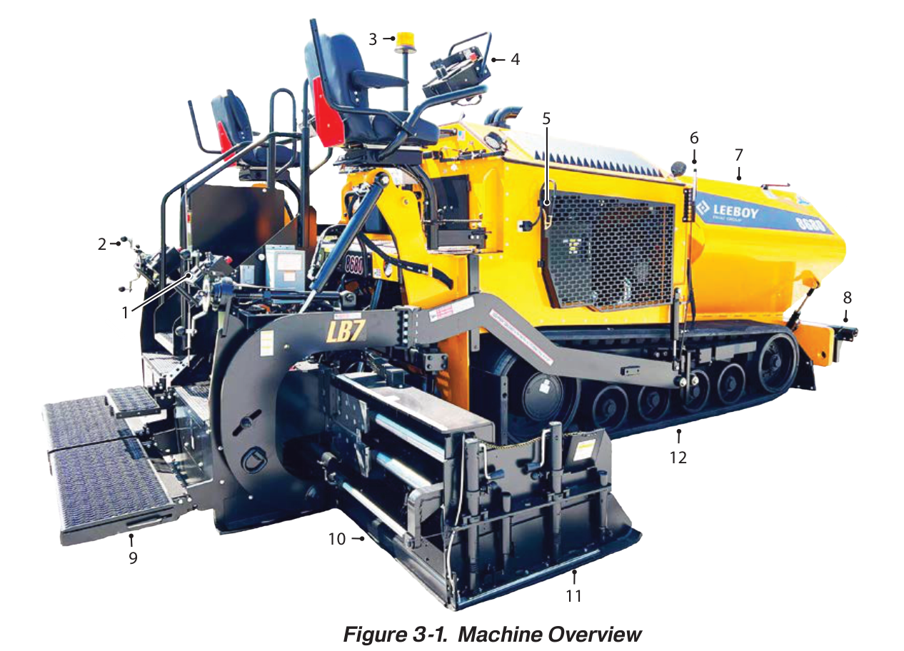

# 3 · From materials to paving

SKILLEDTRADESBC · LINE A<h2>A3 · Describe paving technology</h2>
Read the trade words, use them in a clear explanation, then keep evidence of your own work.

| Outline learning task | Practise here |
|---|---|
| A3.1 · Describe two types of asphalt plants | LA3-02 |
| A3.2 · Describe asphalt ingredients | LA3-01, LA3-05 |
| A3.3 · Discuss required resources | LA3-01 |
| A3.4 · Describe liquids used in asphalt production | LA3-03 |
| A3.5 · Describe asphalt recycling technology | LA3-04, LA3-06 |
| A3.6 · Describe the asphalt “Train” | LA3-04, LA3-06 |

Learning-task wording: SkilledTradesBC (2016, p. 22; PDF viewer p. 24). The activities develop classroom understanding; the answer guide records the evidence to check.

## Follow the material through the system

Paving technology connects material sources, manufacturing, transport and placement. Begin with the function of each stage. A pit or quarry supplies mineral material; processing prepares aggregate to specified characteristics; a plant combines selected materials; haul vehicles move the mixture; paving equipment places and shapes it; rollers compact the placed layer. Preparation, testing, traffic arrangements and finishing also matter. A flow map is a way to understand relationships, not permission to operate equipment.

<figure class="learning-figure" id="figure-la-1">

Figure LA-1

<em>Follow the material, step by step</em>

<figcaption><strong>Note.</strong> An original ACCESS IS4S instructional illustration. The process distinctions are explained in this chapter; the drawing supplies no operating settings or mix proportions. By ACCESS IS4S (2026a); see the figure references in the working reference section.</figcaption>
</figure>

## Read the trade word, then explain its job

| Trade word | Plain-language meaning | Say it in context |
|---|---|---|
| Asphalt cement / asphalt binder | The binding material in an asphalt mixture | “The binder holds the aggregate together.” |
| Processed gravel / aggregate | Mineral material prepared for the required characteristics | “The aggregate source still needs to meet the specification.” |
| Batch plant | Makes identifiable batches of mixture | “This record identifies one batch.” |
| Drum-mix plant | Uses a continuous material and mixing process; layouts vary | “This record describes a continuous feed period.” |
| Pit / quarry | Sources of mineral material: unconsolidated deposits / rock | “The source name does not prove material suitability.” |
| Asphalt train | A coordinated set of equipment and roles | “Name the process before explaining the train.” |

The outline uses **asphalt cement**. This book also uses **asphalt binder** for that material. Keep both terms available when reading different documents; neither means Portland cement. Use the complete phrase when the short word *cement* could be misunderstood.

## Know what the ingredients do

**Aggregate** is mineral material such as processed sand, gravel or crushed stone. A **pit** generally obtains unconsolidated deposits; a **quarry** extracts rock that may need crushing and screening. Material availability does not establish suitability: the required properties come from the approved design and specification. A short haul distance alone cannot answer whether a source meets the project requirements.

**Asphalt binder**, also called asphalt cement in many documents, binds the aggregate in asphalt mixtures. It is distinct from the Portland cement used in concrete. **Additives** and modified binders can change mixture characteristics for a defined purpose, but their selection and proportions require the applicable approved information. Fuel used to heat a production process is not automatically an ingredient in the pavement mixture. A delivery label must identify the actual product rather than relying on the loose word *oil*.

**Technology evidence card T1.** EPA's *Hot Mix Asphalt Plants* description identifies sized aggregate, liquid asphalt cement and potentially reclaimed asphalt pavement as components of hot-mix asphalt. It describes batch and drum-mix production. Its technical account is used here for the process distinction; its historical U.S. production totals and operating details are not current B.C. specifications.

### LA3-01 · Explain the ingredients to a new learner

Write a three-sentence explanation that distinguishes aggregate, asphalt binder and fuel. Include the outline term *asphalt cement* and explain its relationship to *asphalt binder*. Add a sentence explaining the conditional purpose of an additive and why its use needs approved information. Distinguish a pit from a quarry, then name one question about an aggregate source that proximity alone cannot answer. Explain why “cement” needs context when comparing asphalt and concrete. **Skills:** Reading, Writing, Communication.

## Distinguish batch and drum production

A **batch plant** prepares identifiable batches: aggregate is proportioned and combined with binder in a mixer. A **drum-mix plant** uses a continuous process in which material flows through the plant. Drum designs differ; do not treat every drum layout as identical. The beginner distinction is batch quantities versus a continuing material stream, not “one uses a drum and the other has no drum.” A batch plant can have a drying drum before its mixer.

<figure class="learning-figure" id="figure-la-4">

Figure LA-4

<em>Batch or continuous?</em>

<figcaption><strong>Note.</strong> Adapted from <em>The asphalt handbook</em> (7th ed., MS-4; <a href="../ms-4/reader/chapter-07-01.html#page-0344">Figure 7.2, p. 310 / PDF 344</a>; <a href="../ms-4/reader/chapter-07-01.html#page-0346">Figure 7.4, p. 312 / PDF 346</a>), by Asphalt Institute, 2007. Converted equipment drawings into two simplified process lanes; omitted settings and detailed control systems. Original Figure 7.2 is credited to Terex Roadbuilding in the handbook's contributor list. Original Figure 7.4 is credited to National Highway Institute (NHI) in the handbook's contributor list. Copyright 2007 by Asphalt Institute; original contributor credits retained.</figcaption>
</figure>

**Fictional classroom production records.** Plant B's teaching log lists batch 01, batch 02 and batch 03, each with a separate record of ingredients and release. Plant D's teaching log records a continuous feed period and time-stamped checks. These are deliberately simplified descriptions. Neither log provides an approved mix design, production rate or operating instruction.

**Worked example.** “Plant B has a drying drum, so it must be a drum-mix plant” is an invalid inference. Ask where and how the mixture is produced. B's separate batch records support a batch process in this case. The physical presence of one part does not classify the whole system.

### LA3-02 · Compare two process records

Identify the production type indicated by each fictional log. Draw or describe the common stages and the key difference. Add a correction to the worked-example claim in your own words. In pairs, one learner explains the map while the other checks whether it accidentally implies that a batch plant lacks a drying drum. Swap roles. **Skills:** Reading, Problem Solving, Collaboration.

## Treat product codes as information to verify

A product code can identify a grade system or a product, but it does not supply the whole application instruction. A penetration-grade designation and a performance-grade designation are different ways of describing binder characteristics. The numbers are not interchangeable merely because both appear beside asphalt. The purchaser and operator need the approved product, governing specification, supplier record and relevant safety information.

**Fictional document-check case.** An archive card contains the labels “Group A / C,” “85–100 Pen” and “PG 72–22,” and a handwritten note says “altered oil.” A new practice request says only “send the usual oil.” The meaning of “Group A / C” is not defined in this archive card. No current approved binder, project specification or supplier product sheet has been attached. These labels are for recognition and clarification; the case does not recommend either grade for B.C. work. Do not infer a mixing temperature, quantity or handling procedure from them.

### LA3-03 · Write the clarification before the order

First identify which archive wording is undefined and must be clarified; do not guess a classification from the letters. Make a four-item information request that would identify the intended product and its governing documents. Explain why “usual oil” and an archive grade label are insufficient. Read your request to a partner, who checks whether you have accidentally approved a product. Keep it as a classroom draft. **Skills:** Writing, Communication, Problem Solving.

## Separate the recycling routes

**Reclaimed asphalt pavement (RAP)** is asphalt pavement material recovered for possible reuse. A plant-recycling route takes recovered material through suitable processing and an approved production process. Reuse is conditional on the design and quality requirements. A claim that all recovered material can be added without testing is unsupported.

**Hot-in-place recycling** treats an existing asphalt surface on the road using a coordinated equipment train. Its broad purpose is to reuse existing material in place through a specialist process. It is different from hauling recovered material to a plant. A milling machine's removal of material is also not proof that the removed material has been successfully recycled. Track the actual route and evidence for reuse.

An **asphalt train** is a coordinated sequence of equipment and roles. In ordinary placement, haul, paver/screed and compaction functions connect. A specialist hot-in-place train has its own process and equipment. The word *train* does not mean every paving job uses the same machinery, controls or sequence.

## Follow the mixture inside the paver

The **hopper** receives mixture. **Slat conveyors** move it toward the rear. **Augers** distribute it across the width ahead of the **screed**, which places and shapes the mat. The screed also performs the placement stage's initial compaction; rollers have a later compaction role. Read each noun together with its action. The material route explains a general function; an identified machine manual supplies the actual layout and controls.

<figure class="learning-figure" id="figure-la-5">

Figure LA-5

<em>Follow the mixture through the paver</em>

<figcaption><strong>Note.</strong> Adapted from <em>The asphalt handbook</em> (7th ed., MS-4; <a href="../ms-4/reader/chapter-08-02.html#page-0411">Figure 8.11, p. 377 / PDF 411</a>; <a href="../ms-4/reader/chapter-08-02.html#page-0412">8.4.1, component descriptions, p. 378 / PDF 412</a>), by Asphalt Institute, 2007. Replaced the perspective equipment schematic with a labelled functional material route. Not drawn to scale or tied to an actual model. Original Figure 8.11 is credited to Volvo Construction Equipment in the handbook's contributor list. Copyright 2007 by Asphalt Institute; original contributor credits retained.</figcaption>
</figure>

**Worked explanation.** “The conveyor moves mixture rearward; the auger distributes it across the width.” The direction and job differ. Find the hopper and screed in the manufacturer photograph next, then explain why a general route diagram cannot establish another machine's numbered callouts.

## Read one machine picture carefully

The flow map names a function. A manufacturer picture helps you locate a particular machine's parts. Start with the model and numbered callout, then read the matching name. This example introduces paver component vocabulary for later equipment study.

<figure class="learning-figure manual" id="figure-la-3">

Figure LA-3

<em>Find the named part on a LeeBoy 8680 paver</em>

Select the photograph to inspect the callouts at full size.

Model 8680 · Manual 1033428-SOP · Serial number 365152 and above

<figcaption><strong>Note.</strong> Cropped from Figure 3-1, “Machine Overview,” in <em>LeeBoy model 8680 commercial paver: Safety and operations manual</em> (Manual No. 1033428-SOP, p. 3-7; PDF p. 43), by LeeBoy, 2026 (<a href="https://www.leeboy.com/wp-content/uploads/2024/03/1033428-SOP-MANUAL-8680-REV-A_WEB.pdf">manufacturer publication</a>). Copyright 2026 by LeeBoy. Original numbered callouts retained; the surrounding page and legend are omitted from the crop. Selected original component names appear below; the plain-language explanations are authored for this lesson. <a href="../manuals/pdfs/leeboy-8680-safety-operations-1033428-sop.pdf#page=43">Open the complete source page and legend.</a></figcaption>
</figure>

| Original callout | Manufacturer's name | Plain-language explanation |
|---|---|---|
| 7 | Hopper | Holds the supplied asphalt material on this paver |
| 10 | Screed Extension | Extends the screed's working width |
| 11 | End Gate | Contributes to forming the edge of the placed mat |
| 12 | High-Speed Rubber Tracks | The rubber tracks on which this machine travels; the source name supplies no permission to select a travel speed |

**Worked example · Look → name → explain.** “Callout 7 points to the **hopper**. It holds the supplied asphalt material. The photo does not tell me the approved mixture, the operating setting or whether another paver has the same arrangement.” Use the selected table to explain a second part. Keep the manual identity with your answer. The complete manual has the other callouts and their context.

### LA3-04 · Trace two reuse pathways

Draw two labelled routes: recovered material sent to a plant, and a specialist hot-in-place process on the existing road. Mark where the existing material is recovered or reused. Add one document or check needed before calling either route approved. Explain why “milled” and “recycled into a new pavement” are different claims. **Skills:** Reading, Creativity and Innovation, Problem Solving.

### LA3-05 · Calculate a fictional material record

A classroom demonstration model uses **80 counters for new aggregate, 15 for recovered mixture and 5 for binder**, for 100 counters in total. Counters are a visual model, not a mix recipe; the recovered mixture already contains its own materials. Find each category's share of the model and check the sum. Explain why adding the five binder counters to the 15 recovered-mixture counters does **not** establish the real binder content. **Skills:** Numeracy, Reading.

### LA3-06 · Respond to a changed process description

A team initially labels a photo “RAP going to a plant.” The caption is corrected to “specialist hot-in-place train.” Revise the material-flow card and give a handover identifying what changed, what remains accurate and what further process information would be needed. Each learner makes one recorded revision. **Skills:** Adaptability, Collaboration, Communication.

### LA3-07 · Make a retrievable technology note

Create a one-page document with the two plant distinctions, ingredient roles, two recycling routes and the unresolved product request. Save, close and reopen it; check that another learner can find its title and version. Offer a paper route for composing, while keeping actual Digital evidence separate. Finish by explaining one function without providing an operating setting. Add a small Figure LA-3 note: choose two of callouts 7, 10, 11 or 12, record the manufacturer’s names, explain each in plain language, and retain the model, manual number and page. State one thing the photograph cannot establish. Add the four-stage material route from Figure LA-5, using the words hopper, slat conveyors, augers and screed. Explain how the conveyor and auger functions differ. Use Figure LA-4 to check that your plant comparison describes the mixing process.
