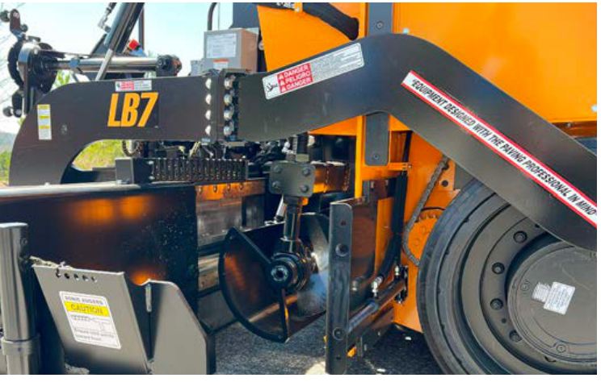
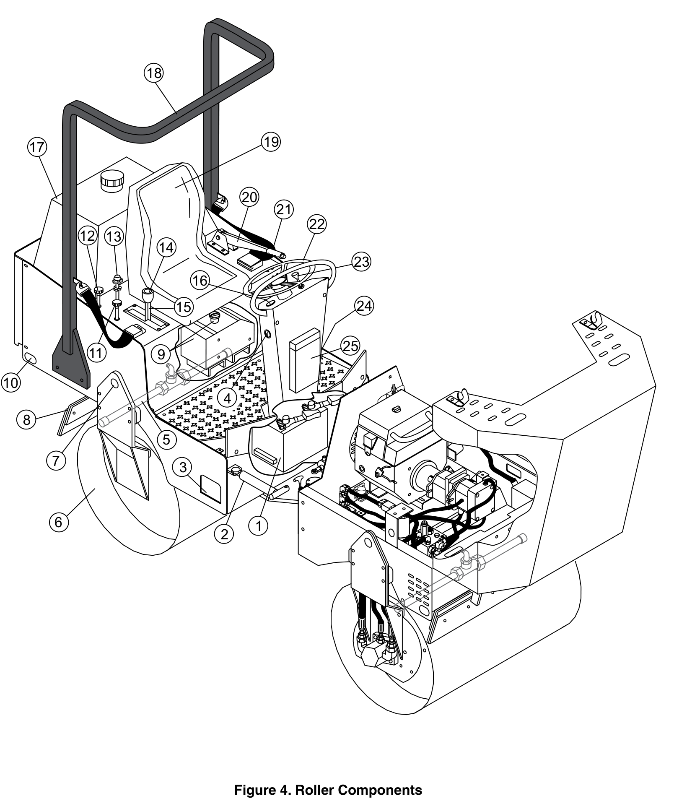
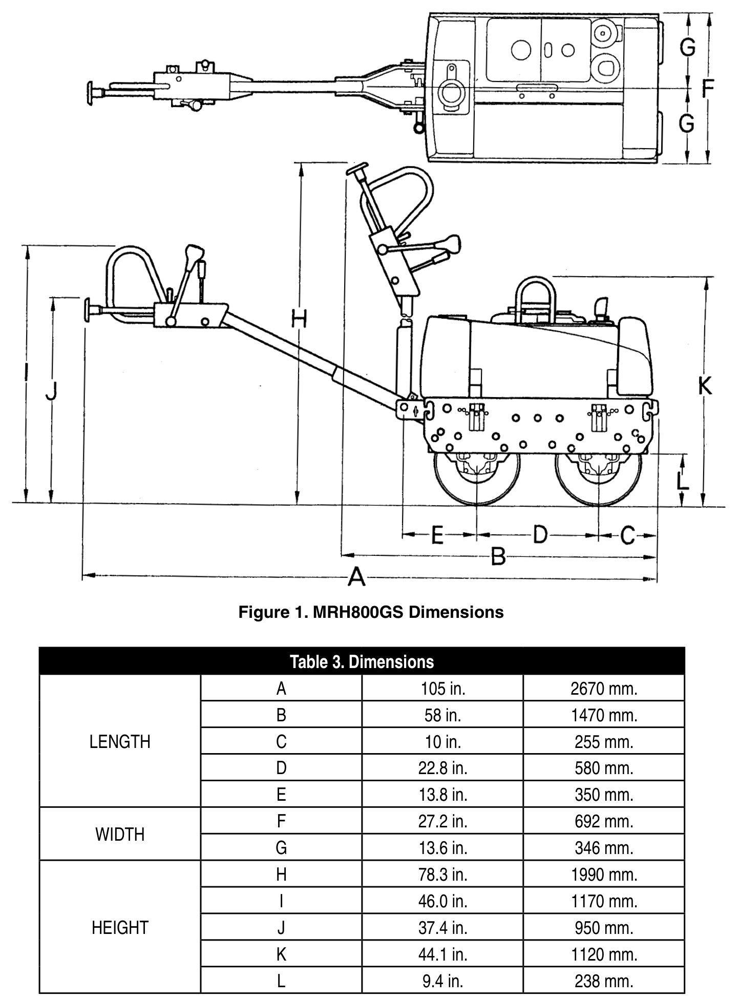

# Read the right manual before using the information

## A document has to fit the machine and the question

A manual is more than a collection of instructions. Its cover, publication number, model, serial range, revision and contents tell you what it can answer. A complete engine manual answers engine questions. A fluids publication answers a narrower family of questions. A machine manual connects those references to a particular machine. The same manufacturer can publish all three. The largest file, highest revision number or newest-looking filename is not automatically the correct choice.

This lesson uses the original manufacturer documents in this folder. Keep each document's title and identifier beside your notes. Open the complete PDF when reading a section: a search result or extracted paragraph can leave out a condition on the previous page. PDF viewer page numbers and printed page labels may differ. For example, the LeeBoy contact-information page is **PDF page 25**, labelled **2-3** on the page. Record both when helping another reader find it.

The work takes place with documents and fictional machine records. You will not operate, service or adjust equipment. A match between a cover and a fictional serial number is a document-selection result. For actual equipment, the responsible instructor or employer must confirm the machine's full identification, configuration, current information and the work you are trained and authorized to do.

## Prepare your reading space

Use a PDF reader and an approved practice folder, or begin with printed covers and contents pages. Enlarge the view, use text-to-speech, a line guide or another agreed access method. A paper attempt can show Reading or Numeracy. For Digital, take your own turn opening a file, finding a passage, saving a note and reopening it. Record any navigation help separately from help that selects the answer.

Work privately or with a willing partner. Use the fictional IDs below; no actual equipment ownership, employee details, account credentials or personal information is needed. Keep individual notes even when a pair develops one useful index. The aim is a clear handover that another person can check.

## Your document set

Open files through the pack's index. Their identifiers remain the same in the manifest and answer guidance.

| Pack ID | What the original file covers | First place to check |
|---|---|---|
| [OEM-01](pdfs/leeboy-8680-safety-operations-1033428-sop.pdf#page=1) | LeeBoy 8680 Commercial Paver, Safety and Operations Manual 1033428-SOP | Cover, PDF page 1; introduction, PDF page 3 |
| [OEM-02](pdfs/multiquip-mrh800gs-operation-rev10-2020.pdf#page=1) | Multiquip MRH800GS walk-behind vibratory roller, Revision 10 | Cover, PDF page 1; contents, PDF page 4 |
| [OEM-03](pdfs/multiquip-ar13ha-ar13har-sn110301-up-rev1-2021.pdf#page=1) | Multiquip AR13HA/AR13HAR ride-on roller, Revision 1 | Cover and serial range, PDF page 1; contents, PDF page 3 |
| [OEM-04](pdfs/multiquip-ar13ha-ar13har-sn100901-below-rev10-2021.pdf#page=1) | Multiquip AR13HA/AR13HAR ride-on roller, Revision 10 | Cover and serial range, PDF page 1; contents, PDF page 3 |
| [OEM-05](pdfs/cat-c3-6-c2-8-engines-m0108394-08-2022.pdf#page=1) | Caterpillar C3.6/C2.8 industrial engines, M0108394-08 | Cover, PDF page 1; product-identification section, PDF page 47 |
| [OEM-06](pdfs/cat-machine-fluids-sebu6250-30-2020.pdf#page=1) | Caterpillar Machine Fluids Recommendations, SEBU6250-30 | Cover, PDF page 1; foreword, PDF page 4 |
| [OEM-07](deere-410g-omt166701-d1/OMT166701_19.htm) | John Deere 410G Backhoe Loader Operator Manual, OMT166701 D1 | Original HTML contents; follow its identification links |

The CAT documents are included for their actual engine and fluids scope. The pack does not say those engines are fitted to the LeeBoy or Multiquip machines. The historical B.C. specification and John Deere reference, where listed in the index, have separate document records. Neither changes the scope of the six OEM PDFs above. The Deere reference is a full HTML manual, with its images and styles retained locally. Its model is roadbuilding support equipment rather than a paving machine.

### MAN-01 · Read the identity before the contents

For OEM-01 through OEM-07, record manufacturer, exact title, document number or revision, date, equipment scope and serial statement. If a cover does not state a serial range, write that it is not stated there. Do not invent a range from another model. For the LeeBoy file, distinguish the revision suggested by its download filename from information actually printed on the cover.

Then answer: Which two documents are complete machine manuals for the same model family but different serial ranges? Which file covers engines rather than the whole machine? Which covers a particular subject across Cat machines? Point to the words supporting each answer. **Skills: Reading, Problem Solving.**

### MAN-02 · Find it, save the evidence and reopen it

On an actual device, open OEM-01. Locate **Contact Information** through the contents or search. Confirm the printed page label and PDF viewer page. Read the paragraph about the machine nameplate and the separate engine-nameplate reference. Create a note named `manual-check-v1-[learning-ID]` with the title, pack ID, page labels and a one-sentence explanation of why machine and engine identification should not be confused. Save, close and reopen the note from its known location.

Show a second way to reach the same page, such as searching its heading after using the page control. Record the method, the result and any help. A filename or screenshot alone does not show that you found the right passage.

Also open OEM-07’s original HTML contents and follow **Record Engine Serial Number**. Record its heading and local filename. Explain why an HTML section is located by its link/title rather than assuming the PDF page number from a different document. Do not enter any real serial number. **Skills: Digital, Reading, Writing.**

## See the equipment, then use the trade words

The trade outline asks learners to describe paving equipment in **A1**, then develops paving-machine components in **I2**, screed functions and attachments in **J1**, and compaction equipment in **L1**. These four visual practices introduce those words through actual manufacturer figures. They build document-reading evidence; the later technical units still need their full instruction and practical assessment. The complete learning-task locations are listed in the teaching guide.

Use this reading routine: **look at the whole view → find a callout → read its name → explain its function → check the complete page.** A callout is the number or letter joined to part of a drawing. A legend connects the callout to its meaning. Read both; the shape alone can mislead.

### VIS-01 · Name the part and say what it does

<figure class="manual-figure" id="mf-01">

<figcaption><strong>Figure 1</strong> <em>Locate the paver components.</em> <em>Note.</em> Cropped from Figure 3-1, “Machine Overview,” in <em>LeeBoy model 8680 commercial paver: Safety and operations manual</em> (Manual No. 1033428-SOP, p. 3-7; PDF p. 43), by LeeBoy, 2026 (<a href="https://www.leeboy.com/wp-content/uploads/2024/03/1033428-SOP-MANUAL-8680-REV-A_WEB.pdf">manufacturer PDF</a>). Copyright 2026 by LeeBoy. Original numbered callouts retained; the surrounding page and function table are outside the crop. Component names appear below. This manual applies to serial number 365152 and above.</figcaption>
</figure>

[Open the larger figure](assets/crops/leeboy-8680-machine-overview.png) · [Read the complete source page](pdfs/leeboy-8680-safety-operations-1033428-sop.pdf#page=43)

| Callout | Name printed in the manual | Callout | Name printed in the manual |
|---|---|---|---|
| 1 | Screed Control Panel | 7 | Hopper |
| 2 | Horizontal Depth Screw | 8 | Push Rollers or Hydraulic Truck Hitch Option |
| 3 | Beacon Light | 9 | Foldable Walkboard |
| 4 | Main Control Panel | 10 | Screed Extension |
| 5 | Spray Down Wand | 11 | End Gate |
| 6 | Screed Elevation Guide | 12 | High-Speed Rubber Tracks |

**Use the trade words.** A paver has a **tractor** and a **screed**. Here, *tractor* means the powered machine section that carries material and pulls the screed. The **hopper** receives asphalt mixture. **Conveyors** carry that mixture rearward; **augers** distribute it toward the screed. The screed shapes the placed layer and provides initial compaction. A **screed extension** changes the working width; an **end gate** helps form the edge. These are functions to understand before learning the actual machine's procedures.

**Worked example.** “Number 10 is a screed extension. I can locate it at the side of the screed. Its role relates to paving width.” This connects a visible callout, a precise term and a function. “Number 10 is the yellow part” does not identify a function and will not help someone reading a different view.

Find **7, 10, 11 and 12**. Write or dictate one name-and-function sentence for each. Check against the full source table, then explain one sentence to a partner using the picture. The listener points to the intended callout and explains what they understood. If pointing is not an accessible action, identify the number and position by words or an agreed communication method. **Skills: Reading, Writing, Communication.**

### VIS-02 · Follow the material, not just the arrows

<figure class="manual-figure compact-photo" id="mf-02">

<figcaption><strong>Figure 2</strong> <em>Look at the auger area.</em> <em>Note.</em> Cropped from the unnumbered photograph above “Augers,” in <em>LeeBoy model 8680 commercial paver: Safety and operations manual</em> (Manual No. 1033428-SOP, p. 3-6; PDF p. 42), by LeeBoy, 2026 (<a href="https://www.leeboy.com/wp-content/uploads/2024/03/1033428-SOP-MANUAL-8680-REV-A_WEB.pdf">manufacturer PDF</a>). Copyright 2026 by LeeBoy. The complete photograph is retained; its surrounding explanation is available in the linked source page.</figcaption>
</figure>

[Open the larger figure](assets/crops/leeboy-8680-augers.png) · [Read “Augers” and “Hopper and Conveyors” together](pdfs/leeboy-8680-safety-operations-1033428-sop.pdf#page=42)

**Read in everyday words.** The hopper holds the delivered mixture. Conveyors move material towards the rear. Augers move material across towards the screed. The screed works on the placed layer. *Hopper*, *conveyor*, *auger* and *screed* name different components; they are not four words for the same thing.

Make four labelled cards using those terms. Add one short function to each. Arrange the cards to explain the material route from receipt to the screed, then compare your explanation with the source page. Connect the two parts that mainly move material with different direction words: **rearward** and **across**. A learner's draft says, “The hopper compacts the finished mat.” Correct that sentence and explain which idea was mixed up.

Try the card arrangement with a partner who has not seen your first arrangement. Record which term they found easiest and which needed clarification. Improve one label if the trial shows a problem, or keep it and explain why. A diagram of material flow does not give a safe place to stand or permission to reach into equipment. **Skills: Reading, Problem Solving, Creativity and Innovation, Collaboration.**

### VIS-03 · Match the roller view to the right vocabulary

<figure class="manual-figure portrait-figure" id="mf-03">

<figcaption><strong>Figure 3</strong> <em>Read a roller component diagram.</em> <em>Note.</em> Cropped from Figure 4, “Roller Components,” in <em>AR13HA/AR13HAR ride-on tandem drum roller: Operation manual</em> (Rev. 1, p. 14), by Multiquip Inc., 2021 (<a href="https://service.multiquip.com/pdfs/AR13HA-R-rev-1-SN-110301-and-above-ops-manual.pdf">manufacturer PDF</a>). Copyright 2021 by Multiquip Inc. All callouts and the original figure caption are retained. The component descriptions follow on p. 15. Serial scope: 110301 and above.</figcaption>
</figure>

[Open the larger figure](assets/crops/multiquip-ar13-roller-components.png) · [Open the diagram and following component descriptions](pdfs/multiquip-ar13ha-ar13har-sn110301-up-rev1-2021.pdf#page=14)

| Selected callout | Name from the source legend on page 15 | What to notice in document reading |
|---|---|---|
| 6 | Rear Roller | The description identifies a steel drum. |
| 16 | Hourmeter | Its reading concerns accumulated use, not travel speed. |
| 17 | Water Tank | Water storage is a different system from the fuel tank. |
| 19 | Operator's Seat | The diagram provides an operator position; it does not demonstrate safe operation. |
| 21 | Seat Belt | The source description also contains a safety instruction; read that complete description. |
| 25 | Documentation Box | The manufacturer identifies a place for the machine's manuals. |

**Use the trade words.** **Drum** and **pneumatic (rubber tire)** describe different contact types. **Vibratory** and **static** describe different compaction actions: vibratory equipment adds vibration; static compaction uses load without added vibration. Those words answer different questions. The drawing shows a tandem drum roller; it does not show a pneumatic roller. The outline also names **breakdown**, **intermediate** and **finish** as phases in a compaction train. A component picture alone does not select a roller, phase, pass count or machine setting for a job.

On a device, open the full PDF, find Figure 4 and then page 15. Locate three of the selected callouts and record the exact names, figure number and both page locations in your saved note. With a partner, swap the finder and checker roles for another two callouts. Keep each person's contribution.

Now review a fictional draft label: “All compaction rollers are diesel powered, so this diagram shows a diesel model.” Check the cover and page 12. Revise the label using the named engine's fuel type and the stated model. Explain why neither a broad category nor a familiar picture establishes the engine specification. Save the corrected version while keeping the first draft. **Skills: Digital when performed, Reading, Collaboration, Adaptability.**

### VIS-04 · Read the dimension, its letter and its unit

<figure class="manual-figure portrait-figure" id="mf-04">

<figcaption><strong>Figure 4</strong> <em>Connect a dimension letter to its value.</em> <em>Note.</em> Cropped from Figure 1, “MRH800GS Dimensions,” and Table 3, “Dimensions,” in <em>MRH800GS vibratory roller: Operation manual</em> (Rev. 10, p. 12), by Multiquip Inc., 2020 (<a href="https://www.multiquip.com/multiquip/pdfs/MRH800GS_rev_10_ops_manual.pdf">manufacturer PDF</a>). Copyright 2020 by Multiquip Inc. The complete diagram and its associated table are retained together; page header and footer are omitted.</figcaption>
</figure>

[Open the larger figure](assets/crops/multiquip-mrh800gs-dimensions.png) · [Read the full dimensions page](pdfs/multiquip-mrh800gs-operation-rev10-2020.pdf#page=12)

**Metric reading table.** The following values are transcribed from Table 3 so the dimensions can also be read as text. Use the drawing to identify each letter's endpoints.

| Source group | Letter | Published metric value |
|---|---|---|
| Length | A | 2,670 mm |
| Length | B | 1,470 mm |
| Length | C | 255 mm |
| Length | D | 580 mm |
| Length | E | 350 mm |
| Width | F | 692 mm |
| Width | G | 346 mm |
| Height | H | 1,990 mm |
| Height | I | 1,170 mm |
| Height | J | 950 mm |
| Height | K | 1,120 mm |
| Height | L | 238 mm |

**Worked example.** Find **B** on the side view, then its row in the table. The metric value is **1,470 mm**, which is **1.470 m** because 1,000 mm = 1 m. Keep the letter and unit with the value. Writing only “1,470” loses what was measured and in which unit. The imperial and metric values are published rounded measurements; do not expect every pair to give an exact conversion match.

Use the **metric column only** for these checks:

1. Find **F** and **G** on the upper view. Record both values and test whether **2 × G = F** in the published table.
2. Convert F from millimetres to metres. Explain why **692 m** would be an unreasonable transcription of **692 mm**.
3. Read **H** and **I** in the side view/table. Calculate their numerical difference in millimetres. Keep the dimension letters in your statement so another reader can check the comparison.
4. A fictional room plan lists a doorway as **700 mm** wide. Calculate the difference between that value and dimension F. Explain why this arithmetic alone cannot approve moving a machine through the doorway: the route, machine configuration, clearances and safe movement procedure have not been checked.

Show the source row, your calculation, unit and explanation. Ask a partner to trace one answer back to the diagram rather than only checking the arithmetic. **Skills: Numeracy, Reading, Writing, Communication.**

## Case A · Three fictional machine records

A classroom resource coordinator has three practice records. The records do not authorize any real assignment.

| Practice record | Stated model | Stated serial number | Request |
|---|---|---:|---|
| A | Multiquip AR13HA | 110450 | Identify the matching cover among OEM-03 and OEM-04 |
| B | Multiquip AR13HAR | 100850 | Identify the matching cover among OEM-03 and OEM-04 |
| C | Multiquip AR13HA | 105500 | Identify the matching cover among OEM-03 and OEM-04, or explain the gap |

Both PDFs are genuine manufacturer files. OEM-03 is dated 18 June 2021, Revision 1; OEM-04 is dated 25 June 2021, Revision 10. Those facts do not make their serial ranges interchangeable. The coordinator has not supplied configuration, service-bulletin status or a current manufacturer confirmation.

### MAN-03 · Count pages and compare ranges

Use the two contents pages. OEM-03 lists Maintenance on printed pages **23–32**; OEM-04 lists it on **25–34**. How many pages does each listed range include? Show why subtracting the first page from the last page alone misses one page. The complete PDFs contain **42** and **46** viewer pages respectively; find that difference and explain why neither count establishes the amount of training required.

Next write the first and last integer serial values in the uncovered interval between OEM-04's stated upper boundary and OEM-03's stated lower boundary. Count those possible values inclusively. Explain why that count is not a count of machines manufactured. **Skills: Numeracy, Reading.**

### MAN-04 · Write a verification note that preserves uncertainty

Write a 70–110-word note to the classroom coordinator covering records A, B and C. Include the selected manual or unresolved status for each, the exact serial evidence, the meaning of the revision dates, and a next confirmation step. Separate a cover match from authorization to work. Keep the note factual; do not claim that a document is current for an actual machine when that has not been checked. Use a heading and a clear requested action. Add this verification note to `manual-check-v1-[learning-ID]`, keeping the MAN-02 navigation note in the same file; on paper, keep both notes together as version 1. **Skills: Writing, Reading.**

### MAN-05 · Resolve the incomplete match

For record C, compare these proposed responses:

1. Choose Revision 10 because its number and date are higher.
2. Choose the nearer serial boundary.
3. Keep the selection unresolved and ask the responsible instructor or manufacturer support to identify the manual from the complete machine record.

State the problem, one consequence of choosing without evidence, two facts already known and two facts still needed. Select a response with a reason. Draft the information request without sending it. Name the evidence that would allow a later decision; do not report that confirmation as already received. **Skills: Problem Solving, Writing.**

### MAN-06 · Give a handover and check what was understood

Explain your decision about record C to a partner in about one minute. The listener restates the model, unresolved range and next action in their own words. Invite a question. Correct a misunderstanding if one occurs, or record what was accurately understood. Swap roles using record A. Keep a short note of the actual check-back rather than writing that communication was successful without evidence. Signing, a communication aid or another agreed method can carry the same information. **Skills: Communication.**

### MAN-07 · Share the checking work without losing individual evidence

Work in pairs with OEM-01 and OEM-02. For the first document, one learner reads the cover and the other verifies the contents/page route. Record the title, scope and one useful navigation anchor. Swap the roles for the second document. Each learner keeps one check they performed and one question or correction they contributed. Agree how the pair's note may be shared. Judge the accuracy and coordination of the work, not speed, confidence or who speaks most. **Skills: Collaboration, Reading.**

## Case B · A changed classroom record

The coordinator corrects **practice record C's serial number from 105500 to 110500**. The model remains AR13HA. This is a fictional correction to the classroom record, not a new manufacturer publication. The reason for the original entry error is not supplied. The two manuals and their stated ranges remain unchanged.

### MAN-08 · Revise the decision and keep the earlier record

Create `manual-check-v2-[learning-ID]`, retaining v1. Identify what changed, what stays the same and which selection is now supported by the cover. State what actual-machine checks still remain. Do not invent a cause for the entry error. Reopen v2 and verify both the corrected serial and the reasoning; changing only the filename would leave the wrong decision in place. If working on paper, date and label both versions. Record Digital only when you performed the file actions. **Skills: Adaptability; Digital when performed.**

### MAN-09 · Make a navigation aid and test it

Develop two possible designs for a one-page manual-finder: for example, an index arranged by equipment family or a decision path that begins with model and serial scope. Choose one and explain why it would help another learner. Include pack ID, document type, model/scope, a useful page route and an unresolved-status option. Use words and visual structure that remain clear without colour. Avoid turning the aid into operating steps or a replacement for the original manual.

Make a small usable version. Ask a willing reader to use it to find the CAT document that addresses engine identification, then to explain whether it can supply the complete operating instructions for a LeeBoy paver. Record the actual choice, explanation and any help. Revise one feature if the evidence suggests a need, or retain it with a reason. Try a second question: find the Multiquip walk-behind roller contents page. State one limit on what these two trials demonstrate. **Skills: Creativity and Innovation, Communication, Problem Solving.**

## Keep the evidence of your work

| Activity / date | Document and page or file version | What I did and checked | Access tools or task-solving help | Next step |
|---|---|---|---|---|
| | | | | |
| | | | | |
| | | | | |

A useful record shows the decision, the source and the check. It can include an unresolved result when the supplied evidence does not support a choice. Keep your authored note, actual file-action record, calculations, check-back and tested navigation aid. Discuss the next practice with your instructor using the local descriptions Not observed, Not yet demonstrated, Demonstrated with support or Demonstrated independently under the agreed conditions.

## Figure references

LeeBoy. (2026). *LeeBoy model 8680 commercial paver: Safety and operations manual* (Manual No. 1033428-SOP). https://www.leeboy.com/wp-content/uploads/2024/03/1033428-SOP-MANUAL-8680-REV-A_WEB.pdf

Multiquip Inc. (2020, June 11). *MRH800GS vibratory roller: Operation manual* (Rev. 10). https://www.multiquip.com/multiquip/pdfs/MRH800GS_rev_10_ops_manual.pdf

Multiquip Inc. (2021, June 18). *AR13HA/AR13HAR ride-on tandem drum roller: Operation manual* (Rev. 1; serial no. 110301 and above). https://service.multiquip.com/pdfs/AR13HA-R-rev-1-SN-110301-and-above-ops-manual.pdf

The figure notes identify the exact source and crop. Full manufacturer documents and their notices remain in this collection. [Figure provenance](assets/figure-manifest.json) records source checksums, original page locations and crop coordinates.
