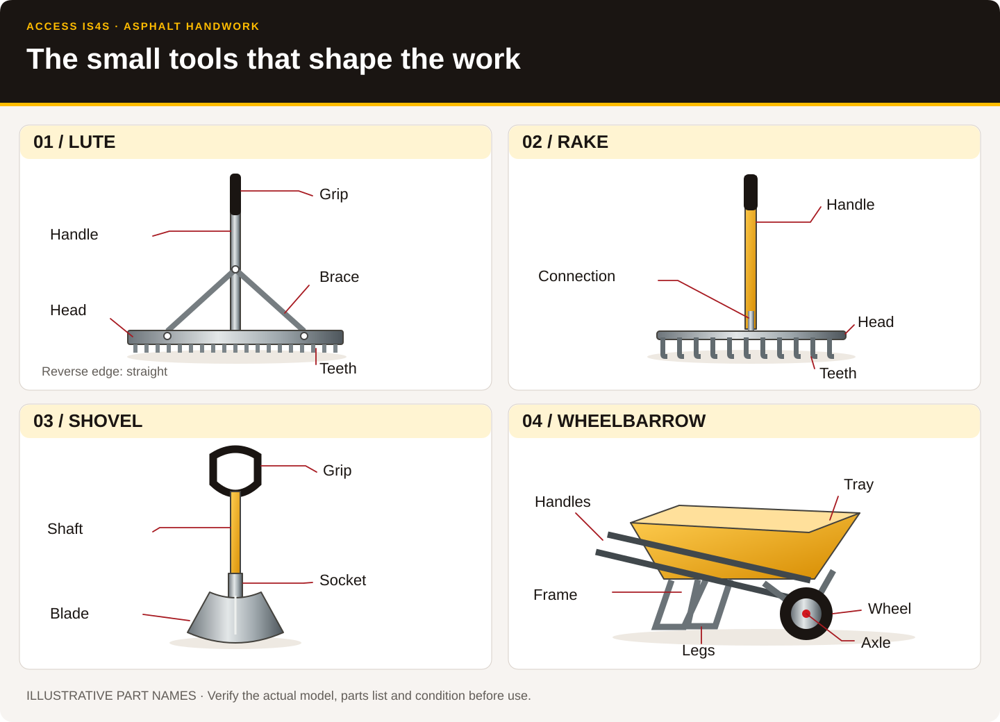
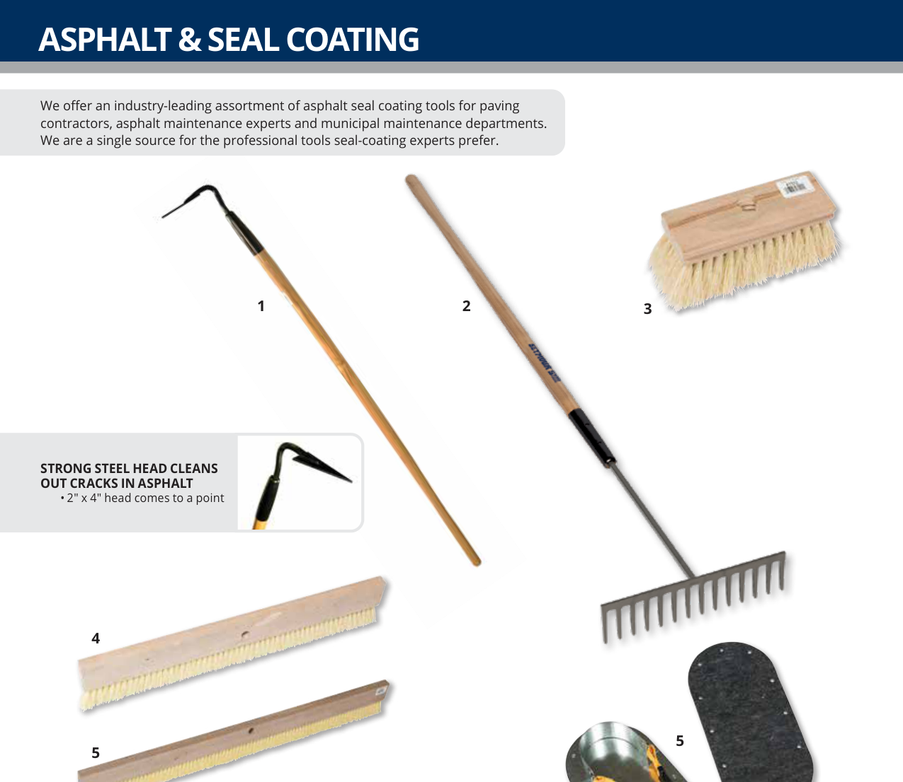
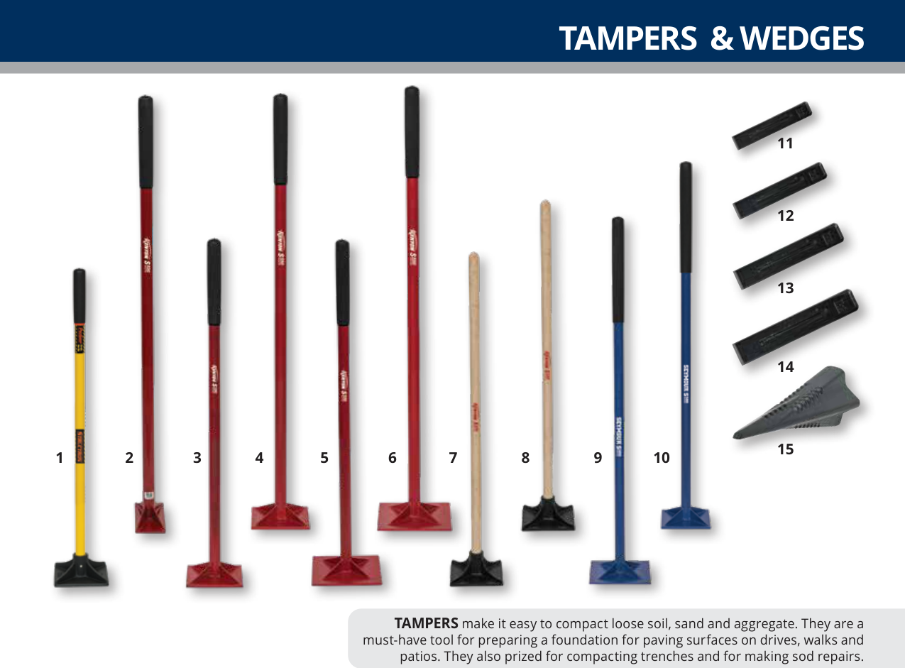
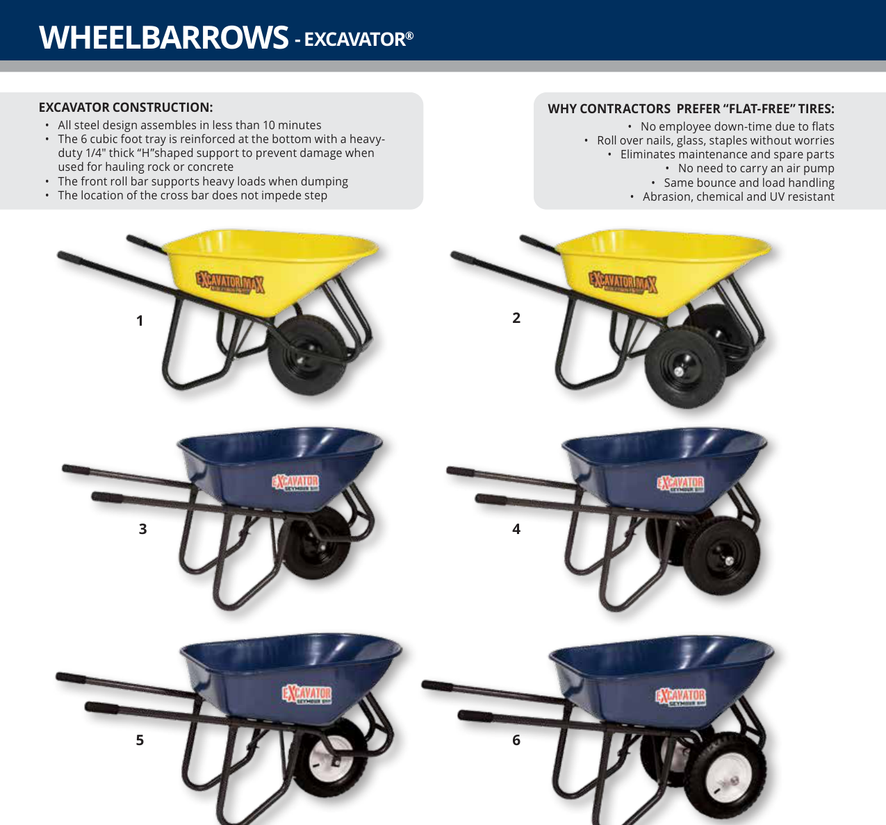
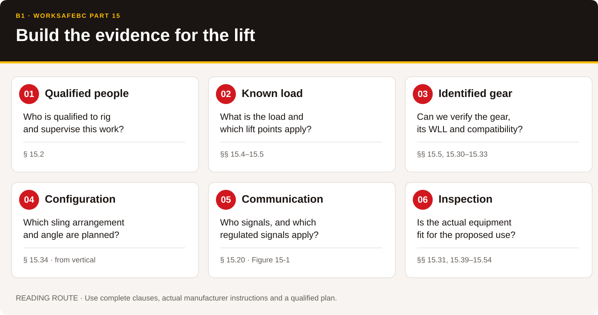
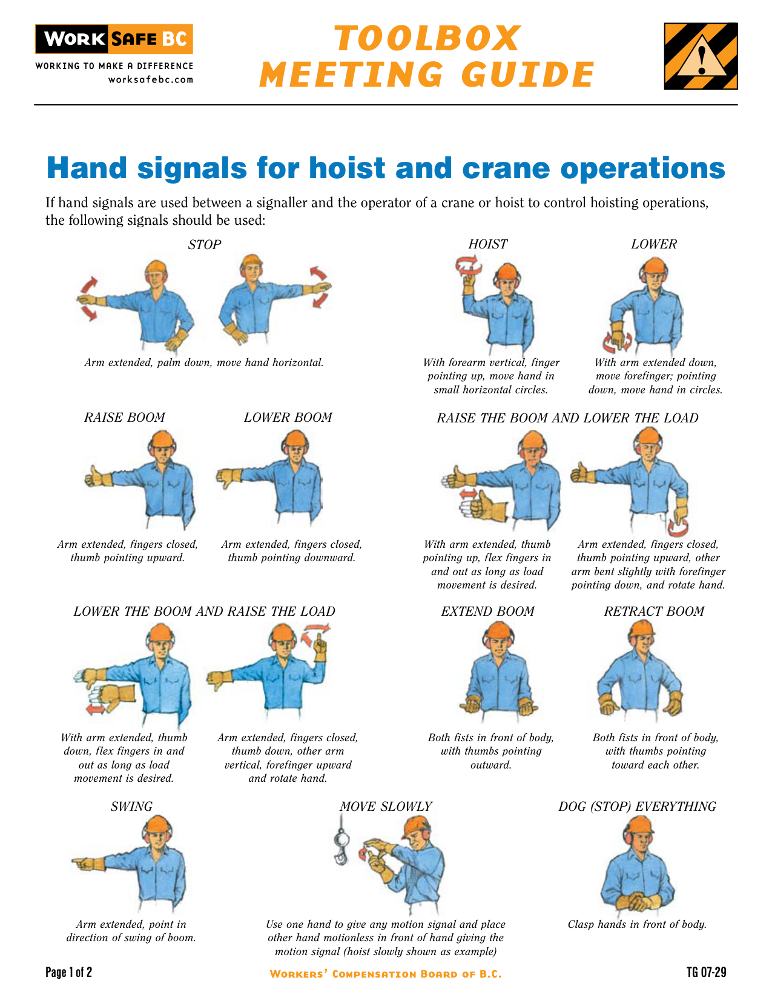
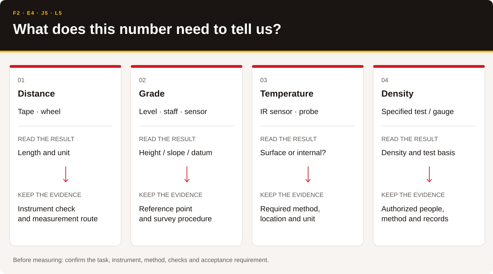

# Know the tools. Prepare the work.

Asphalt work depends on small tools as well as large machines. A sound lute, a readable sling tag and the correct temperature measurement each support the crew's work. This guide connects the trade terms to real manufacturer information and the requirements that govern work in British Columbia.

Start with the picture, say the part name, then locate it in the actual document. Work with a partner to explain what the tool does and what must be checked. Nobody needs to share personal or cultural knowledge to participate. Any local language, place knowledge or community protocol belongs under the direction of the people who choose to contribute it.

[Complete tool register](tools.html) · [All 68 competencies](coverage.html) · [Source library](index.html) · [Outstanding delivery requirements](gaps.html)

## 1 · The handwork kit

*Figure 1. ACCESS IS4S (2026). Handwork tool anatomy. Original schematic informed by Seymour Midwest's Light Lute/Lute Assembly Instructions, pp. 1–2, and Partner Resource Guide, source PDF pp. 18–47, 94–96 and 156–158. Shapes are illustrative; check the selected model's parts list. [Actual manufacturer documents](index.html#seymour-tool-catalogue-2026).*

**Lute.** Locate the head, handle, grip, brace and fasteners. The outline names both toothed and straight lute edges. The manufacturer's assembly sheet identifies different head widths, handle sizes and brace arrangements; those parts are not automatically interchangeable. Use the actual parts list when matching a replacement.

**Asphalt rake.** Locate the handle, head and teeth. Distinguish the rake from a concrete placer, scraper and seal-coating squeegee. Similar-looking tools can have different jobs. The actual catalogue shows the available head shapes and applications.

**Shovel.** Locate the grip, shaft/socket and blade. Select the blade and handle for the material and task, then plan manageable loads, stable footing and movement with the crew. CCOHS's shovelling examples support ergonomic discussion; they are not a maximum load that every learner should lift.

**Wheelbarrow.** Locate the tray, handles, frame, legs, axle and wheel. The catalogue identifies different tray capacities and wheel arrangements. Plan a stable route and controlled loading. A tray's volume does not establish a safe load for a particular person, slope or surface.

<figure><figcaption>Figure 2. Seymour Midwest. (2026 publisher download). <cite>Partner Resource Guide</cite> (source PDF p. 156; printed p. 155). Cropped upper illustration area; original product relationships retained. <a href="index.html#seymour-tool-catalogue-2026">Full page and product specifications</a>.</figcaption></figure>

**Look, locate, explain.** Find one toothed lute head and one straight head in the manufacturer sheet. Point to the matching handle and braces in its parts list. Explain to a partner why matching only the tool's colour would be insufficient. Record the document title and model/part identifier you used.

Read: [Lute assembly and replacement parts](index.html#lute-instructions), [gusset braces](index.html#lute-gusset-brace), [wrap-around braces](index.html#lute-wrap-brace), [blacktop brush](index.html#blacktop-brush), [scraper](index.html#hand-scraper), [general hand-tool safety](index.html#ccohs-handtools-general), [shovelling](index.html#ccohs-shovelling).

## 2 · Compact, clean and maintain

<section><h3>Hand tamper</h3>
Identify the handle, attachment and tamping face. Match the tool to the specified material and confined-area work. A hand tamper and a powered plate compactor have different hazards and instructions.
</section><section><h3>Wheelbarrow</h3>
Compare wheel arrangement, tray, frame and handles. Use actual specifications to describe the differences, then discuss how the route and task affect selection.
</section>

*Figures 3–4. Seymour Midwest. (2026 publisher download). Partner Resource Guide (source PDF pp. 91 and 94; printed pp. 90 and 93). Cropped product illustration areas. [Complete catalogue](index.html#seymour-tool-catalogue-2026).*

The [Multiquip MVC-88VGH/VGHW manual](index.html#multiquip-plate-manual) includes operating information, maintenance and actual parts diagrams for that example plate compactor. It does not establish suitability or settings for another machine. The [Chicago Pneumatic operating manual](index.html#cp-breaker-manual-alt) and [CP 1230 parts list](index.html#cp-1230-manual-pl) provide real air-hammer components and model-specific guidance for B4.

The [Lincoln grease-gun guide](index.html#lincoln-grease-gun) identifies the gun and its servicing requirements. The machine's own lubrication chart determines the lubricant, quantity and interval. Avoid converting the outline's example “shots of grease” into a universal procedure.

Use [Part 12, Tools, Machinery and Equipment](web/ohs-12.html), [Part 10, De-energization and Lockout](web/ohs-10.html), and [pneumatic-tool guidance](index.html#ccohs-pneumatic-tools) alongside the actual equipment instructions. Maintenance and clearing blockages require the employer's applicable isolation procedure, including stored energy.

## 3 · Rigging is a distinct competency

**B1 explicitly calls for WorkSafeBC Part 15.** The local collection now contains the complete regulation article, its tables and all six source figures, Part 14 on cranes and hoists, Part 15 guidelines, an official crane-signal sheet, a rigging-failure bulletin and Crosby's 128-page end-termination manual.

*Figure 5. ACCESS IS4S (2026). Rigging reading route. Original information diagram based on WorkSafeBC, OHS Regulation, Parts 14 and 15, especially ss. 15.2, 15.4–15.5, 15.20 and 15.30–15.39. This is a reading sequence, not a lift plan.*

| Find the requirement | Read it in the actual regulation | What to establish before a practical lift |
|---|---|---|
| Qualified people | Part 15, s. 15.2 | Qualified riggers, or direct supervision by a qualified worker, with the knowledge and signals required by the provision. |
| Load and gear identification | ss. 15.4–15.5 | Load information, working load limits (WLL), required markings and compatible hardware for the proposed configuration. |
| Signals | s. 15.20 and Figure 15-1 | The regulated hand signals when controlling a crane or hoist by hand signals; roles and communication arrangements for the actual lift. |
| Slings and inspection | ss. 15.30–15.33 | Applicable sling requirements, pre-use inspection, identification and WLL. |
| Sling angle | s. 15.34 and Table 15-3 | The regulation measures this angle **from the vertical**. Use the exact table, configuration and qualified planning; do not substitute an angle measured from the ground. |
| Protection and rejection | ss. 15.39–15.54, as applicable | Edge protection and the inspection/rejection provisions for the actual sling material and hardware. |
| Special lifting devices | ss. 15.57–15.60, as applicable | Design, identification and use requirements for the selected below-the-hook device. |

Read the complete [Part 15](web/ohs-15.html), [Part 14](web/ohs-14.html) and [Part 15 guidelines](web/guidelines-15.html). Keep conditions and exceptions with each clause. The historical [Crosby manual](index.html#crosby-termination) supplies actual manufacturer illustrations for named products; it does not provide a lift plan or replace the current instructions for the gear purchased.

<figure class="signals"><figcaption>Figure 6. WorkSafeBC. (n.d.). <cite>Hand signals for hoist and crane operations</cite> (TG07-29, p. 1). Complete first page reproduced. <a href="index.html#wsbc-crane-signals">Both source pages</a>; see also <a href="web/ohs-15.html">the regulation's Figure 15-1</a>.</figcaption></figure>

**Document exercise.** Compare a fictional sling record that has a readable manufacturer, identifier and rated information with a record missing its identifier. Locate the clauses that tell the crew what must be verified. Explain which uncertainty must be resolved before planning the lift. Do not invent a capacity from the sling's colour or appearance.

## 4 · Torch, propane and hot work

The [Tiger Torch 95-B/445 sheet](index.html#fairview-tiger-torch) and [BC Forest Safety Council crew talk](index.html#bcforest-tiger-torch) provide actual instructions and safety context. Read them with the [CCOHS propane profile](index.html#ccohs-propane), the actual supplier SDS, applicable workplace fire precautions and the employer's hot-work arrangements.

Identify the **torch, valve, hose, regulator, cylinder and connection types** using the actual equipment. The outline's phrase “Tiger torch” does not establish that any regulator, pressure, hose or fitting is interchangeable. Obtain the regulator and hose instructions for the selected assembly and confirm its condition and suitability before practical use.

Use the illustrated source sheet for terminology and model identification. Any practical lighting, shutdown, leak response or storage instruction must match the actual equipment, qualified instruction and current site procedure. Keep torch work away from the classroom identification station.

## 5 · Measure the right thing

*Figure 7. ACCESS IS4S (2026). Match the measurement to the decision. Original diagram informed by outline F2, E4 and L5, the Leica NA700 data sheet, ThermoWorks IRK-2 instructions, Troxler 3430 manual and CNSC portable-gauge guidance.*

**Distance and grade.** The [measuring-wheel sheet](index.html#measuring-wheel) explains a specific counter mechanism. The [Leica NA700 brochure](index.html#leica-level-brochure) and [data sheet](index.html#leica-level-datasheet) provide actual level components and specifications. F2 also names spirit levels, builder's levels, laser levels and automatic slope control. Obtain the actual instrument's manual, calibration/check method, units and approved survey procedure before field use.

**Temperature.** The [ThermoWorks manual](index.html#infrared-thermometer) and [field-of-view diagram](index.html#infrared-spot-diagram) distinguish the infrared measurement and supported probe functions. An infrared surface reading is not automatically the internal temperature required by a mix or test specification. Record the measurement method and location as well as the number and unit.

**Density.** The [Troxler 3430 manual](index.html#troxler-3430-manual) identifies actual gauge components and procedures for that model. The [CNSC portable-gauge article](web/cnsc-gauges-current.html), [complete online guide](web/cnsc-gauges-guide.html) and [two-page field guide](index.html#cnsc-gauge-guide-pdf) add Canadian licensing, radiation protection, security, transport and document context. The provider must establish its licence arrangements and authorized people before handling a nuclear gauge. Use diagrams, records or an approved inert training device for classroom identification.

**Mat depth and sampling.** J5 names a poker for depth checks; E2/E3/E4 require sampling and density evidence. The actual contract/test method must define the location, timing, equipment, handling, identification and acceptance criteria. Collect those procedures and the coring/sampling equipment manuals when the equipment is selected.

## 6 · Read the site as well as the machine

| Situation | Acquired reading route | Local information still required |
|---|---|---|
| Traffic and public access | [Part 18](web/ohs-18.html), [2020 Traffic Management Manual](index.html#traffic-manual-2020), [publisher updates](web/traffic-updates.html) | Road-authority requirements, qualified planning, site risk assessment, traffic plan, orientation and TCP credentials where required. |
| Milling dust and silica | [Part 6](web/ohs-06.html), [NIOSH milling engineering-control guide](index.html#niosh-milling) | Exposure assessment, machine dust controls, water/ventilation systems and a respiratory-protection program where required. |
| Heat, cold, noise and vibration | [Part 7](web/ohs-07.html), [2026 heat-stress handbook](index.html#wsbc-heat-stress) | Actual exposure conditions, work/rest arrangements, controls and emergency response. |
| Power lines and buried services | [Part 19](web/ohs-19.html), [Part 20](web/ohs-20.html), [BC 1 Call steps](index.html#bc1call-six-steps) | Current locate ticket, owner responses, utility instructions and the planned work limits. |
| Pits, crushers and plants | [2026 Mines Code](index.html#bc-mines-code-2026), [Part 12](web/ohs-12.html), [Asphalt Plant Regulation](web/bc-asphalt-reg.html) | Applicable jurisdiction, site permit/plan, plant/crusher/conveyor manuals and isolation procedures. |
| Equipment transport | [BC cargo requirements](web/bc-cargo-securement.html), [NSC Standard 10](index.html#nsc10-cargo-securement), [official interpretations](index.html#nsc10-interpretations), [TDG training](web/tdg-training.html) | Actual machine mass, dimensions, tie-down points, trailer/anchor ratings, carrier/driver requirements, route permits and dangerous-goods duties. |
| First aid and emergency access | [Part 3](web/ohs-03.html), [Part 3 guidelines](web/guidelines-03.html) | Written workplace first-aid assessment, trained coverage, supplies, communications, transport and emergency procedures. |
| PPE and chemical hazards | [Part 8](web/ohs-08.html), [Part 5](web/ohs-05.html), [WHMIS library](../whmis/index.html) | Hazard assessment, correctly selected/fitted PPE, actual product labels/SDS and worker instruction. |

<h2 id="skills-practice">7 · Practise all nine Skills for Success</h2>

Use a fictional community access-road work order. Learners help the crew prepare a safe, clear tool station before simulated work. Keep the context practical and respectful: care for one another, clear explanations and responsibility for the place where the work happens.

| Skill | Evidence learners can produce |
|---|---|
| Reading | Locate an actual tool/model and the applicable requirement; retain its conditions. |
| Writing | Complete a short identification/condition record with a precise uncertainty or missing item. |
| Numeracy | Compare listed tool dimensions or read the correct measuring scale and unit. No invented safe working load calculation. |
| Digital | Open the local source, find its original page and record the model/edition. |
| Problem solving | Choose what evidence is needed when a label, instrument method or specification is unclear. |
| Communication | Explain a tool's purpose and ask a clear question; use teach-back to check understanding. |
| Collaboration | Agree who identifies, checks and records; invite a partner to verify the evidence. |
| Adaptability | Revise the plan when the route, weather, equipment or task changes. |
| Creativity and innovation | Design a clearer tool-board label or source card while keeping official safety symbols unchanged. |

Keep classroom identification, technical instruction, supervised practice and authorized assessment as distinct records. [The delivery gap register](gaps.html) gives the exact next acquisitions and decisions.
