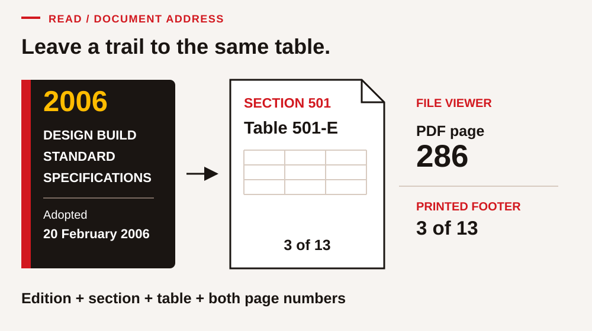
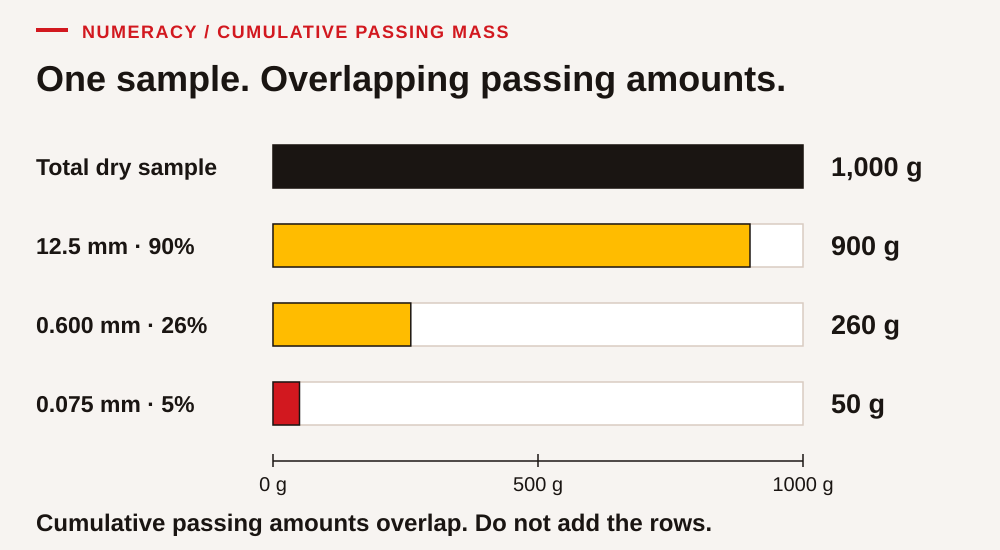
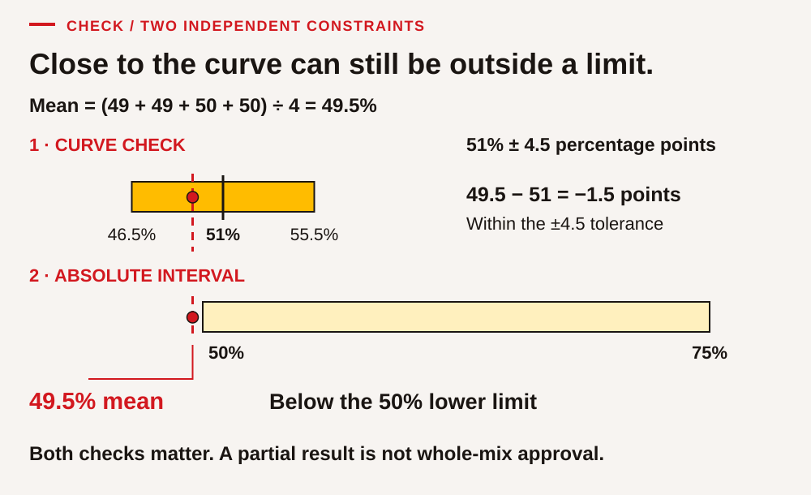
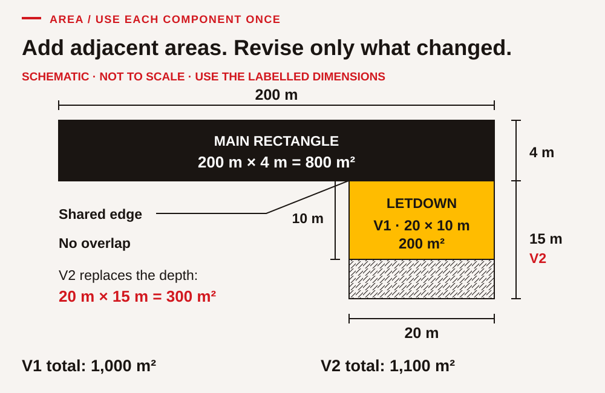
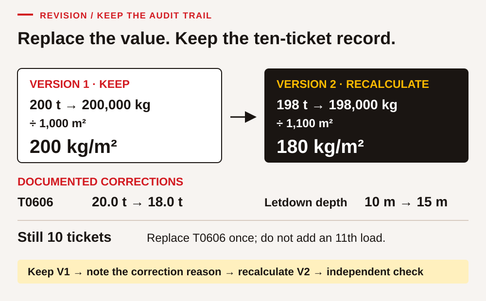

# Asphalt specifications · Read, calculate, check

**ACCESS · Indigenous Skills 4 Success**

## Begin with a reliable record

A paving record is useful when someone else can follow it: where the numbers came from, which units they use, what changed and what remains uncertain. A neat answer with the wrong area or an obsolete ticket can lead the next person in the wrong direction. In this module, your job is to build a record that another person can check.

You will read a specification table, compare fictional aggregate results, total ten delivery tickets, measure two rectangles from supplied dimensions and revise the calculation when a correction arrives. You will also explain your reasoning, hear a partner's check, work through different roles and improve the record form after testing it.

All sample results, deliveries and dimensions below are **invented for classroom practice**. Limits explicitly labelled Table 501-E and Table 501-F come from the **2006 Design Build Standard Specifications for Highway Construction**, adopted 20 February 2006. The publisher is the British Columbia Ministry of Transportation, Construction and Maintenance Branch. This historical edition has not been established as the governing document for a present project. Use its language as technical reading; use a real project's confirmed requirements and authorized instructions for actual work.

This is a document-and-calculation classroom task. It does not involve sampling, plant settings, equipment operation or approval of pavement. Work in a classroom or other agreed learning space. Choose written, spoken or supported responses where offered. A calculator and a unit guide are welcome. Use a partner or ask the facilitator to take that role.

### Your record pack

You need this workbook, paper or an editable copy, a calculator, and a device with spreadsheet software for SP-12. The [CSV data pack](data/README.md) contains the same invented numbers printed here. Keep your first calculation and the corrected version. Write a name or learner code only if you choose; use no personal information in a practice delivery record.

Useful notation: **mm** means millimetres; **m** means metres; **m²** means square metres; **g** means grams; **kg** means kilograms; **t** means metric tonnes. One tonne equals 1,000 kg. A percentage is an amount out of 100. A **percentage-point difference** subtracts two percentages; it is different from a relative percentage change.

## 1 · Find the rule and read the table

### A technical document has several addresses

PDF pages count from the first page of the file. A printed footer may restart at each section. A clause number points to the subject within that section. For example, Table 501-E is on **PDF page 286**, with the footer **3 of 13** in Section 501. Writing just “page 3” leaves the reader searching in the wrong place.

Sections 501 and 502 describe different specification arrangements. Here, the Section 501 exercise concerns grading limits and a four-test mean. The Section 502 exercise concerns delivery records and material application calculations. We will keep those rules separate; the grading worksheet is not a Section 502 acceptance calculation.

<figure class="teaching-figure"><figcaption>A complete source address lets the next reader find the same table.</figcaption></figure>

### SP-01 · Leave an exact page trail

Open the [cover](../sources/design_build_standard_specs_2006.pdf#page=1) and [Table 501-E](../sources/design_build_standard_specs_2006.pdf#page=286), or use the source card and table printed in this workbook. Record: document title; adoption date; section and table identifier; PDF page; printed footer. Then finish this sentence: “Before I use this on a current project, I need to confirm …”. If the facilitator supplies the page aloud, record that support.

| Record field | Your response |
|---|---|
| Title and adoption date | ________________________________________ |
| Section / table / PDF page / printed footer | ________________________________________ |
| Current-project confirmation needed | ________________________________________ |

### SP-02 · Put work descriptions in context

These short descriptions paraphrase the named 2006 clauses:

- **511.01, PDF 339, printed 1 of 1:** cold milling removes existing pavement to the depth and width specified in the Contract and Design to prepare for new surfacing.
- **503.01, PDF 319, printed 1 of 1:** base preparation shapes and compacts an existing granular base to the design grade and cross-section.
- **501.02, PDF 284, printed 1 of 13:** the work includes preparing aggregate, applying prime or tack as applicable, heating and mixing, and hauling, placing and finishing the mix.

A fictional planning card reads: “For this classroom scenario, milling is complete; base preparation is next; paving follows.” Place these three cards in that **given scenario** order: **place and finish mix / remove existing pavement / prepare granular base**. Beside each, write its clause. Explain why this exercise does not supply a complete work procedure or establish that every project uses all three stages.

Response: ____________________________________________________________________

______________________________________________________________________________

### Read across before you compare

A sieve table lists the percentage **by mass passing** each sieve size. The result is cumulative: material passing a smaller opening is included in the amount passing a larger opening. These rows are not separate portions to add to 100%. First read the sieve-size row, then the correct mix column, then the lower and upper limits.

The following six rows are selected from the **Medium Asphalt Mix** column of **Table 501-E**, [PDF 286](../sources/design_build_standard_specs_2006.pdf#page=286), printed 3 of 13. Other rows and mix columns exist in the source. This shortened teaching table cannot establish full mix conformity.

| Sieve size (mm) | Historical lower limit (% by mass passing) | Historical upper limit (% by mass passing) | Fictional sample A (%) | Fictional sample B (%) |
|---:|---:|---:|---:|---:|
| 12.5 | 84 | 95 | 90 | 96 |
| 9.50 | 73 | 90 | 81 | 81 |
| 4.75 | 50 | 75 | 62 | 49 |
| 2.36 | 35 | 57 | 48 | 48 |
| 0.600 | 18 | 34 | 26 | 26 |
| 0.075 | 3 | 7 | 5 | 5 |

### SP-03 · Read one cell precisely

For the **4.75 mm** row, identify the mix column, measurement, lower limit, upper limit and unit. Is 50% within the printed interval? Is 75% within it? Find a second row with a 90% upper limit. State its sieve size, including the unit.

Response: ____________________________________________________________________

______________________________________________________________________________

### Worked example · Passing mass

If a fictional dry sample has a total mass of **1,000 g**, and **26%** passes the **0.600 mm** sieve, the passing mass is **26 ÷ 100 × 1,000 g = 260 g**. Check: one quarter of 1,000 g is 250 g, so 260 g is sensible for 26%. This arithmetic explains the reported percentage; it is not a procedure for performing a sieve test.

<figure class="teaching-figure"><figcaption>Each bar starts from the same total sample mass. Passing amounts overlap across sieve rows.</figcaption></figure>

### SP-04 · Convert percentage to mass

Use sample A and a fictional **1,000 g** total dry mass. Calculate the mass passing **12.5 mm** and **0.075 mm**. Show the conversion from percentage to a fraction or decimal. Estimate first. Explain why adding the six reported percentages is not a useful check that the sample totals 100%.

| Sieve | Estimate | Calculation with units | Answer |
|---|---|---|---|
| 12.5 mm | __________ | __________________________ | __________ |
| 0.075 mm | __________ | __________________________ | __________ |

Explanation: __________________________________________________________________

### SP-05 · Report comparisons without overclaiming

Compare every printed sample A and sample B result with its row limits. List any result outside the shown interval and calculate how many **percentage points** it is above or below the nearest limit. Write one careful conclusion about the six rows. Do not label the whole mix “approved” from this partial table.

| Sample and sieve | Result / nearest limit | Difference (percentage points) | Conclusion for this row |
|---|---|---|---|
| __________________ | __________________ | __________ | __________________ |
| __________________ | __________________ | __________ | __________________ |

Your six-row conclusion: ________________________________________________________

## 2 · Follow a running mean

A mean adds the results and divides by the number of results. A running mean uses a moving window: when the next result arrives, drop the oldest one and include the newest. A four-test mean always has four values.

Under **501.15.03**, [PDF 286–287](../sources/design_build_standard_specs_2006.pdf#page=286), the mean of four consecutive tests is compared with the established grading curve using Table 501-F. At **4.75 mm**, the maximum variation is **±4.5 percentage points**. The following paragraph also says that the running mean must stay inside the applicable Table 501-E limits. Being close to a curve does not cancel the absolute interval.

### SP-06 · Move the four-result window

The invented established curve value at 4.75 mm is **62%**. Five consecutive fictional results are **60%, 62%, 64%, 66%, 68%**. Calculate the mean of tests 1–4, then tests 2–5. For each mean, calculate the signed difference from 62% and compare its size with 4.5 percentage points. Also compare both means with the Medium Asphalt Mix interval **50–75%**.

| Window | Four included values | Sum | Mean (%) | Difference from curve (percentage points) |
|---|---|---|---|---|
| Tests 1–4 | __________________ | ______ | ______ | ______ |
| Tests 2–5 | __________________ | ______ | ______ | ______ |

Check: each mean must lie between the smallest and largest value in its own window. Explain the checks without making a real-world acceptance decision.

### SP-07 · Keep both constraints visible

A different invented established curve is **51%** at 4.75 mm. Four results are **49%, 49%, 50%, 50%**. Calculate the mean, its difference from 51%, and whether the mean lies inside 50–75%. A colleague writes: “The difference is less than 4.5, so every requirement is met.” Write a two-sentence correction using both constraints. Identify the missing evidence before any overall mix conclusion.

<figure class="teaching-figure"><figcaption>The curve tolerance and the grading interval are separate checks. One can be satisfied while the other is not.</figcaption></figure>

Response: ____________________________________________________________________

______________________________________________________________________________

### SP-08 · Design a traceable delivery record

The historical **502.04.04**, [PDF 299–300](../sources/design_build_standard_specs_2006.pdf#page=299), lists these Road Checker's Summary items: truck number; weigh-ticket number and net weight; delivery time and station location; dimensions and calculations for material application rate; and notes about features such as letdowns, intersections and tapers. Its calculation frequency is minimally every ten loads. Here “station” is a location reference along the work; it is not a time.

Create a blank record with those five information groups. Add a **version**, **correction reason** and **checked by/date** field for this classroom workflow. Explain why net load mass and a ticket identifier belong together. A ticket identifier must stay intact even if its mass is corrected.

Sketch your fields: _____________________________________________________________

______________________________________________________________________________

## 3 · Reconcile ten loads and two areas

### The fictional shift record

The following ten-load check block is a short classroom record, **not a formal acceptance Lot**. The source's Lot definitions depend on the property assessed and, for several properties, scheduled daily production and specified conditions; see **502.03.07–.08**, [PDF 297–298](../sources/design_build_standard_specs_2006.pdf#page=297). Ten loads over 90 minutes do not establish those conditions.

The invented design brief for this calculation specifies a comparison target of **200 kg/m²**. This target is supplied for arithmetic practice; it is not a universal paving rate or a number taken from the source. The record covers a main rectangle and one adjacent letdown rectangle, without overlap. There are no other covered areas in this dataset.

| Ticket | Truck | Delivery time | Station | Version 1 net load (t) |
|---|---|---|---|---:|
| T0601 | 07 | 07:30 | 0+000 | 20.0 |
| T0602 | 08 | 07:40 | 0+020 | 19.5 |
| T0603 | 09 | 07:50 | 0+040 | 20.5 |
| T0604 | 07 | 08:00 | 0+060 | 21.0 |
| T0605 | 08 | 08:10 | 0+080 | 19.0 |
| T0606 | 09 | 08:20 | 0+100 | 20.0 |
| T0607 | 07 | 08:30 | 0+120 | 20.5 |
| T0608 | 08 | 08:40 | 0+140 | 19.5 |
| T0609 | 09 | 08:50 | 0+160 | 21.0 |
| T0610 | 07 | 09:00 | 0+180 | 19.0 |

A delivery station locates that event. It does not by itself tell you the area covered by that individual load.

### SP-09 · Total and check the record

Count the tickets, check that each identifier occurs once, and add the net loads. Convert the total to kg. Find the elapsed time between first and last delivery; do not count ten ten-minute intervals. Estimate the total using about 20 t per load and explain whether your exact answer is plausible.

Ticket count: ______ · Total: __________ t = __________ kg · Elapsed time: __________

Estimate and check: ____________________________________________________________

### SP-10 · Calculate area from dimensions

**Version 1 dimensions:** main rectangle **200 m × 4 m**; adjacent letdown rectangle **20 m × 10 m**. Calculate each area and add them. Show square units. The diagram is a schematic, not a scale drawing: use the printed dimensions, not a ruler on the image.

<figure class="teaching-figure"><figcaption>Use area components once each. Version 2 extends the letdown; it does not add a second complete letdown.</figcaption></figure>

Main area: __________________ · Letdown area: __________________ · Total: __________________

### Worked example · Units determine the calculation

For an unrelated invented record, **24 t** covers **120 m²**. Convert the mass: **24 × 1,000 = 24,000 kg**. Divide: **24,000 kg ÷ 120 m² = 200 kg/m²**. An alternative route is **24 ÷ 120 = 0.2 t/m²**, then **0.2 × 1,000 = 200 kg/m²**. The two routes agree. Dividing area by mass would give m²/kg, a different quantity.

The historical **502.14.01**, [PDF 309](../sources/design_build_standard_specs_2006.pdf#page=309), determines material application rate from delivered tonnage recorded on weigh tickets divided by the covered Lot area, including appropriate allowance for entrance letdowns and intersections. Here we practise the mass/area relationship on our ten-load check block only.

### SP-11 · Calculate and explain the version 1 rate

Divide the version 1 delivered mass by the version 1 covered area. Give the answer in **t/m²** and **kg/m²**. Compare it with the fictional design target. State one reason why a matching classroom rate alone cannot establish acceptance of real pavement.

Calculation: __________________________________________________________________

Explanation: __________________________________________________________________

### SP-12 · Make a digital record that can be reopened

On an actual device, open a blank spreadsheet. Import [load-register-v1.csv](data/load-register-v1.csv), choosing text format for ticket, truck and station identifiers. If import is unavailable, type the five headings and ten rows exactly as above. Confirm that truck “07” and station “0+000” are preserved as identifiers.

The supplied CSV places net load mass in **column E**, rows **2–11**. Enter `=SUM(E2:E11)` in E13. In G1 enter `Area_m2` and G2 enter `1000`. In H1 enter `Rate_kg_per_m2` and H2 enter `=E13*1000/G2`. Your software may display localized function names. Inspect the formula bar and check the result against your paper calculation. Save as a spreadsheet file named `paving-record-v1` in your agreed class folder, close it and reopen it. CSV alone does not preserve the workbook formulas and layout.

Show the facilitator: ten rows; intact identifiers; total formula; rate formula; reopened file. Record which steps you completed and any support used. If no device is available, prepare the paper record now and schedule the actual digital task; mark it **not observed** until performed.

Evidence / saved location / support: ______________________________________________

### SP-13 · Correct the record without losing its history

**Version 2 correction card:** the classroom record owner confirms that ticket **T0606** should show **18.0 t**, replacing its version 1 value of 20.0 t. The letdown dimensions are corrected to **20 m × 15 m**, replacing 20 m × 10 m. All other values are unchanged. This supplied correction card is your authority within the fictional exercise.

Keep version 1. Copy to version 2, change the existing ticket row once, and revise the letdown area. Record the old value, new value and reason “classroom correction card”. Recalculate total mass, total area, kg/m², and actual rate as a percentage of the fictional 200 kg/m² target. Find the change in kg/m² and the relative percentage change from version 1. Estimate whether the rate should rise or fall before calculating.

| Version | Total mass (t) | Main area (m²) | Letdown area (m²) | Total area (m²) | Rate (kg/m²) |
|---|---|---|---|---|---|
| 1 | ______ | ______ | ______ | ______ | ______ |
| 2 | ______ | ______ | ______ | ______ | ______ |

Target comparison / change / reasonableness check: __________________________________

<figure class="teaching-figure"><figcaption>A correction changes a value while preserving the evidence of what changed.</figcaption></figure>

### SP-14 · Write a useful handover

Write a 60–100 word message to the fictional class record reviewer. Include the record version, the corrected ticket and dimensions, the revised mass, area and rate, and the question still requiring confirmation. Use an informative subject line. Keep observations separate from authority: you can report a calculation; you cannot approve a real project or infer its governing requirements from this classroom brief.

Subject: _____________________________________________________________________

Message: ____________________________________________________________________

______________________________________________________________________________

______________________________________________________________________________

## 4 · Make the record usable by someone else

### SP-15 · Speak, listen and check back

Use your version 2 record. One person explains the two corrections and the final rate in about one minute. The listener repeats the ticket, units, area and rate in their own words and asks one clarifying question. The speaker confirms or corrects the account. Swap roles. Agree on an accessible mode: speech, an augmentative communication tool, or another mode that lets the listener receive and respond to the message. A read-aloud script is allowed; record the support. The facilitator observes the exchange, not eye contact, accent or speed.

Listener's question: ____________________________________________________________

What I clarified or confirmed: ____________________________________________________

### SP-16 · Reconcile three flawed handovers together

Work in a group of three with roles **record reader**, **independent checker**, and **handover reporter**. Rotate after each round so every learner performs every role. Give each round six minutes: two to read and calculate, two to compare, two to report and note each person's contribution. Use version 2 as the correct record. The facilitator can be the partner and reporter in a cohort of one; then the learner performs all three roles in separate turns.

- **Round A:** “I left all ten version 1 rows in place and added 18 t as a new correction row. Total mass = 218 t.”
- **Round B:** “I have corrected mass 198 t. I used only the 800 m² main rectangle. Rate = 247.5 kg/m².”
- **Round C:** “My total is 198 t and my area is 1,100 m², so the rate is 0.18 kg/m².”

For each round, identify the precise error, show the corrected calculation, and agree on a sentence the reporter will deliver. Keep a short evidence record naming the action each person actually took. Agreement alone is not evidence that everyone checked.

| Round | Error and correction | My role / observable contribution |
|---|---|---|
| A | __________________________ | __________________________ |
| B | __________________________ | __________________________ |
| C | __________________________ | __________________________ |

### SP-17 · Adapt when the working arrangement changes

You planned to present the spreadsheet on a shared screen. A change card now says: **the screen is unavailable; the reviewer needs a larger-print record; you have five minutes before the handover; the verified values must remain unchanged**. Paper, a marker and a photocopier with enlargement are available. A facilitator can prepare an enlarged page if you request it.

State your revised plan, then carry it out: prepare or obtain the larger-print record, preserve the version label and units, and deliver a two-minute handover to a partner. Ask the partner to find the final rate and the corrected ticket. Record what they could find and any change you made. If using a different accessible format, agree it with the partner first. Describe an observed adjustment, not only what you intended to do. This activity does not replace the actual digital task in SP-12.

Plan / action / feedback / adjustment: ______________________________________________

______________________________________________________________________________

### SP-18 · Improve the form and test the idea

Create two different small designs for the top half of the delivery record. Each must show the version, ticket correction, old and new values, units, total mass, covered area and final rate. You might use a correction panel plus totals strip, or a revision timeline beside a compact table. Include labels and shapes so meaning does not depend on colour alone. Select one design and explain why it may help a checker.

Test it with a partner who has not watched you draw it. Ask: “Find the current rate. Find the corrected ticket. Tell me whether 18 t replaces an earlier value or adds a new load.” Record the actual answers. Revise one feature in response, or give a reason for keeping it if the test reveals no useful change. Submit both ideas, the tested version and the feedback. Clarity and usefulness matter more than decorative drawing.

Idea 1: __________________________ · Idea 2: __________________________

Chosen design and reason: _______________________________________________________

Test answers / revision: __________________________________________________________

### Finish with evidence and a next step

Collect your source address, comparison table, means, version 1 and version 2 records, digital evidence, handover and tested form. Identify one thing you can now do, the evidence that shows it, and one task to practise next. Distinguish an independently demonstrated step from one completed with support. A missing opportunity is **not observed**; an attempted step that still needs work is **not yet demonstrated**.

My evidence: __________________________________________________________________

My next practice step: ___________________________________________________________
