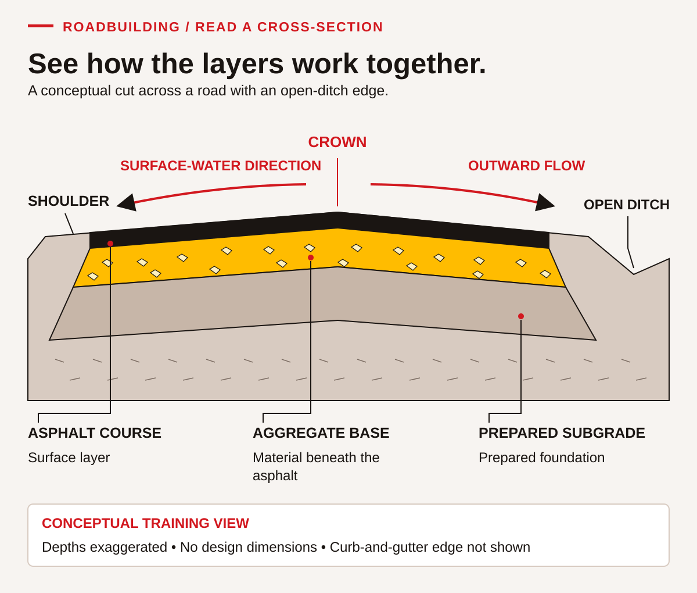
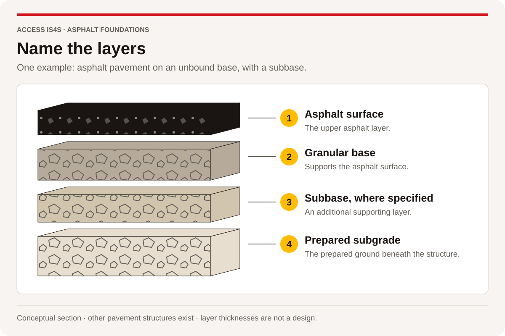

# 5 · Read road documents and quantities

SKILLEDTRADESBC · LINE A<h2>A5 · Describe basic road and highway profiles</h2>
Read the trade words, use them in a clear explanation, then keep evidence of your own work.

| Outline learning task | Practise here |
|---|---|
| A5.1 · Review categories of projects | LA5-01 |
| A5.2 · Describe types of owners | LA5-01 |
| A5.3 · Describe common types of asphalt work | LA5-03 |
| A5.4 · Review specifications for different types of roads | LA5-01, LA5-05 |
| A5.5 · Describe cross section of road | LA5-02–03 |

## Identify the project before the specification

A project may be described by use—commercial, industrial or residential—or by jurisdiction and delivery, such as a provincial highway project. These categories answer different questions and can overlap. A private industrial site is different from a provincially administered highway, even if both use asphalt. Owners can include provincial, federal, municipal or private organizations. A funder, designer, contractor and owner may be different parties.

**Fictional practice project R1 · Cedar Learning Access, drawing P-01 revision B.** The fictional Cedar Learning Society owns a short access route on its own practice property. Valley Surface Ltd. is the fictional contractor. The classroom project brief classifies the work as a private facility access project. A fictional community fund contributes money but does not become the owner. There is no real construction instruction or permission attached to this case.

The practice document register contains P-01 revision B, a plan/profile/section sheet; Q-01 revision B, a quantity record; and SP-01 revision B, a teaching specification card. An earlier P-01 revision A is retained for comparison and marked superseded. In a real project, the contract and authorized document system determine applicable requirements; a familiar document title does not establish that it governs every road.

Document families include B.C.'s provincial highway specifications, **Master Municipal Construction Documents (MMCD)**, a local government's project requirements, and building-specific architectural or civil drawings and specifications. MMCD's publisher produces standardized municipal construction documents and updates. A municipal or private project may adopt particular documents through its contract; naming MMCD does not establish that every edition or clause applies. Provincial specifications likewise need the applicable contract version and special provisions. Record the issuer, edition, project adoption and any authorized change before relying on a requirement.

### LA5-01 · Sort use, ownership and authority

Identify the project use, owner, contractor and funder in R1. Explain why “private” and “asphalt” do not tell you which public standard or special provision applies. Compare provincial, MMCD, local-government and building-specific document families: what project-adoption evidence would you check before using any of them? Name the record you would need before treating a requirement as authorized. **Skills:** Reading, Problem Solving, Writing.

@@fig:site-plan@@

## Read three views of the same place

A **plan** looks down on a project and shows its horizontal arrangement. A **profile** shows elevations along a chosen line, commonly using chainage or stationing to locate points. A **cross-section** cuts across the route and shows its transverse form and layers. A number must be associated with the correct view, direction and unit. Plan width, profile rise and layer thickness are different quantities.

<figure class="learning-figure" id="figure-la-2">

Figure LA-2

<em>See how the layers work together</em>

<figcaption><strong>Note.</strong> An original ACCESS IS4S instructional illustration. Layer depths are exaggerated. Curb-and-gutter and superelevation alternatives are discussed in the text, not drawn here. No design dimensions or acceptance standards are supplied. By ACCESS IS4S (2026b); see the figure references in the working reference section.</figcaption>
</figure>

A **crown** is a raised transverse form that can direct water toward the sides. **Superelevation** describes a cross-slope arrangement used on curves; its design depends on the project. **Runoff** is water moving from the surface. An open ditch and shoulder arrangement differs from a contained curb-and-gutter edge. A sidewalk serves a different function from the vehicle surface. A grader is equipment used in earthwork or grading, not a layer in the finished section. Drainage and preparation must be coordinated before paving; a drawing needs more than a surface outline to establish a buildable design.

@@fig:three-views@@

## Distinguish the supporting layers

A **base** and **subbase** are supporting layers where the design includes them. The **prepared subgrade** is the prepared ground beneath the pavement structure. Figure LA-6 separates one unbound-base arrangement so you can name the layers. Other structures exist, including full-depth asphalt; a subbase is not automatically present on every road. This teaching illustration supplies no dimensions for P-01.

<figure class="learning-figure" id="figure-la-6">

Figure LA-6

<em>Name the layers</em>

<figcaption><strong>Note.</strong> Adapted from <em>The asphalt handbook</em> (7th ed., MS-4; <a href="../ms-4/reader/chapter-01-01.html#page-0048">Figure 1.6, p. 14 / PDF 48</a>), by Asphalt Institute, 2007. Selected the unbound-base example, separated its layers and added functional descriptions. Other structures and design dimensions are not implied.  Copyright 2007 by Asphalt Institute; original contributor credits retained.</figcaption>
</figure>

@@fig:ms4-structures@@

**P-01 revision B · Complete fictional drawing data.** The rectangle extends from chainage 0 m to 50 m. Its constant width is 6 m. The new uniform layer is 40 mm thick for this calculation exercise. No widening, taper, overlap, waste allowance or material loss is included. The exercise asks for geometric volume only. Use the written dimensions; a screen image is not a measuring scale.

| Profile point | Chainage along centreline | Illustrative elevation |
|---|---:|---:|
| Start | 0 m | 100.00 m |
| Midpoint | 25 m | 100.25 m |
| End | 50 m | 100.50 m |

The section names surface course, aggregate base and prepared subgrade. Their presence in a conceptual sketch does not specify material properties, layer thicknesses other than the given calculation layer, drainage design or acceptance criteria. All elevations and dimensions here are invented. The profile arithmetic is not a recommendation for road grade or crossfall.

### LA5-02 · Choose the right view

For route length, width, centreline rise and layer thickness, identify the relevant view and unit. Explain why the profile elevation 100.50 m is not the layer thickness. Sketch three boxes labelled plan, profile and cross-section and put the matching information in each. **Skills:** Reading, Numeracy, Creativity and Innovation.

### LA5-03 · Describe the road form

Using the visual and paragraph, explain crown, shoulder, open ditch, curb/gutter, sidewalk, runoff and superelevation. Put “grader” in the correct category. Use Figure LA-6 to distinguish granular base, subbase where specified and prepared subgrade; explain why one illustrated arrangement does not establish the layers on every project. Choose one drainage question and one preparation question that the conceptual drawing leaves unanswered. **Skills:** Reading, Communication, Problem Solving.

## Point, name and explain

Use the drawing and the reading to connect each word to a function. A learner may point, annotate a copy, or describe the location verbally.

| Trade word | Look for or explain | What the word does not tell you |
|---|---|---|
| Crown | Raised transverse form near the centre of a crowned road | The specified crossfall or an acceptance result |
| Shoulder / open ditch | Edge area / open drainage channel | Their required dimensions or capacity |
| Curb and gutter | A contained edge and associated drainage form | That it is drawn in this open-ditch example |
| Runoff | Surface water moving away from where it falls | The complete route, quantity or drainage design |
| Superelevation | A curve-related cross-slope arrangement | That it is the same shape as the crown in this figure |
| Grader | Equipment used in grading work | A layer in the cross-section |
| Prepared subgrade | The prepared foundation below the pavement structure | That its preparation has been inspected or accepted |

**Worked language check.** “The arrows are runoff direction; the dark layer is the asphalt course.” The arrows describe movement; the layer describes material. In LA5-03, explain two more features in the same way.

## Calculate a quantity you can check

**Worked example, P-01 revision B.** Convert thickness first: `40 mm ÷ 1,000 = 0.040 m`. Plan area is `50 m × 6 m = 300 m²`. Geometric layer volume is `300 m² × 0.040 m = 12 m³`. Estimate: a 300 m² layer one-tenth of a metre thick would occupy 30 m³; a 0.04 m layer is less than half as thick, so 12 m³ is plausible. Units check as `m × m × m = m³`.

The profile rises `100.50 − 100.00 = 0.50 m` across 50 m of stated horizontal distance. For this drawing-reading exercise, rise/run is `0.50 ÷ 50 × 100 = 1%`. This centreline grade is not the transverse crown or an acceptance limit. A real quantity may need a different geometry and an approved measurement method; our rectangular model has stated simplifications.

**Q-01 revision B · Fictional mass model and delivery records.** For this exercise only, the instructor supplies a conversion factor of **2.00 tonnes per cubic metre**. It is an invented teaching factor, not an asphalt density specification. The planned model mass is `12 m³ × 2.00 t/m³ = 24.00 t`. Three classroom records list 8.00 t, 8.00 t and 7.60 t. These are fictional record inputs, not a real delivery or placement measurement.

@@fig:quantity@@

### LA5-04 · Check the quantity and record

Independently reproduce the area, thickness conversion, volume and model mass with units. Sum the three records and calculate their difference from the planned model mass. Explain why that numerical difference alone cannot establish placed thickness, compaction, payment entitlement or rejected work. **Skills:** Numeracy, Reading, Writing.

## Use the applicable version and conditions

**SP-01 revision B · Teaching specification card, fictional.** Use the dimensions printed in the current classroom drawing. Record the revision with every calculation. Keep calculation quantities distinct from acceptance measurements. Refer conflicting instructions to the instructor acting as document coordinator before issuing a final classroom quantity note. This is the complete specification for the exercise; it does not adopt a real road specification.

**Change notice R2, fictional.** The coordinator issues P-01 revision C, extending the rectangle to 60 m while retaining 6 m width and 40 mm layer thickness. The endpoint illustrative elevation becomes 100.60 m; the same linear 1% profile is used for arithmetic practice. The mass model remains 2.00 t/m³. The three existing classroom records stay unchanged. Revision C replaces B for the new quantity calculation; retain B as the previous version.

### LA5-05 · Recalculate after the revision

Find the new area, volume and model mass, and the increase from revision B. Reconcile the unchanged record total with the new model requirement. Explain why changing a filename without recalculating would leave misleading information. Make a versioned paper or digital quantity note with inputs, method, check, result and unresolved limits. **Skills:** Numeracy, Adaptability, Writing; Digital when performed.

### LA5-06 · Review and hand over

Work in pairs: one checks geometry and units, the other checks document revision and claims. Swap responsibilities on the revised case. Give a handover that states the current revision, quantity, supplied factor, record total and the decision that remains outside this exercise. Each learner keeps a checked calculation and records one useful correction or confirmed detail. **Skills:** Collaboration, Communication, Problem Solving.

## Read the map record behind the symbol

A **point** can identify an entrance or a mapped site location. A **line** can represent a road or a utility record. A **polygon** encloses an area, such as a parcel or project selection. The same coloured dot can be used for very different features; read its legend and attributes. Changing a symbol's colour does not change its position or legal meaning.

An **entrance** is an access location. A **site point** may locate a facility or represent a record. A **parcel boundary** describes a parcel geometry from a particular source. None of those is interchangeable. A point in the middle of an area does not tell a delivery driver where to enter. A project-selection area filters what is displayed; it does not create or alter a legal boundary.

A useful map-reading record keeps the feature type, source, date, status and uncertainty together. A missing value is not zero. “Unknown utility status” does not mean “no utility.” A source edit date does not prove when a buried line was installed, surveyed or last verified. Separate ownership, operation and maintenance responsibility when the record provides different fields.

Open the [Cedar plan desk](plan-desk.html). It contains fictional features for this lesson. Toggle a layer, select a record, change the drawing revision and export a note. The desk's written dimensions drive the quantity model; no geographic coordinates or real land rights are attached to it.

@@fig:plan-desk-screen@@

**Worked map decision.** A proposed driver instruction says, “Go to the site dot.” The map shows a site point inside the practice boundary and a separate entrance point on the road. A clearer instruction identifies the confirmed entrance and the current access arrangement. If routing information is used, it must match the vehicle and task: a public car route does not establish truck access, loading restrictions or permission. Road travel distance differs from a straight-line distance between symbols.

### TB5-01 · Read, toggle and preserve a record

In the plan desk, select the site point, entrance and utility record in turn. For each, record what it means, its stated status and one thing it cannot establish. Hide and show the utility layer: explain why hiding a feature does not remove the real-world hazard it could represent. Export your own note, reopen the file and check that it retains the selected revision and record. **Skills:** Reading, Digital, Writing, Problem Solving.

### TB5-02 · Check the revision in two places

Calculate revision B on paper, then switch the desk to revision C. Compare its written length, area, volume and invented model mass against your LA5-05 result. Explain why the same delivery-record total produces a different difference from the new model requirement. Keep both versions with their labels. **Skills:** Numeracy, Digital, Adaptability.

### TB5-03 · Make a usable access brief

Write a 90–120-word brief for the fictional project coordinator. Distinguish the facility, entrance, boundary and approximate utility record. Identify the current revision, the calculation's limited purpose and the information needed before issuing actual work instructions. Ask a partner to identify any claim the map does not support. Improve one sentence and retain both versions. **Skills:** Communication, Collaboration, Writing, Creativity and Innovation.
