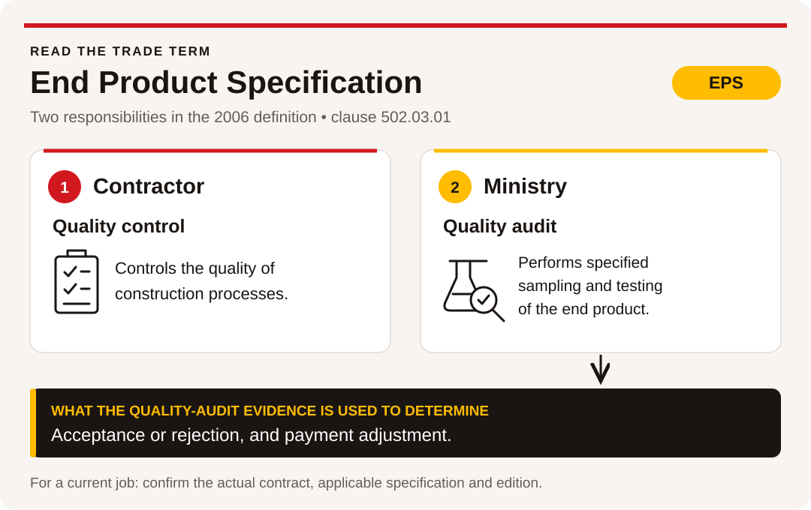

# Asphalt A1 • From materials to a finished road

## Learner workbook

**ACCESS IS4S classroom practice • Three 60-minute sessions**

These sessions prepare you to learn about the paving industry. You will explain a basic paving process, read a small project brief, use industry-style numbers and make a clear information sheet for a new learner. The examples and project names in this workbook are invented for practice.

This is an introduction to equipment purposes. Equipment operation belongs in supervised technical training.

| Session | What you will make | Focus Skills for Success |
|---|---|---|
| 1. See the whole job | A process map and a partner explanation | Reading; Communication; Collaboration |
| 2. Read the industry picture | A checked data table and a short project note | Numeracy; Digital; Writing |
| 3. Check a claim and improve the message | A revised information sheet with a reason for its changes | Problem solving; Adaptability; Creativity and innovation |

**Your name or learning ID:** \_\_\_\_\_\_\_\_\_\_ **Date:** \_\_\_\_\_\_\_\_\_\_

You can use a glossary, enlarged pages, a calculator and assistive tools. Tell the instructor which supports help. Work with a partner where directed, and keep your own answers so your progress is visible. Use the [response sheet](materials/response-sheet.md) or a notebook for longer answers and sketches.

## Session 1 • See the whole job

### 1. Read: roads connect people and places

Roads connect homes, schools, workplaces, recreation areas and services. They help people travel and help goods reach the places where they are needed. A road is part of **infrastructure**: the shared physical systems that support a community. A road connects with other systems such as bridges, drainage and public transport.

Roads have developed in different ways in different places. Some began as paths made by repeated travel. People improved routes by clearing, shaping or adding materials such as stone and gravel. Later construction methods used more planned layers, drainage and surfaced pavements. These approaches did not replace every earlier type of route. Today, different road types still serve different purposes. This is a broad introduction, not a complete history or a single story for every community.

Road users include people walking or using mobility devices, cyclists, bus passengers, drivers, delivery workers, emergency responders and people travelling for recreation. Their needs can differ. A good project discussion asks who needs access and how a change could affect them.

**A1-Q01 — Find the evidence.** Underline the sentence that explains infrastructure. In your own words, explain one way that roads support daily life and one way that they support trade. Point to the wording that helped you.

**A1-Q02 — Tell a short history.** Complete this three-part explanation using the reading: “Some routes began as \_\_\_\_. People improved them by \_\_\_\_. Different road types still exist because \_\_\_\_.” Do not add a date that the reading does not provide.

### 2. Read: the materials and the basic process

**Aggregate** means mineral material such as sand, gravel or crushed stone. Paving projects need materials with properties specified for the job. Gravel and sand can come from deposits worked as pits; crushed rock can come from quarries. Materials may be screened, crushed or otherwise processed to meet the specification. Availability, suitability, permitted supply and transport distance matter. A nearby source is not automatically a suitable or approved source.

For a basic asphalt-paving example, aggregate and asphalt binder are combined at a plant. A truck takes the paving mixture to the work area. A paver places the mixture, and rollers compact it. Real projects have additional preparation, checking and finishing steps. This five-stage map helps a new learner see the main connections:

<figure class="flow" aria-label="Five-stage introductory paving process">
<figcaption>From mineral materials to a paved surface</figcaption>
<ol>
<li><strong>Pit or quarry</strong>Obtain and process mineral materials.</li>
<li><strong>Plant</strong>Prepare the specified asphalt mixture.</li>
<li><strong>Haul</strong>Move the mixture to the work area.</li>
<li><strong>Place</strong>Place the mixture on the prepared area.</li>
<li><strong>Compact</strong>Compact the placed material.</li>
</ol>

Read in numbered order. Real projects include additional preparation, checking and finishing.

</figure>

**Word bank:** pit • quarry • aggregate • asphalt binder • plant • haul • paver • compact

**A1-Q03 — Build the flow.** Put these stage cards in order: **PLACE / HAUL / PIT OR QUARRY / COMPACT / PLANT**. Add a short purpose under each. Check against the map, then explain one connection to your partner.

### 3. Match equipment to its main purpose

Read the cards. They describe purposes, not operating instructions.

| Equipment or component card | Main purpose in this introductory example |
|---|---|
| E1. Screed | The paving-equipment component that helps control the thickness of the asphalt layer being placed. |
| E2. Crusher or screening plant | A crusher reduces material size; a screen separates material by size. |
| E3. Asphalt plant | Prepares the specified asphalt paving mixture. |
| E4. Haul truck | Transports paving material between the supply point and work area. |
| E5. Asphalt paver | Receives asphalt mixture and moves it toward the screed during placement. |
| E6. Compaction roller | Compacts the placed material as part of the paving process. |

**A1-Q04 — Match and check.** Write an equipment code beside each need:

1. Transport the mixture: \_\_\_\_
2. Receive and move mixture toward the screed during placement: \_\_\_\_
3. Separate mineral material by size: \_\_\_\_
4. Compact placed material: \_\_\_\_
5. Help control the thickness of the layer being placed: \_\_\_\_
6. Prepare the asphalt mixture: \_\_\_\_

Then explain to your partner why a paver and a roller have different jobs.

**A1-Q05 — Check a resource claim.** A fictional supplier says, “There is a gravel pit nearby, so its material must be right for this project.” Use the materials reading to write one question you would ask before accepting that claim. Name two resource sources or material types from the reading that are relevant to paving in the province.

### 4. Compare road types and users

| Road type | Introductory description |
|---|---|
| Earth road | A route whose running surface is earth; conditions and maintenance affect its use. |
| Gravel road | A route with a gravel running surface. It can serve access and transport needs without an asphalt or concrete surface. |
| Asphalt-surfaced road | A route with an asphalt pavement surface. The project design determines its construction. |
| Concrete-surfaced road | A route with a concrete pavement surface. The project design determines its construction. |
| Ice road | A seasonal route using a frozen surface under the responsible authority's controls. This workbook provides no guidance for deciding whether ice is safe. |

**A1-Q06 — Make the connection.** Choose two road types. Briefly describe each running surface or type, then name a possible use for each, using “could” rather than claiming every road of that type has the same purpose. Identify two different groups of road users and one access question each group might ask about a project.

### 5. Explain together

Use this listening routine: **explain → listen → restate → clarify → confirm**.

Example: “The haul stage moves the mixture.” “You mean the truck takes it from the plant to the work area. Have I got that right?” “Yes. The paver then places it.”

**A1-Q07 — Team check.** Partner A explains the five-stage map. Partner B restates it and asks one useful question. Swap roles. Agree on one improvement to the map, such as a clearer label. Both partners must make a contribution.

**My contribution:** \_\_\_\_\_\_\_\_\_\_ **A useful suggestion from my partner:** \_\_\_\_\_\_\_\_\_\_

**A1-Q08 — Exit note.** Explain one difference between a road's purpose and an equipment item's purpose. Name one term you want to practise again.

## Session 2 • Read the industry picture

### 6. Read a project brief

> **Fictional practice document — Willow Reach access project, version 1**
>
> **Purpose:** Improve the surfaced access route serving a recreation centre and nearby delivery area.
>
> **Road owner:** The fictional Town of Willow Reach. Its project team defines the project requirements, manages the contract and decides whether the completed work meets the contract.
>
> **Contractor:** The fictional Pathway Paving Company. It is engaged to deliver the work described in the contract. Being the contractor does not make it the road owner or give it the power to rewrite public rules.
>
> **Funding plan for this exercise:** Town contribution $60,000; fictional Regional Access Fund $40,000; fictional Community Route Fund $20,000. All amounts are confirmed within this invented scenario. These fund names are not real grant programs.
>
> **Information still needed before real work:** Current applicable requirements, the authorized project specifications, permits or approvals that apply, the contract's responsibilities and the responsible contacts. This classroom brief supplies none of those legal permissions.

In real projects, the owner, contractor, regulator and funder can be different organizations. The arrangement depends on the project and jurisdiction. A road owner sets and manages its project requirements; applicable law still governs the work. A funder contributes money subject to its terms. A contractor delivers the work it is engaged to do.

**A1-Q09 — Who does what?** In this fictional project, name the owner, contractor and funding contributors. Explain why paying for work, owning the road and performing the work are different roles. Total the three contributions and show your addition.

### 7. Read an older source label carefully

The supplied historical training outline includes this short line under A1 learning task 8:

> “Government regulations like EPS, MMCD, etc.”

The page carries a **12/12** footer. Its short list does not identify the edition or project where a requirement applies. Start by finding the term in the right document, then check what governs the work.

**Read the trade term.** The supplied *2006 Design Build Standard Specifications for Highway Construction*, clause **502.03.01**, defines **EPS as End Product Specification**. In that clause, the contractor is responsible for quality control of construction processes. The Ministry performs the specified quality-audit sampling and testing of the end product to determine acceptance/rejection and payment adjustment. These are different responsibilities. The definition explains the term in this particular document; the actual contract determines which requirements apply to a job.

**Say it plainly.** “Quality control” asks how the construction process is being controlled. “Quality audit” checks the end product through the sampling and testing specified in this historical clause. Knowing what EPS stands for does not establish that this 2006 specification governs today's project.

<figure class="teaching-figure"><figcaption><strong>Figure 1. Two responsibilities within an End Product Specification.</strong> <em>Note.</em> Original ACCESS IS4S illustration based on <em>2006 Design Build Standard Specifications for Highway Construction</em> (clause 502.03.01, PDF p. 297, printed p. 1 of 22), by British Columbia Ministry of Transportation, Construction and Maintenance Branch, 2006. <a href="../sources/design_build_standard_specs_2006.pdf#page=297">Read the original clause.</a></figcaption></figure>

**A1-Q10 — Find what needs confirming.** First write the full term for EPS as used in the clause above. Explain one difference between the contractor's and the Ministry's responsibilities. Then complete three entries:

| Item in the older source | What I need to confirm | Who or what could provide the answer |
|---|---|---|
| EPS — End Product Specification in clause 502.03.01 | | |
| MMCD | | |
| Funding for a real project | | |

For EPS, you now have a documented definition; ask which specification and edition the actual contract adopts. For MMCD, confirm the full document title, issuer, version and contractual applicability. For funding, ask about the actual funding agreement and conditions. Keep a documented meaning separate from a decision about current project requirements.

### 8. Worked example: read a small industry table

**All numbers below are invented. They do not describe the real B.C. paving industry.** Each employer and worker is counted once in each table. Contract values are stated in dollars and are not company profits.

| Fictional area | Employers | Workers | Contract value in the practice year |
|---|---:|---:|---:|
| East | 2 | 20 | $200,000 |
| West | 3 | 30 | $300,000 |

**Question:** How many employers are shown, what fraction are in East, and how do the contract values compare?

1. Read the heading. Count employers, not workers: `2 + 3 = 5 employers`.
2. Use part over whole: East has `2/5` of the employers. Five is the total, not the West count.
3. Compare like units: `$300,000 − $200,000 = $100,000`. West's stated contract value is $100,000 greater.
4. Check: `2 + 3` returns the total of five. Both values are dollars from the same practice year. The table says nothing about profit or the whole province.

### 9. Your turn: make a checked industry summary

**Independent practice table — fictional data only.** The areas are invented. The counts do not overlap. Use only these rows when answering.

| Fictional area | Employers | Workers | Contract value in the practice year |
|---|---:|---:|---:|
| North | 4 | 120 | $6,000,000 |
| Central | 3 | 90 | $4,000,000 |
| South | 3 | 90 | $5,000,000 |

**A1-Q11 — Calculate and interpret.** Work individually before checking with a partner.

1. Total the employers: \_\_\_\_\_\_\_\_\_\_. Total the workers: \_\_\_\_\_\_\_\_\_\_.
2. What fraction of the employers are in Central? \_\_\_\_\_\_\_\_\_\_. State the whole you used.
3. Total the contract value: \_\_\_\_\_\_\_\_\_\_. How much greater is North's value than Central's? \_\_\_\_\_\_\_\_\_\_.
4. Write one comparison that the table supports. Then explain why “B.C. has this many paving employers” is not supported.
5. Check one answer using a different method, such as grouping, subtraction or a calculator. Record the check: \_\_\_\_\_\_\_\_\_\_.

**Optional extend:** Express Central's share of employers as a percentage. Explain why a contract-value total cannot be labelled “profit”.

### 10. Put the same evidence in a digital table

**A1-Q12 — Create, check, save and find.** Use a spreadsheet or accessible table tool. A partner may coach; each learner needs a turn controlling the tool.

1. Create headings: Area, Employers, Workers, Contract value (dollars).
2. Enter the North, Central and South rows from the independent table. Check every entry against the printed source.
3. In a spreadsheet, if headings are row 1 and data are rows 2–4, enter `=SUM(B2:B4)` in B5, `=SUM(C2:C4)` in C5 and `=SUM(D2:D4)` in D5. Label A5 “Total”. Use plain numbers in the value cells, then apply currency formatting if available. Formula names can differ by software language.
4. Compare the digital totals with A1-Q11. Investigate any difference.
5. Save as `A1-industry-[your-learning-ID]`. Close or leave the document, then find and reopen it. Show the instructor one value you checked and how you found the file.

If using a simple table tool without formulas, enter your checked totals and show the calculation separately. If a device is unavailable, finish on paper and arrange a later tool turn. Paper completion does not yet show Digital skill evidence.

### 11. Write for the next learner

**A1-Q13 — Project note.** Write four to six short sentences for a new team member. Include:

- Who owns the fictional road and who carries out the contracted work.
- The total practice funding and one named contributor.
- One accurate statistic from A1-Q11, clearly labelled fictional.
- One item from A1-Q10 that still needs confirmation before making a real-world claim.

Use this opening if helpful: “In the practice project, \_\_\_\_ owns the road. \_\_\_\_ carries out the contracted work.” Check names, numbers and the distinction between a fictional fact and an unconfirmed requirement. Your partner reads the note and tells you what they understood. Make one useful edit.

## Session 3 • Check a claim and improve the message

### 12. Read: an environmental question needs a clear comparison

“Which is more environmentally friendly: asphalt or concrete?” needs more information than a material name. A useful comparison identifies the same job and service expectations, the period being considered, and the impacts being compared. Material production, transport, construction, maintenance, reuse and end-of-life handling may all matter. Local water, habitat, noise and community concerns may also matter. A claim about one factor is not automatically a conclusion about every environmental impact.

A useful response can be conditional: “For this factor, under these assumptions, this option may have an advantage. We still need these facts before comparing the whole project.”

### 13. Use the evidence cards

> **Card C1 — Unchecked advertisement**
>
> “Asphalt is always the greener choice. No comparison is needed.” No author, method, project or evidence is supplied.

> **Card C2 — Fictional project information**
>
> A designer is considering an asphalt option and a concrete option for the same fictional access route. A supplier says a source for the asphalt option is 20 km from the work area and a source for the concrete option is 50 km away. The card does not state material quantities, vehicle loads, number of trips, fuel use, production impacts, design life, maintenance or whether both options meet the same requirements. The distances are invented classroom values.

> **Card C3 — A focused question**
>
> “Could the shorter route reduce transport distance?” Yes, it is a shorter one-way route in this example. Total vehicle travel and emissions still depend on the quantities, trips, vehicles and other conditions. That one fact cannot rank the whole environmental performance of either pavement.

Use this routine: **name the claim → find the evidence → identify what is missing → choose a justified next step**.

**A1-Q14 — Check the claim.** Complete all four parts.

1. Which word in C1 makes the claim too broad? \_\_\_\_\_\_\_\_\_\_.
2. What comparison does C2 actually support? \_\_\_\_\_\_\_\_\_\_.
3. Name two missing pieces of information needed for a fairer project comparison. \_\_\_\_\_\_\_\_\_\_.
4. Rewrite C1 as a cautious, useful statement of no more than three sentences. Include one question you would ask a qualified project reviewer.

### 14. Design an information sheet

> **Fictional communication task — version 1**
>
> Your team is making an introductory sheet for a new learner visiting the classroom. The learner asks: “Where does the paving material come from? Who owns the road? Does a shorter delivery route prove which material is greener?”
>
> Make a one-page sheet that answers those three questions using this workbook. The visitor has time to read up to 150 words. You may use headings, arrows, a table or a small drawing. Keep the fictional project and numbers labelled. Do not invent operating instructions or a legal rule.

**A1-Q15 — Generate and choose.** Sketch two different ways to organize the sheet. Compare them against the three visitor questions. Choose one and explain why it could help the reader. Make a first draft before receiving the change card.

### 15. Respond to a change

Your instructor will hand out a change card after you finish the first draft. Read the new requirements before revising.

**A1-Q16 — Adjust the plan.** State what changed, one useful feature to keep and one feature to revise. Then revise the sheet. Record a strategy you used to keep working when the task changed, such as checking priorities, asking a clear question or trying a simpler layout.

**A1-Q17 — Test and improve.** Swap sheets. The reader locates the three answers and identifies anything unclear. The author listens, makes one justified improvement and checks the word limit. Keep the first and revised drafts.

**A1-Q18 — Reflect and transfer.** Point to evidence for these three statements:

- “I checked a claim before accepting it.” Evidence: \_\_\_\_\_\_\_\_\_\_.
- “I changed my approach when the requirement changed.” Evidence: \_\_\_\_\_\_\_\_\_\_.
- “I tried an idea and improved it using feedback.” Evidence: \_\_\_\_\_\_\_\_\_\_.

Name one habit from these sessions you could use when reading a real job document: \_\_\_\_\_\_\_\_\_\_.

## Your evidence checklist

| Skill | Where you can show it |
|---|---|
| Reading | A1-Q01–A1-Q06: locate and apply details from readings, tables and cards. |
| Communication | A1-Q07: explain, listen, restate and clarify. |
| Collaboration | A1-Q07: contribute, invite your partner's contribution and agree an improvement. |
| Numeracy | A1-Q09 and A1-Q11: calculate with the right units and check the answer. |
| Digital | A1-Q12: use the tool, check the record, save it and find it again. |
| Writing | A1-Q13: produce and revise a clear note for a reader. |
| Problem solving | A1-Q14: distinguish a supported conclusion from a claim needing more evidence. |
| Adaptability | A1-Q16: revise priorities and the sheet after a stated change. |
| Creativity and innovation | A1-Q15 and A1-Q17: generate alternatives, try one and improve it. |

**One strength I used:** \_\_\_\_\_\_\_\_\_\_ **One next practice goal:** \_\_\_\_\_\_\_\_\_\_

## Continue your learning

Use [Industry evidence and decisions](../line-a/01-industry-evidence.md) to work with dated public industry figures, workplace requirements, a real project funding record and a sourced material-recovery comparison. Follow the [Roadbuilding foundations sequence](../line-a/README.md) for history, technology, teamwork, road documents and emerging trends. Keep your evidence from each activity and record the support you used.

*Occupational alignment: [SkilledTradesBC Asphalt Paving/Laydown Technician Program Outline, A1](../sources/asphalt-paving-laydown-technician-program-outline-august-2016.pdf#page=22), PDF page 22 / printed page 20. The [instructor guide](instructor.md) records the question mapping, teaching sequence and feedback criteria.*

## Figure reference

British Columbia Ministry of Transportation, Construction and Maintenance Branch. (2006). *2006 design build standard specifications for highway construction* (clause 502.03.01, PDF p. 297). [Local full publication](../sources/design_build_standard_specs_2006.pdf#page=297).
