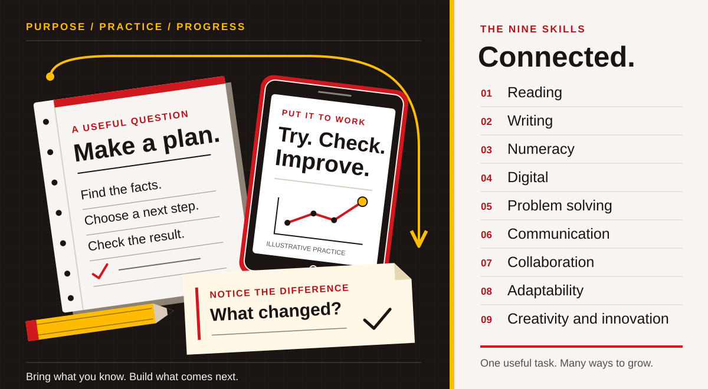
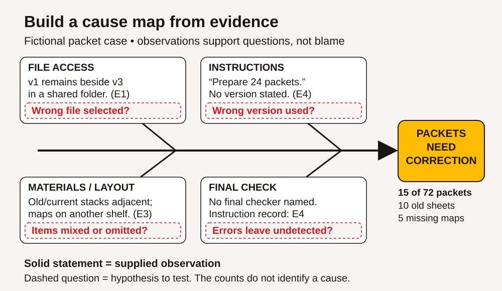

# Visual index — ACCESS IS4S

[Preview eight illustrated pages](visual-sampler.pdf) · [Learner book](learner-textbook.pdf) · [Practitioner guide](practitioner-guide.pdf)

The visual edition contains 38 SVG assets and four fictional illustrations. SVGs carry the exact teaching information; selected illustrations provide human context. Each linked SVG opens separately for inspection or editing.

## Four examples

## Editable SVG library

| Graphic | First teaching context |
|---|---|
| [Nine-skill cover pictograms](assets/diagrams/cover-nine-skills.svg) | Both book covers |
| [Reading map](assets/diagrams/foundation-reading-map.svg) | [Six parts of a useful reading process](learner/01-reading.md) |
| [Reading connection](assets/diagrams/foundation-reading-connection.svg) | [RD-05 • Read the condition](learner/01-reading.md) |
| [Reading versions](assets/diagrams/foundation-reading-versions.svg) | [Worked example 3: resolve a version conflict](learner/01-reading.md) |
| [Writing map](assets/diagrams/foundation-writing-map.svg) | [Six parts of writing with a purpose](learner/02-writing.md) |
| [Writing request](assets/diagrams/foundation-writing-request.svg) | [Worked example 1: turn the plan into a useful request](learner/02-writing.md) |
| [Writing record](assets/diagrams/foundation-writing-record.svg) | [Worked example 2: order the record for the reader](learner/02-writing.md) |
| [Numeracy map](assets/diagrams/foundation-numeracy-map.svg) | [Six connected parts of numeracy](learner/03-numeracy.md) |
| [Numeracy whole packs](assets/diagrams/foundation-numeracy-whole-packs.svg) | [NU-04 • Complete and evaluate the order](learner/03-numeracy.md) |
| [Numeracy board fit](assets/diagrams/foundation-numeracy-board-fit.svg) | [NU-13 • Test fit, not just total area](learner/03-numeracy.md) |
| [Digital map](assets/diagrams/foundation-digital-map.svg) | [Six parts of Digital](learner/04-digital.md) |
| [Digital versions](assets/diagrams/foundation-digital-versions.svg) | [DG-06 • Make a usable second version](learner/04-digital.md) |
| [Digital privacy](assets/diagrams/foundation-digital-privacy.svg) | [DG-14 • Make a practice sharing decision](learner/04-digital.md) |
| [Problem solving routes](assets/diagrams/middle-problem-solving-routes.svg) | [Develop options before selecting one](learner/05-problem-solving.md) |
| [Problem solving trial](assets/diagrams/middle-problem-solving-trial.svg) | [Evaluate results and learn from them](learner/05-problem-solving.md) |
| [Communication check back](assets/diagrams/middle-communication-check-back.svg) | [Listen to understand, then check](learner/06-communication.md) |
| [Communication equipment](assets/diagrams/middle-communication-equipment.svg) | [Case document B • Two people understood different tasks](learner/06-communication.md) |
| [Problem solving components](assets/diagrams/middle-problem-solving-components.svg) | [Six steps that can loop back](learner/05-problem-solving.md) |
| [Communication components](assets/diagrams/middle-communication-components.svg) | [Six connected components](learner/06-communication.md) |
| [Collaboration two checks](assets/diagrams/social-collaboration-two-checks.svg) | [Disagree about the work without reducing the person](learner/07-collaboration.md) |
| [Collaboration handover](assets/diagrams/social-collaboration-handover.svg) | [Turn individual tasks into one finished result](learner/07-collaboration.md) |
| [Adaptability time plan](assets/diagrams/social-adaptability-time-plan.svg) | [Revise the plan without losing the goal](learner/08-adaptability.md) |
| [Adaptability retry](assets/diagrams/social-adaptability-retry.svg) | [Persistence means learning from the attempt](learner/08-adaptability.md) |
| [Creativity three prototypes](assets/diagrams/social-creativity-three-prototypes.svg) | [Case document 2 · Three possible prototypes](learner/09-creativity-innovation.md) |
| [Creativity kit revision](assets/diagrams/social-creativity-kit-revision.svg) | [Case document 3 · Results and a changed requirement](learner/09-creativity-innovation.md) |
| [Collaboration six components](assets/diagrams/social-collaboration-six-components.svg) | [Collaboration — contribute, listen and finish together](learner/07-collaboration.md) |
| [Adaptability six components](assets/diagrams/social-adaptability-six-components.svg) | [Adaptability — keep the purpose, adjust the plan](learner/08-adaptability.md) |
| [Creativity six components](assets/diagrams/social-creativity-six-components.svg) | [Creativity and innovation — notice, make, test and improve](learner/09-creativity-innovation.md) |
| [Project 1 versions](assets/diagrams/social-project-1-versions.svg) | [Project 1: A training information morning](learner/10-integrated-projects.md) |
| [Project 2 stations](assets/diagrams/social-project-2-stations.svg) | [Document D: session brief](learner/10-integrated-projects.md) |
| [Portfolio](assets/diagrams/social-portfolio.svg) | [Add a short evidence note](learner/11-reference-and-portfolio.md) |
| [Nine skills map](assets/diagrams/teaching-nine-skills-map.svg) | [What the nine skills describe](practitioner/01-purpose-and-framework.md) |
| [Six approaches](assets/diagrams/teaching-six-approaches.svg) | [Bring the six approaches into one session](practitioner/02-teaching-approaches.md) |
| [Evidence cycle](assets/diagrams/teaching-evidence-cycle.svg) | [5. Collect evidence that can guide the next lesson](practitioner/02-teaching-approaches.md) |
| [Fraction ruler](assets/diagrams/teaching-fraction-ruler.svg) | [Worked example 1: count the divisions](practitioner/12-integrated-lesson-plans.md) |
| [Root cause fishbone](assets/diagrams/teaching-root-cause-fishbone.svg) | [Handout P3: cause map](practitioner/12-integrated-lesson-plans.md) |
| [Email anatomy](assets/diagrams/teaching-email-anatomy.svg) | [Worked comparison: unclear draft and useful revision](practitioner/12-integrated-lesson-plans.md) |
| [Source transition chart](assets/diagrams/source-transition-chart.svg) | [Preserve useful Essential Skills work and update its purpose](practitioner/01-purpose-and-framework.md) |

## Context illustrations

| Scene | Image |
|---|---|
| Four fictional Indigenous adults compare a drawing, notebook and tablet outside a BC community learning centre, with a mountain landscape and a separated closed training road beyond. | [Open image](assets/illustrations/community-learning.png) |
| Two fictional Indigenous adults compare revised notices and a paper timetable in a community learning centre. | [Open image](assets/illustrations/reading-together.png) |
| An adult writer revises a paper draft beside a laptop while another adult reader gives feedback. | [Open image](assets/illustrations/writing-feedback.png) |
| Two fictional Indigenous adults measure a small practice board and check a calculator in a BC training room. | [Open image](assets/illustrations/measuring-together.png) |

The [asset notes](assets/README.md) record design provenance, original source reuse and editing instructions. The [visual audit](research/visual-audit.md) explains what changed from the first edition. The [validation record](VALIDATION.md) reports print and browser checks.
