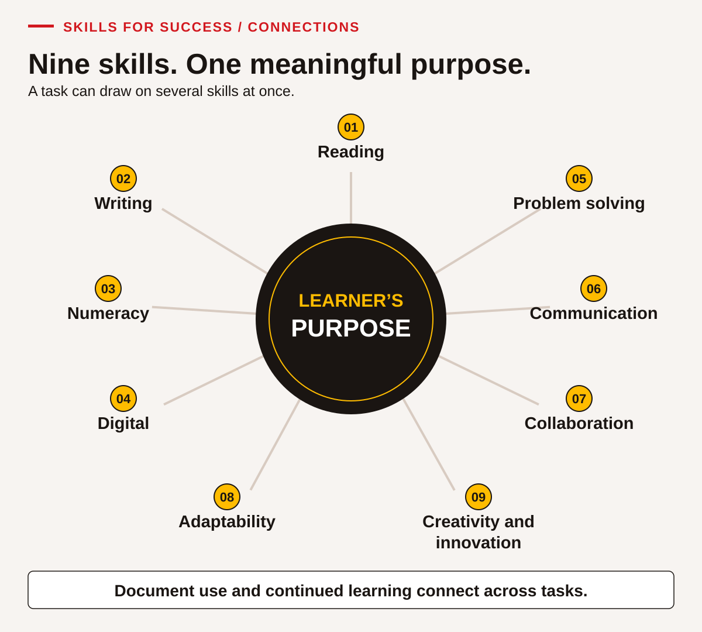

# Start with the skills you already use

<!-- visual:community-learning--learner-00 -->
<figure class="teaching-figure scene" data-visual="community-learning--learner-00">

<figcaption>Teaching scene Skills connect learning, work and community. This original illustration depicts fictional adults in a BC learning setting. <a class="visual-original" href="../assets/illustrations/community-learning.png">Open full-size visual</a></figcaption>
</figure>
<!-- /visual:community-learning--learner-00 -->

You bring knowledge and experience to this learning. You may have organized a journey, explained an idea, compared prices, cared for someone, repaired something, asked a useful question or found a way through a changed plan. Some skills may feel familiar. Others may need a clear example, more time or a chance to practise in a new setting. This book gives you those opportunities.

ACCESS IS4S uses the nine Skills for Success to support learning, work and everyday life. The chapters show practical ways to find information, use numbers, communicate, work with other people and make decisions. You do not need to know every term before you begin. Start with a task that matters to you and build from there.

You are welcome to use the fictional situations throughout this book. You do not have to share a personal record, family story, cultural knowledge or experience you would prefer to keep private. You can bring your own example when it helps, after checking what is appropriate to share. The choice of example should help you learn.

## Your purpose belongs in the plan

Think of one thing you would like to do more easily. It might be understanding a training notice, checking a calculation, writing a clear message or taking part in a team decision. You may be working toward a job, a course, a community role or a personal goal. You may still be deciding. A small, useful goal is enough to begin.

Try finishing this sentence: “I would like to be able to ______ so that I can ______.” For example: “I would like to check a changed schedule so that I know when and where to arrive.” This tells you and your instructor what to practise. You can change the goal as you discover what you need.

You may already have a strategy that works. Perhaps you underline a date, talk through a calculation, make a checklist, keep related files together or ask someone to repeat the important detail. Bring that strategy into the activity if you want to. Compare it with the method shown in the book. Keep what helps and try another approach when it does not.

Learning does not have to look the same for everyone. You can ask for time to think, a demonstration, a glossary, larger print, a quieter place, accessible electronic text or help using a tool. Your instructor can explain which supports are available. You do not need to discuss private information with the group to ask what would make a task easier to access.

## Find your way through the nine skills

<!-- visual:teaching-nine-skills-map--learner-00 -->
<figure class="teaching-figure diagram" data-visual="teaching-nine-skills-map--learner-00">

<figcaption>Visual guide Start with a useful purpose. One real task can call on several connected skills; this map is not a ranking or a required learning order. <a class="visual-original" href="../assets/diagrams/teaching-nine-skills-map.svg">Open full-size visual</a></figcaption>
</figure>
<!-- /visual:teaching-nine-skills-map--learner-00 -->

Each skill chapter gives an explanation, examples and activities. The questions below can help you choose where to start. They are a navigation guide, not a test or a ranking.

| When you want to… | Start with… | A useful thing to practise |
|---|---|---|
| Understand a notice, instruction, table or message | [Reading](01-reading.md) | Find the information, check the conditions and explain what it means. |
| Give someone clear written information | [Writing](02-writing.md) | Plan for your reader, create a text and revise it. |
| Use quantities, time, money or measurements | [Numeracy](03-numeracy.md) | Choose the numbers and units, calculate and check the result. |
| Complete a task with a device or application | [Digital](04-digital.md) | Use a tool, check the information and save or find your work. |
| Work through an issue or decision | [Problem solving](05-problem-solving.md) | Identify the issue, compare information and explain a workable response. |
| Understand others and make your meaning clear | [Communication](06-communication.md) | Listen or receive a message, ask a useful question and check understanding. |
| Contribute to a shared task | [Collaboration](07-collaboration.md) | Agree roles, consider ideas and make a decision together. |
| Respond when a plan or requirement changes | [Adaptability](08-adaptability.md) | Identify the change, adjust your approach and learn from the result. |
| Develop and improve an idea | [Creativity and innovation](09-creativity-innovation.md) | Generate possibilities, try one and improve it. |

You will often use more than one skill at a time. Planning a learning session may involve reading a room notice, calculating supplies, entering a table, asking a question and revising a message. Your instructor may ask you to focus on one part while recognizing the other skills you use. You do not need to separate everything you do into nine boxes.

The [integrated projects](10-integrated-projects.md) bring the skills together in two complete practice situations. The [reference and portfolio chapter](11-reference-and-portfolio.md) explains useful terms and helps you keep examples of your learning. Return to an earlier chapter whenever you need a model or a reminder.

## Use a chapter in a practical way

Begin by reading the purpose of the activity. Ask what the person in the situation needs to understand, decide or produce. Look over the supplied notice, table, message or other information before answering. Check whether the dates, units or conditions matter. In a practice case, use the information supplied rather than guessing what a real organization might do.

Study a worked example before trying a similar task. Look for the decisions behind the answer: Why was that number chosen? Why was that sentence clearer? How did the reader know which message was current? You can cover the next step and predict it, then compare your thinking with the example. A different method can be useful when it meets the task accurately.

Try the activity and keep enough of your thinking to explain it. Show the numbers and units for a calculation. Point to a sentence that supports a reading answer. Keep a first draft when you revise a message. For a conversation, note the clarification you asked and what it changed. The evidence can be brief; it needs to show the action that matters.

Review the attempt with the answer guidance, a partner or your instructor as agreed. Correcting an answer is part of learning. Try to explain the reason for a change rather than simply copying the final result. Then choose a next attempt. You might practise with less prompting, a different document or a new situation that uses the same strategy.

The cases are original classroom simulations unless a source is clearly identified. Their names, schedules, budgets and arrangements are practice information. They are not live bookings, official announcements or instructions from a real employer. When you use a skill outside the class, obtain the current information for that situation and check that it applies.

## Work with others and keep your own contribution visible

Partners can help you notice something you missed. They can ask a question, explain an approach or read a draft as its intended audience. Collaboration does not require everyone to have the same idea. A useful disagreement can lead to a clearer answer when people explain their reasons and check the information together.

Agree who will do what before you begin. For a partner explanation, one person can explain while the other listens, restates the message and asks a clarification. Then swap. For a shared table, both people should have a chance to use the tool when Digital is a focus skill. Watching a partner complete everything is different from demonstrating your own action.

You can contribute through speaking, signing, an accessible communication tool, writing or another agreed method suited to the task. Your instructor will explain how the intended skill can be observed. An accurate check-back matters more than looking or sounding a particular way. Ask for a preparation moment if you need one.

If a group product is submitted, identify your contribution. “I checked the room capacity and corrected our total” tells more than “we worked well.” Also name one idea from someone else that helped. You can value shared work and still keep a clear record of what each person learned.

## Understand feedback and supports

The activities provide evidence from a particular task under particular conditions. Your instructor may use four feedback descriptions. These are local learning notes, not official Skills for Success levels.

| Feedback description | What it means for your next step |
|---|---|
| Not observed | There was not enough opportunity or evidence to judge this action. Arrange a chance to show it. |
| Not yet demonstrated | The attempt did not yet show the agreed outcome. Ask which step to practise and what help could be useful. |
| Demonstrated with support | You met the outcome with a recorded prompt, model or help. Identify what helped and what you want to try next. |
| Demonstrated independently | You met the outcome under the agreed conditions without task-specific prompting. Keep a record of the task and tools you used. |

Agree the task conditions before an attempt. You may be allowed a calculator, a glossary or an accessibility tool. Using an agreed tool does not automatically mean you need task-specific help. For example, independently choosing and checking a calculation with a calculator is different from another person choosing and entering the numbers for you.

Supports should fit the skill. You might explain a reading answer aloud and point to the evidence. A Writing activity needs a text you author, even if you use speech-to-text or another agreed tool. A Digital activity needs an opportunity for you to control the device or application. If access is unavailable, record that and arrange another opportunity; a paper substitute does not show the same digital action.

Ask for specific feedback: “Which part was clear?” “Where did I lose the units?” “What would make this message easier for the reader?” “What should I check next time?” These questions can turn a general comment into a useful practice step. One difficult attempt does not describe everything you know or can learn.

## Make a small learning plan

Use the following template with your instructor or on your own. You do not need to fill every space at once. Keep the plan somewhere you can find it and return to it after practice.

| My learning plan | My note |
|---|---|
| A task I want to do more easily | ______________________________ |
| Why this matters to me | ______________________________ |
| Something I already do that may help | ______________________________ |
| The skill or action I will focus on first | ______________________________ |
| A support, tool or condition I want to discuss | ______________________________ |
| An activity or example I will try | ______________________________ |
| What a useful attempt would show | ______________________________ |
| When I will review it | ______________________________ |
| My next step after the review | ______________________________ |

A completed example could be: “I want to find the right version of a session notice. I already check dates, but I sometimes miss a correction. I will compare two versions, mark what changed and explain which instruction applies. I want to begin with both versions side by side. After practice, I will try a different notice and check the version label before answering.”

You can keep a portfolio of selected work. A portfolio does not need to contain every page. Choose examples that show something useful: a first and revised message, a checked calculation, a file you created or a short note about a conversation. Ask how the program stores work and who can see it. Use fictional information when personal details are unnecessary.

## Bring learning into another situation

A strategy becomes more useful when you can use it elsewhere. After learning to compare versions of a training notice, you might use the same check with a revised meeting message. After checking units in a supplies table, you might use that habit in a personal purchase comparison. Choose a suitable next context and check the real information before acting.

This is called transfer. It needs its own evidence. Completing a familiar activity does not prove that you can use the strategy in every setting. Record where you tried it next, what was different, what support you used and how it worked. If it did not work yet, identify what needs another explanation or more practice.

Respect your own boundaries in choosing a transfer example. You can use another fictional task instead of sharing a private situation. You also have the right to question unclear or unsuitable information. Asking for clarification, checking a limit or seeking appropriate help can be a strong use of a skill.

## A note about this book and its sources

The teaching approach is informed by SkillPlan’s *Skills for Success Get Started Guide for Practitioners*, revised March 2024, especially [pp.10–11](../../asphalt-paving/sources/SFS-Get-Started-Guide_FINAL_MAR2024.pdf#page=10), [pp.24–25](../../asphalt-paving/sources/SFS-Get-Started-Guide_FINAL_MAR2024.pdf#page=24) and [pp.37–42](../../asphalt-paving/sources/SFS-Get-Started-Guide_FINAL_MAR2024.pdf#page=37). This book contains original explanations and practice; it does not assign official proficiency levels.

Our emphasis on individual agency and varied Indigenous experiences is also informed by verified BC sources: [Douglas College Indigenous Student Services](https://www.douglascollege.ca/student-services/indigenous-student-services) and JIBC’s [*Living Indigenization: Engagement Protocols & Guidelines*](https://www.jibc.ca/sites/default/files/2025-01/Engagement_Protocols_and_Guidelines-Online-FINAL.pdf#page=8), printed pp.14–15 / PDF p.8, retrieved 23 October 2026. These sources describe their own contexts. This book does not speak for every Nation or assume that learners share cultural practices. Local relationships and your choices matter in how learning takes place.
