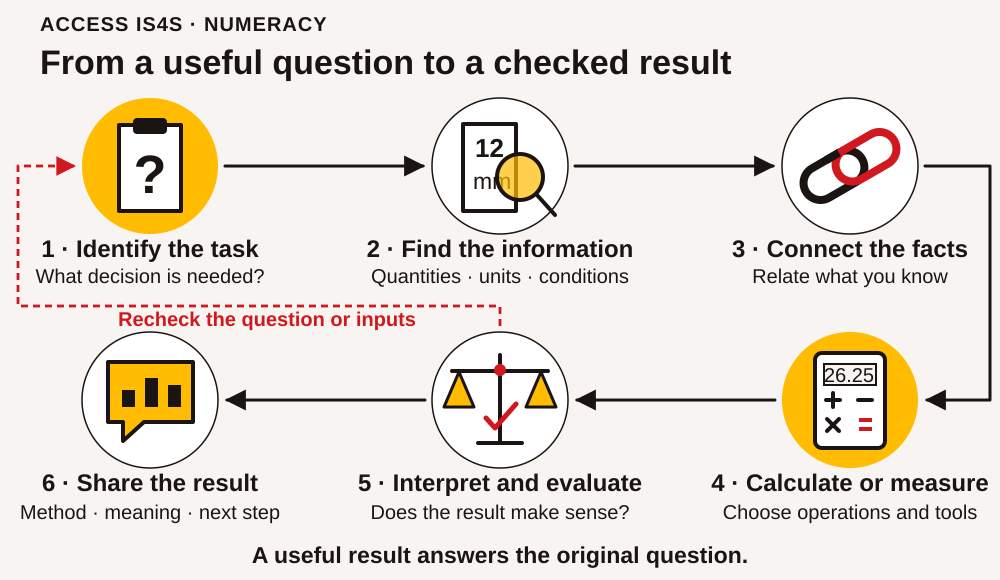
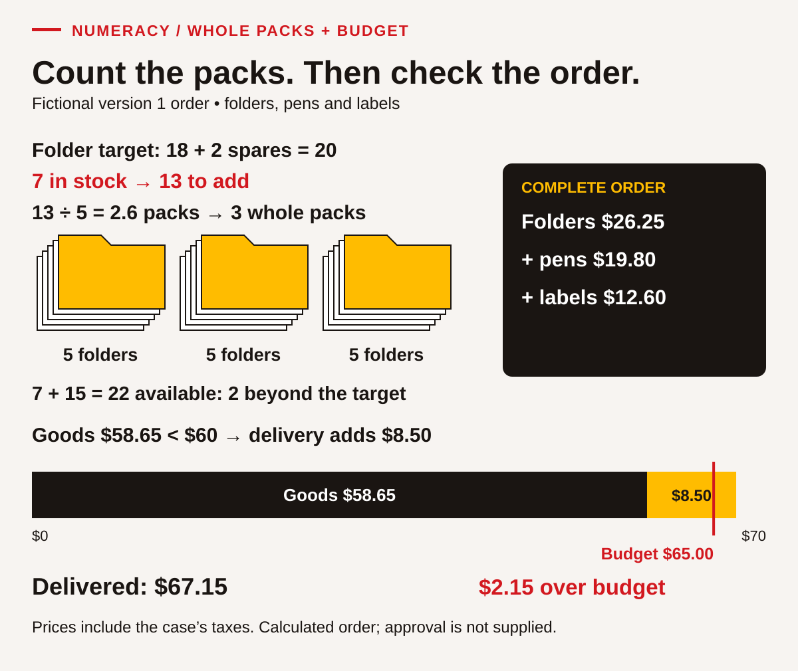
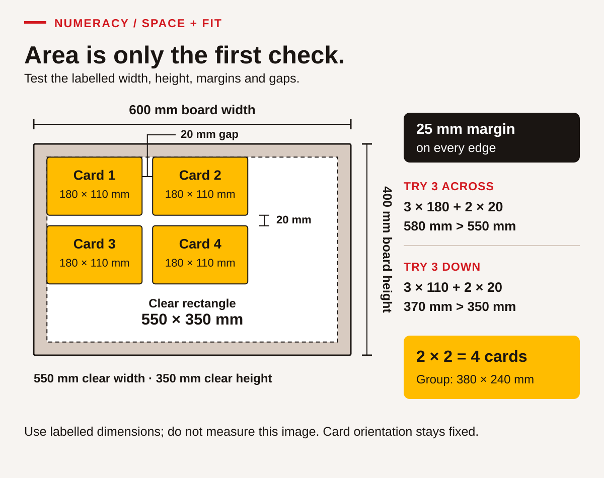

# Numeracy • Find the quantities, choose a method, explain the result

## Start with a useful question

Numeracy helps you answer questions that matter: Will the supplies cover everyone? Which travel plan meets the arrival time? How much space is available? What does a table actually tell us? Getting a number is part of the work. Knowing what that number means, checking it and explaining its consequences complete the task.

You may already estimate quantities, compare prices, organize time, follow a score, count materials or share costs. You can build from those strategies. You do not need to describe your finances, household, cultural responsibilities or employment history to practise here. Every project, price, timetable and dataset in this chapter is invented. Use the supplied cases or agree on another non-sensitive classroom example with your instructor.

Try a task before checking the answer guidance. Keep a record of your method, including a sketch or spoken explanation recorded by the instructor if that works better for you. A calculator, counters, larger print or a spreadsheet can support the reasoning. Record the support you used. A correct calculator display still needs the right question, inputs and interpretation.

## Six connected parts of numeracy

<!-- visual:foundation-numeracy-map--learner-03 -->
<figure class="teaching-figure diagram" data-visual="foundation-numeracy-map--learner-03">

<figcaption>Visual guide Six connected numeracy actions. Follow the numbered route, and return to the question or inputs when a result needs checking. The icons condense the six component descriptions in the table. <a class="visual-original" href="../assets/diagrams/foundation-numeracy-map.svg">Open full-size visual</a></figcaption>
</figure>
<!-- /visual:foundation-numeracy-map--learner-03 -->

The supplied SkillPlan guide names these six components on page 62. This chapter turns them into a repeatable working routine.

| Component | What it looks like in your work |
|---|---|
| 1. Identify the task that requires you to use numeracy | State the decision or question and the form of answer needed. |
| 2. Identify the mathematical information | Find quantities, units, dates, conditions and missing information. |
| 3. Make connections between related pieces of mathematical information | Link the available information to the unknown, including information in another table or note. |
| 4. Apply mathematical operations and tools you will need to answer the question | Choose and carry out a suitable calculation, measurement, comparison or display. |
| 5. Interpret and evaluate the information | Check whether the result makes sense and what the evidence can support. |
| 6. Share the mathematical information, results and implications | Explain the result, method, assumptions and consequences clearly enough for another person to use. |

You can move back and forth through this routine. A result that seems too large may send you back to the units. An unclear question may require clarification before calculation. That is useful checking, not failure. Separate “I do not yet have this information” from “I have the information but need help choosing a method.” Each calls for a different next step.

Before calculating, make a rough prediction. For example, three packs costing about nine dollars each will cost about twenty-seven dollars. An exact result near that estimate is plausible; a result of two hundred and seventy dollars needs investigation. An estimate does not replace a required exact total, but it gives you an independent check.

## Case document A • Supplies for a classroom project

**Fictional training order: Willow Reach information project, version 1.** The Town of Willow Reach is the fictional road owner and Pathway Paving is the fictional contractor in the wider practice case. This order is for classroom materials used to explain that project. It is not an order for road-building equipment or a real purchasing instruction.

Eighteen learners will prepare information folders. Each learner needs one folder, two pens and three labels. The group also wants two spare folders, four spare pens and six spare labels. The supplies cupboard contains seven usable folders, nine usable pens and sixteen usable labels. These counts have already been checked for this invented task. The spare quantities are additional to the learner quantities.

The practice supplier sells complete packs only. The listed prices already include every tax used in this classroom example; do not add another tax. The goods subtotal determines delivery: an order of at least $60 has no delivery charge; an order below $60 has an $8.50 delivery charge. The available budget is $65 for goods and delivery together. No pickup arrangement, discount or alternative supplier has been provided.

| Item | Quantity in one pack | Price for one pack |
|---|---:|---:|
| Folders | 5 | $8.75 |
| Pens | 12 | $6.60 |
| Labels | 20 | $4.20 |

The purchasing note must state what is needed, what is already available, how many whole packs to obtain and whether the total fits the budget. An order should not be described as approved merely because someone has calculated it. Where a condition is unresolved, identify the question for the instructor acting as project coordinator.

### NU-01 • State the task before calculating

Read document A and write a two-sentence task statement. Identify the decision the coordinator needs and the units your answer will use. Then sort these details into **needed now**, **background** or **not supplied**: learner count, contractor name, usable stock, pack prices, delivery conditions and permission to collect an order. Explain why a missing permission cannot be replaced with a convenient assumption.

### NU-02 • Connect learners, spares and stock

Make a table with three rows: folders, pens and labels. Add columns for learner quantity, spare quantity, total target, existing stock and additional quantity needed. Complete the target and additional quantities. Before working exactly, predict which item needs the most individual pieces added. Point to the two parts of document A you had to connect. Explain why subtracting stock before adding the spare target could hide a requirement.

## Whole packs, fractions and money

A pack count is different from a piece count. If thirteen more folders are needed and each pack holds five, `13 ÷ 5 = 2.6 packs`. The supplier does not sell 0.6 of a pack, so this order needs three whole packs. Rounding down would leave a shortage. In another task, such as counting complete kits that can be made from limited stock, rounding down might be necessary. The purpose decides the rounding direction.

Money calculations need a clear order. First find each line cost, then add the goods subtotal, then apply the stated delivery condition. Do not compare the budget with a subtotal that leaves out a required charge. Keep cents through the calculation. These prices are exact classroom inputs, so round a final money amount to cents only when an operation produces more than two decimal places.

**Worked example 1 — folders.** Eighteen learners need eighteen folders. Add two spares: `18 + 2 = 20 folders`. Seven already exist: `20 − 7 = 13 more folders`. Whole packs: `13 ÷ 5 = 2.6`, so buy three packs. Cost: `3 × $8.75 = $26.25`. Check the quantity: `7 + 3 × 5 = 22 folders`, two more than the target of twenty. Check the money: three packs at roughly nine dollars suggest roughly twenty-seven dollars. Both checks support the result. Report “three packs, $26.25, providing two folders beyond the planned target,” not simply “2.6.”

### NU-03 • Work out the pen order

Use the folder example as a model, but calculate the pens yourself. Show the learner requirement, spare requirement, target, shortage, whole-pack count, cost and final quantity available. Explain the difference between the four planned spare pens and any additional pens created by buying complete packs. Check the quantity using multiplication and addition after you have calculated the pack count.

### NU-04 • Complete and evaluate the order

Calculate the label order independently. Then use the folder, pen and label costs to find the goods subtotal, applicable delivery charge and complete order cost. Compare the complete cost with the $65 budget and state the size of any surplus or shortfall. A note says, “The goods cost less than $65, so the order fits.” Correct that note with evidence. Do not invent a discount or permission to omit required supplies.

A fraction compares a part with a defined whole. Seven existing folders out of a target of twenty is `7/20`. Dividing gives `0.35`; multiplying by one hundred gives `35%`. These are three ways to represent the same share. The denominator must be the relevant whole, not a number chosen because it is nearby in the document. “We already have nine pens and seven folders” does not tell us which requirement is better covered because the target quantities differ.

<!-- visual:foundation-numeracy-whole-packs--learner-03 -->
<figure class="teaching-figure diagram" data-visual="foundation-numeracy-whole-packs--learner-03">

<figcaption>Visual guide After your attempt, use this worked visual check. Worked visual check — version 1 needs three whole packs of each item. Goods of $58.65 attract $8.50 delivery, making the order $67.15: $2.15 above the $65 budget. All values are fictional. <a class="visual-original" href="../assets/diagrams/foundation-numeracy-whole-packs.svg">Open full-size visual</a></figcaption>
</figure>
<!-- /visual:foundation-numeracy-whole-packs--learner-03 -->

### NU-05 • Compare shares fairly

Find the share of each target already covered by stock for folders and pens. Give each as a fraction and a percentage. Which target has the larger share covered, even though the other item has more pieces in stock? Explain the role of the whole in your comparison. Use a strip divided into twenty or forty equal parts, a calculator or another clear representation to check your reasoning.

### NU-06 • Respond to a changed quantity

**Version 2:** The learner count rises from eighteen to twenty-two. Each learner's quantities, spare quantities, stock, pack sizes, prices, delivery rule and $65 budget stay the same. Recalculate the three whole-pack counts and total order cost. Identify which lines change and which stay unchanged. Give the coordinator a concise revised report, including the budget consequence and one decision that still needs their direction. Keep version 1 visible so the change can be checked.

## Case document B • A training visit timetable

**Fictional travel plan, one practice day.** A learner is travelling from the fictional South Stop to a training room. Registration must be reached by 08:45. The workshop starts at 09:00 and ends at 15:20. There is an eight-minute walk between Training Stop and the room. The planning instruction adds a ten-minute buffer after the planned walk and before the registration deadline. The buffer is a classroom planning allowance, not a promise about real service reliability.

The learner must change services at Central Stop. Times in the table are for this invented exercise and do not describe a B.C. transport service. A connection is possible only when the first service arrives before the second leaves. No other outbound departures are available in this document.

| Outbound service | Leaves | Arrives |
|---|---|---|
| A: South Stop to Central Stop | 07:10 | 07:45 |
| B: South Stop to Central Stop | 07:40 | 08:15 |
| C: Central Stop to Training Stop | 08:00 | 08:25 |
| D: Central Stop to Training Stop | 08:25 | 08:50 |

After the workshop, the same eight-minute walk returns the learner to Training Stop. The return service leaves at 15:40 and reaches Central Stop at 16:05. The next service leaves Central at 16:20 and reaches South Stop at 16:55. For the exercise, each vehicle boarding costs $2.50. A fictional $8 day pass covers all four boardings on that day. There are no additional fares or discounts in this case.

The coordinator asks for a workable outward journey, the expected return time and a fare comparison. They also want the learner to identify conditions that a real travel plan would need to confirm, such as current schedules and accessible travel arrangements. No one needs to disclose their actual address or travel needs to solve the case.

## Read time as time

Clock minutes use groups of sixty. From 08:25 to 09:00 is thirty-five minutes, not seventy-five. A decimal hour uses a different representation: half an hour is `0.5 h`, which is thirty minutes. When a document says `1.30 h`, you need to know whether the writer means one hour thirty minutes or 1.30 decimal hours. Clear reporting avoids that ambiguity by writing `1 h 30 min` or `1.5 h`.

**Worked example 2 — a return journey.** The workshop ends at 15:20. Add the eight-minute walk to reach Training Stop at 15:28. The wait for 15:40 is twelve minutes. The first vehicle journey takes twenty-five minutes, the Central wait takes fifteen minutes, and the final journey takes thirty-five minutes. Total: `8 + 12 + 25 + 15 + 35 = 95 minutes`, or `1 h 35 min`. Check directly: 15:20 to 16:20 is sixty minutes, then another thirty-five reaches 16:55. The report should name both the final clock time and the elapsed duration.

### NU-07 • Choose a feasible outward journey

Find the latest listed departure from South Stop that allows the learner to meet registration **including** the eight-minute walk and ten-minute buffer. Name both connecting services. Show arrival at Training Stop, arrival at the room and the end of the buffer. Explain why the later South departure does or does not work. This is a question about stated constraints, not simply about the shortest ride.

### NU-08 • Check elapsed time another way

For the feasible outward journey you chose, calculate the Central waiting time and total elapsed time from South departure to room arrival. Add the return journey's elapsed time to find the combined outward-and-return journey time. Include travel and waits within those journeys; exclude all time in the room before the 09:00 workshop, including the planning buffer, and exclude the workshop itself. Report hours and minutes. Correct this claim: “Eighty-three minutes is 1.83 hours.” You may show a timeline, grouped minutes or a calculator conversion.

### NU-09 • Compare like-for-like fares

Calculate the cost of four separate boardings and compare it with the day pass. State the saving and the assumptions that make the comparison valid. Then consider a different learner who needs only two boardings that day. Which option costs less for that learner, and by how much? Explain why “the pass is always cheaper” is not supported by the supplied prices.

### NU-10 • Update a plan without losing its conditions

**New notice:** Registration is now due by 09:10 and the workshop starts at 09:20. Everything else in document B stays unchanged, including the ten-minute buffer and the workshop end time. Recheck the later South departure. Prepare a short revised journey note with service letters, room-arrival time, buffer-end time, registration margin and fare choice for four boardings. Identify one real-world fact the fictional timetable cannot verify.

## Case document C • A classroom information board

**Fictional layout brief.** A learning room is preparing an information board using paper cards. The board is a rectangle 600 mm wide and 400 mm high. The first layout requires a clear margin of 25 mm on every edge. Each information card is 180 mm wide and 110 mm high. Cards must keep that orientation. Leave a 20 mm gap between neighbouring cards, horizontally and vertically. The 20 mm rule applies only between neighbouring cards; no additional 20 mm gap is required at an outside edge.

All dimensions are nominal design inputs for this exercise. They are not measurements of the printed page. Printing or screen zoom can change a diagram's physical size. Use the labelled values for calculations. If you practise measuring an actual classroom object, use a suitable real measuring tool and record the unit and precision; do not assume this workbook prints at a particular scale.

The board will explain four fictional practice-session categories. The visitor table counts thirty-six invented visitors, with each person assigned to only one category. It is a complete table for this exercise, not a survey of an actual community. The instructor asks for a neat arrangement, a simple chart and a short explanation of what the chart supports.

| Practice-session category | Fictional visitors |
|---|---:|
| Orientation | 8 |
| Trades preparation | 12 |
| Service roles | 6 |
| Community project planning | 10 |

Later, the instructor may change the margin requirement. Keep the original layout and calculations so a revision can be compared. The task concerns paper information design. It does not establish structural design, accessibility compliance or a safe installation method for a real board.

## Measure the quantity the task actually asks for

Length, perimeter and area answer different questions. Length describes a single dimension. Perimeter is the distance around a shape. Area describes the surface covered. A rectangle's perimeter is `2 × (width + height)`, while its area is `width × height`. Label perimeter in a length unit such as metres and area in a square unit such as square metres. The same numbers can produce both calculations, but the results are not interchangeable.

Changing units also requires attention to the quantity. Because `1 m = 1,000 mm`, 600 mm is 0.6 m. For area, one square metre contains `1,000 × 1,000 = 1,000,000 square millimetres`. Dividing a square-millimetre area by only one thousand produces an incorrect conversion. A sketch of a one-metre square can help explain why two dimensions change.

**Worked example 3 — the clear inside rectangle.** The board loses a 25 mm margin on both the left and right: `600 − 25 − 25 = 550 mm`. It also loses the top and bottom margins: `400 − 25 − 25 = 350 mm`. The clear area is `550 × 350 = 192,500 mm²`. Converting the sides first gives `0.55 × 0.35 = 0.1925 m²`, which agrees with `192,500 ÷ 1,000,000`. Check that the clear area is smaller than the whole board. Do not subtract the margin only once from each dimension.

### NU-11 • Identify units and precision

Convert the board width and height to centimetres and metres. Rewrite the 20 mm gap in centimetres. Explain why measuring the drawing on a resized screen would not establish these dimensions. If you have a real ruler, measure a plain classroom sheet's width to the nearest millimetre and record your method; otherwise describe where zero and the endpoint would need to align using the supplied board values. Keep actual measured data separate from nominal case dimensions.

### NU-12 • Choose perimeter or area

Calculate the whole board's perimeter in metres and its area in square metres. Then calculate the total area of four information cards and express it as a percentage of the whole board area. Explain which result could describe the amount of surface covered and which describes the distance around the board. Check that the card coverage percentage is below 100% without relying only on the calculator display.

### NU-13 • Test fit, not just total area

Using the original margins, work out how many cards fit across and how many fit down. Include only the gaps between cards: two cards have one gap, three cards have two. Find the total number of cards in a rectangular arrangement. Show why a proposed three-column layout fails even if the cards' combined area seems small enough. Draw a labelled sketch that another learner can check without measuring your drawing.

<!-- visual:foundation-numeracy-board-fit--learner-03 -->
<figure class="teaching-figure diagram" data-visual="foundation-numeracy-board-fit--learner-03">

<figcaption>Visual guide After your attempt, use this worked visual check. Worked visual check — 25 mm margins leave 550 × 350 mm. Two columns and two rows fit with 20 mm gaps. Three columns need 580 mm and three rows need 370 mm, so each exceeds the clear space. Use the labels, not the displayed size. <a class="visual-original" href="../assets/diagrams/foundation-numeracy-board-fit.svg">Open full-size visual</a></figcaption>
</figure>
<!-- /visual:foundation-numeracy-board-fit--learner-03 -->

### NU-14 • Read a different unit system

A separate fictional paper strip is labelled **6½ inches**. Use the exact conversion `1 inch = 25.4 mm` to calculate its length in millimetres. First rewrite 6½ as a decimal. A second strip is **¼ inch** wide; convert that width too. Explain why multiplying by 25 rather than 25.4 would be an approximation. These labels are supplied values, not a claim about the physical size of any printed illustration.

## Turn data into a message

A useful graph has a question, a title, clear category labels and a scale. A bar chart compares category amounts well. Start its count axis at zero so the visual lengths represent the quantities fairly. Equal steps on the axis must mean equal numerical changes. A picture with attractive bars but no units may leave the reader unable to tell whether the values represent people, dollars or minutes.

A percentage also needs its population and period. “One third chose trades preparation” means one third of these thirty-six fictional visitors, not one third of all learners or all Indigenous people. A count can describe this dataset without explaining why someone attended or predicting demand next year. Sharing a result includes saying what remains unknown.

### NU-15 • Make a chart that can be checked

Total the visitor counts. Create a bar chart on paper or with a digital tool using an axis from zero to twelve in steps of two. Include a title that says the data are fictional. Calculate the share represented by Trades preparation as a fraction and percentage. Write two supported comparisons and one conclusion the table cannot support. If using a tool, check its chart against the original table; paper work demonstrates the numeracy task without claiming Digital evidence.

### NU-16 • Recalculate after a layout change

The instructor changes every outside margin from 25 mm to 10 mm. Card orientation, card dimensions and 20 mm between-card gaps stay unchanged. Calculate the new clear width and height. Test the number of cards across and down, then compare capacity with the original arrangement. Explain why increasing clear area alone is not enough to establish that a particular arrangement fits. Report both the new count and its conditions.

### NU-17 • Transfer the checking routine to a purchasing choice

Return to document A, version 1 with eighteen learners. The coordinator now permits **one extra pack of labels** because they will be used at the next session and storage is available. Compare the original minimum-quantity delivered order with an order containing that additional pack. Reapply the delivery rule and find the total difference. Does the revised order fit $65? Explain the trade-off: spending more on goods can sometimes reduce the final charge, but buying unneeded goods is not automatically a saving.

### NU-18 • Make a numerical handover

Choose your revised journey, revised board layout or revised supply order. Prepare a handover containing the question, relevant inputs, method, checked result and implication. Include one uncertainty or condition and show how another person could check the result. Your partner or instructor restates the recommendation; correct any misunderstanding. Finally, identify a specific mistake you corrected or a checking strategy you strengthened, using evidence from your working rather than a general claim about being “good” or “bad” at maths.

## Practise with a suitable amount of support

Start with a preformatted table, a number line, fraction counters or an instructor modelling one step. Then try a related item with fewer prompts. If a whole case is too much at once, complete its quantities before its costs, or its arrivals before its fares. Keeping the purpose visible helps you reconnect the parts. For an extension, explain a second valid method or show what additional information a real task would require.

A partner can ask questions and compare methods, but keep individual evidence of your reasoning. Explain an operation before entering it into a calculator. When two results differ, compare the task, source values, units and steps in that order. Repeating the same calculation without identifying the disagreement may simply repeat the error. Feedback should name the useful action: “You checked both margins,” or “The delivery condition still needs applying.”

Your local feedback record can distinguish **Not observed**, **Not yet demonstrated**, **Demonstrated with support** and **Demonstrated independently**. An attempt with an error is different from a task nobody has observed. These descriptions are not official Skills for Success proficiency levels. Application in a different context is recorded separately as transfer, with the new task and evidence named.

## Component and evidence map

| Component | Main evidence in this chapter |
|---|---|
| 1. Identify the task | NU-01 states the decision; NU-07 identifies deadline constraints; NU-12 selects the required quantity. |
| 2. Identify mathematical information | NU-02 extracts quantities; NU-07 reads the timetable; NU-11 identifies units and precision. |
| 3. Connect related information | NU-02 links people, spares and stock; NU-04 joins pricing and delivery; NU-13 connects dimensions and gaps. |
| 4. Apply operations and tools | NU-03–NU-06 calculate packs, money and shares; NU-08–NU-09 calculate time/fares; NU-12–NU-16 calculate and display measurements/data. |
| 5. Interpret and evaluate | NU-04 challenges a subtotal claim; NU-13 tests actual fit; NU-15 limits conclusions; NU-17 compares complete costs. |
| 6. Share results and implications | NU-06 and NU-10 report revisions; NU-15 explains a chart; NU-18 gives a checkable handover. |

## Source and teaching-design note

The six component names and numeracy framework come from the supplied SkillPlan *Skills for Success Get Started Guide for Practitioners*, revised March 2024, [PDF/printed page 62](../../asphalt-paving/sources/SFS-Get-Started-Guide_FINAL_MAR2024.pdf#page=62). Use page 62 for component 6; the table on page 63 repeats the operations heading in that position, while its sharing example concerns communication of results. Teaching choices draw on contextualized numeracy and support [pages 64–65](../../asphalt-paving/sources/SFS-Get-Started-Guide_FINAL_MAR2024.pdf#page=64), collaborative explanation and feedback [pages 66–67](../../asphalt-paving/sources/SFS-Get-Started-Guide_FINAL_MAR2024.pdf#page=66), and measurement/data-display examples [page 70](../../asphalt-paving/sources/SFS-Get-Started-Guide_FINAL_MAR2024.pdf#page=70). The guide's page 68 cautions about preliminary proficiency alignment; this chapter assigns no official level. All case documents, questions and worked examples here are original teaching designs. They have not been presented as community-approved material, real industry statistics or certification assessments.
