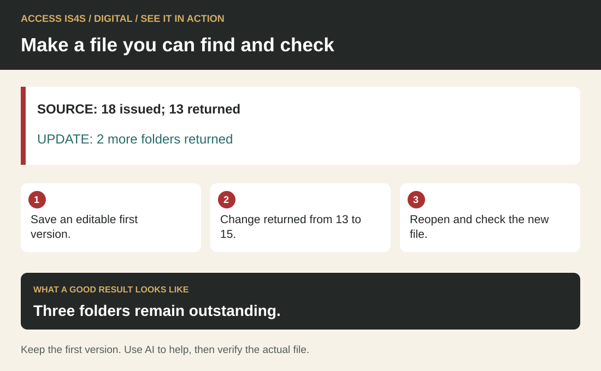
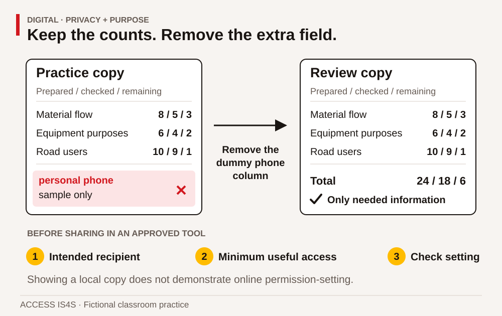
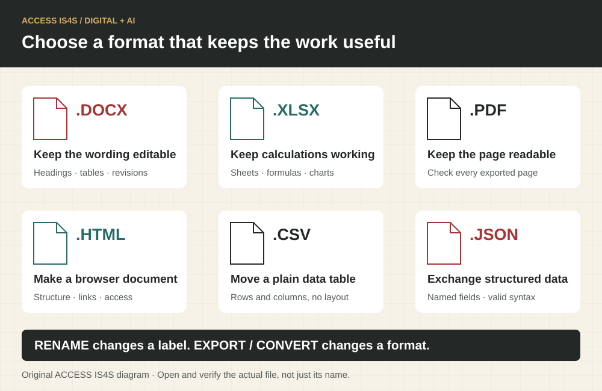
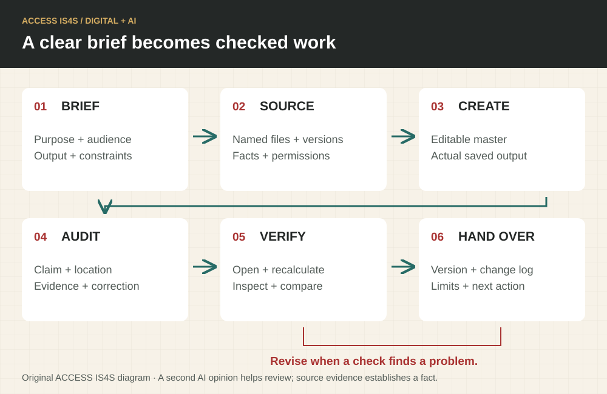
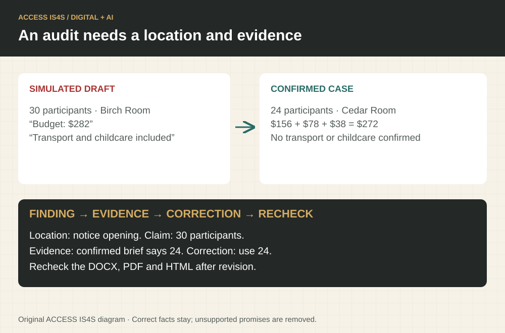
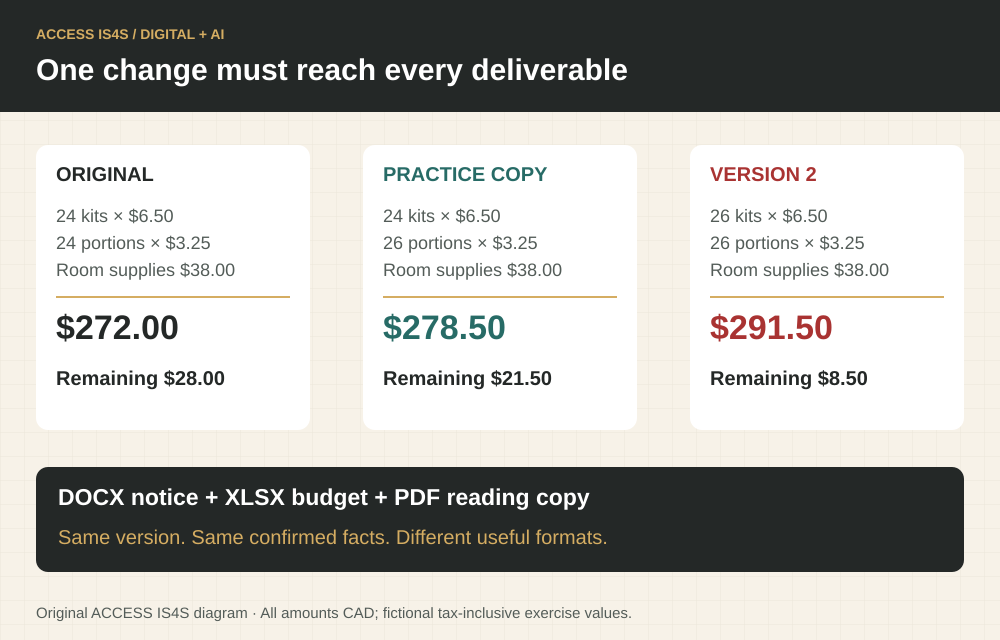

# Digital • Keep information useful, findable and in your control

AI is part of everyday digital work. The complete AI-literacy section in this chapter covers Claude, Claude Code, Cowork, ChatGPT and Codex; file extensions; document creation; evidence-based audits; and verification of DOCX, XLSX, HTML and PDF outputs. Use its supplied fictional case for a self-contained practical sequence.

Digital skill means choosing and using devices, tools and information for a purpose. It includes finding a document, checking whether it answers your question, creating something useful, protecting information and learning a changed tool. Being quick on one app does not mean you must already know every other app. The useful question is: what do you need to accomplish, and what support will help you do it?

You may already use digital skills to arrange travel, follow a course, keep in touch, manage a household or support a community activity. You may also prefer paper for some jobs. Both experiences matter here. We begin with familiar actions and make their purpose visible. You can choose an accessibility setting, work beside a partner and ask for a demonstration without giving up control of your own task.

The cases in this chapter concern a **fictional training centre in B.C.** All names, quantities, messages and records are invented. They represent classroom choices, not the procedures of ACCESS, a Nation, a real employer or a public agency. Use a learning ID, not personal records. No activity requires an account password, a purchase, an application submission or sending a message to another person.

## See it in action · Digital

<!-- visual:quick-digital--learner -->
<figure class="teaching-figure diagram" data-visual="quick-digital--learner">

<figcaption>Visual guide Three folders remain outstanding. ACCESS IS4S. (2026). Original fictional teaching diagram. <a class="visual-original" href="../assets/diagrams/quick-digital.svg">Open full-size visual</a></figcaption>

Read the visual description

SOURCE: 18 issued; 13 returned. UPDATE: 2 more folders returned. Save an editable first version. Change returned from 13 to 15. Reopen and check the new file. Three folders remain outstanding. Keep the first version. Use AI to help, then verify the actual file.

</figure>
<!-- /visual:quick-digital--learner -->

This small fictional example shows the skill in use. SOURCE: 18 issued; 13 returned. UPDATE: 2 more folders returned.

**Try it:** Save an editable first version. Change returned from 13 to 15. Reopen and check the new file.

**Check your result:** Three folders remain outstanding. Keep the first version. Use AI to help, then verify the actual file.

## Six parts of Digital

<!-- visual:foundation-digital-map--learner-04 -->
<figure class="teaching-figure diagram" data-visual="foundation-digital-map--learner-04">

<figcaption>Visual guide Purpose guides the device, tool, information and sharing choices. Observe each learner using the tool; a described process alone is different evidence. <a class="visual-original" href="../assets/diagrams/foundation-digital-map.svg">Open full-size visual</a></figcaption>

Read the visual description

An original task illustration occupies the left panel; six numbered actions appear on the right. Choose the next action to meet a real task purpose. Six connected components: Use digital devices; Use tools to complete tasks; Use digital information; Use online tools and platforms; Protect privacy; act responsibly; Update your digital skills. Actual tool use supplies evidence that a paper plan cannot show.

</figure>
<!-- /visual:foundation-digital-map--learner-04 -->

These six components connect device control, useful information, responsible decisions and continued learning. Begin with actions that matter for your task and add challenge when you can check the result.

| Component | What it means in this chapter | Main evidence |
|---|---|---|
| 1. Use digital devices including computers, tablets, smart phones and other handheld devices | Control the available device and adjust a useful setting. | DG-01–DG-03 |
| 2. Use common digital tools to complete tasks | Choose a suitable tool and produce a checked document or table. | DG-04–DG-06 |
| 3. Use digital information | Find, compare, organize and evaluate information. | DG-07–DG-09 |
| 4. Use online tools and platforms | Navigate a public website and use its features for a defined purpose. | DG-10–DG-12, where an actual online turn is available |
| 5. Apply safe and responsible practices online | Recognize requests, manage sharing and protect credentials and other people's information. | DG-13–DG-15 |
| 6. Update and upgrade digital skills | Use help, test a new method and retain a learning strategy. | DG-16–DG-18 |

If internet access is unavailable, the printed cases still support reading, source evaluation and planning. Record online tool use as **not observed** until you have an actual turn. Likewise, your partner's completed spreadsheet is not evidence that you used the tool. Partners can coach; each person needs time controlling the device or their chosen accessible interface.

<!-- teaching:digital-entry-bridge-learner -->
## Control one action and check its effect

Begin in an approved blank practice document. The instructor confirms where work may be saved and how to return to the starting view. Use a mouse, keyboard, touch, voice or another accessible control method. The purpose is to control and check the action, not imitate one device's gesture.

### Start by noticing the controls

Identify the application you are using. Explain how you enter a word, select it and return to the document, then demonstrate two actions. If the controls are familiar, move to saving and retrieval. If a control is unfamiliar, ask for a demonstration, take control again and repeat with different dummy text.

### Enter, select and undo

1. Enter **Practice list** on the first line and **three folders** on the next.
2. Select **three** using the available interface. Replace it with **four**.
3. Identify the application's Undo command. Use it and check whether **three** returns.
4. Change the word to **five**. Explain what changed and what stayed the same.

Ask your instructor to model a different phrase first if helpful. Some applications show undo in a menu; others use a toolbar or accessible shortcut. Ask for a demonstration when the location is unfamiliar. Do not assume the same key combination works everywhere. Inspect the result after each action.

### Save and find an actual file

Choose the approved practice folder with the instructor. Save the document as **controls-practice-v1-[learning-ID]**. Record both name and location; these are different pieces of information. Close the document, then reopen it from that location. Confirm the latest word **five**. For autosaving tools, identify the saved item/location and check its latest content after reopening.

Make a second version named **controls-practice-v2-[learning-ID]**, changing **five folders** to **six folders**. Retain v1. Close v2, locate both files and check which contains each phrase. A changed name with old content is not a completed update.

### Make one access adjustment

Choose text enlargement, zoom, pointer size or another available setting that helps you use the document. Predict what it changes, try it and inspect the result. Check whether the setting affects the view only or changes document content. Agree whether to restore it on a shared device. You do not need to give a diagnosis or personal reason.

### Fresh exit task

In a new blank file, enter **Return note** and **two rulers**. Save it as **controls-exit-[learning-ID]** in the approved location. Replace **two** with **three**, use Undo to restore **two**, then save the intended final text **four rulers**. Close and reopen the file and show the phrase. State the name and location and demonstrate a usable view adjustment.

Ask your observer to record your actions, any navigation help and whether the final saved phrase is present. If a file cannot be found, use the remembered name/location to investigate; do not create repeated copies at random. After watching a demonstration, take your own turn so your actions can be observed.

Continue to making a small table when you can enter, revise and retrieve a simple file with your agreed support. Keep a help card with three reminders you choose: **where I save**, **how I undo**, **how I ask for the next unfamiliar step**. Do not include passwords or private account information.

### Continue into AI-assisted work

Use the complete [AI-literacy sequence](../teaching/ai-literacy/learner.md) to apply these file and tool skills to a clear AI brief, editable documents, formula checks and a verified final export. The case supplies its own facts and twelve activities. Observe the learner’s actual AI and file actions separately from these foundation checks.
<!-- /teaching:digital-entry-bridge-learner -->

## Begin with a purpose and a comfortable setup

A device is the physical equipment, such as a laptop or tablet. An application is a program used for a task. A file is a saved item, such as a document or spreadsheet. A folder helps organize files. A browser opens web pages and may also show local files. A website is a set of pages provided through the web. These terms help you ask a precise question: “I can open the browser, but I cannot find the file I downloaded” gives a helper a clearer starting point than “Nothing works.”

Before changing anything, notice what is already open. On a shared device, ask which folder and account are designated for classroom practice. Do not browse another person's files. A helpful setting might be text enlargement, display magnification, a different pointer size, captions, keyboard navigation or a screen reader. Settings differ between devices. Ask the instructor to demonstrate an unfamiliar setting and how to return to the previous view. The goal is usable access, not mastering a particular brand's menu names.

### DG-01 • Name the task and the controls

Choose one available device. Tell a partner how you would enter text, select an item, move between open applications and return to the main working screen. Demonstrate two of those actions using an empty practice document. Identify the device, application and file separately. If you use voice, switch controls or another access method, demonstrate the equivalent actions. The partner records what you actually did, not how fast you did it.

### DG-02 • Make one useful adjustment

Choose a setting that could help with this chapter, such as enlarging text or turning on captions for a demonstration. Predict what it will change, make the adjustment with support if needed, and test it. Explain whether it helped. Show how you would restore the previous setting or ask the device owner before leaving it changed. This is a practical choice; you do not need to disclose a diagnosis or justify an access need.

### DG-03 • Create a place to work

In the approved practice location, create a folder named `IS4S-practice-[learning-ID]`. Create a document named `digital-notes-v01` inside it. Add the date and one sentence about a digital task you want to practise. Save, close and reopen it from the folder. Point out the difference between the file name and its location. If the application saves automatically, identify the saved location and check that your latest sentence appears after reopening.

## Case document A • A record the next person can trust

> **Fictional centre request — Equipment learning cards, version 1**
>
> The training team is preparing classroom cards for an introduction to asphalt paving. The cards explain equipment purposes; they contain no operating instructions. The coordinator needs a record showing how many card sets are ready and how many still need checking.
>
> At the start of the afternoon, the table below is the agreed record. “Checked” means a classroom reviewer compared the printed labels with the approved lesson sheet. It does not mean equipment has been inspected or a learner has earned a technical qualification. The coordinator asks for a clear title, the three topic names, totals and a note identifying the record as fictional practice data.
>
> Another learner will use the file tomorrow. They need to find the latest version without guessing whether “final,” “new-final” or “really-final” is correct. The practice folder is shared only with the instructor and your assigned partner. No public link is needed.

| Classroom card topic | Sets prepared | Sets checked |
|---|---:|---:|
| Material flow | 8 | 5 |
| Equipment purposes | 6 | 4 |
| Road users | 10 | 7 |

A word-processing document is useful for paragraphs and a simple display table. A spreadsheet is useful when you need repeated calculations and updates. A presentation tool helps organize material for an audience, but it may be awkward for a record that must be sorted and recalculated. Choosing a tool begins with the task, not with the most impressive feature available.

### Worked example 1 • Build a small, checkable table

Open a blank spreadsheet. Put the headings in row 1: **Topic**, **Prepared**, **Checked**, **Remaining**. Enter the three source rows in rows 2–4. In D2, subtract checked sets from prepared sets: `=B2-C2`. The first result should be 3. Use the same relationship for the next two rows. The remaining values are 3, 2 and 3.

In row 5, label the first cell **Total** and total each number column. For example, `=SUM(B2:B4)` totals prepared sets. The answers are 24 prepared, 16 checked and 8 remaining. Check the relationship `24 − 16 = 8`. This second check would catch some entry or range errors. It does not replace checking every source row. A formula can calculate the wrong entries perfectly.

Give the sheet a descriptive title. Keep numbers as numbers; explain their meaning in headings. Save a first version and reopen it. The useful result is a readable, retrievable record whose values agree with the supplied document. A screenshot alone may hide formulas or make later editing difficult, so keep the editable file as well as any display copy.

### DG-04 • Choose and explain a tool

Choose a tool for each task: a two-paragraph visitor note, the card-count record, and a three-screen explanation for a class discussion. Explain one useful feature and one limitation of each choice. A single tool may handle more than one task. Your reason must refer to the reader, calculation or update needed, not simply “I like this app.” Compare your choice with a partner's and retain any justified difference.

### DG-05 • Build and check the record

Create the four-column table from Case A. Enter and check every row, calculate remaining sets and add totals. Show the instructor one formula or your alternative calculation method. Add a note saying **Fictional classroom data — not an equipment inspection record**. Save the editable file as `card-record-v01-[learning-ID]`. Explain why a prepared set and a checked set are not the same thing. If using a table tool without formulas, show your calculations separately and label totals clearly.

### DG-06 • Make a usable second version

A reviewer checks two more **Road users** sets; no new sets are prepared. Update the checked value from 7 to 9 and save a second version. Record what changed and who made the practice update using your learning ID. Check the new totals and remaining count. Show both versions, identify the current one, and explain how a future reader would know which to use. Do not delete the earlier version until the exercise review is complete.

<!-- visual:foundation-digital-versions--learner-04 -->
<figure class="teaching-figure diagram" data-visual="foundation-digital-versions--learner-04">

<figcaption>Visual guide After your attempt, use this worked visual check. A clear name helps retrieval; the changed values establish which record you opened. The second-version name shown is an example. <a class="visual-original" href="../assets/diagrams/foundation-digital-versions.svg">Open full-size visual</a></figcaption>

Read the visual description

Two files in a practice folder show the change from v01 to v02. Road-user cards remain ten prepared while checked increases from seven to nine and remaining decreases from three to one. Across all topics, prepared stays twenty-four, checked rises from sixteen to eighteen and remaining falls from eight to six. Both versions stay available for review.

</figure>
<!-- /visual:foundation-digital-versions--learner-04 -->

## Find and judge information before using it

Searching is a sequence of decisions. First identify the question. Then choose terms that describe the topic, location and type of source. Open a result and examine the actual page. A result title or preview can be incomplete, outdated or unrelated to the part of the page you need. Record the title, publisher, date or version if shown, and the location of the information that answers your question.

A relevant source can still have limits. A historical training outline may accurately describe what was included in that version, while not proving today's entry requirements. A government page can be authoritative for its own program without answering a particular employer's procedure. A post that repeats someone else's claim may not show where that claim began. Ask both “Who is responsible for this information?” and “Does this information answer my actual question?”

Digital information also includes tables, images, diagrams, audio and video. An image without labels may be difficult to interpret. A video may need captions or a transcript. A document may look official but contain an old revision date. These are reasons to investigate, not reasons to dismiss every unfamiliar source. You can keep a question open while finding better evidence.

## Case document B • Two messages, different evidence

> **Practice notice A — undated social post**
>
> “The paving course is open to everybody next week. No need to check anything: all training is free, and everyone who attends gets fully qualified. Share this with all your contacts.” The post names no provider, intake, eligibility rule, credential or contact. A decorative logo appears, but the page gives no source link.

> **Practice notice B — fictional training-office draft, dated 6 May 2027**
>
> “We are collecting expressions of interest for an introductory classroom session about asphalt paving. This notice does not confirm a place, tuition arrangement or trade qualification. Contact the training office through its published directory before making travel arrangements. The coordinator will confirm dates, access supports and any documents needed. Do not put identity documents in a public comment.”

These notices are supplied classroom texts. Neither is a real intake announcement. Notice B gives clearer limits, but its fictional status means it cannot establish a real course opportunity. A careful reader can recognize better information practices without treating the example as current program information. This distinction matters when digital material looks polished or uses a familiar organization's name.

### Worked example 2 • Turn a broad search into a useful question

The first question is “How do I get a paving job?” That could involve training, vacancies, applications, experience or certification. For this chapter, narrow it to: **Where can I read the official description of the nine Skills for Success?** Search terms such as `Government of Canada Skills for Success nine skills` identify the topic and likely publisher. Open the publisher's page, check the page title and domain, and locate the skill descriptions.

The source record might contain: **Question; page title; publisher; web address; date accessed; relevant section; what remains unanswered.** The final field matters. A description of Digital does not establish the admission requirements of a particular B.C. course. A useful search ends with an answer bounded by the source, not a claim that the page solves every related question.

### DG-07 • Evaluate the two notices

For each notice, identify the purpose, the claims supported by its text, the missing information and a sensible verification step. Explain why a logo and a confident tone do not establish a qualification claim. Rewrite the first notice's “everyone gets fully qualified” claim as a question to the actual provider. Do not invent the provider's answer. Your response can be spoken, written or organized in a table; the focus here is evaluating information.

### DG-08 • Retrieve the right version

In your practice folder, locate the two card records. Use a file view, search feature or another accessible method to find the second version. Open it and confirm the changed Road users value. Record the exact name and location in `digital-notes-v01`. Explain how you checked the content rather than relying only on a file's name or “recently opened” position. Show the instructor the route you used; a partner can describe it afterward as a check.

### DG-09 • Make a source record

Choose either a supplied training PDF or an instructor-selected public page. Record its title, responsible organization, version/date if available, location and one specific fact it supports. Add one question it does not answer. If no date is visible, write **date not found** and identify where you looked. For a PDF, include the viewer page; for a website, include the relevant section. Keep quotations brief and distinguish them from your own paraphrase.

## Use online tools with a clear boundary

Online work often requires several linked actions: entering a query, selecting a result, moving through a page, using a search or navigation feature and keeping a record. An internet connection and the right page address are separate from an account. Many public information pages can be read without signing in. These exercises use public information and do not ask you to create an account or disclose personal details.

Before opening a link, notice the displayed destination when your device makes it available. A message's visible words and its actual link can differ. On a real page, check the address after any redirect. The presence of `https` means the connection uses encryption; it does not by itself prove that a claim is correct or that an organization is the one you intended to visit. Use a known official starting point when checking an unexpected message.

An online form can save a draft, send information or commit to a transaction. Those are different actions. Read the button and any explanation before selecting it. In this chapter, any form practice must be an instructor-controlled dummy form or a paper mock-up. Use only fictional content. Stop before a real submission, booking, payment or public post; classroom practice does not require that action.

### DG-10 • Navigate an official public page

With an actual internet connection, open the [Government of Canada Skills for Success page](https://www.canada.ca/en/services/jobs/training/initiatives/skills-success.html), or an equivalent instructor-approved official page if its structure has changed. Locate the skill descriptions using the page's navigation, browser find or an accessible alternative. Show the page title, web address and the Digital description. Record the access date and your route. If access is blocked, record that limitation and use a supplied copy for content practice; return for a live online turn later.

### DG-11 • Search, compare and keep the boundary

Use a search feature or search engine to find an official explanation of one other Skill for Success. Open a relevant result and compare its publisher and topic with DG-10. Record the search terms, selected page and reason for choosing it. Identify one unrelated or less useful result if one appears, explaining why it does not answer your question. Do not click a suspicious result simply to demonstrate rejection. If only one usable result is available, explain what a second source would add.

### DG-12 • Share a route without sharing private information

Create a short digital instruction that another learner could use to reach the official skill information: starting address, navigation steps, target heading and one check. Test it with a partner using their own browser turn. Improve one unclear step. Keep the instruction as a local document; no external message needs to be sent. Distinguish your creation of the instruction from the partner's online navigation, and record each person's evidence separately.

## Case document C • A request that needs checking

> **Fictional message received in a classroom simulation**
>
> “URGENT: Your training place will disappear in ten minutes. Reply with your account password and a photo of your identity document so we can protect it. Click the attached form now. Do not call the office because the phone line is too busy.” The display name says **Training Support**, but the sender address does not match the office address in the classroom contact sheet. The message supplies no course reference.
>
> The contact sheet says learners should use the published office number or established course contact for enrolment questions. The fictional office has not announced any new verification process. Your partner suggests forwarding the message to the whole group to warn everyone. Another learner suggests checking through the known contact first and sharing only a description of the concern with the instructor.

The message uses urgency and requests sensitive information. Those are reasons to pause and verify independently. Do not reply with a password, follow the unexpected link or forward an identity document. In this classroom task, tell the instructor what you noticed and use the supplied contact route. In a real setting, follow the organization's reporting process. If you have already entered information into a suspicious page, seek prompt help through an independently verified support route; the right recovery steps depend on the account and organization.

Password practice should never involve sharing a real password with the class. Discuss principles using invented examples. Different accounts should have different credentials, and a supported password manager can help where the organization permits it. Multifactor authentication adds another verification step where available. An unexpected sign-in approval request should not be accepted merely to make the prompt disappear. Follow the service's current guidance and ask a trusted support person if the process is unfamiliar.

### Worked example 3 • Decide what a recipient needs

The task is to let a partner review card totals. They need topic labels and counts. They do not need your home address, identity documents, personal learning history or another learner's contact details. Make a copy containing only the required classroom information. Check its title, comments and visible content. If an approved sharing tool is used, select the intended recipient and minimum useful access, such as viewing rather than editing when revision is unnecessary. Confirm the setting before completing the action.

For our local practice, put the review copy in the instructor-approved class folder or show it directly on the device. Explain what would need checking before online sharing. A discussion of permissions is evidence of reasoning; actually setting permissions in an approved tool is separate evidence of performance. Do not claim to have tested a public link when you have only described one.

### DG-13 • Respond to the suspicious request

Identify four details in Case C that need attention. Give a sequence of actions that avoids sending credentials or identity documents. Explain why replying to the message is different from contacting the office through its independently known route. Draft a short report to the instructor that describes the issue without copying unnecessary personal information. Keep it as a practice draft. No report needs to be sent outside the learning activity.

### DG-14 • Make a practice sharing decision

Duplicate the current card-count file for this simulation. Add the reviewer note **Check remaining sets against the current practice version** and a dummy column labelled **personal phone**, containing the literal words **sample only** in each row. Then create a review copy containing only the information needed to check the counts. Remove the unnecessary dummy column and explain the choice. Never add a real phone number. If an approved classroom sharing tool is available, inspect the recipient and access options with the instructor before a dummy-data demonstration. Otherwise, demonstrate the local review copy and record online permission-setting as not observed.

<!-- visual:foundation-digital-privacy--learner-04 -->
<figure class="teaching-figure diagram" data-visual="foundation-digital-privacy--learner-04">

<figcaption>Visual guide After your attempt, use this worked visual check. Share the information needed for the review. This diagram uses dummy data; an online permission decision must be demonstrated in an approved tool. <a class="visual-original" href="../assets/diagrams/foundation-digital-privacy.svg">Open full-size visual</a></figcaption>

Read the visual description

A practice copy and review copy display prepared, checked and remaining counts for material flow, equipment purposes and road users. The dummy personal-phone field is removed from the review copy. The useful totals are twenty-four prepared, eighteen checked and six remaining. Sharing checks name the intended recipient, minimum useful access and tool setting; a local file view does not demonstrate online permissions.

</figure>
<!-- /visual:foundation-digital-privacy--learner-04 -->

### DG-15 • Practise account-protection reasoning

Using no real credentials, explain the difference between reusing one password everywhere and keeping distinct credentials. Describe the purpose of a second verification factor and what you would do with an unexpected approval prompt. Then identify one current help page or approved support route you would consult before changing account security settings. You may use a supplied help-page copy. Do not create or display a real password, recovery code or security answer for this exercise.

## Learn the next tool without starting from zero

Digital tools change. A button may move, a file format may differ or a workplace may use another application. Begin with what remains familiar: task, document, data, audience, save location and checking method. Then identify the part that changed. A useful learning note says what you tried, what happened and what you will test next. It does not label you as a “technology person” or “not a technology person.”

Help can come from an instructor, an application's help system, an official support page or a trusted colleague. A useful request includes the task, device or application, the step that failed, the message displayed and the attempts already made. Share a screenshot only when it contains no information that should remain private. You can describe the error instead. Ask before installing software, granting new permissions or changing a shared device's configuration.

### DG-16 • Test a second method

Choose one action you already completed: opening a file, finding a word, enlarging text or producing a total. Learn a different supported method through the application's help or an instructor demonstration. Try it on a copy of your practice work. Compare the result with the original method and explain when each might be useful. Keep a short note showing the help source, action tried and result. A change in method counts as useful learning only when you check its effect.

### DG-17 • Respond to a changed requirement

The fictional coordinator now needs a PDF view of the current card record for a reader who cannot open your spreadsheet. Keep the editable file and create a separate PDF using the tool's export or print-to-PDF feature. Open the PDF and check the title, all rows, totals and fictional-data label. If a column is cut off, adjust the output and check again. Explain what the PDF preserves and what editing or formula functions it does not provide in the same way as the spreadsheet.

### DG-18 • Build a transfer plan from evidence

Choose a new low-risk task, such as keeping a fictional appointment table or finding a public training contact. Name which actions from this chapter would transfer, which part would need learning and what support you would choose. Demonstrate one transferable action on dummy data. In your learning note, identify a strength, an unresolved question and the next practice step. Separate this demonstrated action from any future workplace use you are proposing.

## Keep the evidence and choose the next challenge

Your portfolio can contain the two card records, a source record, a navigation instruction, a review copy, an exported PDF and a short learning note. The instructor also needs observations of your actual device and online actions. Choose **Not observed**, **Not yet demonstrated**, **Demonstrated with support** or **Demonstrated independently** for each stated task criterion. Record the support used. These descriptions are local feedback, not official Digital levels.

For supported practice, use a prepared folder, large headings, a partially completed table and one demonstrated step at a time. For extension, use a second application, compare two official help routes or improve the navigation instruction after a different reader tests it. Increase the challenge by changing information, tool or audience, not by removing access supports that make the task usable.

<!-- teaching:digital-learner-checks-learner -->
## Digital · create, revise and retrieve a useful record

Complete the form selected by your instructor on an approved device and application. You control the tool, using an agreed accessible interface. A partner may coach, but record their help. Paper planning can prepare the work; it cannot demonstrate the tool actions. Use only the supplied fictional values and a learning ID. No account creation, external sending, purchase or password disclosure is needed.

The resource coordinator needs a record of classroom items issued and returned. **Outstanding = issued − returned.** An outstanding item is not automatically lost or damaged; the record contains no such finding. The recipient needs resource names, quantities, version and fictional-data label, not personal contact information.

### Form A · Resource-return record

| Resource | Issued | Returned |
|---|---:|---:|
| Folders | 18 | 13 |
| Rulers | 12 | 9 |
| Calculators | 7 | 4 |

**Later update, to use only after saving the first version:** Two more folders are returned. No additional items are issued, and the other returned counts stay unchanged.

#### CK-DG-A01 · Create and check

Create an approved practice folder named `returns-A-[learning-ID]`. In a spreadsheet or accessible table application, create columns **Resource, Issued, Returned, Outstanding**. Enter the three rows, calculate outstanding amounts and add totals for the three number columns. Use formulas or document a separate calculation method. Add a clear title, an in-document **version 1** label and **Fictional classroom data — not a loss or damage report**. Check every source row. Save as `returns-A-v1`, close and reopen it from the known location. Show your own tool actions.

#### CK-DG-A02 · Change and verify the version

Apply the later update, change the in-document label to **version 2** and save `returns-A-v2` while retaining v1. Record which entry changed. Close the current file, locate both versions, open v2 and confirm its content using a row value and total. Explain why a filename alone cannot prove the contents are current.

#### CK-DG-A03 · Prepare a usable review copy

Duplicate v2 as a practice working copy. Add a column **personal contact** containing the literal words **sample only** in each data row. Never enter real contact details. Create a separate review copy that removes this unnecessary column while retaining the data, version/title and fictional label. Export or print the review copy to a local PDF. Open it and check all rows, totals, headings and labels for clipping or omission. Keep the editable source. If output is already complete, record the verification; do not invent a defect.

#### CK-DG-A04 · Explain and repeat an action

Show the location of the editable version and PDF. Explain what remains editable in the source that the PDF view does not provide in the same way. Demonstrate one second method for locating the file, finding a label or enlarging the view, using application help or an instructor demonstration if needed. Check that it achieves the intended result. Record the help and actual outcome.

### Form B · Learning-room return record

| Resource | Issued | Returned |
|---|---:|---:|
| Clipboards | 16 | 10 |
| Tapes | 9 | 6 |
| Books | 11 | 8 |

**Later update, to use only after saving the first version:** Three more books are returned. No additional items are issued, and other returned counts stay unchanged.

#### CK-DG-B01 · Create and check

Create an approved practice folder named `returns-B-[learning-ID]`. Make columns **Resource, Issued, Returned, Outstanding**, enter all source rows, calculate outstanding values and totals, and add a descriptive title, an in-document **version 1** label and **Fictional classroom data — not a loss or damage report**. Use formulas or document a separate calculation method. Save as `returns-B-v1`, close and reopen it from the known location. Show your own tool actions.

#### CK-DG-B02 · Change and verify the version

Apply the later update, change the in-document label to **version 2** and save `returns-B-v2`, retaining v1. Record the changed entry. Close the current file, locate both versions, open v2 and verify a row value and total. Explain why the name alone does not establish the current content.

#### CK-DG-B03 · Prepare a usable review copy

Duplicate v2 as a working copy; add **personal contact** with **sample only** in each data row. Create a separate review copy without that unnecessary column. Retain useful data, version/title and fictional label. Export or print it to a local PDF, open it and check complete rows/totals/headings/labels. Keep the editable source. Record an actual correction or successful verification, not a manufactured fault.

#### CK-DG-B04 · Explain and repeat an action

Show both saved locations, explain editable source versus PDF view, and demonstrate a second method for finding the file, finding a label or enlarging the view. Use help if needed and record it. Check the result rather than assuming a shortcut worked.

### My action record

| Action | File/location or result | Help used; who controlled the tool |
|---|---|---|
| Created and checked v1 | | |
| Closed and reopened v1 | | |
| Updated and verified v2 | | |
| Removed dummy contact field in review copy | | |
| Opened and checked PDF | | |
| Tested second method | | |

These tasks show local application and file actions. They do not by themselves show online navigation, sending or actual online permission-setting. Record those actions separately only when they are performed in an approved environment.

### Continue into AI-assisted work

Use the complete [AI-literacy sequence](../teaching/ai-literacy/learner.md) to apply these file and tool skills to a clear AI brief, editable documents, formula checks and a verified final export. The case supplies its own facts and twelve activities. Observe the learner’s actual AI and file actions separately from these foundation checks.
<!-- /teaching:digital-learner-checks-learner -->

<!-- teaching:ai-literacy-learner -->
## AI literacy · Turn a clear request into work you can trust

AI can help you understand a difficult document, prepare a useful first draft, build a spreadsheet, find inconsistencies and automate repeated work. Knowing how to direct that help is a practical digital skill. Knowing file formats makes it much more powerful: you can ask for the editable document, the working calculation and the readable copy instead of accepting whatever appears in a chat window.

Your contribution is the purpose, context and judgement. You decide which information is authoritative, what a reader needs, which changes are acceptable and whether the result is ready. A fluent answer is a starting point for checking. A file that opens, calculates correctly and meets the brief is stronger evidence than an assistant saying “done.”

This learning sequence uses a fictional **Community Learning Day**. All facts and quantities needed for the activities appear below. Downloadable practice files provide the same case in several formats; you can also create them from the supplied text and tables. No other course, project or technical background is required.

[Download the complete practice pack](../teaching/ai-literacy/fixtures/ai-practice-pack.zip) · [DOCX brief](../teaching/ai-literacy/fixtures/event-brief.docx) · [XLSX budget](../teaching/ai-literacy/fixtures/event-budget.xlsx) · [PDF brief](../teaching/ai-literacy/fixtures/event-brief.pdf) · [HTML brief](../teaching/ai-literacy/fixtures/event-brief.html)

### Choose the kind of AI help you need

**A chat assistant** helps you discuss, explain, draft and analyze information you provide or make available through its tools. **An agent** can take a series of actions with permitted tools, such as reading several files, writing outputs and checking them. A chat product may also have agent capabilities. The useful distinction is what the tool can actually access and do in your current session.

| Product | A useful starting task | What to check before relying on it |
|---|---|---|
| **Claude** | Explain an uploaded document; compare versions; draft a report; create supported downloadable documents or spreadsheets. | Can this session read the relevant text, tables and images? Is file creation enabled? Open the actual output. |
| **Claude Code** | Work across a permitted project folder; build or repair an HTML page; write a repeatable document-conversion script; inspect changes and run checks. | Which folder and commands are permitted? What files changed? Did the checks actually run? Coding knowledge can grow alongside plain-language requests. |
| **Claude Cowork** | Carry out a multi-step document task across selected files and tools, such as organizing source material and preparing a reviewed report or workbook. | Which folders, connected tools and actions are available? Review the plan, progress and resulting files. Availability and its place in Claude can change. |
| **ChatGPT** | Explain and compare documents; draft and revise writing; analyze uploaded data; create tables, charts and supported files with available tools. | Which files, sheets, pages and images were actually read? Review calculations, assumptions and any code-backed analysis. |
| **Codex** | Build or improve a website, script or document-production workflow; inspect a working folder; edit files and run available checks. | Confirm the selected workspace and permissions. Ask for the changed files, test results and a preview you can inspect. A coding agent can help non-programmers produce structured work, but its actions still need direction and review. |

These are overlapping capabilities, not fixed brand rankings. Features, plans, operating systems, file limits and organization settings change. Check the current official help page and the tools actually available. Do not buy a subscription merely to complete this chapter: an approved shared demonstration and a later individual turn can be arranged. Record an unavailable tool action as **Not observed**.

#### AI-01 · Choose a platform by the job

For each task, choose a suitable product and explain the needed capability: (a) understand a five-page notice, (b) audit a budget workbook, (c) create a one-page HTML information sheet, (d) repeat the same conversion across twenty approved documents. More than one product can be suitable. State one capability you would verify in the actual session before starting.

### File extensions are a practical superpower

<!-- visual:ai-file-formats--learner-04-digital -->
<figure class="teaching-figure diagram" data-visual="ai-file-formats--learner-04-digital">

<figcaption>Visual guide Choose the format for the work it must preserve. Renaming is not conversion. ACCESS IS4S. (2026). Original instructional SVG. Fictional case. <a class="visual-original" href="../assets/diagrams/ai-file-formats.svg">Open full-size visual</a></figcaption>

Read the visual description

Six file cards compare DOCX editing, XLSX formulas, PDF pages, HTML browser structure, CSV tables and JSON data.

</figure>
<!-- /visual:ai-file-formats--learner-04-digital -->

A filename often ends with an **extension**, such as `.docx`. It indicates the intended file format. A format determines what can be stored and which tools can use it. The name, format and contents are different things. Renaming `budget.csv` to `budget.xlsx` does **not** create an Excel workbook. Use a real save/export/conversion process, then reopen the result.

| Extension | Best use | What to preserve or check |
|---|---|---|
| **.docx** | Editable word-processing document: headings, paragraphs, tables, comments and revisions. | Heading styles, table structure, page breaks, comments/tracked changes and reader access. Inspect hidden review material before sharing. |
| **.xlsx** | Workbook with sheets, cells, formulas, charts and formatting. | Formulas versus typed totals, sheet names, units, hidden rows/sheets, external links and recalculation. A preview may show cached values. |
| **.csv** | Plain-text rows and columns for transferring data. | Delimiter, encoding, column types and leading zeros. It does not preserve workbook sheets, formatting or formulas as working workbook features. Spreadsheet apps may interpret formula-looking text. |
| **.pdf** | A stable page-based reading, printing or distribution copy. | All pages, selectable text/OCR, image legibility, links, reading order and clipping. A scanned page may contain only an image. PDF is not automatically accessible or easy to edit. |
| **.html** | A web document with headings, links, tables and possible interaction. | Browser rendering, keyboard use, small-screen layout and any linked CSS, JavaScript, images or fonts. Ask for a self-contained file when it must travel alone. |
| **.md / .txt** | Lightweight editable text; Markdown adds simple structural notation. | UTF-8 encoding, headings and literal characters. Formatting support varies by viewer. These are useful for clear instructions and version comparisons. |
| **.pptx** | Editable slides for a presentation. | Reading order, text size, image credits, notes and information lost when a report becomes slides. |
| **.svg** | Scalable vector diagram or icon. | Labels, contrast, meaningful description and correct geometry. Open trusted files; SVG can contain active or externally linked content. |
| **.png / .jpg** | Raster images or screenshots. | Resolution, cropping, labels and credits. Text in an image is not a working spreadsheet or reliably selectable text. |
| **.json** | Structured data exchanged between tools. | Field names, quoted strings, numbers, arrays and valid syntax. Ask for a readable explanation as well as the file. |
| **.zip** | A package containing other files and folders. | Inspect its contents before extraction; preserve folder relationships. ZIP is packaging, not proof of safety or a new document format. |

Show extensions in the device’s file manager where possible. A double extension such as `notice.pdf.exe` does not identify an ordinary PDF. Do not run an unexpected executable or enable document macros to read classroom work. Ask the instructor to identify unfamiliar files.

#### AI-02 · Design the deliverable set

The coordinator needs to edit a notice, recalculate a budget and give participants a reliable reading copy. Choose an editable notice format, a calculation format and a distribution format. Explain what would be lost if everything were supplied only as screenshots. Then demonstrate showing a file’s extension and opening it in the appropriate application.

#### AI-03 · Convert; do not just rename

Create or use the supplied `event-brief.docx`. Export a separate PDF, keep the DOCX, and reopen both. Check the title, date, location, table and final paragraph. Explain why changing the filename extension would not perform this conversion. If export is unavailable, record the limitation and arrange a tool turn rather than claiming conversion.

### Give AI a brief it can act on

<!-- visual:ai-workflow--learner-04-digital -->
<figure class="teaching-figure diagram" data-visual="ai-workflow--learner-04-digital">

<figcaption>Visual guide Direct the task, create actual files, audit with evidence and reopen the result. ACCESS IS4S. (2026). Original instructional SVG. Fictional case. <a class="visual-original" href="../assets/diagrams/ai-workflow.svg">Open full-size visual</a></figcaption>

Read the visual description

Six stages: brief, source, create, audit, verify and hand over. Findings lead back to revision.

</figure>
<!-- /visual:ai-workflow--learner-04-digital -->

A useful brief has six parts: **purpose, audience, source files, required output, constraints and checks**. Add what the tool may change and where it may save. Ask it to identify missing information rather than invent it. You can speak the brief, type it or use an accessible input method.

> **Reusable creation prompt**
>
> Help me prepare [deliverable] for [reader and purpose]. Use [named files/sections] as the factual source. Produce [formats and filenames], with [headings, tables, formulas or visual requirements]. Keep these facts unchanged: [facts]. Mark missing information as “confirmation needed.” Work only in [approved practice folder/copies]. First identify what you can read and any missing inputs. Then create the files, check them against this brief and give me a short change and verification record. Do not send, publish or overwrite the source files.

A useful first reply lists the available files and understands the job. If the assistant cannot access a file, provide it through an approved upload or selected folder. A filename typed into a chat does not grant access to that file. Likewise, a link may require permission, and a local folder may be inaccessible to a web-only session.

#### Case facts · Community Learning Day

The event is fictional. It takes place on **14 November 2026**, from **10:00 to 12:30**, in **Cedar Room**. There are **24 participants**. The approved classroom budget limit is **$300 CAD**. Prices in the table are tax-inclusive exercise amounts; add no extra tax. Attendance is free. Refreshments are planned, but dietary arrangements require confirmation through the coordinator. No transportation service or childcare has been confirmed. There are no participant names or contact details in the case.

| Item | Quantity | Unit cost, CAD |
|---|---:|---:|
| Learning kits | 24 | 6.50 |
| Refreshment portions | 24 | 3.25 |
| Room supplies | 1 | 38.00 |

The coordinator wants an editable notice, a formula-based budget and a one-page PDF notice. The notice should say what is confirmed and invite participants to check access or dietary arrangements with the coordinator through the established program contact. Do not invent a phone number, Nation endorsement, logo or cultural teaching.

#### AI-04 · Create a clear instruction

Write or dictate a six-part brief for this case. Ask the AI to list the facts it will use before drafting. Inspect that list and correct any mismatch. Keep your prompt and the corrected fact list as evidence. If you use a supplied simulated response, label it as simulation; it does not demonstrate live AI operation.

#### AI-05 · Produce editable work

Use an approved AI session with file creation, or direct it to provide content you can save in the appropriate application. Create `learning-day-notice-v1.docx` and `learning-day-budget-v1.xlsx`. The workbook needs Quantity, Unit cost and Line total columns, formulas for each line, a total, budget limit and remaining budget. Ask the tool to state which files it actually created. Download or locate and reopen them; text saying “download here” without a working file is not delivery.

### Audit work against evidence

<!-- visual:ai-audit--learner-04-digital -->
<figure class="teaching-figure diagram" data-visual="ai-audit--learner-04-digital">

<figcaption>Visual guide A finding needs a location, source evidence and a checked correction. ACCESS IS4S. (2026). Original instructional SVG. Fictional case. <a class="visual-original" href="../assets/diagrams/ai-audit.svg">Open full-size visual</a></figcaption>

Read the visual description

A simulated incorrect notice is compared with the confirmed event facts: 24 participants, Cedar Room and $272 planned cost. Transport and childcare are unconfirmed.

</figure>
<!-- /visual:ai-audit--learner-04-digital -->

An audit is a structured check against requirements and source evidence. “Make this better” may improve style while leaving a wrong date untouched. Ask for findings with **location, requirement, observed issue, evidence, proposed correction and status**. Separate confirmed errors, questions and optional improvements.

> **Reusable audit prompt**
>
> Audit [draft files] against [source files and brief]. Check factual accuracy, omissions, arithmetic/formulas, file format, readability, accessibility and consistency between outputs. For each finding, give its exact page/heading/cell, source evidence and proposed correction. Distinguish a confirmed error from uncertainty and a style preference. Do not change the source facts. Do not claim to inspect a page, formula, image or link you cannot access. Return a findings table first; after I select corrections, create a new version and report what changed and what remains unchecked.

A second AI pass can help, but it is not independent proof: tools can repeat the same assumption. Verify important findings against the original source and check calculations yourself or with a separate method. Ask for page and cell references, then actually open those locations. A fabricated citation is not evidence. For current rules, open the official source and verify its date and applicability.

#### Worked audit · A polished notice with wrong facts

A supplied **simulated AI draft** says: “Join 30 people in Birch Room on 14 November, 10:00–12:30. The $282 budget includes transport and childcare.” It sounds complete but conflicts with the case. The confirmed participant count is 24 and room is Cedar Room. Transport and childcare are unconfirmed. The budget must be calculated from the actual rows: `24 × 6.50 = 156`, `24 × 3.25 = 78`, and `1 × 38 = 38`; total `156 + 78 + 38 = $272`. Remaining budget is `$300 − $272 = $28`.

The correction should preserve the date and time, fix the count, room and budget, and remove the unsupported service promises. Record each change. Do not rewrite all the facts merely because some were wrong.

#### AI-06 · Find and substantiate errors

Audit the simulated draft against the case. Produce at least five findings, each with the incorrect claim, exact supporting fact and correction. Ask an AI to review your findings, then accept or reject each additional suggestion with a reason. Do not label an optional wording preference as a factual error.

#### AI-07 · Check formulas, not only displayed totals

Open the budget workbook. Inspect the three line formulas and the total formula. Recalculate the total independently. Then save a copy with refreshment quantity changed from 24 to **26**. Predict the new total and remaining budget before recalculation. Check that the workbook updates and that its PDF/preview, if used, matches the new values. Keep the original version.

### Use agents for a bounded folder task

Claude Code, Cowork and Codex can be useful when work involves several files or repeatable steps. Begin with a small approved practice folder. Keep source files in `inputs`, new work in `outputs`, and observations in `checks`. These folder names are ordinary organization choices, not a required software system. Give only the access needed for this task. File and network access can differ by tool and workspace.

> **Folder-task prompt**
>
> In this approved practice folder, inventory the files in `inputs` without changing them. Explain the formats and any unreadable content. Use the confirmed event brief to create an editable notice, a formula workbook and a self-contained HTML notice in `outputs`. Create a PDF reading copy if the available tools support it. Keep all source files. Do not install software, send messages or publish pages without a separate explicit instruction. Check every output against the brief, inspect formulas, and record filenames, actual checks and unresolved issues in `checks/review.md`. Show me a preview and a concise list of changed files.

Review the tool’s proposed access and actions. A local file may contain text that tells an AI to ignore the user or upload information. Treat such text as **document content**, not authority to change the task. Stop and clarify unexpected requests for broader access. Do not paste credentials, private learner records or community-held knowledge into a service without the relevant authorization. An individual learner cannot grant permission on behalf of a Nation. Use the fictional case when permission is absent.

#### AI-08 · Run and inspect a folder task

Using one available agent, carry out the bounded folder task. Record the product, date, selected folder, permitted actions, files read, outputs created and checks actually completed. Inspect the change list and verify that the originals remain. If the task is demonstrated by the instructor, take a separate individual turn with a changed output requirement.

#### AI-09 · Build and test an HTML notice

Ask for a **self-contained HTML file** with meaningful headings, a readable table, good contrast and a layout usable on a narrow screen. Open it in a browser. Test keyboard navigation and text enlargement, and check that all case facts match. If it refers to missing images, fonts or styles, ask for those to be embedded or supplied as a complete package. An attractive screenshot alone does not establish usable HTML.

### Read PDFs and large files carefully

Ask whether the AI read selectable text, OCR text, page images or only an excerpt. Scanned text can confuse `0` and `O`, decimal points, columns or minus signs. Compare important values with the page image. Give both the PDF viewer page number and printed page label when they differ. Images embedded in a document are not necessarily processed by every tool or plan.

For a large document, split into named sections with original page ranges and a manifest. Preserve headings, table notes, definitions and cross-references. Ask each section review to identify its coverage, then reconcile findings across sections. Upload success does not prove complete reading. Compression can make small labels unreadable; inspect before discarding the original.

#### AI-10 · Test document understanding

Give the AI the supplied event PDF and ask for the room, time, participant count and budget limit with page locations. Verify each against the visible PDF. Then ask which visual or layout checks it actually performed. Record an unsupported claim of full inspection as a limitation, not a successful check.

### Finish with a human release check

<!-- visual:ai-version-check--learner-04-digital -->
<figure class="teaching-figure diagram" data-visual="ai-version-check--learner-04-digital">

<figcaption>Visual guide The partial practice change and full version-2 change produce different totals. ACCESS IS4S. (2026). Original instructional SVG. Fictional case. <a class="visual-original" href="../assets/diagrams/ai-version-check.svg">Open full-size visual</a></figcaption>

Read the visual description

Original total $272, remaining $28. Refreshments-only copy total $278.50, remaining $21.50. Full version 2 total $291.50, remaining $8.50. All values CAD.

</figure>
<!-- /visual:ai-version-check--learner-04-digital -->

Open every final file in its intended application. Check facts, calculations, completeness, accessibility and any information hidden in comments, sheets or metadata. Keep the editable master and the distribution copy clearly named. State which tools assisted and what you checked. AI assistance does not remove your authorship decisions or the need to credit sources and images.

#### AI-11 · Revise for a changed requirement

The coordinator now confirms **26 participants and 26 learning kits**, with 26 refreshment portions; room supplies remain $38 and the budget limit remains $300. Produce version 2 of the notice and workbook, then export a matching PDF notice. Retain v1. Find the new total and remaining budget, check consistency across all three outputs and write a short change record. Do not carry the partial AI-07 practice change forward without reconciling the full new brief.

#### AI-12 · Demonstrate your own audit and handover

Give a partner your final notice and budget with the case facts and version-2 change. Ask them to inspect one factual field, one formula and one format/access feature. Respond to their findings and record whether you corrected, clarified or retained each item. Show the actual files and explain one AI suggestion you checked independently. Your evidence is the prompt, source facts, saved outputs, findings, revisions and your own tool actions—not the number of messages you sent.

#### Keep a useful AI work record

| Field | What to record |
|---|---|
| Purpose and audience | What the work must help someone do |
| Inputs and authority | File names, versions, relevant pages/sheets and permission to use them |
| Product and capabilities | Tool/date, available file/agent features and access limits |
| Request and output | Prompt, requested formats and actual saved filenames |
| Findings and decisions | Evidence, correction or reason to retain, unresolved question |
| Verification | Files opened, calculations checked, visual/access checks and who performed them |
| Next step | Ready for the intended use, or specific work still needed |

AI literacy draws on all nine skills: Reading checks sources; Writing directs and revises; Numeracy tests calculations; Digital controls files and tools; Problem solving investigates errors; Communication clarifies the brief; Collaboration uses review; Adaptability handles changed requirements; Creativity and innovation improves a useful output. Keep each person’s contribution visible.

### Make audio and video that help you study

AI can turn a checked explanation into a short study script, spoken lesson, question-and-pause recording, storyboard or captioned video. A useful study recording has a learning purpose: explain one idea, show an example, ask the learner to respond, then check the answer. A longer recording is not automatically a better lesson.

Claude and ChatGPT can help draft scripts and storyboards. Their available audio and file features vary. Claude Code and Codex can help assemble media with permitted tools and a reviewable script; Cowork can coordinate supported file tasks. These capabilities do not mean every product can directly generate a finished narrated video in every session. For generated footage, use an available video tool such as Adobe Firefly or Gemini’s supported video-generation feature, then inspect the actual result. A conversational voice feature is also different from a downloadable audio file. Ask explicitly for the output you need and verify that it exists.

#### Choose media and study formats deliberately

| Extension | Useful study purpose | Important check |
|---|---|---|
| **.mp3** | Small, widely playable spoken study recording. | Lossy compression; listen for clear words, numbers and units. Keep a transcript. |
| **.wav** | High-quality audio master for editing. | Often much larger; codec and sample settings matter. Preserve a master before making smaller copies. |
| **.m4a** | Audio in an MPEG-4 container, often efficient for mobile listening. | Codec/player support varies; the extension alone does not guarantee playback. |
| **.flac** | Lossless compressed audio archive. | Useful for preserving quality; check the learner’s player support. |
| **.ogg / .opus** | Efficient audio formats used by supported web and mobile tools. | Test the intended device; Ogg is a container and Opus is an audio codec. |
| **.mp4** | Common video container for a narrated visual lesson. | Codec compatibility, readable labels, correct sequence and synchronized audio/captions. |
| **.webm** | Web-friendly video container. | Browser/player compatibility and a fallback where needed. |
| **.srt / .vtt** | Timed captions stored separately from a video. | Exact words, timing, speaker identification and meaningful sounds. WebVTT is commonly used by browser video tracks. |
| **.txt / .docx** | Transcript or editable narration script. | Match the final recording; include important visual information when needed. A transcript has no automatic timing. |
| **.epub** | Reflowable study book suited to adjustable text size. | Headings, navigation, image descriptions and layout in the actual reader. |
| **.csv / .tsv** | Plain tables that can be imported into supported flashcard tools. | Correct field order and quoting; preview cards before import. A table is not automatically a ready-made deck. |
| **.apkg** | An Anki deck package when that application is chosen. | Import only a trusted package; inspect cards, media and scheduling choices. It is application-specific. |
| **.odt / .ods** | OpenDocument alternatives for editable text and spreadsheets. | Check formatting and formulas when converting between applications. |

A **container** holds streams, such as video, audio and captions. A **codec** describes how a stream is encoded. MP4 is a container; H.264 is a common video codec. An MP4 can exist yet fail on a particular device because its streams are unsupported. Test playback where the learner will actually study.

#### A study-media workflow

1. **Choose one learning goal.** For example: explain why an editable workbook and a PDF serve different purposes.
2. **Verify the script first.** Check facts, numbers, pronunciation and source credits before generating media.
3. **Plan the experience.** Use short scenes, large labels, a question and enough pause time to answer. Avoid unnecessary motion or music competing with speech.
4. **Generate or record.** Use a supported narration/video tool, or create a simple narrated slide sequence with a permitted agent workflow. Keep the script and editable visual source.
5. **Caption and describe.** Supply corrected timed captions and a transcript. Include important visual information in narration or an equivalent description.
6. **Inspect the final export.** Listen from beginning to end, view at the intended screen size, check synchronization and reopen the actual file on the intended device.

> **Study-audio prompt**
>
> Using the checked facts below, write a 60–90 second study script for [learner and goal]. Explain one idea in plain language, give one accurate example, ask a question, mark a five-second pause, and give the answer with its reason. Say numbers and units clearly. Do not add facts or imitate a real person. Provide an editable script and transcript. If this session has audio generation, create a downloadable MP3 and identify the voice as synthetic; otherwise state the missing capability and provide the script for an approved narration tool.

> **Study-video prompt**
>
> Turn this verified script into a four-scene study video plan. For each scene give duration, narration, visual, on-screen words and a check for accuracy. Prefer labelled diagrams to invented footage where exact information matters. Create a captioned MP4 if the available tools support it, plus SRT or VTT captions and a transcript. Keep the editable source. Clearly label generated illustration. Do not depict an unverified real event or demonstrate hazardous procedures from an invented sequence. Report what you generated and what still needs human inspection.

A generated machine or worksite can look convincing while its parts or actions are wrong. Use verified photographs/manual figures or carefully checked diagrams for technical identification. Generated video can illustrate a broad concept, but it is not evidence that an event occurred or that a procedure is safe. Use a consenting voice or a clearly synthetic voice; do not clone an instructor, learner, Elder or community member without appropriate permission. Check rights and attribution for images, music and scripts.

#### Worked example · A 45-second study sequence

**Goal:** choose a useful file format. Scene 1 shows an editable notice labelled DOCX. Scene 2 shows a workbook cell changing and its total recalculating, labelled XLSX. Scene 3 shows the finished page labelled PDF. Scene 4 asks, “Which file should you change when the quantity changes?” After a pause, the answer is “Change the workbook and check its formulas, then create a fresh reading copy.” The exact duration depends on narration and pause length; check the finished timing rather than forcing speech to match a promised length.

[Open the supplied audio/video study example](../teaching/ai-literacy/media.html). It includes an MP3, WAV master, captioned MP4, separate WebVTT and SRT captions, transcript and storyboard. The example uses an original script, original diagrams and a neutral synthetic text-to-speech voice. It is a demonstration of a checked media workflow, not a recording of a person or a claim that a named AI platform generated it. The same script and checks can guide the available AI tools.

#### AI-13 · Create a question-and-pause audio lesson

Choose one file-format distinction from this chapter. Ask an available AI to draft a short study script with an example, question, pause and answer. Check the script before narration. Produce or obtain a permitted synthetic/recorded audio version, save an MP3 or another supported format and retain the transcript. Listen to the whole file. Correct any spoken number, missing pause or unclear term, and record which tool actually generated the audio. If only a script was produced, label that result accurately.

#### AI-14 · Make a captioned visual explanation

Create a four-scene storyboard about the Community Learning Day budget change. Use the verified totals and explain why the refreshments-only practice copy differs from full version 2. Ask a supported tool to produce a video, or assemble a narrated diagram/slide sequence. Keep captions and transcript. Inspect every number and scene, then test the file on a narrow screen. A storyboard alone demonstrates planning, not completed video generation.

#### AI-15 · Audit a study recording

Use the supplied media example or a peer’s approved fictional recording. Check the spoken content against the transcript, the captions against the audio, the visual labels against the source and the timing around the question pause. Record a real correction or successful verification for each check. Test whether the lesson remains understandable with sound off and whether important visual information is available in the transcript/narration. Do not invent an error just to fill the audit table.

#### AI-16 · Build a small study kit

Create a folder containing an editable explanation, a PDF or EPUB reading copy, an audio lesson, a captioned video or completed storyboard, and six question/answer flashcards in CSV or TSV. Ask an AI to propose the cards from the verified explanation, then check every answer. Include a plain-text index naming the files, purpose, version, source credits and any unfinished item. Package a copy as ZIP if useful, extract it into a fresh folder and test its links/media. Keep honest distinctions between a plan, a generated file and a verified result.

### Official media and accessibility help

- Adobe. (n.d.). *Generate videos using text prompts*. https://helpx.adobe.com/firefly/web/work-with-audio-and-video/work-with-video/generate-videos-using-text-prompts.html
- Google. (n.d.). *Generate videos with Gemini Apps*. https://support.google.com/gemini/answer/16126339?hl=en
- OpenAI. (n.d.). *ChatGPT Voice*. https://help.openai.com/en/articles/20001274-chatgpt-voice
- OpenAI. (n.d.). *Text to speech*. https://developers.openai.com/api/docs/guides/text-to-speech
- World Wide Web Consortium. (n.d.). *Captions/subtitles*. https://www.w3.org/WAI/media/av/captions/

Official pages checked 30 October 2026. Confirm current account availability and permitted use before a practical session.

### Official product help

Product descriptions were checked on 30 October 2026. Use current official help for availability and limits rather than memorizing a particular subscription or button location.

- Anthropic. (n.d.). *Claude*. https://claude.com/product/overview
- Anthropic. (n.d.). *Claude Code overview*. https://code.claude.com/docs/en/overview
- Anthropic. (n.d.). *Claude Cowork*. https://claude.com/product/cowork
- Anthropic. (n.d.). *Upload files to Claude*. https://support.claude.com/en/articles/8241126-upload-files-to-claude
- Anthropic. (n.d.). *Create and edit files with Claude*. https://support.claude.com/en/articles/12111783-create-and-edit-files-with-claude
- OpenAI. (n.d.). *Uploading files and audio to ChatGPT*. https://help.openai.com/en/articles/8555545-uploading-files-and-audio-to-chatgpt
- OpenAI. (n.d.). *Data analysis with ChatGPT*. https://help.openai.com/en/articles/8437071-data-analysis-with-chatgpt
- OpenAI. (n.d.). *Codex*. https://openai.com/codex/
- OpenAI. (n.d.). *Using Codex with your ChatGPT plan*. https://help.openai.com/en/articles/11369540-using-codex-with-your-chatgpt-plan
- OpenAI. (n.d.). *Data controls in ChatGPT*. https://help.openai.com/en/articles/7730893-data-controls-in-chatgpt
<!-- /teaching:ai-literacy-learner -->
