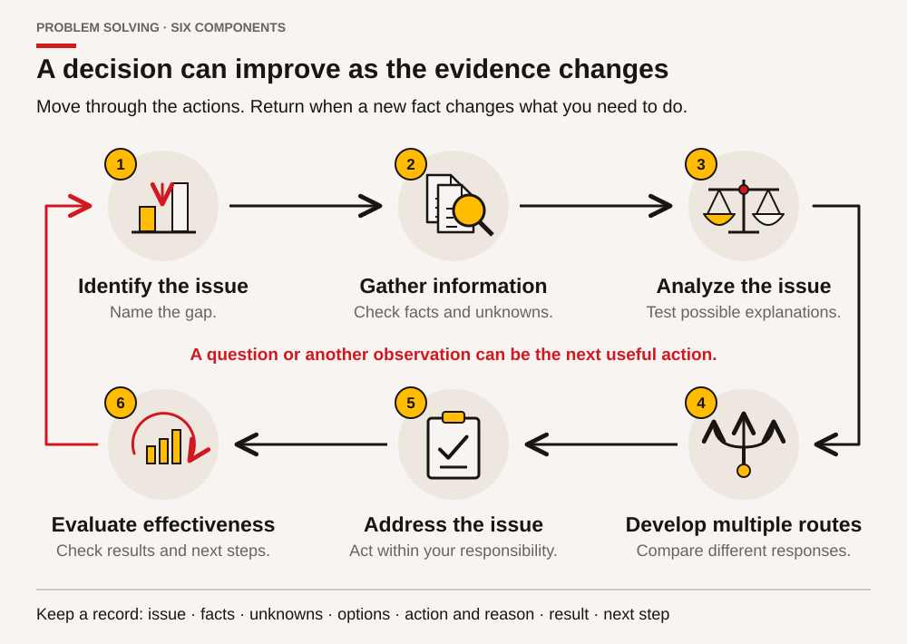
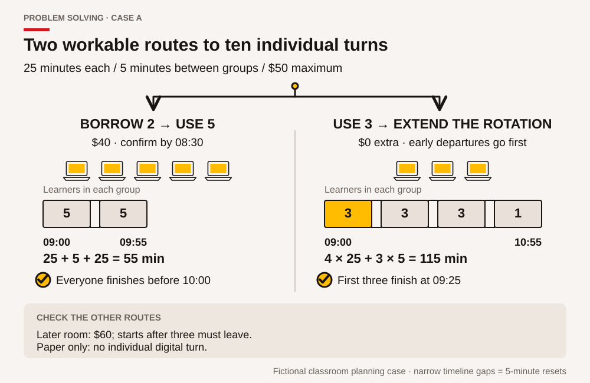
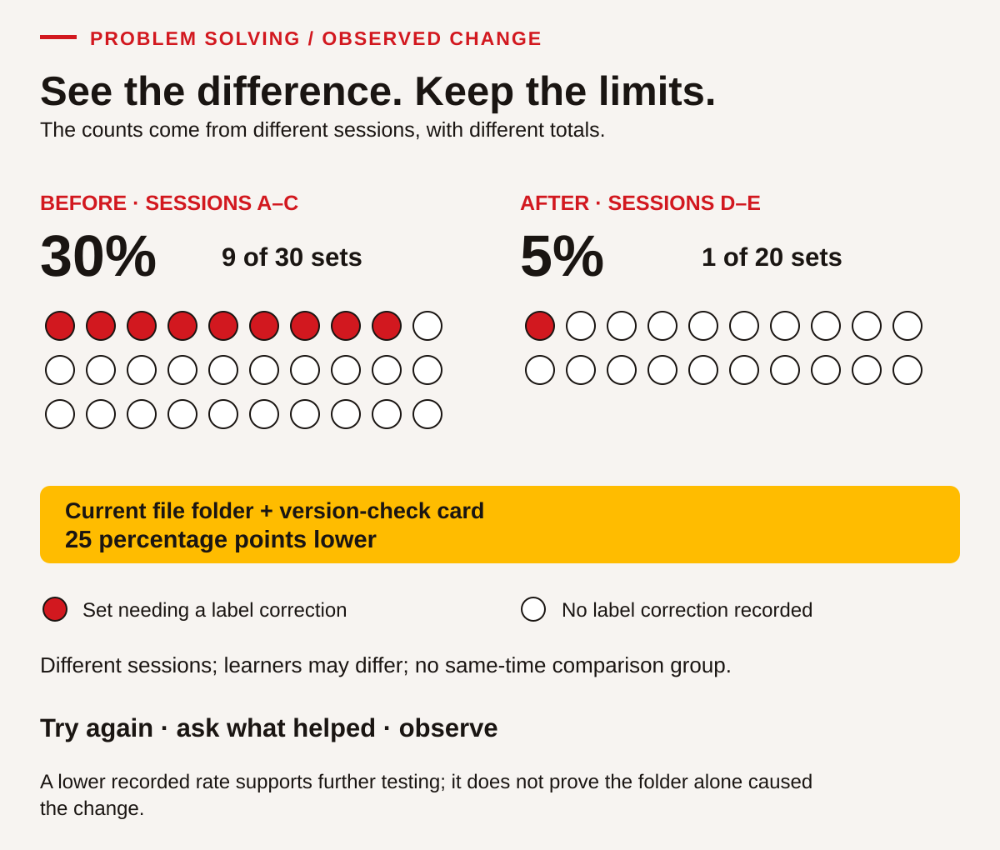

# Problem solving • Understand the issue, choose a response, check what happened

Problem solving is a process for making a decision when the next step is uncertain. It includes finding out what is happening, gathering useful information, considering more than one response, acting within your role and checking the result. It does not require having an instant answer. Sometimes the soundest next step is a specific question, a small test or a request to someone with the right responsibility.

People bring experience from work, learning, family and community responsibilities. That experience can suggest useful possibilities. It can also lead us to expect that a new situation has the same cause as an earlier one. In this chapter, experience is a starting resource, and evidence helps decide how well it fits the present case. You may draw on a personal example if you choose, or use every supplied fictional example without sharing private experiences.

The cases involve classroom scheduling, learning documents and a community information display. They use invented B.C. training situations, not the affairs of a Nation, employer or actual ACCESS cohort. There is no live equipment troubleshooting. When a real problem concerns machine safety, harassment, legal obligations or someone's immediate wellbeing, involve the responsible qualified person or established support process. A classroom decision exercise does not give a learner authority to resolve every kind of problem alone.

## Six steps that can loop back

<!-- visual:middle-problem-solving-components--learner-05 -->
<figure class="teaching-figure diagram" data-visual="middle-problem-solving-components--learner-05">

<figcaption>Visual guide All six Problem Solving components contribute to a reasoned decision. New evidence can send you back to an earlier action; returning to check a fact is useful progress. <a class="visual-original" href="../assets/diagrams/middle-problem-solving-components.svg">Open full-size visual</a></figcaption>
</figure>
<!-- /visual:middle-problem-solving-components--learner-05 -->

The component names below follow SkillPlan's supplied guide, page 78. You may return to an earlier step when a new fact changes the picture. Returning to gather information is progress when it prevents an unsupported decision.

| Component | Practical question | Main chapter evidence |
|---|---|---|
| 1. Identify the issue to be addressed | What is happening, to whom, and what needs to be different? | PS-01–PS-03 |
| 2. Gather information to help you address the issue | What do we know, need to know and need help to establish? | PS-04–PS-06 |
| 3. Analyze the issue | Which explanations fit the evidence, and which are still guesses? | PS-07–PS-09 |
| 4. Develop multiple routes of action | What different responses could meet the actual needs? | PS-10–PS-12 |
| 5. Address the issue | What will we do, who is responsible and what needs permission? | PS-13–PS-15 |
| 6. Evaluate the effectiveness of the solution or decision | Did the response help, for whom, and what should change next? | PS-16–PS-18 |

Use a simple record throughout: **issue; known facts; missing information; options; chosen action and reason; result; next step**. A drawing, voice note, table or supported written record can help you hold the process in mind. If the instructor is observing Problem solving, the quality of the reasoning matters separately from spelling, handwriting or confidence when speaking.

## Define the issue without defining a person as the problem

“The learners do not care” is an interpretation of people. “Four of ten card sets used an older heading” is an observation that can be checked. The second statement gives a starting point for useful questions: which file was available, what instruction was given, how was the version shown, and when was the check made? A clear statement does not pretend people never make mistakes. It makes it possible to investigate the situation without beginning with an unsupported judgement.

Include the gap between present and needed conditions. Name the affected work and a boundary. For example: “The group has three working practice devices for ten learners, and each learner needs an individual tool turn within their available time.” That statement is more useful than “We need more money” because money is only one possible route. It also avoids choosing a solution before understanding the requirements.

A problem statement can acknowledge uncertainty: “We do not yet know whether loan devices will open the practice files.” An unknown is not a failure. Hiding it inside a confident recommendation can create a failure later. Put the unknown beside the decision it affects so the person responsible knows why checking it matters.

## Case document A • A tool turn for every learner

> **Fictional planning brief — Thursday practice session**
>
> Ten learners need an individual digital practice turn. Each turn includes **20 minutes controlling a device and 5 minutes saving, reopening and checking the file**, so allow 25 minutes per learner. Learners can work simultaneously on separate devices. Allow **5 minutes between groups** to reset the classroom practice files. A partner watching does not count as that partner's own turn.
>
> The original plan uses five devices from 09:00 to 10:00. Two devices have become unavailable for the class. Three remain available. A technician is responsible for the unavailable devices; learners are not asked to repair them.
>
> Three learners must leave at 10:00. The other seven can remain until 11:00. The instructor and room are available until 11:00. Finishing everybody's turn by 10:00 is preferred, but completing a genuine turn within each learner's available time is required. The extra classroom budget is **no more than $50**.
>
> The training office can reserve two compatible loan devices for **$40 total**, if confirmed by 08:30. A later room with six devices costs **$60** and is available only from 10:00 to 11:00. Paper planning materials cost nothing extra and are already printed. All costs, times and arrangements are invented for this exercise.

### Worked example 1 • Separate the issue from the first idea

A first reaction is “Buy two new devices.” Buying is a proposed action, not the issue. Read the brief again. The required outcome is an individual 25-minute device turn for all ten learners within their availability and the $50 extra budget. The original five-device plan needs two groups: `25 + 5 + 25 = 55 minutes`, which fits 09:00–10:00.

With only three devices, ten learners need four groups: three, three, three and one. The device time is `4 × 25 = 100 minutes`, with three 5-minute changes: `100 + 15 = 115 minutes`. A four-group sequence can run 09:00–10:55 if the three learners leaving at 10:00 are in an early group. It does not meet the preferred 10:00 finish for everybody, but it can meet the mandatory availability requirement. That difference keeps a potentially workable option open.

### PS-01 • Write a bounded problem statement

Write one or two sentences describing the issue in Case A. Include the learners affected and the required outcome. Leave out a preferred solution. Underline the information that comes directly from the brief and mark anything you are assuming. Explain why “the group is too large” does not yet identify the decision the coordinator needs to make.

### PS-02 • Distinguish requirements from preferences

Make two columns: **must meet** and **prefer if possible**. Sort the individual tool turn, $50 maximum, each person's availability, everyone's 10:00 finish and use of a familiar device. The brief does not explicitly rank familiarity; identify that as something to discuss rather than quietly making it mandatory. Add one question that would help the coordinator understand learner access needs without asking for private personal explanations.

### PS-03 • Identify people and responsibilities

List the learners, instructor, training office and technician. For each, explain one relevant need or responsibility using the brief. Identify who can reserve a loan device and who should address the unavailable equipment. Explain how learners could contribute to the plan without being expected to authorize spending or disclose why they must leave at a particular time.

## Gather enough information for the decision

Gathering information is purposeful. You are not required to collect every fact that might exist. Start with the decision and ask which missing facts could change it. A device's colour is unlikely to matter here. Its ability to open the practice file, accessibility settings and reservation deadline may matter. Distinguish confirmed information from a suggestion that still needs checking.

Useful questions are specific and answerable. “Will this work?” can mean several things. “Can the two loan devices open the practice spreadsheet, and can we confirm the needed access settings before the session?” identifies what must be checked. A question about availability can allow a simple yes/no answer without asking someone to explain family, health, transport or community responsibilities.

Keep source and date beside important information. A room that was free yesterday may have been booked today. A remembered price may exclude an additional charge. For a real decision, use the responsible person's current confirmation or the current authorized document. The fictional brief gives fixed facts for this exercise; do not silently import a real provider's prices, policies or rules into it.

### PS-04 • Create an information checklist

Make a checklist for comparing the three-device plan with the loan-device plan. Include information already supplied and at least three questions that could matter before real delivery, such as required access settings, how loan devices reach the room and who confirms the reservation. Mark each entry **provided**, **needs confirmation** or **not relevant to this decision**. Do not change the given classroom numbers while identifying real-world checks.

### PS-05 • Ask without assuming

Draft three short questions: one to the training office, one to a learner about the usable schedule, and one to the instructor about the required evidence. Use a purpose statement so the person knows why you are asking. Then exchange questions with a partner acting from the brief. Notice any question that asks for information the case does not supply; record it as unresolved rather than inventing an answer.

### PS-06 • Organize conflicting information

A fictional sticky note beside the room calendar says, “All learners can stay until 11.” The dated planning brief says three must leave at 10. Explain why choosing whichever statement makes your preferred plan easier is unreliable. Record the conflict, its effect on the schedule, the responsible confirmation route and the temporary assumption you will use until it is resolved. Continue using the brief's three early departures for the remaining classroom calculations.

## Analyze causes, patterns and limits

Analysis connects facts without claiming more than they support. It can involve comparing rows, grouping possible causes, noticing a sequence or asking how a process works. A cause-and-effect diagram can group possibilities under headings such as information, tools, time, process and access. Those headings organize questions; they do not prove a cause.

A “why” question is useful when it opens an investigation. It becomes less useful when it forces every answer toward blame. Ask “What made the current version difficult to identify?” rather than “Why did someone ignore the correct version?” Do not keep asking “why” as though a fifth answer must be the truth. Stop at an evidence gap and name what would test the proposed link.

Watch for familiar thinking shortcuts. You might favour the explanation you first heard, notice only examples that support it, or trust the most confident speaker. Counter that by asking what evidence would make you revise your view. Invite a different interpretation before settling on a cause. A partner's question can improve a decision without making either person the winner or loser of a debate.

## Case document B • Repeated card-label corrections

> **Fictional improvement record — classroom print station**
>
> During three practice sessions, learners printed ten card sets each session. The review found four sets needing a label correction in Session A, two in Session B and three in Session C. The group did not record each person's name; the purpose was to improve the process, not rank learners.
>
> The instructor observed that both an older practice file and a current practice file were available in the same folder. Their names differed by only one letter. A spoken reminder was given, but no version example was displayed beside the print station. One learner said they selected the first result shown by the file search. Another said they used the file already open on the device. These observations suggest possible links but do not establish the cause of every correction.
>
> For the next two sessions, the instructor placed the current practice file in a clearly named folder and displayed a version-check card. Session D had one corrected set out of ten; Session E had none out of ten. Different learners may have attended, and the record does not measure their prior experience. No comparison group used the old arrangement during the same period.

| Session | Sets reviewed | Sets needing label correction | Arrangement |
|---|---:|---:|---|
| A | 10 | 4 | Earlier arrangement |
| B | 10 | 2 | Earlier arrangement |
| C | 10 | 3 | Earlier arrangement |
| D | 10 | 1 | Revised arrangement |
| E | 10 | 0 | Revised arrangement |

### PS-07 • Build explanations that can be tested

Identify three possible contributors to the corrections in Case B. For each, point to supporting information and state what remains unknown. Include at least one explanation concerning the information or process, not a learner's attitude. Do not claim that everyone used the older file. The record does not say that. Suggest a respectful way to learn more without collecting unnecessary personal information.

### PS-08 • Use a cause-and-effect map

Create a map with the issue in the centre: **some printed sets need label corrections**. Use at least three headings such as file organization, instructions, display or checking process. Place known observations and untested possibilities in visibly different styles or labelled columns. Choose one proposed link and write a small, low-risk test. Explain which result would support the link and which would make you reconsider it.

### PS-09 • Challenge a conclusion

A fictional colleague says, “The new folder proves that people were careless before.” Explain two problems with that conclusion. Then write a statement supported by the record and a question worth investigating. Compare your response with a partner's. Identify one assumption in your own first explanation that you revised after considering the other person's reasoning.

## Develop options before selecting one

<!-- visual:middle-problem-solving-routes--learner-05 -->
<figure class="teaching-figure diagram" data-visual="middle-problem-solving-routes--learner-05">

<figcaption>Visual guide Two routes meet the required individual turns, availability and budget. The shorter route costs $40; the longer route requires the three early departures to go first. Group segments share the same time scale. <a class="visual-original" href="../assets/diagrams/middle-problem-solving-routes.svg">Open full-size visual</a></figcaption>
</figure>
<!-- /visual:middle-problem-solving-routes--learner-05 -->

Options should be genuinely different ways to address the issue. “Tell people more firmly,” “give a stronger reminder” and “repeat the instruction louder” may be three versions of the same approach. A different option might change the file arrangement, provide a visible example, add a check before printing or allow a different way to access the instruction. Generate possibilities first, then compare their likely effects and constraints.

Mandatory criteria come before preferences. An option that cannot meet a required access need does not become suitable because it is cheap. An option outside the authorized budget needs a new decision by the responsible person; a learner cannot make the limit disappear by giving cost a low score. After checking requirements, compare useful preferences such as time, simplicity, travel or the amount of new learning needed.

A table can make your reasoning visible, but numbers do not make a judgement objective automatically. If you use ratings, explain their meaning and why a criterion matters. Keep uncertain entries marked as uncertain. A precise-looking total based on guessed ratings can hide the question that most needs discussion.

### Worked example 2 • Compare the schedule options

For Case A, compare four routes. Two compatible loan devices cost $40 and restore five simultaneous places, so two groups finish by 09:55. Using only three devices costs no extra money and takes 115 minutes; early departures must be placed before 10:00. The later room costs $60, exceeds the stated budget and begins after three learners must leave. Paper-only work costs nothing but does not supply the required digital tool turn.

Two options remain feasible under the supplied facts: loan devices or a longer rotation with three devices. If the coordinator gives high priority to finishing the whole group before 10:00, the $40 loan plan fits that preference. If minimizing extra spending is the priority and a longer rotation is acceptable, the three-device plan can work. The recommendation must explain the trade-off instead of pretending there is only one possible answer.

### PS-10 • Generate three routes

For Case B's label-correction issue, propose three different changes. Explain how each could help and what effort or check it would require. At least one option should change the information or workflow rather than relying only on an extra verbal reminder. Include an option proposed by a partner and identify what you learned from it. Do not select the final response until all three have been described.

### PS-11 • Build a decision table

Compare the four Case A routes: loan devices, extended three-device rotation, later six-device room and paper-only replacement. Include extra cost, total device-session duration, early-departure access and whether the actual digital outcome is met. Mark required criteria separately from preferences. Recommend either feasible route with a reason based on the brief. If you recommend a route that needs a changed requirement, name the authorization or new information needed before it could become feasible.

### PS-12 • Test your preferred option against a drawback

Take your preferred route from PS-11. Identify its strongest drawback and one situation that would make it unsuitable. A partner takes the role of a coordinator and asks one challenging but respectful question. Respond using evidence, or change your recommendation if the question reveals a real gap. Record the reason for keeping or revising the choice. Defending a first idea at all costs is not the purpose of this task.

## Address the issue with a workable action plan

A decision becomes useful when someone can act on it. Record the action, responsible role, time, required confirmation and check. “We will communicate better” is too broad. “The coordinator will confirm the two loan devices by 08:30; the instructor will check the practice file before learners arrive; the group list will show each person's turn” gives people a clearer shared plan.

Keep within your role. A learner can propose, check classroom data and ask questions. Reserving equipment, spending funds or changing a real schedule may belong to a coordinator. A useful recommendation identifies that boundary rather than presenting a classroom suggestion as an approved decision. The same principle applies to community information: permission to learn about a topic is not automatically permission to publish someone's contribution.

Before acting, decide what would trigger a pause or a fallback. If loan devices do not arrive, when should the coordinator switch to the longer rotation? If a printed display contains an unapproved statement, who checks it before the display is used? A fallback should still meet the required outcome or clearly state which part must be rescheduled. It should not quietly lower the standard and call the work complete.

## Case document C • A useful display with an unanswered request

> **Fictional classroom display brief**
>
> A group is preparing a public-information display for an open classroom afternoon. It explains the five-stage introductory paving process and how the nine Skills for Success appear in the learning activities. The display uses original learner diagrams and clearly labelled fictional data. The coordinator has approved a one-page explanation of the classroom project.
>
> A visitor suggests adding a local community story and a photograph of participants to make the display more engaging. The group has no permission to use a particular story or photograph. One learner knows a person who might be willing to contribute, but has not asked them. The deadline is tomorrow. The existing approved diagram can be used without those additions.
>
> The group wants an inviting display and respectful relationships. No learner is expected to speak for a Nation or community, reveal personal identity information, or provide cultural material to improve a class product. The coordinator can discuss a later community-directed contribution if the appropriate people choose to participate.

### PS-13 • Write the action plan

Create a plan for your feasible Case A route. Include at least four actions, the responsible role, timing and a check. Make the group sequence clear enough to show how all ten people receive 25 minutes, including the three who must leave at 10:00. Identify the decision that belongs to the training office or coordinator. Your plan is a classroom proposal; do not contact or book anything outside the exercise.

### PS-14 • Respond to a changed fact

At 08:35, the fictional office confirms that the loan devices are unavailable. Use the supplied room and learner availability to make a fallback plan. Show the four groups and their times, placing the early-departure learners appropriately. Explain what you would tell the group about the changed finish time and what would need reconfirming in a real class. Paper planning can occupy waiting time, but it cannot replace the required device turn.

### PS-15 • Make a decision that respects permission

Apply the six-step process to Case C. Identify the immediate display decision, the facts and missing permissions, at least two possible routes and a justified action before tomorrow. Explain how the group could remain open to a future contribution without treating a possible personal connection as permission. Write a short recommendation to the fictional coordinator. Use the supplied case; no learner needs to provide a real cultural story or photograph.

## Evaluate results and learn from them

<!-- visual:middle-problem-solving-trial--learner-05 -->
<figure class="teaching-figure diagram" data-visual="middle-problem-solving-trial--learner-05">

<figcaption>Visual guide The recorded correction proportion fell from 9/30 (30%) to 1/20 (5%): 25 percentage points. The small before-and-after record supports another check, not a claim that one change alone caused the result. <a class="visual-original" href="../assets/diagrams/middle-problem-solving-trial.svg">Open full-size visual</a></figcaption>
</figure>
<!-- /visual:middle-problem-solving-trial--learner-05 -->

Evaluation asks whether the response achieved its intended purpose, what else happened and what should be done next. Decide what evidence you will collect before trying the change. In Case A, useful evidence includes whether every learner actually controlled a device, whether files were saved and reopened, whether departures were respected and whether the cost stayed within the limit. A full attendance list alone does not answer those questions.

Look at the denominator when comparing counts. One correction out of ten sets is different from one out of a hundred. Keep the observation period and conditions visible. A change seen in a small classroom trial can be promising without proving that the same result will occur in every class. Learner feedback may reveal an access problem that a numerical average hides.

### Worked example 3 • Compare the correction record carefully

Before the revised arrangement, Case B records `4 + 2 + 3 = 9` corrections among `10 + 10 + 10 = 30` reviewed sets. The proportion is `9/30 = 0.30 = 30%`. After the change, there is `1 + 0 = 1` correction among `20` sets: `1/20 = 0.05 = 5%`. The difference is **25 percentage points**, because `30% − 5% = 25 percentage points`.

A supported statement is: “The recorded correction proportion was lower in the two sessions using the revised arrangement.” It is too strong to say the folder change alone caused the improvement or that the problem can never return. The record includes different sessions and possibly different learners. Continue checking versions, ask whether the process is usable and review another trial before making a broader claim.

### PS-16 • Define success and inspect the evidence

For your Case A plan, write four observable success checks. Then consider this invented result: all ten learners attended; nine saved and reopened a file independently or with recorded support; one learner watched a partner but did not control a device. The cost was $40 and everyone left within their availability. State which criteria were met, which remain unmet and what follow-up is needed. Do not turn attendance into proof of the missing individual turn.

### PS-17 • Evaluate and improve the print-station trial

Use Case B's data to calculate the before and after correction proportions. Write a two-sentence interpretation that includes one limitation. Add one question for learner feedback and one next observation that would help evaluate the revised process. Explain why asking whether the folder and version card were usable is different from asking who was careless. Preserve both the numerical result and the people affected by the process.

### PS-18 • Transfer the method to a new situation

Choose one supplied new issue: a fictional classroom bus-time notice has two different departure times, or a practice supply list contains an item with no quantity. Apply all six steps using a small invented document you label as practice. Identify at least one fact you would need from the responsible person before acting. Explain which step from this chapter helped most and show the record of your reasoning. A planned future workplace use should be recorded as a plan, not as demonstrated transfer at work.

## Your evidence and next practice

Keep the problem statement, information checklist, cause map, options table, action plan and evaluation. These records show how your thinking changed; a final answer alone may hide the strongest part of your learning. You can record a question you left unresolved when the available evidence was insufficient. That is useful evidence of judgement when you also identify an appropriate next step.

For support, work with fewer options, highlight the mandatory criteria, use counters for the learner groups or ask an instructor to model one question. For extension, add one clearly labelled changed fact and test whether the recommendation still holds. Increase the reasoning challenge gradually. The local feedback descriptions are **Not observed**, **Not yet demonstrated**, **Demonstrated with support** and **Demonstrated independently**; record support and transfer separately rather than awarding a made-up official level.

**Teaching-source connection:** SkillPlan, *Skills for Success Get Started Guide for Practitioners*, revised March 2024, [pp.78–84](../../asphalt-paving/sources/SFS-Get-Started-Guide_FINAL_MAR2024.pdf#page=78): six problem-solving components, explicitly taught models, guided problem-based learning, different perspectives and observed assessment. The cases, calculations, decision criteria and prose here are original ACCESS IS4S learning materials. They do not reproduce the source's deficit-based example about children or treat people as problems to control.
