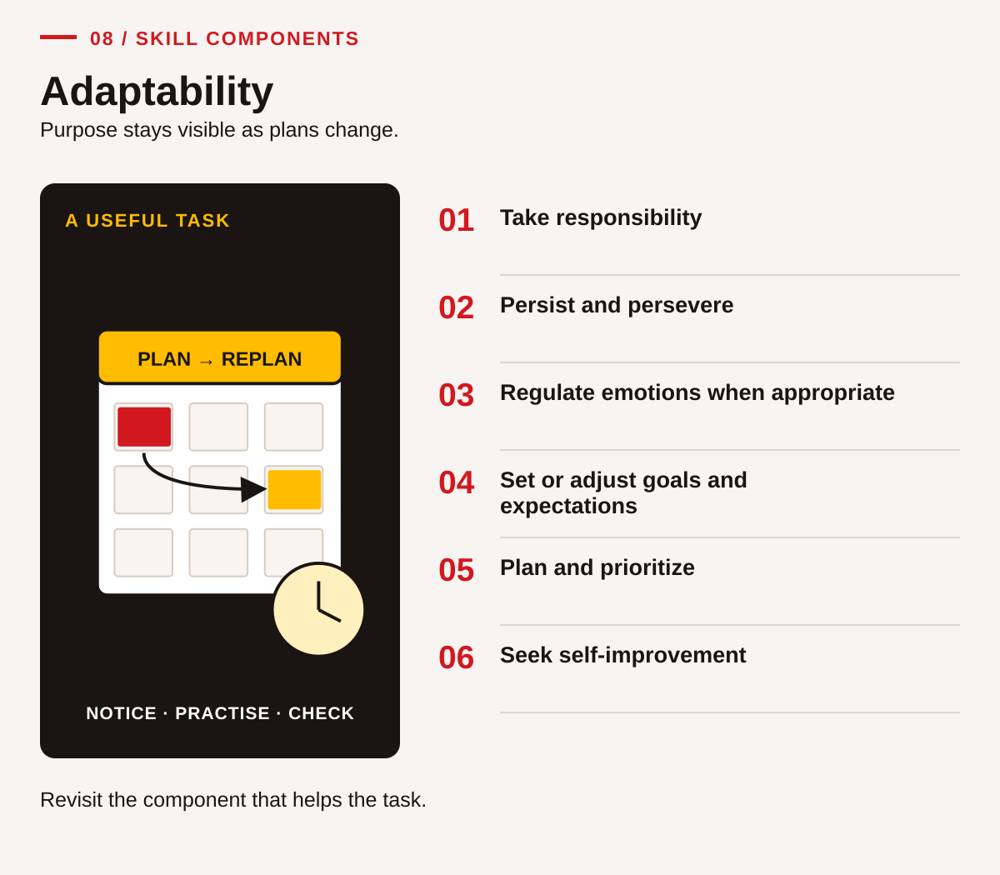
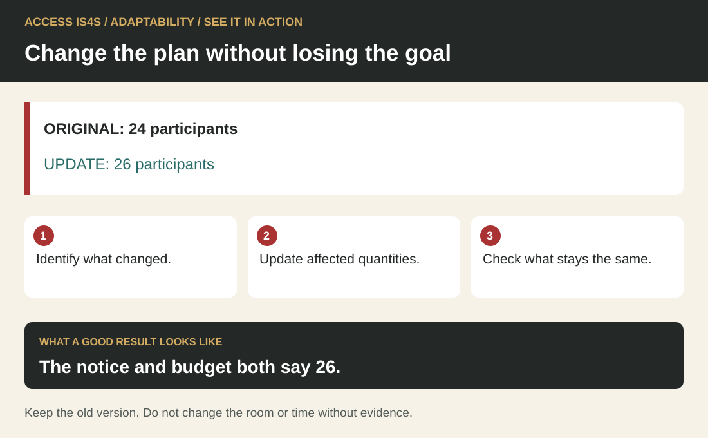
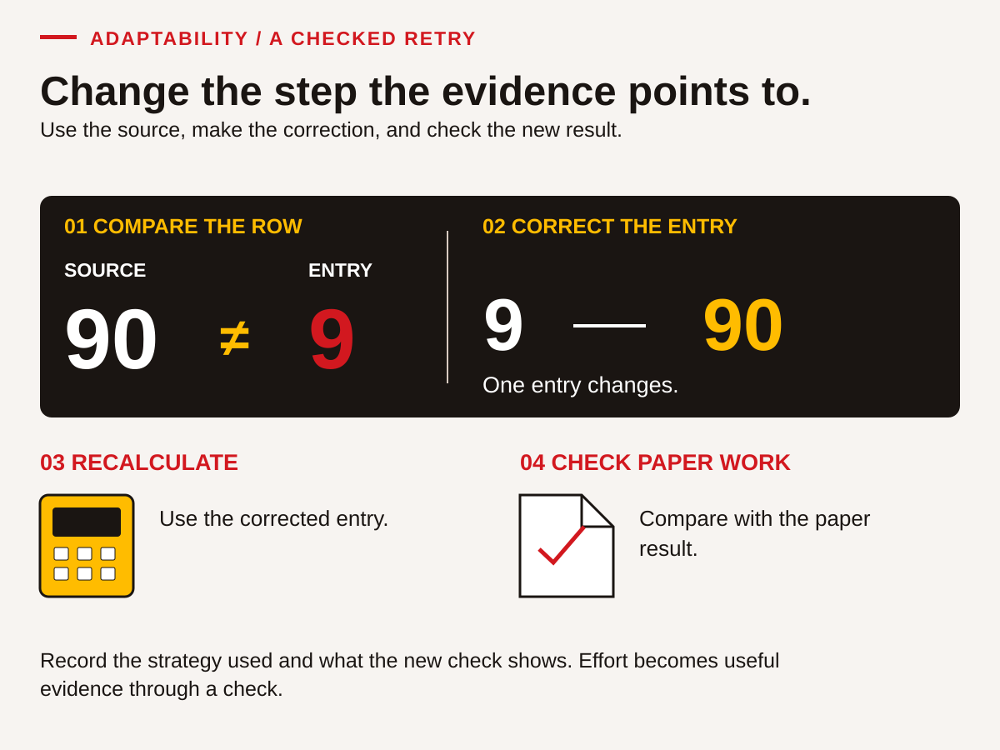
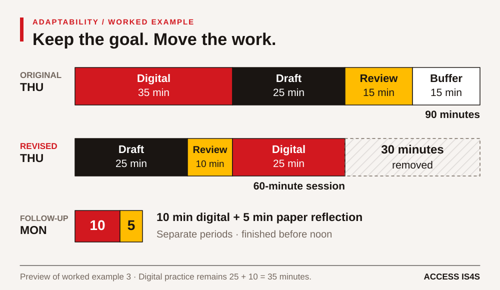

# Adaptability — keep the purpose, adjust the plan

<!-- visual:social-adaptability-six-components--learner-08 -->
<figure class="teaching-figure diagram" data-visual="social-adaptability-six-components--learner-08">

<figcaption>Visual guide Six connected components of adaptability. Short labels summarize the six skill components; numbers match the chapter list. Use the connections in the order the task needs. <a class="visual-original" href="../assets/diagrams/social-adaptability-six-components.svg">Open full-size visual</a></figcaption>

Read the visual description

An original task illustration occupies the left panel; six numbered actions appear on the right. Purpose stays visible as plans change. Six connected components: Take responsibility; Persist and persevere; Regulate emotions when appropriate; Set or adjust goals and expectations; Plan and prioritize; Seek self-improvement. Revisit the component that helps the task.

</figure>
<!-- /visual:social-adaptability-six-components--learner-08 -->

## See it in action · Adaptability

<!-- visual:quick-adaptability--learner -->
<figure class="teaching-figure diagram" data-visual="quick-adaptability--learner">

<figcaption>Visual guide The notice and budget both say 26. ACCESS IS4S. (2026). Original fictional teaching diagram. <a class="visual-original" href="../assets/diagrams/quick-adaptability.svg">Open full-size visual</a></figcaption>

Read the visual description

ORIGINAL: 24 participants. UPDATE: 26 participants. Identify what changed. Update affected quantities. Check what stays the same. The notice and budget both say 26. Keep the old version. Do not change the room or time without evidence.

</figure>
<!-- /visual:quick-adaptability--learner -->

This small fictional example shows the skill in use. ORIGINAL: 24 participants. UPDATE: 26 participants.

**Try it:** Identify what changed. Update affected quantities. Check what stays the same.

**Check your result:** The notice and budget both say 26. Keep the old version. Do not change the room or time without evidence.

## Change the approach with care

Adaptability is the ability to work toward or adjust a goal when circumstances change. It includes noticing what has changed, deciding what still matters, choosing a workable response and learning from the attempt. Sometimes the response is a new method. Sometimes it is a request for support, a revised deadline or a decision to pause until the right information is available.

You may already adapt while balancing training, employment, travel, family responsibilities or community commitments. This chapter does not ask you to disclose those responsibilities. It uses fictional situations so you can practise without putting private information on a worksheet. You can choose a different relevant example with the instructor, provided the same skill can be observed.

Training in B.C. may take place close to home or away from people and places that support you. Your own priorities belong in goal setting when you want them included. You might connect a learning goal with employment, a community role, further study or a practical task that matters to you. The instructor can help make the plan workable without asking you to justify your identity or disclose private commitments.

Being adaptable does not mean accepting every request, hiding frustration or continuing through an unsafe situation. It does not make an individual responsible for barriers outside their control. A useful plan identifies both your next action and any support or decision another person must provide. Asking for an accessible format, clarification or an appropriate adjustment can be part of responsible action.

In this chapter, emotional regulation means choosing a practical way to respond or regain focus when that is useful. It is not a test of whether your feelings are acceptable. The instructor observes the plan and actions you choose, not a diagnosis, a personality trait or a requirement to appear cheerful.

| Component | What you will practise | Main evidence |
|---|---|---|
| 1. Demonstrate responsibility | Clarify commitments, attend to the task and report relevant changes. | AD-01–AD-03 |
| 2. Persist and persevere | Try a purposeful next step, use support and recognize when the approach needs changing. | AD-07–AD-09 |
| 3. Regulate your emotions when appropriate | Choose a task-focused pause or support strategy without required personal disclosure. | AD-04–AD-06 |
| 4. Set or adjust your goals and expectations | Define a meaningful goal and revise it when resources change. | AD-02, AD-10–AD-12 |
| 5. Plan and prioritize | Identify dependencies, choose an order and make space for checking. | AD-03, AD-10–AD-15 |
| 6. Seek self-improvement | Use specific feedback, compare attempts and choose further practice. | AD-13–AD-18 |

<!-- teaching:ad-route-learner -->
## Adaptability route card

**Practise in four steps**

1. State the purpose, make a workable plan and keep the first version.
2. Read the changed requirement. Separate what changed from what stays the same.
3. Choose a useful response, ask for support if needed and carry out the revised plan.
4. Retrieve and check the result yourself. Use feedback to decide what to keep or try next.

**Support route.** Use the paper workflow if that suits the focus and available tools. Read the brief together, use a blank “changed / unchanged / next action / check” organizer, or ask for a tool demonstration before the observed attempt. A learner-directed request for an appropriate support can show Adaptability even when the later tool action is assisted. Do not require a personal account of stress or a rehearsed emotional display. If regulation is not needed or chosen, leave that component unobserved in this task.

**Retry route.** Select the affected step and repeat it after feedback. Use Kit T for a different content requirement when appropriate; record whether it was new. If the first work was accurate, retrieve and verify again or choose another challenge. A retry can confirm a successful process; it need not begin with an invented failure. Track who performs the tool action so a partner's work is not claimed as individual Digital evidence.

**What the instructor observes.** Keep the first plan, changed requirement and checked result. Discussing a case does not show that the learner carried out the action.

**Next-attempt agreement:** purpose ___; changed requirement ___; chosen next action ___; paper/digital tool route ___; support and boundary ___; observer/booking ___; check/result ___.
<!-- /teaching:ad-route-learner -->

## Case document 1 · A plan for the learning folder

**Fictional ACCESS-style classroom schedule.** A learner is preparing a small learning folder to show three kinds of work: a checked industry table, a short project note and a reflection explaining one improvement. The table uses invented data from the introductory asphalt unit. The project note must distinguish the fictional road owner from the contractor and label the numbers as practice data. The reflection should name a change the learner made after feedback.

The initial goal is to complete the folder by Friday at 12:00. Two supported classroom work periods are available: Tuesday for 60 minutes and Thursday for 90 minutes. These times are classroom planning values, not a requirement of a funded program or a real person's schedule. An instructor can help the learner identify a smaller starting point or an accessible response method.

The learner's Tuesday plan is to read the brief for 20 minutes, practise the table calculation for 25 minutes and check the result for 15 minutes. Thursday's plan is to use the digital tool for 35 minutes, draft the project note for 25 minutes, review the folder for 15 minutes and keep 15 minutes available for questions or revision. The digital task includes entering and checking data, saving a file and finding it again; a paper table alone does not demonstrate those actions.

The folder is a learning record, not a pass-or-fail judgement about the learner's future. A useful record shows what was attempted, what support was used and what still needs practice. If a requirement or resource changes, the learner and instructor will agree the next step. The learner should not silently remove an outcome or claim an unfinished action is complete just to meet the original date.

### AD-01 · Separate the purpose from the schedule

Read the case and identify the purpose of the folder, its three products and the initial deadline. Then identify one resource and one support. Explain the difference between “complete the folder” and “demonstrate every skill independently.” Mark one outcome that cannot be demonstrated solely through paper work. Use the case rather than guessing how an actual ACCESS program assesses learners.

### AD-02 · Write a goal you can check

Write a goal for one folder product that names the action, evidence and agreed time. Keep it within the resources in the case. For example, “By the end of Tuesday I will have a checked table with units and one recorded check” is more usable than “I will improve my maths.” Add the support you may use and one question to clarify with the instructor.

### AD-03 · Build a first plan

Turn the Tuesday and Thursday tasks into a simple plan with time, task, output and check. Confirm that Tuesday totals 60 minutes and Thursday totals 90 minutes. Identify one dependency, such as checking source values before using them in a note. Mark the purpose of Thursday's 15-minute buffer. Explain why a buffer is not evidence that someone is working too slowly.

## Stay with the task without judging yourself

When a task changes, your first response may be concern, irritation, curiosity, relief or something else. You do not have to report that response to the class. The useful learning question is, “What action will help me understand the situation and choose a next step?” A strategy can be small: reread the changed instruction, ask for one point at a time, use a written checklist, request a brief pause or speak privately with the instructor.

The strategy should fit you and the setting. A quiet pause is useful for some people and uncomfortable for others. A movement break may be possible in one classroom and require a different arrangement in another. No learner needs to close their eyes, follow a breathing exercise, discuss trauma or participate in a cultural practice to demonstrate adaptability. Choose a task-focused action that supports your work and respects the available setting.

Responsibility also includes communication. If you need a pause, a short message can protect the shared task without giving private reasons: “I need five minutes to review the changed brief. I will come back with one question.” If you cannot make a commitment, state what you can confirm and when you can update the person. Honest uncertainty is more useful than an assurance you cannot keep.

**Worked example 1 — pause, clarify, choose.** A learner hears, “You have less computer time now,” and starts deleting planned steps. The instructor offers the change in writing. The learner reads it, marks the time restriction and asks whether the completion date can be adjusted. The learner then chooses a revised sequence. The evidence is the clarification, revised plan and next action. The instructor does not need to decide whether the learner looked calm enough or had the “right attitude.”

### AD-04 · Compare useful responses

A fictional learner receives a changed task and says, “I will finish everything somehow,” without checking the new conditions. Compare that response with “Let me identify what changed, check the required outcomes and agree what is possible.” Explain what information the second response could reveal. Name one situation in which pausing for clarification would protect the quality of the work.

### AD-05 · Rehearse a strategy by choice

Choose one strategy: review the written brief, ask for a short pause, use a three-point checklist or request a private clarification. Rehearse it in a low-pressure role-play with the instructor or a partner. Use a fictional task change, not a personal stress story. Afterwards, describe what the strategy helped you do and one adjustment that would make it more useful.

### AD-06 · Set a boundary and a next step

Draft a response to this classroom request: “We are behind, so skip checking the source and mark the table complete.” State what you can do, what you cannot honestly claim and a workable next step. Then explain how setting that boundary can support adaptability. Do not turn the exercise into a debate about whether a learner should tolerate unsafe or dishonest instructions.

## Persistence means learning from the attempt

<!-- visual:social-adaptability-retry--learner-08 -->
<figure class="teaching-figure diagram" data-visual="social-adaptability-retry--learner-08">

<figcaption>Visual guide Worked-example preview: compare the entry with its source, correct 9 to 90, recalculate and check the paper work. Record the strategy and result. <a class="visual-original" href="../assets/diagrams/social-adaptability-retry.svg">Open full-size visual</a></figcaption>

Read the visual description

Four actions compare the source value ninety with an incorrect entry of nine, correct the entry to ninety, recalculate, and compare the new result with the paper work. The strategy, action and new check provide evidence of a useful retry.

</figure>
<!-- /visual:social-adaptability-retry--learner-08 -->

Repeating the same action is not always persistence toward the goal. If a saved file cannot be found, opening random folders again may create more confusion. A purposeful next attempt uses information from the first one: check the file name, recall the chosen location, use the application's recent-files list if available, or ask for a demonstration of the search step. The method changes while the learning goal remains visible.

A useful retry has four parts: **notice the result → identify one likely gap → choose a different action → check what happened**. A likely gap is a working explanation, not a judgement about ability. “I did not record the save location” points toward a practical action. “I am bad with computers” does not tell you what to practise next and may hide the exact step you already know.

Some barriers require another person's action. A broken device, inaccessible file or unavailable support is not solved by telling the learner to try harder. Record the barrier, preserve any completed evidence and agree another opportunity. Persistence may mean returning to the task when the necessary conditions exist. It can also mean deciding with the instructor to change the task while keeping the intended outcome.

**Worked example 2 — a retry with evidence.** A learner's table total is wrong. Instead of retyping the total, the learner compares the three source rows with the entries. One value was entered as 9 instead of 90. The learner corrects the entry, recalculates and checks the total against the paper working. The useful feedback is, “Comparing each row helped you locate the error.” The record should not say that effort alone guarantees the right answer; it names the strategy and the result.

### AD-07 · Choose a better second attempt

Use this fictional record: “The learner entered three rows, saved the file, and later could not find it. They remember the file name but did not note the folder.” Propose two reasonable next actions and choose the one you would try first. Explain what you would check afterwards. Identify what evidence is already available and what remains unobserved.

### AD-08 · Keep, change or ask

Sort these responses into a useful next action, an action needing revision or a request for support: repeat an unchanged calculation without checking its inputs; compare each source row with the entry; ask for an accessible copy of a file that cannot be read; claim a partner's saved file as your own; ask the instructor to demonstrate one unfamiliar saving step. Explain each choice using the learning goal.

### AD-09 · Make a retry record

Choose a small classroom task you can safely repeat, such as locating a saved practice file, checking a fictional total or explaining a process term. Record the first result, the specific change in method and the second result. You may use a supplied example if you prefer. Identify the support used and what you still need to practise; do not invent a successful result if the retry remains unfinished.

## Case document 2 · The time and device access change

**Fictional update after Tuesday's work.** Tuesday's reading, calculation practice and check are complete. Thursday's work period has been reduced from 90 minutes to 60 minutes. A device is available only during the final 25 minutes of that period. The paper brief and table remain available for the full hour. The initial digital practice was planned for 35 minutes, and the instructor does not expect the learner simply to perform it faster.

The instructor offers a supported 10-minute device appointment on Monday, followed by a separate five-minute paper-review period to update the reflection. Both periods finish before Monday at 12:00. If the learner books this arrangement, the instructor agrees that the remaining digital evidence and reflection update can be added by that deadline. The project note and an interim reflection can still be reviewed on Friday. The learner may instead propose another arrangement, but it must be confirmed; the offer does not mean every possible new deadline is approved.

The folder must continue to distinguish completed work from pending work. The project note should use the already checked paper numbers, so it can be drafted before the Thursday device turn. A paper plan can prepare the headings and file name, but it does not count as the learner using the digital tool. The reflection can explain the revised plan and later be updated after the Monday appointment.

The learner and instructor need to decide how Thursday's first 35 minutes will be used and what will happen during the 25-minute device turn. They also need a clear handover to Monday: what was done, where the practice file is saved and which action remains. The change is a planning problem with support options, not a test of how much personal pressure a learner can withstand.

## Revise the plan without losing the goal

<!-- visual:social-adaptability-time-plan--learner-08 -->
<figure class="teaching-figure diagram" data-visual="social-adaptability-time-plan--learner-08">

<figcaption>Visual guide Worked-example preview: proportional bars show the original 90-minute Thursday, the revised 60-minute session and separate Monday follow-up. This is one feasible plan, subject to confirmation and observed work. <a class="visual-original" href="../assets/diagrams/social-adaptability-time-plan.svg">Open full-size visual</a></figcaption>

Read the visual description

Proportional time bars compare an original ninety-minute Thursday plan with a revised sixty-minute session. The original has thirty-five minutes digital work, twenty-five drafting, fifteen reviewing and fifteen buffer. The revision has twenty-five drafting, ten reviewing and twenty-five digital. Monday adds ten minutes digital and five paper reflection in separate periods before noon. Digital practice remains thirty-five minutes.

</figure>
<!-- /visual:social-adaptability-time-plan--learner-08 -->

Start by separating **changed conditions, unchanged outcomes and open decisions**. The changed conditions are the shorter Thursday period and limited device access. The outcomes still include accurate information, an authored note, genuine tool use and a reflection based on evidence. The open decision is the agreed completion arrangement. Keeping these categories separate prevents a resource change from silently becoming a lower-quality outcome.

Prioritizing means choosing what must happen before something else. It does not always mean doing the hardest task first. In this case, drafting the note from checked paper information can happen before device access. Saving and locating a file require the actual tool. A final digital check depends on knowing what was entered. Put the tasks in an order that respects those relationships.

Write a revised commitment in plain language. State what will be completed, what remains pending and when the next check will occur. Avoid promising outcomes controlled by someone else. You can commit to attending an agreed appointment or asking for clarification; you cannot guarantee that an unconfirmed device will be available.

**Worked example 3 — make the change visible.** The learner plans 25 minutes to draft the note and 10 minutes to review its source labels during Thursday's first 35 minutes. During the 25-minute device turn, the learner enters and checks the data and saves the file, recording the location. Monday's 10-minute device appointment is reserved for finding/reopening the file and checking the remaining digital evidence. The separate five-minute paper-review period is used to update the reflection. The exact tool actions must be observed; the plan alone does not prove they occurred. The revised record keeps Friday's partial review and Monday's agreed completion distinct.

### AD-10 · Identify what changed

Make three columns: changed condition, unchanged outcome and decision to confirm. Use the update to place at least two details in each relevant column. Calculate the reduction in Thursday work time and the difference between the original digital allocation and Thursday device access. Explain why the 10-minute appointment is a support option, not permission to mark Digital complete before it occurs.

### AD-11 · Revise a goal and schedule

Write a revised folder goal that preserves the required evidence and uses the offered arrangement or a clearly labelled proposal. Build a 60-minute Thursday plan and a separate Monday follow-up. Show Thursday's first 35 minutes and final 25 minutes clearly; distinguish Monday's 10-minute device appointment from the separate five-minute paper review. Identify what will be ready for Friday review, what remains pending and the confirmation needed before treating a new deadline as agreed.

### AD-12 · Communicate the revised commitment

Write or rehearse a short update to the instructor. Include the changed condition, your proposed order of work, one support request and how you will record unfinished evidence. Ask the listener to restate the plan. Correct any misunderstanding. Keep private reasons out of the message unless you choose to share them; the task is communicating a workable learning arrangement.

## Use feedback as information for the next attempt

Feedback is most useful when it names a feature you can inspect and an action you can try. “Your note is unclear” may be true, but it leaves you searching for the problem. “The note names the contractor but does not identify the road owner; add the role from the brief” points to a specific revision. You can ask for that level of detail when feedback is too broad.

Receiving feedback does not require agreeing with every suggestion. Compare the suggestion with the task purpose and evidence. If it seems to conflict with the brief, ask a clarifying question. If it is about preference, consider whether a reader test would help. A reasoned decision to retain accurate wording can show thoughtful review, provided you can explain the decision.

An improvement record should include what changed and what difference it made. Keep the earlier attempt where possible. A before-and-after pair can show learning more clearly than a final polished product alone. It can also show that one strategy did not help and needs replacing. That is useful information for the next lesson, not something to conceal.

## Case document 3 · Feedback on the project note

**Fictional learner draft.** “Pathway Paving owns the Willow Reach road and gets $120,000 profit. We will use all the same rules on every project. My computer work is finished.”

**Source facts available for revision.** In the practice brief, the Town of Willow Reach owns the road and Pathway Paving Company performs the contracted work. The $120,000 is the total fictional funding, not a profit figure. Applicable requirements depend on the actual project and authorized documents; the historical source labels are not a complete statement of current rules. The learner has entered and saved a practice table but has not yet demonstrated finding and reopening the file.

**Instructor feedback.** “Your note is brief and names the practice project. Check the owner/contractor distinction, replace the profit claim with the correct funding label, and state which digital action remains. For requirements, name the need to confirm current applicable documents rather than saying all projects use the same rules.”

The learner does not need to defend the first draft as a personal achievement or discard everything in it. The useful next action is to compare each statement with the available facts and revise the misleading parts. Keeping the short format may still serve the reader well.

### AD-13 · Turn feedback into actions

Convert the instructor feedback into a revision checklist. For each item, identify the source detail to check and the change needed. Keep one useful feature of the original draft. Explain why “try harder” would provide less guidance than this checklist. The task is to use feedback, not to write a judgement about the fictional learner.

### AD-14 · Revise and compare

Write a corrected version of the note using the source facts. Then compare the first and revised versions, naming at least three substantive changes. Include an honest statement about the pending digital action. Ask a partner to identify the owner, the meaning of $120,000 and what remains unfinished. Use their response to check whether your revision worked.

### AD-15 · Prepare for another change

The Monday device appointment is confirmed, but the learner will use a different computer with a different folder layout. Create a short preparation plan that preserves the learning goal without assuming the same screen arrangement. Name the information to bring, one step to check with the instructor and how to record the result. Do not put actual passwords or personal records in the plan.

## Keep a record of learning over time

One task shows what happened under particular conditions. It does not tell the whole story of your adaptability. A useful record includes the original goal, the change, your selected response, support used, the result and a next step. Several records over time can reveal strategies that help you and situations where different support is needed.

Your goals can also change for good reasons. You may learn more about a role, discover a useful interest or find that an original timeline does not fit available resources. A revised goal should explain what changed and why the new goal remains meaningful. Changing a goal thoughtfully is different from claiming that an unmet goal was completed.

### AD-16 · Test a strategy in a new task

Choose a short unfamiliar classroom task with the instructor, such as reorganizing a practice checklist or finding information in a different supplied document. Predict one difficulty and choose a strategy. Try the task, record what happened and decide whether to keep or adjust the strategy. Distinguish your prediction from the observed result and record any support.

### AD-17 · Build a one-week practice plan

Plan two short practice opportunities for one skill from this chapter. Give each a task, available resource, check and possible support. Include one reasonable backup if the resource is unavailable. The dates and commitments can be fictional. Explain how you will decide whether to continue the goal, change the method or ask for a different learning arrangement.

### AD-18 · Review all six components

Select evidence for each component from your activities. Identify an action you completed, any support used and any component still needing observation or practice. If all intended evidence was collected independently, record that accurately and choose a new practice challenge. Choose a next goal that can be checked through a task. If you plan to use the strategy in work or community life, record that as a transfer plan; do not claim workplace transfer before there is evidence.

## Supported practice and extension

For a supported route, use a printed before-and-after plan and work through one changed condition at a time. An instructor can model the first clarification, help record a selected strategy and observe a small retry. For an extension, combine two changed conditions and ask a new partner to check whether your revised commitment is clear. Keep challenge proportionate to learning; surprise, distress and personal disclosure are not required ingredients.

<!-- teaching:ad-case-learner -->
## CK-AD · Revise a small pack and carry out the next step

These four original cases give you another opportunity to use a skill after the chapter practice. **All people, rooms, events and organizations in these cards are fictional.** You can use these cases without sharing personal, family, community or cultural knowledge. They are classroom tasks, not instructions for operating equipment or following an actual workplace procedure.

Your instructor will give you the relevant card when your turn begins. Keep a sender's information separate from the receiver's card until after the exchange. If you have already read the information, say so: the activity remains useful practice, but that attempt cannot show how you receive an unfamiliar message. No one needs to conceal prior practice.

Agree your language, communication mode, tools, access supports and response time before beginning. Speech, sign, text, AAC, a learner-directed scribe and agreed interpretation can be appropriate. The person observing needs a reliable way to understand the meaning of your contribution. Receiving a message in writing shows reception through that mode; it does not automatically show auditory listening. You may decline audio/video recording and use live observation. Ask for a pause or another opportunity if the conditions are not usable. There is no requirement to look cheerful, make eye contact or disclose why you need an arrangement.

**Purpose:** respond to a changed requirement, choose a workable approach and carry it out. A plan alone is not evidence that a tool or workflow was used. Choose the paper route or an available digital route with the instructor; both can show Adaptability.

### CK-AD initial brief · Version 1

Prepare one fictional practice pack called **Kit R**. It needs:

| Card label | Number of copies |
|---|---:|
| WELCOME | 1 |
| EXAMPLE | 2 |
| BLANK RESPONSE | 2 |

Use this text for the cards: **WELCOME — Kit R, classroom practice**; **EXAMPLE — Sample response: I checked the label**; **BLANK RESPONSE — Write, draw or dictate a practice response**. The blank-response card contains that instruction but no completed response. There is no private learner information in the pack.

For paper work, copy these labels/text onto separate slips and put them in a folder or envelope labelled **Kit R — Version 1**. For digital work, create a local document containing one clearly separated section per card and save it with a distinguishable Version 1 name. Use a location and software already agreed with the instructor. Ask for ordinary tool instruction if needed; record who directed the content and who operated the tool.

Before building, make a short plan: goal, order of actions, check and storage or retrieval method. Retain the Version 1 plan or draft so the change can be seen. The next card is a planned classroom change, not a test of how surprised or distressed you appear.

### CK-AD change card · Instructor releases after the first plan

> **Fictional coordinator update · Version 2**
>
> Kit R now needs **one additional EXAMPLE card**. The WELCOME and BLANK RESPONSE requirements remain unchanged. Label the revised pack **Version 2** and retain a record of what Version 1 required.
>
> The printer is unavailable. A hand-prepared paper pack **or** a saved on-screen pack is acceptable for this classroom task. Do not wait for a printout or claim that printing has occurred. The next group needs a clear account of what is ready and what, if anything, still needs help.

Identify what changed and what stayed the same. Choose a practical next step, carry it out and check the revised contents against the change card. For a paper pack, close or set aside the labelled pack, retrieve it and check you have the intended version. For a digital pack, save, close and reopen the intended version. This is your own tool/workflow turn; a partner doing it for you cannot become evidence that you did it.

You may choose a brief pause, mark the next action, request clarification, use a checklist or ask for appropriate help. You do not have to explain a feeling or demonstrate a calming routine. If no regulation strategy is needed or chosen, the observer must leave that component unobserved in this attempt rather than infer it from your appearance.

Ask for feedback about one actual feature. If a correction is needed, make it and repeat the affected check. If the check is successful, explain the evidence and repeat the retrieval/check step to confirm the process. A successful result does not require inventing an error. State the revised commitment and any genuine unfinished item or support need.

### CK-AD fresh retry brief · Kit T

For a later task, the instructor may give this brief after the Kit R attempt. **Kit T — Version 1** needs **1 WELCOME**, **1 EXAMPLE** and **3 BLANK RESPONSE** cards, using the same texts but replacing Kit R with Kit T. After you plan, the change is to **add 1 REFERENCE card** with the text **REFERENCE — Check the card list before handing over** and mark the pack Version 2. The other counts remain unchanged. Paper or saved on-screen versions remain acceptable; the printer is still unavailable. Perform the same build, retrieve and check steps. Record whether the brief was new to you and which support was used.
<!-- /teaching:ad-case-learner -->
