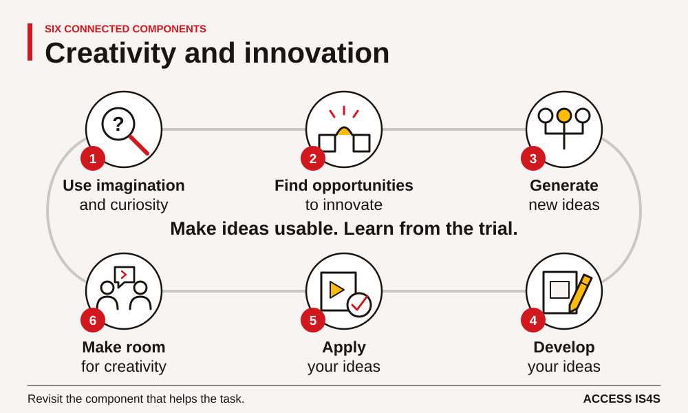
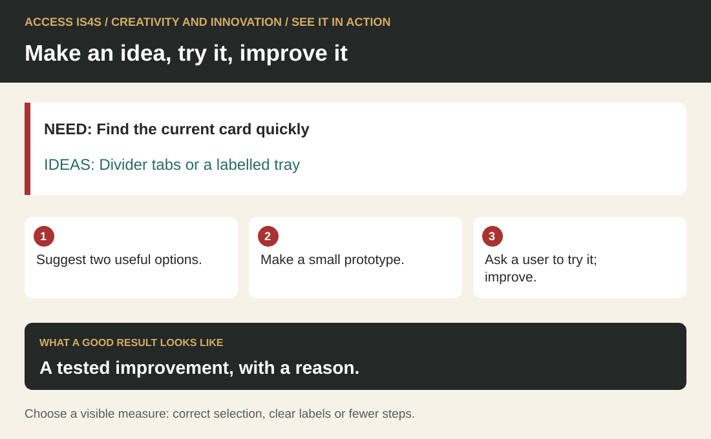
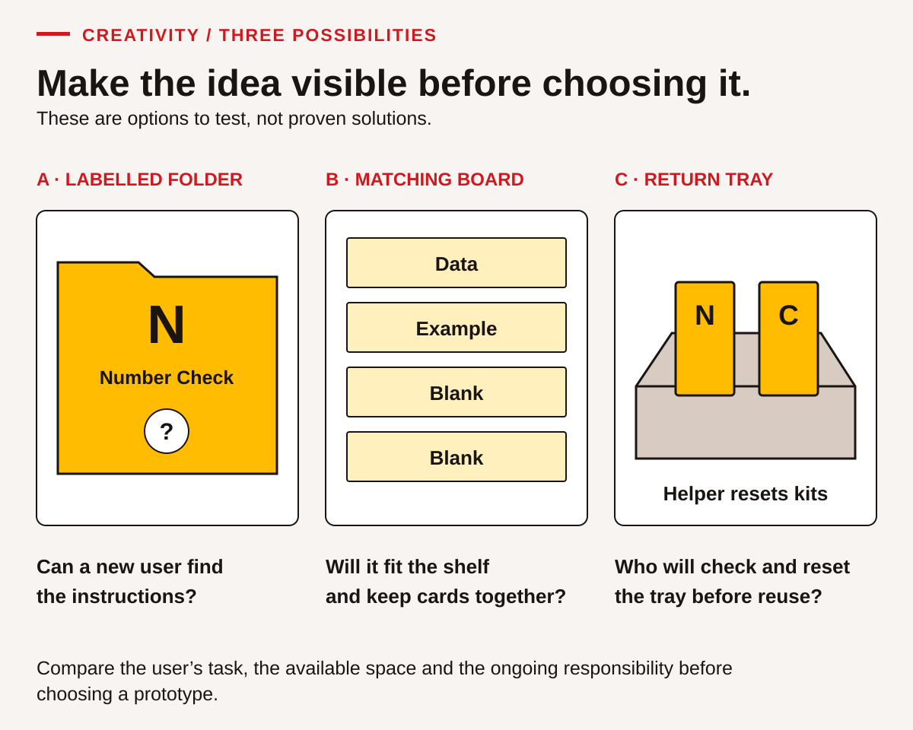
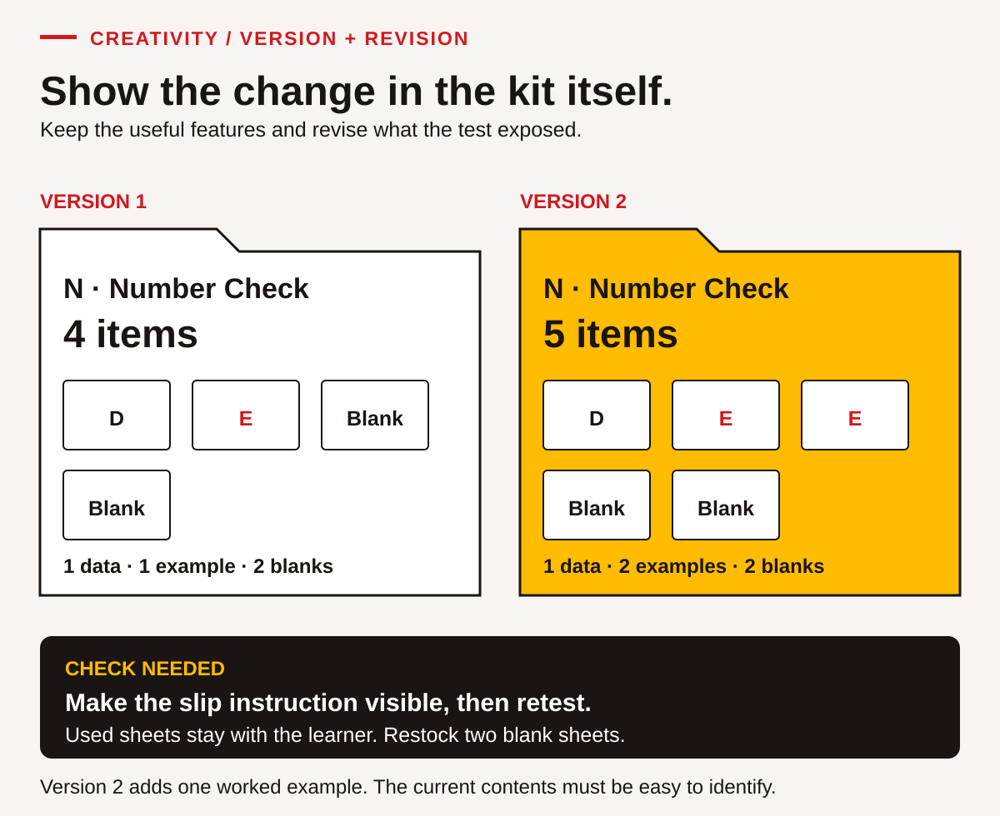

# Creativity and innovation — notice, make, test and improve

<!-- visual:social-creativity-six-components--learner-09 -->
<figure class="teaching-figure diagram" data-visual="social-creativity-six-components--learner-09">

<figcaption>Visual guide Six connected components of creativity and innovation. Short labels summarize the six skill components; numbers match the chapter list. Use the connections in the order the task needs. <a class="visual-original" href="../assets/diagrams/social-creativity-six-components.svg">Open full-size visual</a></figcaption>

Read the visual description

An original task illustration occupies the left panel; six numbered actions appear on the right. Make ideas usable. Learn from the trial. Six connected components: Use imagination and curiosity; Find opportunities to innovate; Generate new ideas; Develop your ideas; Apply your ideas; Make room for creativity. Revisit the component that helps the task.

</figure>
<!-- /visual:social-creativity-six-components--learner-09 -->

## See it in action · Creativity and innovation

<!-- visual:quick-creativity-innovation--learner -->
<figure class="teaching-figure diagram" data-visual="quick-creativity-innovation--learner">

<figcaption>Visual guide A tested improvement, with a reason. ACCESS IS4S. (2026). Original fictional teaching diagram. <a class="visual-original" href="../assets/diagrams/quick-creativity-innovation.svg">Open full-size visual</a></figcaption>

Read the visual description

NEED: Find the current card quickly. IDEAS: Divider tabs or a labelled tray. Suggest two useful options. Make a small prototype. Ask a user to try it; improve. A tested improvement, with a reason. Choose a visible measure: correct selection, clear labels or fewer steps.

</figure>
<!-- /visual:quick-creativity-innovation--learner -->

This small fictional example shows the skill in use. NEED: Find the current card quickly. IDEAS: Divider tabs or a labelled tray.

**Try it:** Suggest two useful options. Make a small prototype. Ask a user to try it; improve.

**Check your result:** A tested improvement, with a reason. Choose a visible measure: correct selection, clear labels or fewer steps.

## Useful ideas can begin with an ordinary question

Creativity and innovation involve imagining possibilities, developing ideas and putting them into use. You do not need to be an artist, invent a product for sale or produce an idea nobody has ever had. An idea can be new to you or useful in a particular setting. A clearer information card, a better way to organize a practice kit or a different explanation of a number can all make learning and work easier.

You may already create solutions when materials are limited, when a familiar approach does not suit a person or when a task needs a different explanation. This chapter makes that process visible. You will practise asking questions, generating several possibilities, selecting one for a reason, making a small version and learning from a reader or user's response.

Creativity also involves care. Changing a classroom filing method is different from changing an approved equipment procedure. Ideas that affect safety, privacy, community knowledge or someone else's work need the appropriate boundaries and permissions. A useful question is, “What can we try safely in this learning task, and who needs to guide a real change?”

In an ACCESS IS4S classroom, learners bring different experiences and ways of making meaning. You may choose to draw on your own experience, but you do not need to provide cultural knowledge, tell a personal story or make an object represent your identity. This chapter uses original fictional classroom cases. It does not supply Nation-specific designs, teachings or claims about a single Indigenous way of being creative.

A useful design is developed with attention to the people who will use it. An urban learning centre and a smaller B.C. community may need different information arrangements, and two learners in the same room may prefer different formats. Ask about the actual task and invite input. The connection to people and place comes through purpose, relationships and appropriate local direction, with learners deciding what they wish to contribute.

| Component | What you will practise | Main evidence |
|---|---|---|
| 1. Use your imagination and curiosity | Ask questions and explore another possibility before settling on an answer. | CI-01–CI-03 |
| 2. Identify opportunities for you to innovate | Locate a useful change within the task's purpose and boundaries. | CI-02–CI-04 |
| 3. Generate ideas that are novel to yourself or others | Make several genuinely different options. | CI-05–CI-07 |
| 4. Develop your ideas | Add details, compare features and prepare a usable prototype. | CI-08–CI-10 |
| 5. Apply your ideas | Try the prototype, observe results and improve it. | CI-11–CI-15 |
| 6. Facilitate a creative and innovative environment for yourself and others | Make room for ideas, give useful feedback and share work by agreement. | CI-06, CI-12, CI-16–CI-18 |

<!-- teaching:ci-route-learner -->
## Creativity and Innovation route card

**Practise in four steps**

1. Observe what a user needs to do. State one useful improvement.
2. Generate different options, compare them and make a small usable version.
3. Let a partner try it. Record what they actually do and any help they need.
4. Keep or revise a feature for a stated reason. Give useful feedback without taking over another person’s design.

**Support route.** Use plain words, movable cards, a spoken specification or a learner-directed scribe. Start with one visible need and practise two approaches before the fuller three-option attempt. A model can support learning; record when it was available and do not call the copied solution independent idea generation. Ask a willing partner or the instructor to be the user. No artistic quality, cultural motif or personal story is required.

**Retry route.** Change one feature in response to actual evidence, or retain an effective feature with a reason. Try the held status-change card and matching user request. Separate help to the designer from prompts to the user. A repeat with a familiar user shows that repeat under those conditions; it does not establish first-use accessibility or usefulness for everyone. If a truly new user is needed, arrange one rather than claiming a familiar partner is new.

**What the instructor observes.** Keep the options, prototype, trial observations and reason for the next version. A plan for later use needs a later observation.

**Next-attempt agreement:** user task ___; design decision ___; authoring support ___; user/role and prior familiarity ___; trial prompts ___; change/keep reason ___; observer/booking ___; limit of conclusion ___.
<!-- /teaching:ci-route-learner -->

## Case document 1 · The practice-card shelf

**Fictional classroom design brief.** A training room has three kinds of practice kits. Learners use the kits in pairs, then return the cards to a shared shelf. The next pair sometimes finds a mixed or incomplete kit. The instructor wants a simple classroom system that helps people find the right kit, notice missing pieces and return it without needing to remember every item.

The **Paving Process kit**, code P, contains five stage cards, six equipment-purpose cards and one instruction card: 12 cards in total. It supports introductory learning about the sequence pit or quarry → plant → haul → place → compact. It does not contain machine-operation instructions. The **Number Check kit**, code N, contains one fictional data table, one worked example and two blank record sheets: four items. The **Communication kit**, code C, contains four message cards, two role cards and one check-back checklist: seven cards.

The room has one complete kit of each type. All kit names, counts and observations in this chapter are invented for practice. In four fictional classroom sessions, learners spent 6, 8, 4 and 7 minutes finding or sorting the materials before they could start. Those observations suggest a problem to investigate; they do not prove why it happens or show that every learner has the same difficulty.

The instructor offers plain folders, scrap paper, markers and removable labels for a prototype. A small supply budget may be proposed, but no purchase will be made in this activity. The system must work in black and white, use plain-language labels and avoid putting learners' names or personal information on the shelf. It must fit on one shelf and be easy to reset when a kit changes.

The team can change labels, organization and classroom checking steps. It cannot discard the source cards, invent new equipment facts or require every learner to read small print. A learner should be able to ask for a supported explanation. The design must help people use the materials, not shame someone when an item is missing.

### CI-01 · Notice before proposing

Read the brief and list three things you know, three questions still open and one assumption you should avoid. Identify the evidence that suggests an opportunity for improvement. Explain why the four waiting-time observations do not, by themselves, prove that learners are careless or that a particular storage system will solve the problem.

### CI-02 · Define the useful change

Write a design question beginning, “How could we help a learner…” Include finding, checking or returning a kit. State the intended user and one limit from the brief. Avoid putting a preferred solution into the question too early. Compare your question with a partner's and explain which wording leaves room for more than one useful approach.

### CI-03 · Ask from another viewpoint

Review the shelf from three fictional viewpoints: a first-time learner, a learner who wants larger print and the person resetting the room. Write one question from each viewpoint. Use the brief to identify which questions can be answered now and which need a simple user check. Do not ask a classmate to disclose a disability or represent a whole group of learners.

## Curiosity turns an inconvenience into a design question

When a familiar task goes wrong, it is easy to jump to a solution or blame the person nearest the problem. Curiosity creates a pause. Ask what happened, what information was available, what the task required and which part caused difficulty. A missing card might reflect unclear labels, an incomplete starting kit, mixed storage, a changed activity or an uncertain return process. The same visible result can have several explanations.

Observation should be specific. “The kits are a mess” is a broad judgement. “The Number Check folder contains a Paving Process stage card, and its worked example is missing” identifies something a person can inspect. Specific observations help you choose what to test and avoid redesigning everything at once.

An opportunity for innovation is a useful gap between the current situation and the intended result. It does not require a dramatic new invention. If people cannot tell which pieces belong together, a visible contents list may help. If the list is difficult to use, the next idea may involve larger labels, a matching layout or a supported check. Keep asking whose task becomes easier and how you will know.

**Worked example 1 — frame the opportunity.** A learner first writes, “Make everyone use a better folder.” That statement already chooses a solution and puts the burden on the user. After reading the brief, the learner revises it to: “How could a first-time learner find and check the Number Check kit without remembering its contents?” This question points to a user, a task and a need. It leaves room for a contents card, a matching arrangement or another useful approach.

### CI-04 · Compare two design questions

Compare “How can we stop people losing cards?” with “How can the shelf show what belongs in each kit and make a missing piece easy to notice?” Identify an assumption in the first question and a testable feature in the second. Rewrite the first question so it focuses on a useful change without assigning blame. State one thing your revised question still does not establish.

## Generate options before choosing one

Idea generation and evaluation are different parts of the work. If you reject every idea as soon as it appears, you may end with only the first familiar approach. If you never evaluate ideas, you may choose something attractive that does not meet the brief. Give each part its own time: first make several possibilities visible, then compare them against the task.

You can generate ideas through lists, sketches, spoken descriptions, a simple model or an accessible tool. The form should help you think, not become a test of drawing skill. Try changing one feature at a time: where the information appears, how pieces are grouped, how a missing item is shown or how a person asks for help. You can also combine useful features from different ideas, while crediting contributions.

“Different” means more than changing the colour of the same design. A folder with a contents list, a board with matching spaces and a small check-out card use different ways to guide the user. Each may have strengths and limits. The goal is not to produce the most ideas at any cost; it is to create enough variety to make a considered choice.

A respectful idea session allows uncertainty. Someone can say, “This is an early thought,” or “I can explain it better with a sketch.” During the first generation round, ask clarifying questions and build on possibilities. Later, give specific feedback against the agreed criteria. Respect for the person does not require accepting an inaccurate fact or an unusable design.

### CI-05 · Generate three different options

Create three options for the practice-card shelf. Use any combination of words, sketches or a simple model. For each, explain how a learner would find a kit and notice a missing item. Make the options different in their organization or checking method, not just colour. Mark one question that would need testing before you could recommend each option.

### CI-06 · Help another idea develop

With a partner, take turns sharing an unfinished option. The listener asks one clarifying question and offers one possible extension, such as adding a larger label or changing where a contents list appears. The author decides what to use and explains why. Record the contribution with permission. Notice whether the conversation helped the author think, rather than replacing the author's idea with the listener's.

### CI-07 · Break one unnecessary assumption

Choose an assumption such as “every kit needs a separate colour,” “instructions must be a full page” or “the first draft has to look finished.” Explain why the brief does not require it. Generate another approach that still meets the actual requirements. Identify one important limit that you must keep, such as accurate source content, no personal data or black-and-white usability.

## Case document 2 · Three possible prototypes

<!-- visual:social-creativity-three-prototypes--learner-09 -->
<figure class="teaching-figure diagram" data-visual="social-creativity-three-prototypes--learner-09">

<figcaption>Visual guide Case preview: the labelled folder, matching board and shared return tray organize the same task in different ways. The questions beneath them remain to be tested. <a class="visual-original" href="../assets/diagrams/social-creativity-three-prototypes.svg">Open full-size visual</a></figcaption>

Read the visual description

Three original prototypes show a labelled Number Check folder, a matching board with data, example and two blank-sheet spaces, and a return tray with N and C kits and a named helper-reset action. Questions ask whether a new user can find instructions, whether cards fit and stay together, and who checks and resets the tray. These are options to test.

</figure>
<!-- /visual:social-creativity-three-prototypes--learner-09 -->

**Fictional design notes.** A group develops three ideas. **Option A: labelled folders** uses one folder per kit, a large code and name on the front, and a contents list inside. A small “check needed” marker can be placed on a folder when something is missing. The marker identifies the kit status, not the person who last used it.

**Option B: a matching board** shows an outlined space and label for each kind of item. Learners place returned items beside the corresponding labels. The board makes some gaps visible, but the group is unsure whether it will fit the shelf or whether small cards will stay together when moved.

**Option C: a shared return tray** has one large sign and a short return checklist. An assigned classroom helper checks the tray at the end of the activity and rebuilds the kits. This may make the learner's immediate return task simple, but it creates a recurring responsibility and a possible delay before another pair can use the materials.

The instructor gives four criteria: the system must show the correct contents; a new user must be able to follow it; it must work without colour; and it must be manageable when the kit changes. The group may add one justified criterion, such as fitting the available shelf. It should not choose a design simply because the most confident member prefers it.

The group has enough scrap materials to make one rough prototype. It is not being asked to buy supplies, publish images or change the real training room permanently. Its recommendation should explain both the useful features and the questions that remain after a small classroom test.

## Develop an idea so someone else can use it

Development adds the details that turn a possibility into something testable. Decide what the user sees first, what they do next, how they check the result and what happens when something is missing. A rough prototype can be a folded paper, a labelled folder, a sketch with movable pieces or a short spoken walkthrough supported by an accessible record.

Use the real requirements of the practice brief as your criteria. A beautiful design that relies only on colour does not meet a black-and-white requirement. A complicated tracking sheet may record many details but be harder to use than the task requires. More features are not automatically better. Each feature should help the intended person complete the task or understand the information.

A comparison table can help you choose, but it cannot make the decision for you. Before testing, “easy to use” is a prediction. Label it that way. After testing, you can report what a particular user did under particular conditions. Keep uncertain information visible so a small classroom trial does not become a claim that a design works for everyone.

**Worked example 2 — turn an idea into a prototype.** The group selects labelled folders for a first test. It writes “N — Number Check” in large text, then lists “1 data table; 1 worked example; 2 blank record sheets; total 4 items.” It adds a “check needed” slip and a short instruction: “If an item is missing, leave this slip with the folder and tell the instructor.” The group has not proved the system works, but another person can now try a clear sequence and report what happened.

### CI-08 · Compare features with reasons

Make a comparison table for Options A, B and C using the four given criteria and one criterion you can justify. For each option, record a likely strength, a likely limitation and a question to test. Mark predictions as predictions. Select a first prototype and explain the choice without claiming that the other options have been disproved.

### CI-09 · Specify the prototype

Prepare the words, arrangement and checking steps for your selected option. Use the correct kit contents from Case document 1. State what the user should do when something is missing and how the kit will be updated if its contents change. Ask a partner to describe the sequence from your specification. Revise any step they have to guess.

### CI-10 · Make a small usable version

Build a prototype with paper or an accessible tool. Include at least one complete kit representation, accurate labels and the missing-item response. You may use dummy cards rather than the original kit. Record which parts are ready to test and which are only suggested for a later version. Artistic polish, expensive supplies and cultural decoration are not required.

## Test the task, not the user's worth

A test gives the user a task and observes what happens. For the Number Check prototype, you might ask, “Find this kit, check whether it is complete and show what you would do if the worked example were missing.” Avoid explaining the design while the person is trying it, unless that support is part of the intended use. If you help, record the help so the result is not reported as independent use.

Ask permission before observing or keeping feedback. Use fictional role labels rather than personal information. A user can choose not to take part. The purpose is to learn about the design, not to rank classmates by speed or make someone feel responsible for a confusing instruction. If a person pauses or misinterprets a label, ask what information they were looking for.

Separate observation from interpretation. “The user opened two folders before finding N” is an observation. “The user is careless” is an unsupported judgement. “The code may need to appear on the shelf edge as well as the folder” is a possible design explanation to test. Keeping these separate helps the next revision address the actual difficulty.

### CI-11 · Plan a fair small test

Write a task for a willing partner using your prototype. Include what you will observe, what support is available and how you will record feedback without personal data. Add one question that asks about the design rather than the person's ability. Explain why a successful test with one person would still leave limits on your conclusion.

### CI-12 · Give and receive useful feedback

Exchange prototypes with another learner or pair. Give one specific observation, one question and one suggestion tied to the brief. The author restates the feedback, decides what to use and explains the decision. If testing is not available, rehearse with the instructor and label the result as a supported walkthrough. Do not present a rehearsal as an independent user test.

## Case document 3 · Results and a changed requirement

<!-- visual:social-creativity-kit-revision--learner-09 -->
<figure class="teaching-figure diagram" data-visual="social-creativity-kit-revision--learner-09">

<figcaption>Visual guide Worked-example preview: the second worked example changes the Number Check kit from four items to five. D = data table; E = worked example; unlettered pages = blank record sheets. Update the version and visible instructions, then retest. <a class="visual-original" href="../assets/diagrams/social-creativity-kit-revision.svg">Open full-size visual</a></figcaption>

Read the visual description

Two Number Check folders show an inspectable revision. Version 1 has four items: one data card, one worked example and two blank sheets. Version 2 has five: one data card, two worked examples and two blanks. A further check must make the slip instruction visible and retest; used sheets stay with the learner and two blank sheets are restocked.

</figure>
<!-- /visual:social-creativity-kit-revision--learner-09 -->

**Fictional test record.** A first-time user finds the Number Check folder after reading its large name and code. They count the data table, worked example and two blank sheets correctly. When the worked example is removed for the next trial, they notice that there are only three items but do not know where to put the “check needed” slip. The slip's instruction is printed on its reverse side, which the user has not seen.

A second user says the contents list is easy to find but asks whether used record sheets are returned or replaced. The original brief does not answer that question. The instructor clarifies the classroom rule for this fictional case: used record sheets stay with the learner's practice work; the kit is restocked with two blank sheets before reuse. No learner names are written on the folder.

The instructor then changes the kit. The Number Check kit will contain a second worked example, so its new contents are one data table, two worked examples and two blank sheets: five items. The system must show which version is current and prevent an old four-item list from being treated as the new requirement. The group has time for one revision and another small test.

The first prototype has useful features worth keeping. The large name and code helped the first user find the kit. The clear inventory supported counting. The revision should address the slip location, the restocking instruction and the changed contents without making the front of the folder crowded or blaming the users for the original gaps.

**Worked example 3 — revise from evidence.** The author moves the missing-item instruction to the visible face of the slip, adds a marked pocket for it and writes “Version 2 — five items” beside the new contents list. The author adds, “Keep your used record sheets; ask for two blank sheets before returning the kit ready for reuse.” A second user tries the changed kit and explains the return steps. The record states what that user could do and what support was given. It does not claim the design has solved every future storage problem.

### CI-13 · Separate findings from guesses

Make three columns for Case document 3: observed result, possible explanation and next check. Include the hidden instruction, the used-sheet question and the changed item count. Identify a useful feature to retain. Explain why the second user's question reveals missing information in the design rather than proving that the user failed to read carefully.

### CI-14 · Revise for the changed kit

Update your prototype or the labelled-folder example for the five-item Number Check kit. Make the version change clear, include the clarified restocking rule and improve the missing-item response. Keep an earlier version or a description of it. Explain how each revision answers evidence from the test or a changed requirement, rather than adding an unrelated feature.

### CI-15 · Retest and make a limited claim

Ask a willing user to try the revised version, or use an instructor-supported walkthrough if needed. Record whether the user can find the kit, identify its five required items and explain the missing-item and used-sheet steps. State the conditions and support. Write a conclusion that describes the result accurately and names one question that would need further testing before broader use.

## Help ideas grow without taking them over

A creative environment is built through ordinary choices. People need access to the task, materials and time to think. They need to know whether a suggestion is an early possibility or a final decision. They need feedback that can be used and an opportunity to revise. Credit matters too: ask before displaying a person's work or combining it into another product, and name contributions in the way the person agrees.

You can support another learner's idea without treating it as yours to finish. Ask what they are trying to achieve, what is uncertain and what kind of feedback would help. Offer options rather than instructions when the task allows choice. If the idea contains an inaccurate source fact, address that fact clearly while leaving room for a different design solution.

Reflection can also recognize a useful failure. A prototype may reveal that the problem was framed too narrowly or that an important user task was missing. That finding can improve the next attempt. The learning evidence is not simply the number of ideas or whether the finished object looks attractive. It includes how you investigated, developed, applied and improved the idea, and how you made that process possible for others.

### CI-16 · Facilitate a short idea session

Lead a small idea session about another classroom improvement, such as making a practice schedule easier to read. State the purpose and limits, offer more than one contribution mode and separate idea generation from evaluation. Invite participants to decide how their contributions may be recorded. Afterwards, ask what helped them think and choose one facilitation improvement.

### CI-17 · Transfer the process with boundaries

Choose a fictional office, training or community-room task that could benefit from a clearer form, label or information aid. Describe the user, opportunity, two possible ideas and a small test. Identify who would need to approve a real change and what information or knowledge should not be copied without permission. Do not propose altering live equipment procedures as a classroom creativity exercise.

### CI-18 · Assemble your idea-development record

Keep your design question, three options, comparison, prototype, test notes and revision. Use them to identify evidence for all six components. Name one idea contribution from another person and how you used or declined it respectfully. Choose a next practice goal. If a component has not been observed, name the task that could provide evidence instead of claiming the whole skill from the finished object alone.

## Supported route and extension

For supported practice, use one kit, a partly completed contents list and an instructor model of a test question. Generate two options first, then add a third by changing one feature. For an extension, test with a different task or revise after a new content requirement. A digital prototype can develop Digital as well, but paper work is a valid route for the creativity outcomes in this chapter.

Use the local evidence descriptions **Not observed, Not yet demonstrated, Demonstrated with support,** and **Demonstrated independently** for the stated task. These are not official proficiency levels. A plan to use the design process elsewhere is a transfer intention; a later documented task provides stronger evidence of actual transfer.

<!-- teaching:ci-case-learner -->
## CK-CI · Design a clear choose-and-check display

These four original cases give you another opportunity to use a skill after the chapter practice. **All people, rooms, events and organizations in these cards are fictional.** You can use these cases without sharing personal, family, community or cultural knowledge. They are classroom tasks, not instructions for operating equipment or following an actual workplace procedure.

Your instructor will give you the relevant card when your turn begins. Keep a sender's information separate from the receiver's card until after the exchange. If you have already read the information, say so: the activity remains useful practice, but that attempt cannot show how you receive an unfamiliar message. No one needs to conceal prior practice.

Agree your language, communication mode, tools, access supports and response time before beginning. Speech, sign, text, AAC, a learner-directed scribe and agreed interpretation can be appropriate. The person observing needs a reliable way to understand the meaning of your contribution. Receiving a message in writing shows reception through that mode; it does not automatically show auditory listening. You may decline audio/video recording and use live observation. Ask for a pause or another opportunity if the conditions are not usable. There is no requirement to look cheerful, make eye contact or disclose why you need an arrangement.

**Purpose:** develop and test a small information design. Artistic polish is not the goal. The design should help someone make a correct choice from the supplied fictional facts.

### CK-CI design brief and source cards

A practice shelf has three classroom packs. Users need to check what is ready before choosing. Make a tabletop paper prototype; a screen version is optional if available. Use only these facts:

| Pack | Current status | What a user may do |
|---|---|---|
| MAP | Ready | Select it for the classroom activity. |
| WORD | Being checked | Leave it in place; ask the instructor when it will be ready. |
| NUMBER | Ready | Select it for the classroom activity. |

The prototype must name all three packs, make each status and next action understandable, and identify itself as **classroom practice**. It must work without colour as the only status signal. It must not collect names, photographs, cultural knowledge or personal reasons for choosing a pack. Available materials are plain paper, six blank cards, a marker or pencil and removable tape. A learner-directed scribe may prepare the marks you specify. Use descriptive words or simple original shapes; no cultural imagery is required.

Before choosing a design, ask a useful question about the user's task and record at least three different possible approaches. Differences must change how information is found or used, not just the colour. Select one approach with a reason tied to the brief. Make a usable small prototype. Keep a sketch or note of the other options; a finished attractive product alone does not show idea generation.

### CK-CI user card · Give to a willing test partner

You want the **WORD** pack first. If it is not ready, you would use the **MAP** pack today and ask the instructor about WORD. Using the prototype, identify your first-choice pack's status, say what you will do next and locate the pack you can use today. Explain one point that helped or confused you. Do not pretend to misunderstand a clear display, and do not praise it just to be polite. You can decline or stop the user role; the instructor can take the role or arrange another partner.

### CK-CI test and revision

Tell the user the task and agree how they will give feedback. During the first trial, observe rather than coaching the answer. If the user asks for help, you may provide it, but record the actual prompt and treat the trial as supported at that point. A person's support need is not a fault in them. Note whether the display itself made the required information available in the agreed mode.

Ask permission before marking or changing someone else's contribution. Identify a useful change from the trial, make it, and repeat the task. If no change is needed, retain the prototype and explain the evidence from the check. A repeat with the same user is a familiar-task retest; it is not an independent first-use trial with a new person. State what this trial supports and what it cannot establish.

When you take the user role for a partner's design, offer one concrete observation and leave the design decision with its author. Each learner needs a design turn and an opportunity to give feedback. A peer's successful use of your display does not prove you developed it without support.

### CK-CI later change card · Hold for a later design attempt

The fictional status changes: **WORD is now Ready**; **MAP is now Being checked**; **NUMBER remains Ready**. The next user's first choice is **MAP**, with **NUMBER** as their acceptable alternative. The action for a pack being checked remains “leave it in place and ask the instructor.” Update the prototype, verify all three statuses, and test with this task. If the same person already knows the earlier display, record that familiarity. This is a bounded application in a changed classroom task, not evidence of effectiveness across workplaces or communities.
<!-- /teaching:ci-case-learner -->
