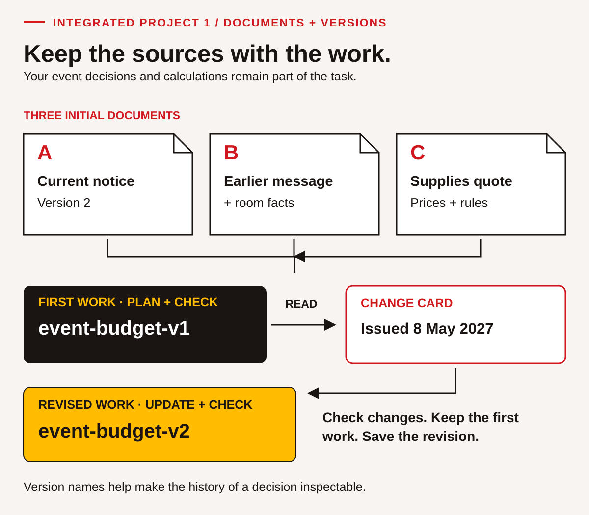
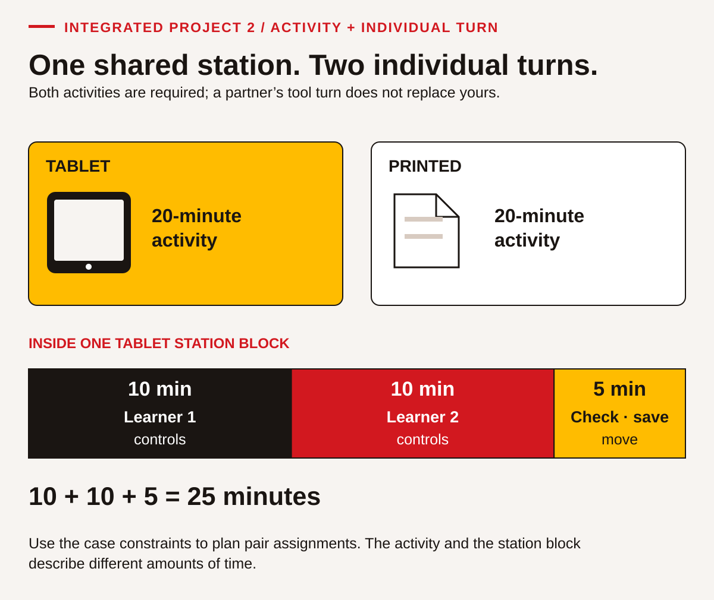

# Put the nine skills to work together

These projects let you plan something useful, explain your decisions and respond when the information changes. Each project contains all the notices, prices, quantities and conditions needed for the questions. The organizations and arrangements are fictional. Use the supplied information as a classroom case; do not treat it as a live event, booking or purchasing instruction.

You can complete a project with a partner or small group, but keep your own work and take your own turn with the digital tool. For Communication and Collaboration, an instructor or another learner can be your partner. A written script can prepare you for an interaction; it does not replace the interaction. You may use an accessible communication method agreed with your instructor.

Use a spreadsheet or an accessible table application for the digital tasks. You need to enter information, check it, save it and find it again yourself. If a device is unavailable, complete the planning on paper and record Digital as not observed until you can demonstrate the tool actions. You do not need to create an online account, post publicly or use personal information.

Keep first drafts and revisions. The change is part of the task, not a trick. Your work should show what changed, what you kept, what you revised and why. The answer guide gives model responses and calculations; other responses can work when they meet the stated conditions and explain their evidence.

## Project 1: A training information morning

<!-- visual:social-project-1-versions--learner-10 -->
<figure class="teaching-figure diagram" data-visual="social-project-1-versions--learner-10">

<figcaption>Visual guide Process preview: the initial notice versions and your saved-work versions identify different things. Keep the sources and first work, read the later change card, and check and save the revised work. Use the supplied documents to make your own decisions. <a class="visual-original" href="../assets/diagrams/social-project-1-versions.svg">Open full-size visual</a></figcaption>

Read the visual description

Three source documents feed the first project work: A is the current version 2 notice, B the earlier message plus room facts, and C the supplies quote with prices and rules. CP01–CP04 produce CP01-budget-v1. A change card issued 8 May 2027 leads to CP05–CP06 and CP01-budget-v2. The first work is retained and the revision saved.

</figure>
<!-- /visual:social-project-1-versions--learner-10 -->

A fictional Learning Centre is preparing a short information morning for people considering a training course. You are helping the planning team make the arrangements clear and keep supplies within the available budget. No cultural activity or personal disclosure is required. The purpose is to help participants know where to go, what to expect and whom to ask.

Your planning package contains three initial documents and one later change card. Work with the initial documents for CP-01 to CP-04. Read the change card before CP-05 and use the updated information in CP-06. Do not erase the first plan; label its version so another person can follow your decisions.

### Document A: current event notice, version 2

**Learning Centre — Training information morning** 
**Date:** 14 May 2027 
**Session:** 9:00–10:30 a.m. 
**Place:** Learning Centre, Room A 
**People:** 18 learners and two staff members 
**Contact:** Ask the Learning Desk for clarification. 
**Version:** Version 2, issued 5 May 2027. It replaces the earlier message below.

| Part of the morning | Time |
|---|---|
| Welcome and check-in | 9:00–9:10 |
| Course information | 9:10–9:30 |
| Try a practice task | 9:30–10:10 |
| Questions and review | 10:10–10:25 |
| Pack up | 10:25–10:30 |

Participants do not need to bring a device. The centre supplies the practice materials. Participation in the morning does not reserve a course place; the Learning Desk will explain the application process. Learners may ask privately about access or support arrangements. The planning team should not collect personal support information in a public sign-up sheet.

### Document B: earlier message and room information

**Earlier message, version 1, issued 1 May 2027:** “The information morning is planned for 8:30–10:00 a.m. in Room B. We will send a final notice.” This message is retained so the team can identify what needs correcting. Version 2 is the current notice.

| Room | Maximum people, including staff | Information for the initial plan |
|---|---:|---|
| A | 24 | Booked for this event at the times in version 2. |
| B | 18 | Mentioned in the earlier message; not the current booking. |

Count every learner and staff member when checking room capacity. A room that fits the learners alone may still be too small for the event. No other rooms or bookings are part of this case.

### Document C: initial supplies quote

The budget is **$160.00**. Prices include all charges for this exercise; add no tax or delivery amount. Items can be bought individually in the quantities shown. Buy one notebook and one snack pack per learner. Buy one pen, one handout and one water per person, including staff. Staff do not need notebooks or snack packs in this plan.

| Item | Initial quantity | Price per item |
|---|---:|---:|
| Notebook | 18 | $2.50 |
| Pen | 20 | $0.80 |
| Handout | 20 | $0.15 |
| Water | 20 | $1.00 |
| Snack pack, option 1 | 18 | $3.00 |

The initial plan uses snack option 1. A later change card will provide another option. There are no other costs to include. This limited table is a practice budget, not a complete real-world event budget.

### CP-01 — Read the plan and identify the current instruction

Create a short planning note answering these questions: What is the current date, session time and room? Which document establishes that it is current? What changed from version 1? How many people will be in the room? Does Room A fit them, and how many places remain within its maximum? Would Room B fit the same group?

Calculate the total session length and check it by adding the five activity durations. Identify two things the notice tells participants about preparation or next steps. Also name one matter that should go to the Learning Desk rather than being guessed. Point to the relevant line, table or condition for each answer.

Your aim is to show how you used the documents, not simply to give a likely event plan. Keep the note so you can compare it with the later change. Reading is the focus; an oral explanation with pointed evidence is acceptable if you and your instructor agree how to record it.

### CP-02 — Build and check the initial budget

Estimate whether the initial supplies are likely to cost less than $160. Then make a digital table with the headings **Item, Quantity, Price each, Line cost**. Enter all five items and calculate each line cost. Use formulas if you know how; if you enter calculated values, show your separate calculations and check the entries. Add the total and the money remaining.

Check the result in a second way. You could add grouped costs, use a calculator after a spreadsheet calculation, or compare the total with a reasonable estimate. Include dollars and cents and explain whether the budget is sufficient. Do not add quantities with different purposes and call that number the event size.

Save the file as `CP01-budget-v1` in an agreed folder. Close it and find or reopen it. Show your instructor or partner the saved file and explain your check. Record the application, any formula used and any support needed. This is evidence of local digital work; it does not show online research or online-platform skills.

### CP-03 — Give a clear briefing and work toward agreement

Work with a partner. In the first round, you are the organizer and your partner is a prospective participant. Brief them using the current notice. Your partner uses this role card: **“I saw the earlier 8:30 message. I want to know when and where to arrive, whether I need a device, and whether attending means I have a course place.”** The partner asks at least one clarification and checks the answer back in their own words.

Swap roles so each person explains and receives information. Together, agree the three details that most need to appear at the top of a participant message. If you prefer different priorities, explain your reasons and check the notice before deciding. Neither person should have to agree without understanding the other’s reason.

Record your own contribution, one useful question from your partner and the shared decision. Your instructor observes whether the briefing is accurate, whether meaning is checked and whether both people contribute. A fluent-sounding speech alone is not the whole outcome; listening and responding matter too.

### CP-04 — Write the first participant message

Write a message of about 80–120 words for someone who saw version 1. Give it a useful subject or heading. Correct the old time and room, state the date and current time, explain what participants need to bring, distinguish attendance from a course reservation, and identify where to ask questions. Use information from the supplied notice without inventing a contact address or application deadline.

Ask your partner to read it and state when and where they would arrive. Ask what they would do if they needed clarification. If their interpretation differs from your intention, revise the wording. Keep both versions or mark the edit clearly.

Label the final first-stage message **Version 2 information — before change card**. This is a writing task: produce text you control and can revise. You may use an agreed authoring tool. A conversation about what the message might say is preparation, not the completed message.

### Change card: issued 8 May 2027

Four more learners will attend. There are now **22 learners and two staff**. The event remains on **14 May 2027 in Room A**, but the booking has moved to **10:00–11:30 a.m.** Keep the same sequence and length of activities. The budget remains **$160.00** and the per-person supply rules remain the same.

Snack option 1 is still available at **$3.00 each**. Snack option 2 is now available at **$2.50 each**. Either option meets the case requirements; choose one type for all 22 learners. Buy all required supplies. The Learning Desk remains the contact. Do not claim that the room, registration process or device requirement changed; the card does not say that.

### CP-05 — Solve the revised budget and update the plan

List what changed and what stayed the same. Check the new total number of people against Room A’s maximum. Recalculate the quantities and costs using snack option 1. State exactly whether that plan meets the budget. Then calculate the full plan using snack option 2 and select a workable response with a reason.

Update the five activity times to start at 10:00 while preserving their lengths. Save your revised budget as `CP01-budget-v2` so the first version remains available. Check that the new quantities follow the learner/person rules and that the saved file contains the revised total. Explain one check that helped you catch or avoid an error.

Record how you adjusted your approach. You might compare versions side by side, mark changed quantities before calculating or ask a partner to interpret the revised schedule. The evidence is the adjustment you made and its result; you do not need to describe private feelings or personal experiences of change.

### CP-06 — Create, test and improve a final information sheet

Sketch two different ways to organize a one-page participant sheet using the revised information. For example, you might compare a short checklist with a compact schedule-and-questions layout. Both must make the current date, time, room, preparation and contact clear. Choose one with a reason related to the reader. Originality here means developing a useful approach for this task, not inventing a new kind of event.

Create a final sheet of **no more than 100 words**, excluding its heading. It must remain understandable in black-and-white print; do not use colour alone to identify changes. Include a clear correction to the earlier time. Ask your partner to use the sheet to answer: “When and where do I arrive? What should I bring? Does this reserve my course place? Where do I ask?” Note one response and improve the sheet if needed.

Keep your two sketches, chosen version, reader-test note and final revision. Add a short reflection naming one skill you used effectively, one support or strategy that helped and one task you want to try next. Do not describe the project as official event-planning certification.

### Project 1 evidence check

| Skill | Evidence from your own work |
|---|---|
| Reading | CP-01 uses the current document and identifies its conditions. |
| Writing | CP-04 and CP-06 produce and revise reader-focused text. |
| Numeracy | CP-02 and CP-05 show quantities, costs, capacity, durations and checks. |
| Digital | CP-02 and CP-05 show your own table entry, checking, saving and reopening. |
| Problem solving | CP-05 identifies the budget issue and justifies a workable option. |
| Communication | CP-03 includes an accurate briefing, clarification and check-back. |
| Collaboration | CP-03 records both contributions and a shared decision; CP-06 uses reader feedback. |
| Adaptability | CP-05 records changes and implements a revised plan. |
| Creativity and innovation | CP-06 compares two layouts, develops one and improves it through a trial. |

## Project 2: A community learning-room session

A fictional Community Learning Room will host a practice session using tablets and printed activities. You are helping arrange the resources so every learner can take part. People may choose the supplied fictional examples; nobody has to use a personal account or reveal private information. Your task is to plan access, explain the arrangement and revise it when equipment availability changes.

The project begins with a confirmed group and an initial resource count. Later, two more learners join and some equipment becomes unavailable. The goal is a workable plan within the existing time, room capacity and printing budget. You are planning a learning activity, not repairing devices or changing the building’s procedures.

### Document D: session brief

<!-- visual:social-project-2-stations--learner-10 -->
<figure class="teaching-figure diagram" data-visual="social-project-2-stations--learner-10">

<figcaption>Visual guide Concept schematic: each pair completes both 20-minute activities. Within a tablet block, each learner has ten minutes of control, followed by five minutes for checking, saving and moving. Plan the pair assignments using the case conditions. <a class="visual-original" href="../assets/diagrams/social-project-2-stations.svg">Open full-size visual</a></figcaption>

Read the visual description

Tablet and printed activities each need twenty minutes. A proportional tablet-station bar separates ten minutes controlled by learner 1, ten controlled by learner 2 and five for checking, saving and moving, totalling twenty-five minutes. Each learner needs an individual turn; station time and activity time are different constraints.

</figure>
<!-- /visual:social-project-2-stations--learner-10 -->

**Date:** 21 May 2027 
**Session:** 1:00–2:30 p.m., Community Learning Room 
**Initial group:** 12 learners and two helpers 
**Room maximum:** 16 people, including helpers 
**Contact:** The Session Coordinator, available at the room’s front desk.

Learners work in pairs, initially named **A, B, C, D, E and F**. Each pair needs one **20-minute tablet activity** and one **20-minute printed activity**. Within the tablet activity, each learner controls the device for ten minutes. Each station block lasts 25 minutes, including five minutes for checking, saving and moving. The printed activity can run at the same time as the tablet activity.

| Part | Time |
|---|---|
| Orientation | 1:00–1:10 |
| Station block 1 | 1:10–1:35 |
| Station block 2 | 1:35–2:00 |
| Break | 2:00–2:10 |
| Shared review | 2:10–2:25 |
| Return resources and finish | 2:25–2:30 |

Initially, all six pairs may do tablets in block 1 and printed activities in block 2. A different rotation is allowed if every pair completes both activities. The session must finish by 2:30. Do not shorten the 20-minute activities, ask learners to bring personal devices or assume extra helpers.

### Document E: resource desk count before the change

| Resource | Total owned | Unavailable | Available for this session |
|---|---:|---:|---:|
| Tablets | 8 | 2 | Calculate this. |
| Calculators | 12 | 1 | Calculate this. |
| Reusable folders | 18 | 2 | Calculate this. |
| Chargers | 15 | 2 | Calculate this. |

Unavailable items cannot be used in the plan. Each pair needs one calculator. Each learner needs one folder. Each tablet in use needs one charger. These resources have no borrowing charge in the case and are returned before the session ends. Only the printing and labels below use the **$15.00** supplies budget.

### Document F: printing and label quote

| Item | Quantity rule | Price |
|---|---|---:|
| New practice pages | Six pages for each learner; helpers do not need a set. | $0.12 per page |
| Name labels | One for each learner and helper. | $0.10 each |

All charges are included. Items can be bought in the exact quantities needed. Do not assume labels need real names; participants can use agreed practice names or pair labels. A supplier can provide additional working tablets for the session at **$6.00 each**, including a charger. Any rental would use the same $15.00 budget as printing and labels. No other funds are available.

### CP-07 — Read the requirements and find the limits

Write a planning note identifying the initial total people, room capacity and remaining places. Calculate the available count for each resource in Document E. Explain whether the initial six-pair plan has enough tablets, calculators, folders and chargers. Show the needed and available quantities rather than simply saying “yes.”

State how long the session lasts, how long each station block lasts and how much tablet-control time each learner receives. Identify three conditions a revised plan must preserve. Explain the difference between a resource being owned and being available. If the source does not confirm that a device works, would you count it as available? Explain using the case’s rule.

Keep your note as the baseline. It should help someone unfamiliar with the session understand the purpose and limits without reading every planning discussion.

### CP-08 — Create the resource and cost tables

Make a digital resource table with columns for **Resource, Total, Unavailable, Available, Initially needed, Spare**. Calculate the entries for the initial plan. Keep the resource types separate; adding all the spare items together would not tell you whether there are enough tablets.

In a second table, calculate the initial number of printed pages, printing cost, number of labels, label cost, total cost and money remaining from $15.00. Estimate and then check the total. Explain why the helpers count for labels but not for practice-page sets.

Save the work as `CP02-plan-v1`, close it and find or reopen it yourself. Demonstrate one correction or verification of an entry. Keep the original work available for the later change. Record any formulas or assistance used. The digital evidence concerns the tool actions you actually perform, not a partner’s completed file.

### CP-09 — Explain the rotation and agree how to support access

Work with a partner. One person is a helper; the other uses this learner role card: **“I want to know whether I get my own turn on the tablet. I would prefer a printed reminder of where to go next. I do not want to use a personal account.”** Explain the initial plan using the brief. The learner asks a clarification and checks the answer back. Swap roles so both people practise receiving and explaining information.

Together, choose a clear way to show pair assignments and the next station. Agree how you will avoid one partner controlling the device for the whole activity. You can use a timer, a visible turn note or another workable reminder that fits the supplied conditions. The learner does not need to explain why a support would help.

Record the shared plan, your contribution and one way your partner’s input improved it. Ask the instructor to observe the exchange. Writing “we listened” is less useful than noting the question that changed the plan.

### CP-10 — Write an initial helper handover

Write a handover of about 80–120 words for the two helpers. Include the date, time, initial number of learners and pairs, room-capacity check, resource quantities needed, the two station blocks and the ten-minute device turn for each learner. State where an unresolved question should go. Use the supplied facts; do not promise services or equipment that are absent from the brief.

Ask your partner to explain the plan after reading your handover. Check whether they can distinguish a 20-minute activity from a 25-minute station block. Revise any wording that could lead them to skip the five-minute transition or keep the tablet with only one person. Label this handover as the initial plan so it can be distinguished from the revision.

### Change card: confirmed before the session

There will now be **14 learners and two helpers**, forming seven pairs **A–G**. Two of the tablets previously counted as available are now unavailable. This makes **four working tablets available**, not six. The other resource counts are unchanged. The room maximum, $15.00 supplies budget, date, session times and activity lengths are unchanged.

You may rotate groups between tablets and printed work. Everyone still needs both activities and an individual ten-minute tablet turn. You may compare rental with rotation, but any rental must fit the same $15.00 budget. There is no permission to use personal devices, reduce practice time or increase the room maximum.

### CP-11 — Compare options and revise the plan

Check the changed attendance against room capacity. Recalculate pages, labels, costs and remaining money. If all seven pairs used a tablet at once, how many additional tablets would be needed? Calculate the full printing, label and rental cost for that option and decide whether it is possible within the budget.

Create a feasible rotation using the four available tablets. Name the pairs at each station in each block. Show that every pair gets a tablet activity, a printed activity and the required individual turns. Check the needed calculators, folders and chargers against availability. Record why the chosen response meets the constraints.

Save the revised tables as `CP02-plan-v2`. State what changed, what stayed the same and one strategy you used to revise without losing a requirement. If you work with a partner, both people must be able to explain the decision and their own file work.

### CP-12 — Design and test a usable station guide

Sketch two ways to explain the revised rotation to participants. One could use a table by time; another could use a short route for each pair group. Choose a design with a reason related to ease of use. Make a guide of **no more than 120 words**, excluding its heading, that works in black-and-white print and states the individual device-turn arrangement.

Ask your partner to act as Pair C, then Pair F. Can they find their first station, second station and move time? Can they explain how both people get a device turn and when the session finishes? Record one observation and make a useful improvement or explain why the tested version already works. Keep the sketches, guide and test note.

Finish with a brief portfolio note: identify an example for each of the nine skills using the evidence table below. Choose one strategy to try in a different situation, and name the new task and how you would check it. This is a transfer plan; record transfer as observed only after you actually try the new task.

### Project 2 evidence check

| Skill | Evidence from your own work |
|---|---|
| Reading | CP-07 interprets the brief, availability and limits. |
| Writing | CP-10 and CP-12 create and revise useful instructions. |
| Numeracy | CP-08 and CP-11 show resource counts, time, costs and checks. |
| Digital | CP-08 and CP-11 demonstrate your table work and file management. |
| Problem solving | CP-11 compares rental and rotation against the same constraints. |
| Communication | CP-09 includes clarification and an accurate check-back. |
| Collaboration | CP-09 reaches a shared access plan with both contributions visible. |
| Adaptability | CP-11 implements the changed group and equipment conditions. |
| Creativity and innovation | CP-12 develops two layouts, selects one and tests its usefulness. |

## Review your work

Use the [answer guidance](../answers/10-integrated-projects.md) after an attempt as agreed with your instructor. Retain the evidence that best shows your learning, record support conditions and choose a specific next task. A project completed in class is evidence of that project; workplace or everyday transfer needs a separate opportunity and observation.
