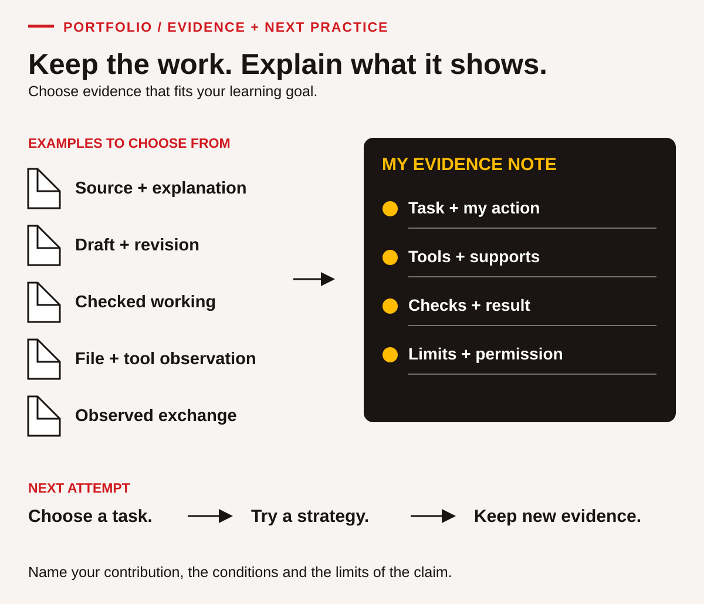

# Reference and portfolio • Keep evidence you can use

## Make your learning visible

A portfolio is a selected collection showing what you can do and what you are practising next. Use a paper folder, an accessible digital folder or both. Choose examples of a useful action, a checking strategy, a revision or a response to a new situation.

You decide which personal connections to share. Fictional cases can demonstrate learning without disclosing family records, community information, identity details or difficult experiences. Ask before including another person's words, image or work. Identify your contribution to shared tasks and follow the program's storage and sharing arrangements.

## A practical glossary

These short working definitions help you use the book. They are original explanations for learning, not legal definitions or an official assessment scale.

| Term | Meaning in this book |
|---|---|
| Adaptability | Adjusting your approach or goals when conditions change, while continuing purposeful work. |
| Assumption | Something treated as true that still needs checking or stating clearly. |
| Audience | The person or group who needs to understand your message. |
| Baseline | A recorded starting example used to compare later work under stated conditions. |
| Calculation | A mathematical operation or sequence used to answer a defined question. |
| Check-back | Restating or clarifying a message to confirm shared understanding. |
| Collaboration | Contributing and supporting others to achieve a shared goal. |
| Communication | Receiving, considering and sharing information through interaction with others. |
| Condition | A circumstance that affects the task, such as available time, tools or information. |
| Constraint | A limit or requirement the solution must respect. |
| Creativity and innovation | Developing, trying and improving an idea that offers a useful new possibility. |
| Criterion | A stated feature used to judge whether work meets its purpose. |
| Digital | Using digital tools to find, manage, create, apply or share information responsibly. |
| Estimate | An approximate result used for planning or checking. |
| Evidence | An observable action, record or product that supports a specific learning claim. |
| Feedback | Specific information about what worked and what could improve. |
| Formative practice | Learning activity used to guide improvement and the next teaching step. |
| Goal | A result you intend to work toward, with a way to recognize progress. |
| Inference | A conclusion drawn from evidence rather than directly stated in the source. |
| Iteration | Another version made after trying, checking or receiving feedback. |
| Measurement | A quantity found using a method and unit, with an appropriate degree of precision. |
| Numeracy | Finding, using, checking and reporting mathematical information in context. |
| Observation | A record of what someone actually saw or heard during the task. |
| Paraphrase | Restating a meaning in your own words while keeping it accurate. |
| Portfolio | A selected collection of learning evidence with enough context to interpret it. |
| Problem solving | Understanding an issue, considering options, acting and checking the result. |
| Reading | Finding, understanding and using information in words, symbols and images. |
| Reflection | Looking back at an action and its evidence to choose a useful next step. |
| Revision | A purposeful change to improve a draft, plan or product. |
| Simulation | An invented practice situation that represents selected features of a real task. |
| Source | The document, person or record from which information comes. |
| Support | A tool, accommodation, model or prompt that helps someone complete a task. |
| Transfer | Applying a learned strategy in a different task or context, with evidence of the application. |
| Unit | The named quantity used in a measurement or calculation, such as minutes or metres. |
| Writing | Creating written words, symbols or images to communicate a purpose to a reader. |

## Choose evidence across the nine skills

Use this table as an index. One project may support several skills, but identify the action behind each claim. Leave a row open when more practice or observation is needed.

| Skill | A useful item or observation to collect | My chosen item / activity ID |
|---|---|---|
| Reading | A source detail located and correctly used, with an explanation of its meaning. | |
| Writing | An authored message and revision that make its purpose clearer to the reader. | |
| Numeracy | Labelled working, a checked result and an explanation of its consequence. | |
| Digital | An observed tool action plus a file or record the learner can find and explain. | |
| Problem solving | A defined issue, evidence considered, alternatives and a checked decision. | |
| Communication | An observed exchange showing listening, explanation and clarification. | |
| Collaboration | Your contribution, response to another person and effect on a shared task. | |
| Adaptability | An original plan, a changed condition and a justified revised approach. | |
| Creativity and innovation | Alternatives considered, an idea tried and an improvement based on testing. | |

For examples of a checkable record, revisit [Reading](01-reading.md), [Writing](02-writing.md) or [Numeracy](03-numeracy.md). Choose evidence for your present goal rather than trying to make every artifact demonstrate every skill.

## Add a short evidence note

<!-- visual:social-portfolio--learner-11 -->
<figure class="teaching-figure diagram" data-visual="social-portfolio--learner-11">

<figcaption>Visual guide Five examples of evidence types flow into a short note and a next attempt. Choose the items that fit your goal; identify your own action, supports, result and limits. Keep personal sharing and permission choices visible. <a class="visual-original" href="../assets/diagrams/social-portfolio.svg">Open full-size visual</a></figcaption>

Read the visual description

Five possible evidence items are a source plus explanation, draft plus revision, checked working, file plus tool observation and an observed exchange. A personal evidence note records task and action, tools and supports, checks and result, and limits and permission. A next attempt moves from choosing a task to trying a strategy and keeping new evidence.

</figure>
<!-- /visual:social-portfolio--learner-11 -->

Copy this template for each selected item. A few clear sentences are enough.

| Field | Your note |
|---|---|
| Item title, activity ID and date | |
| Task and intended result | |
| Skill and criterion being observed | |
| What I personally did | |
| Tools, access arrangements and prompts used | |
| Evidence location and observer, if applicable | |
| What the result shows, including any limit | |
| Feedback and one next practice step | |
| Sharing choice or permission needed | |

Describe conditions precisely. “Used a calculator to check the total” is more informative than “had help.” “Partner explained which operation to use” records a different kind of support. Agree the task conditions and criteria with the instructor before interpreting independence. Routine access tools do not automatically mean someone else did the reasoning; record what the tool or person actually contributed.

A paper table can demonstrate numerical organization, but it does not establish Digital until tool use is observed. An oral explanation can show understanding, but a Writing outcome needs learner-authored text. Communication needs evidence of the exchange, rather than relying only on a written summary. A group product needs an observation of each person's contribution before it supports an individual Collaboration claim.

## Use feedback to choose the next step

These four local descriptions refer to a particular task and criterion. They are not official Skills for Success levels, admission decisions or trade/professional qualifications.

| Description | What it records |
|---|---|
| Not observed | There is not yet enough evidence to judge the task criterion. |
| Not yet demonstrated | An attempt was observed, but the criterion has not yet been met. |
| Demonstrated with support | The criterion was met using the recorded task support. |
| Demonstrated independently | The criterion was met under the agreed conditions without task-solving prompts. |

Record transfer separately, with the new situation and evidence named. A result can be independent in a familiar task while transfer to a different task still needs practice. Likewise, needing a reminder on one new task does not erase earlier evidence.

Review the task, evidence, checks, useful support and remaining uncertainty. Choose an observable next action: check units before calculating, or ask a listener to restate a deadline. “Be better at maths” is harder to act on than “show the unit beside every quantity and check the answer another way.”

## Plan a specific transfer attempt

Choose a new context that matters to your learning goal. It can remain fictional. Transfer means applying a strategy to a different demand, not only replacing a name on a completed worksheet.

| Transfer-plan field | Your plan |
|---|---|
| Strategy I already practised | |
| New task and why it is different | |
| Source information or materials required | |
| Criterion for a useful result | |
| Agreed tools, supports and observer | |
| Date or session for the attempt | |
| Evidence I will keep | |
| Review: what transferred and what needs more practice? | |

**Example:** After calculating whole packs for a classroom order, use the same checking routine for a new fictional folder request. Twelve learners each need one folder, with two spares. Three folders are available. Packs contain five folders and cost $8.75; delivery is free in this new case, and the budget is $25. The target is fourteen, so eleven more are needed. Three packs cost $26.25, exceeding the budget by $1.25. The successful transfer includes noticing the new delivery condition, rounding the pack count appropriately and reporting the budget gap. Copying the previous case's delivery charge would miss the changed information.

Keep the working and ask someone to check whether the quantities and conditions support the result. Identify any step to revisit. Progress can include catching an error sooner, asking a precise question, explaining clearly or completing a task with fewer prompts.
