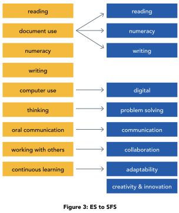

# A shared foundation for ACCESS IS4S practice

ACCESS IS4S teaching begins with adults who already use knowledge, judgement and skills in their lives. This practitioner guide helps you make that learning visible, teach a useful next step and create another opportunity to practise. A learner may be preparing for a trade, returning to education, changing work, supporting family or strengthening confidence with a particular task. The nine Skills for Success offer a shared language for that work. The learner’s purpose gives the language meaning.

This is an independently authored teaching companion informed by SkillPlan’s *Skills for Success Get Started Guide for Practitioners*, revised March 2024. It expands the supplied guide into original ACCESS IS4S explanations, classroom cases, teaching decisions and evidence records. SkillPlan is the source guide’s author and publisher; the Government of Canada is its identified funder. Our activities are classroom proposals, not SkillPlan lesson reproductions, validated assessments or professional certification.

The learner textbook and this practitioner guide are designed to work together. Learners need clear explanations, useful examples, time to try, feedback and a reason to return to a skill. Practitioners need the reasoning behind those choices, ways to adjust support and a defensible account of what an attempt shows. A completed page is useful when you can explain what the learner did and what they need next.

## Who can use this guide

An instructor can use the chapters to plan explicit teaching and observe individual evidence. A curriculum developer can check whether a task, its documents and its success criteria fit together. A program lead can review access, time, materials and opportunities for practice across a cohort. A career or employment practitioner can select a short activity that connects a learner’s goal to a concrete next step. A workplace trainer can use the same approach with suitable current documents and appropriate permission.

These roles overlap. An experienced trades instructor may know the occupation well and want a clearer way to teach reading a table. An adult educator may know how to build reading confidence and need help understanding the occupational purpose of a table. Neither needs to know everything before collaborating. Identify whose expertise is needed and keep the learner’s task at the centre. SkillPlan’s opening pages deliberately address instructors, curriculum developers, instructional designers and program managers, including people new to the framework and practitioners moving from Essential Skills. [S1, pp.3–8]

Use the material in a sequence that fits the learner and the program. The numbered skill chapters make resources easy to find; they do not require every cohort to begin with Reading or to spend equal time on every skill. The existing asphalt A1 unit, for example, begins with Reading, Communication and Collaboration; continues with Numeracy, Digital and Writing; and then emphasizes Problem solving, Adaptability, and Creativity and innovation. That is one teaching sequence for a particular unit, not a national order of acquisition.

Before delivery, choose a manageable purpose. “Use a changed training notice correctly” supports a clearer session than “improve employability.” Agree the materials, target skill, supports, evidence and next opportunity. Leave enough time to teach and revisit a strategy. An activity that rushes through nine labels can leave less learning than one task with two explicitly taught skills.

## What the nine skills describe

<!-- visual:teaching-nine-skills-map--practitioner-01 -->
<figure class="teaching-figure diagram" data-visual="teaching-nine-skills-map--practitioner-01">

<figcaption>Visual guide The learner’s purpose connects all nine skills. Document use and continued learning remain visible across tasks. This is a planning map, not a sequence or proficiency scale. <a class="visual-original" href="../assets/diagrams/teaching-nine-skills-map.svg">Open full-size visual</a></figcaption>
</figure>
<!-- /visual:teaching-nine-skills-map--practitioner-01 -->

The Skills for Success framework, launched in 2021, describes foundational skills used in work, learning and life. The skills overlap and interact with technical knowledge and other experience. They are not a list of occupations, a personality inventory or an ordered ranking of people. SkillPlan explains this relationship and the expanded model on pp.10–11. The short descriptions below are our paraphrases for planning instruction. [S1, pp.10–11]

| Skill | Useful instructional question | Evidence you could observe |
|---|---|---|
| Reading | What information is needed, and what does the document actually support? | A learner locates a condition, relates it to another detail and explains the action it requires. |
| Writing | What does this reader need to understand or do? | A learner produces a clear message, checks its information and revises it for the reader. |
| Numeracy | Which quantities matter, what calculation fits, and does the result make sense? | A learner identifies units, calculates, checks and interprets a result. |
| Digital | Which device or tool helps complete the task, and how will the information be managed? | A learner enters information, uses a suitable tool, checks the output and saves or shares it appropriately. |
| Problem solving | What is the issue, what evidence is available, and which response is justified? | A learner compares options, explains a choice and checks whether it addresses the issue. |
| Communication | How will we understand one another and confirm the message? | A learner listens or receives a message, asks a useful question, explains and checks understanding. |
| Collaboration | How will people contribute to a shared purpose? | A learner takes a role, considers another contribution and helps the group reach a decision. |
| Adaptability | What has changed, and how should the goal or approach change? | A learner identifies a changed requirement, adjusts a plan and uses feedback. |
| Creativity and innovation | What different approach could work, and how can we test and improve it? | A learner generates alternatives, develops one and improves it after a trial. |

These examples cover selected actions. Each skill has a fuller component structure explored in its chapter. A digital file exercise does not cover every aspect of Digital; a friendly conversation does not establish every Communication component. Choose the components that the activity actually makes observable. Record other skills as supporting demands unless you also teach and assess them.

Consider a learner checking a revised session notice. Reading helps locate the new time and compare versions. Numeracy may help calculate a journey duration. Digital may help retrieve the latest file. Communication helps clarify an unresolved detail. Adaptability helps revise the plan. You can recognize the whole task while focusing the observation on whether the learner used the correct version. The framework gives a way to distinguish evidence within integrated work.

## Preserve useful Essential Skills work and update its purpose

<!-- visual:source-transition-chart--practitioner-01 -->
<figure class="teaching-figure source-diagram" data-visual="source-transition-chart--practitioner-01">

<figcaption>Source figure Original historical transition chart from SkillPlan’s Skills for Success Get Started Guide for Practitioners (March 2024), p.18. Document Use remains embedded; continued learning is relevant across skills. Read these arrows with the explanation below, rather than as exact one-to-one equivalents. <a class="visual-original" href="../assets/diagrams/source-transition-chart.svg">Open full-size visual</a></figcaption>
</figure>
<!-- /visual:source-transition-chart--practitioner-01 -->

The older Essential Skills framework supported occupational profiles, document-based teaching and task complexity. SkillPlan traces that history on pp.12–16. Existing materials can still contain useful notices, forms, diagrams and questions. A transition requires more than replacing the old title with the new one. Check what the learner actually does, whether the document is current and how the task relates to the expanded skill components. [S1, pp.12–18]

| Earlier Essential Skills label | Planning implications in Skills for Success |
|---|---|
| Reading | Retain useful comprehension work; include the document forms and evaluation demands of the current Reading task. |
| Document Use | Identify its Reading, Writing or Numeracy actions. Locating a table entry, entering information in a form and calculating from a chart need different evidence. |
| Writing | Preserve a real reader and purpose; teach planning, drafting and revision alongside accurate information. |
| Numeracy | Connect mathematical information, calculation, interpretation and communication; retain the document context. |
| Computer Use / Digital Technology | Consider the broader range of devices, tools, information and platforms relevant to the actual task. |
| Thinking Skills | Revisit the activity through Problem solving, with an identifiable issue, relevant evidence and a reasoned response. |
| Oral Communication | Review the broader Communication demands, including how people receive meaning and interact. |
| Working with Others | Make shared goals, contribution, inclusion and respect for difference explicit within Collaboration. |
| Continuous Learning | Examine relevant Adaptability actions and learning across all skills; a completed course alone does not demonstrate adaptability. |
| No separate earlier label | Add explicit opportunities for Creativity and innovation rather than assuming an open-ended assignment teaches it. |

This table paraphrases SkillPlan’s transition discussion; it is a curriculum planning aid, not a score conversion. Document Use has been embedded in Reading, Writing and Numeracy, not discarded. Keep its useful work visible. For example, on one practice form a learner might read the required fields, calculate a total and write a concise explanation. Observe each action separately if all three are learning outcomes. [S1, pp.17–18]

The supplied paper-plane lesson illustrates an opportunity to update older material. It names earlier Essential Skills and asks learners to reflect on their use. To develop a current lesson, first check what the available pages actually contain. A folding document mentioned in a lesson is not available evidence if it was not supplied. Provide an accessible current instruction sheet before asking learners to interpret it. Teach a check-back routine before observing Communication. Set shared roles and an individual reflection before claiming Collaboration. Add a deliberate change and a revised plan only if Adaptability is a genuine objective.

Do not attach all nine labels to the plane activity simply because people read, talk and move. A measurement task requires a defined quantity, consistent method and a purpose. A writing outcome requires learner-authored text. A Digital outcome requires an individual interaction with a digital tool. A creative outcome needs an opportunity to generate and develop an idea. This approach preserves useful teaching while making the new claims more precise.

## Use complexity and proficiency carefully

A skill can be used in straightforward or demanding circumstances. A task may become harder when relevant information is spread across documents, competing details must be rejected, the purpose is unfamiliar or the learner must justify an inference. Adding more questions does not necessarily change the kind of thinking required. Support conditions also matter: a correct answer after a full demonstration is different evidence from an independent attempt on a new document.

SkillPlan’s March 2024 guide describes its Skills for Success proficiency descriptors as preliminary. It presents Levels 1–5 for Reading, Writing and Numeracy and Entry, Intermediate and Advanced for the other six skills, and explains that further refinement is needed. Its discussion of legacy survey scales and Essential Skills levels on pp.13–16 is historical framework context. This edition does not turn those descriptions into a test or assign a learner a national level from our activities. Consult current official descriptions and the terms of any selected assessment before using formal classifications. [S1, pp.13–19]

Avoid repeating the guide’s historical population statistics as present-day facts about a cohort or an individual. A learner’s language history, disability, attendance, age or Indigenous identity cannot establish a proficiency level. One reading difficulty also cannot establish general judgement, collaboration or ability to learn. Describe the task and the observation rather than attaching a broad label to the person.

For classroom feedback, use four local statuses:

| Status | Meaning in this resource |
|---|---|
| Not observed | There was no adequate opportunity or evidence to judge this criterion. Arrange another opportunity. |
| Not yet demonstrated | An opportunity was available, but the evidence did not yet meet the stated criterion. Identify a teaching response. |
| Demonstrated with support | The criterion was met with a recorded prompt, model, assistance or agreed support. State what support mattered. |
| Demonstrated independently | The criterion was met under the agreed conditions without task-specific prompting. Record the task and tools. |

These are teaching notes, not official proficiency bands. An agreed accessibility tool can be part of the independent task conditions; using it does not automatically mean task-specific assistance. Explain the conditions before the attempt and record them consistently. A learner who independently uses an agreed calculator is different from a learner whose partner chooses and enters every operation.

Record transfer separately: “Used the version-checking strategy on a different notice one week later.” A familiar classroom attempt does not establish workplace transfer. An independently completed simulation does not establish competence to operate equipment, meet a regulated requirement or perform an employer’s procedure. Foundational skill evidence and technical qualification serve different purposes.

## Plan for BC Indigenous adults through relationship and choice

A shared ACCESS setting does not mean shared histories, identities, languages, cultural practices or goals. Urban Indigenous learners may have relationships with many places and communities. People may be connected to a Nation, exploring connections, maintaining family responsibilities, living away from home or choosing not to discuss identity in class. The practitioner does not need disclosure to provide respectful teaching.

Verified BC sources help ground this approach. Douglas College’s Indigenous Student Services describes support for self-directed independent learners and welcomes mature, returning and new students. JIBC’s engagement guidance recognizes distinct First Nations, Inuit and Métis identities, migration and urbanization, and the right of people and communities to determine how they participate. These are sources for our design choices, not a claim that those institutions set ACCESS policy. [S2; S3, printed pp.12–17 / PDF pp.7–9]

Begin with an invitation: “Choose an example that matters to you, or use the fictional case.” Offer meaningful choices in context and access while keeping the learning outcome clear. A learner can practise reading with a training notice instead of a personal letter. A writing task can use a fictional appointment instead of a real medical record. Someone can contribute a practical strategy without explaining its family or cultural origin.

Respectful local engagement is more than inserting a story or image. An ACCESS lead should establish who has authority for the proposed contribution, whether participation is wanted, the scope of use, attribution, review and compensation. BCIT’s Protocol Welcome guidance distinguishes a host-Nation welcome from acknowledgement and emphasizes that practices differ. Do not script a welcome for an instructor to perform, copy a campus territorial statement into another location, or present a generic ceremony as a learning technique. [S4]

There is also a directly relevant professional-learning resource. Douglas’s *Indigenous Skills for Success Journey, Planting the Seeds for Growth* is designed for practitioners supporting Indigenous learners. Its facilitator guide acknowledges an ACCESS advisory contribution and dedicates the project to former ACCESS CEO John Webster. This establishes a documented connection to that project, not endorsement of our textbook. Link to the original course and respect its CC BY-NC-ND licence; do not reconstruct its stories, artwork or activities here. [S5, printed pp.1, 4–10 / PDF pp.2, 5–11]

Assess learning actions rather than conformity to one interaction style. A learner can show that they understood by giving an accurate check-back and asking a relevant question. Accent, rapid speech, eye contact or ease with public disclosure are not the success criteria. Collaboration can be visible in a careful question, a useful written contribution or attention to a partner’s idea. Teach respectful disagreement through evidence and agreed purpose; quiet participation needs an appropriate observation opportunity.

## Establish the teaching agreement

Before the first activity, explain what the program will ask learners to do, how feedback works and how to ask for support. Confirm the real program procedures for information storage and sharing; do not promise confidentiality beyond those arrangements. Keep records limited to the learning purpose. Cultural identity, family history and diagnoses are not routine evidence for a skill judgement.

Set a practical agreement with the group: listen for meaning, ask when information is unclear, make space for others, use the fictional case when preferred and review how the group is working. Allow time to think before responding. A group agreement should help people participate; it should not require personal storytelling or agreement with every view. Respond to harmful conduct through the program’s actual procedures, rather than expecting a learner to practise adaptability by accepting it.

Make the path visible: explanation, model, supported practice, individual attempt, feedback and another opportunity. Tell learners what counts as a successful attempt and show an example. Let them help select a next goal. Instructors and learners can both ask, “What evidence do we have, what helped, and what should we try next?” The following chapter develops the six teaching approaches that turn these commitments into a usable session.

## Sources and reading directions

**S1. SkillPlan.** *Skills for Success Get Started Guide for Practitioners*, revised March 2024, [supplied source](../../asphalt-paving/sources/SFS-Get-Started-Guide_FINAL_MAR2024.pdf#page=3), pp.3–22. Printed and PDF page numbers agree. Pages 20–22 introduce SRDC reports, the practitioner competency framework, Essential Skills Profiles, the Reader’s Guide and *Controlling Complexity*. They are reference leads here; citing SkillPlan’s descriptions does not mean those works were independently read. The source’s page 11 attributes the nine formal definitions to Government of Canada.

**S2. Douglas College.** [Indigenous Student Services](https://www.douglascollege.ca/student-services/indigenous-student-services), retrieved 23 October 2026. Institutional service descriptions support the examples of learner agency and individualized support; availability and eligibility are Douglas-specific.

**S3. Justice Institute of British Columbia.** [*Living Indigenization: Engagement Protocols & Guidelines*](https://www.jibc.ca/sites/default/files/2025-01/Engagement_Protocols_and_Guidelines-Online-FINAL.pdf#page=7), ©2025; content credited to Heather Saranczak and Jason La Rochelle; retrieved 23 October 2026. Cited pages are concise paraphrases. The PDF and artwork are not reproduced in this resource.

**S4. BCIT.** [Protocol Welcome](https://www.bcit.ca/indigenous-initiatives/resources/land-acknowledgement-protocol-welcome/protocol-welcome/) and [Land Acknowledgement](https://www.bcit.ca/indigenous-initiatives/resources/land-acknowledgement-protocol-welcome/land-acknowledgement/), retrieved 23 October 2026. Guidance is institutional and location-specific; confirm local relationships and arrangements.

**S5. Douglas College.** [Indigenous Skills for Success Journey](https://www.douglascollege.ca/programs-and-courses/workplace-skills/skills-success/skills-success-practitioner-training/indigenous-skills-success-journey-planting-seeds-growth) and [Facilitation Guide](https://www.douglascollege.ca/sites/default/files/docs/training-group/indigenous-skills-for-success-journey-facilitator-guide_.pdf), retrieved 23 October 2026. The guide’s printed p1 / PDF p2 specifies CC BY-NC-ND 4.0; this chapter links and paraphrases selected front matter, not the course activities.
