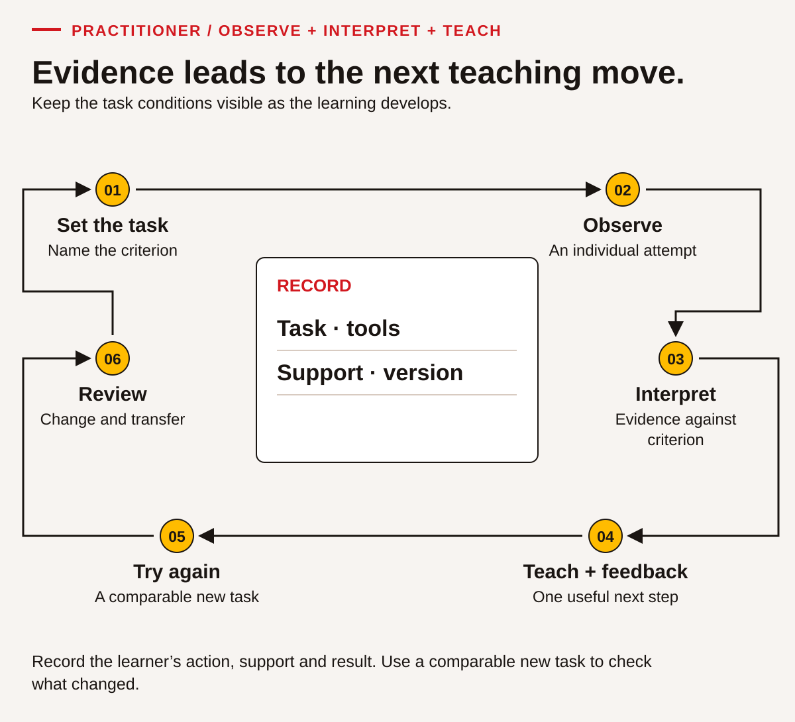
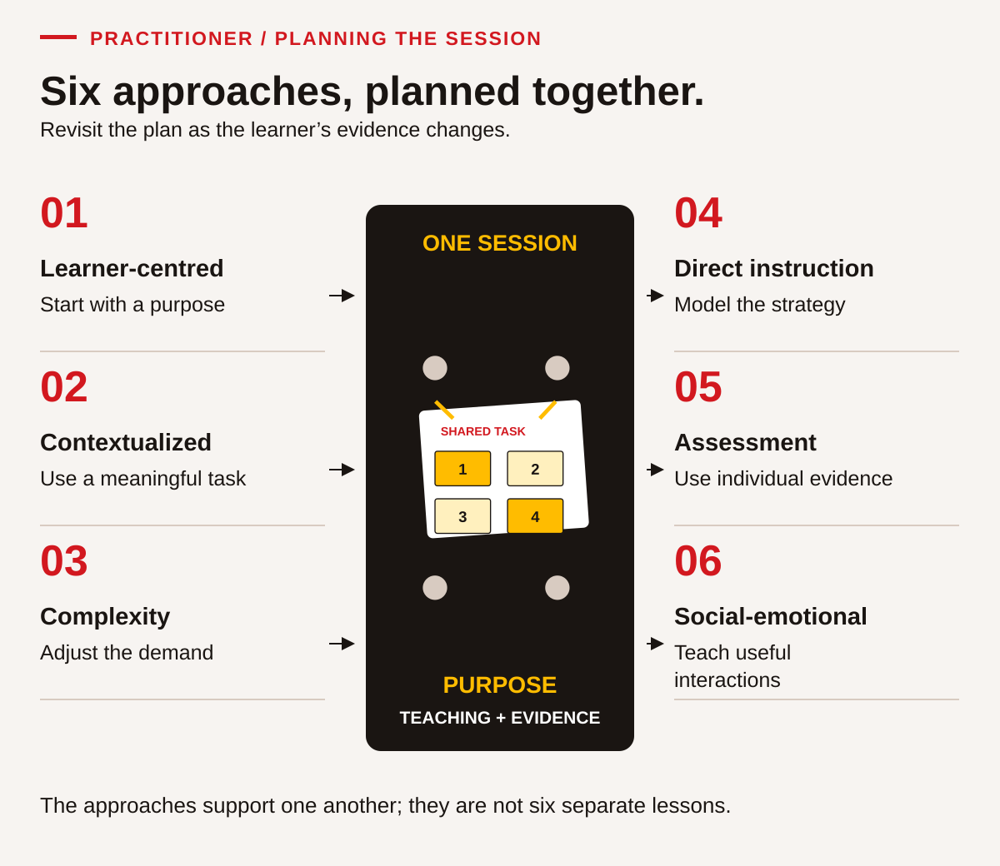

# Teaching the nine skills through useful work

This chapter turns the six overarching approaches in SkillPlan's guide into decisions an ACCESS IS4S practitioner can make before, during and after a session. The approaches work together. A relevant task can still be inaccessible; a welcoming conversation can still leave the skill unexplained; a polished group product can still hide one person's learning. Plan the task, the teaching and the evidence together.

The examples below are original classroom simulations. They can be used in an asphalt preparation cohort, another trades pathway or a broader employment and community learning program. They do not establish an employer's procedures or a Nation's protocols. Local partners and learners help determine which examples matter, and a learner can use the supplied case without sharing a personal experience.

## 1. Begin with the learner's purpose and existing knowledge

A useful first meeting is a conversation about a goal, a task and a workable next step. It need not begin with a test or a request to describe everything that has been difficult. Someone who has managed a household budget, repaired equipment, cared for relatives, organized travel or learned a new language brings knowledge to the room. The practitioner still needs evidence of the particular skill being taught; recognizing experience does not mean assuming a skill is already demonstrated.

Invite the learner to choose a practical goal. “I want to understand a training schedule without missing a change” is specific enough to plan instruction. “I want to improve all my skills” can be narrowed by asking which situation would make the next week easier. Offer examples when a learner is uncertain. A person does not need a settled career plan to take part.

Explain what information will be recorded, why it is useful and who normally sees it under the program's actual procedures. Ask about supports privately. A learner can request larger print or a quieter place without giving the class a diagnosis. An Indigenous learner is not required to name a Nation, discuss family history, explain a ceremony or become the class's cultural resource. Invite knowledge; do not make disclosure the price of participation.

### A ten-minute starting conversation

| Prompt | What the practitioner listens for | Possible next action |
|---|---|---|
| What would you like to be able to do more easily? | A task or purpose chosen by the learner. | Select a relevant chapter activity together. |
| Where have you done something similar? | Existing strategies and experience, including outside paid work. | Ask whether the learner wants to demonstrate a strategy. |
| Would you rather begin with this notice, this table or a short conversation? | A workable entry point, not a permanent learning-style label. | Offer a brief task in the selected format. |
| What would make this easier to access? | Print, language, device, pace, communication or environmental supports. | Arrange a specific support and record only what is necessary. |
| What should we look at again after practice? | A shared success criterion. | Set a review point and retain the first attempt if the learner agrees. |

This conversation provides starting information, not a diagnosis. Avoid turning a preference into a fixed category such as “visual learner.” Someone may prefer a diagram for equipment parts and an oral explanation for an unfamiliar form. Ask what helps for this task, then check whether the support actually helps.

### Make choice real without removing the outcome

Suppose the outcome is to identify the date, location and required action in a notice. Offer the same notice in large print, accessible electronic text and a normal print copy. A learner may use text-to-speech; record that support. If the outcome is independent reading without an audio support, that different condition needs its own observation. The accessible attempt remains useful evidence of supported comprehension.

For a writing task, a keyboard, speech-to-text or a scribe can preserve learner authorship when the learner chooses the wording and revises the text. A conversation about what someone might write is preparation, not the final writing product. For a listening task, requiring a long written report may introduce a writing demand that obscures comprehension. Ask for a spoken, signed, AAC or other accessible check-back that lets the learner show the intended communication action.

Choice also concerns subject matter. A learner may use the fictional training-room notice rather than a real medical appointment or family message. The skill demand can remain comparable while the personal exposure changes. This is a practical way to respect boundaries without lowering the expectation that the learner locate, interpret and use the information.

### Build a small individual learning plan

Use a plan that can be read during a conversation rather than filed away after intake. A completed example might say: “Goal: check a changed session time. Starting evidence: found the room and date; used the old time after reading a correction. Support: two versions displayed side by side. Teaching: compare version labels before answering. Next attempt: another notice with one changed field. Review: next session.” This is more useful than “weak reading” because another practitioner can act on it.

The learner's goal can change. Record the change and its reason without treating it as failure. A person may discover that digital file organization matters more immediately than a longer report. Keep the agreed pathway visible, with opportunities to return to earlier goals. Learning ownership is supported by clear choices and dependable follow-through, not by leaving someone alone with an unfamiliar task.

## 2. Choose a context that makes the skill necessary

Contextualized teaching connects a skill to a purpose the learner can recognize. The document, decision and consequence should fit together. A fabricated pay table used to practise arithmetic is a simulation. A current employer-issued record used with permission is an authentic workplace document. Both can support learning, but label them accurately and choose them for different reasons.

Start with a task sentence: “A new crew member needs to know where to report and whom to contact if the information conflicts.” Identify the documents the person would actually consult. Then identify what the learner must do with them: locate a name, compare two dates, recognize a missing approval, calculate a total or ask a clarification question. These actions determine the teaching. A decorative photograph of a construction site does not by itself make an unrelated worksheet occupationally relevant.

For asphalt preparation, the supplied A1 outline provides a useful content boundary: introduce the industry, equipment purposes, resources, users and project information. The nine foundational skills help learners understand and communicate that content. An equipment-name matching activity does not demonstrate machine operation. A fictional project budget does not establish the real cost of a paving job. State the boundary where it affects what the learner may conclude.

### Build a document set from a real task

Use the following sequence when creating or selecting materials:

1. Name the person who needs the information and the decision they must make.
2. Identify the relevant document type: notice, schedule, label, form, table, drawing, message or procedure.
3. Check the document's source, date, version, scope and intended users.
4. Check whether personal or organizational information must be removed and whether classroom use is authorized.
5. Identify the exact reading, writing, mathematical, digital or interaction demand.
6. Prepare a simpler entry version if needed, preserving the meaning of the task and marking alterations.
7. Create a new but comparable task for a later independent attempt.

To find suitable documents, begin with people and organizations responsible for the work. A subject-matter expert or employer can identify the forms, schedules and instructions actually used in a task. Regulators and government agencies provide current requirements within their authority; industry associations, trade publications and public company resources offer other useful examples. Academic partners and established training networks may help locate material or arrange a practitioner conversation. Check the source and version rather than assuming that a familiar logo makes a document current. Agree permission, removal of private information, attribution and classroom use before adapting material. A professional forum or social post can supply a lead, but trace a claim to the responsible source before teaching it as a requirement. These routes adapt the practical collection guidance on source page 28.

Do not remove a key condition merely to make a task easier. If a schedule says “arrival at 8:45; instruction starts at 9:00,” simplifying it to a single time removes the distinction the learner may need to understand. Instead, highlight the two labels and model how to explain their relationship.

### A complete practice document: two versions of a notice

> **Fictional training notice — version 1, issued Monday**
>
> The classroom materials session is on Wednesday in Room 3. Arrive at 8:45 a.m. Instruction begins at 9:00 a.m. and finishes at 11:30 a.m. Bring your workbook and a pencil. If travel arrangements affect your arrival, contact the training coordinator before the session. No equipment operation is scheduled.

> **Fictional correction — version 2, issued Tuesday**
>
> Wednesday's materials session will use Room 5. Arrival and instruction times are unchanged. The coordinator will place a printed correction at the original room. Use version 2 for the room information. If you cannot confirm which notice is current, ask the coordinator before making a new arrangement.

This short set supports several distinct outcomes. Reading: identify what changed and what stayed the same. Numeracy: distinguish the 15-minute arrival interval from the 150-minute instruction period. Writing: prepare a concise correction for a classmate. Communication: check that the classmate understands the new room. Digital: save the two files with meaningful version names, if actual device use is part of the activity. Problem solving: decide what to do when only an undated screenshot is available.

The same set does not automatically demonstrate all nine skills. Collaboration would require a shared goal and observable contributions. Adaptability would require a first plan and an adjustment. Creativity and innovation would require developing and trying an improvement. Add those actions deliberately when they are intended outcomes; otherwise keep the lesson focused.

### Make B.C. and community context specific without inventing culture

Travel distances, winter daylight, a ferry connection, an urban bus route or a shared device can be relevant to B.C. learners. Use an accurate current source for a real service, or label the timetable as fictional. Do not assume that every Indigenous learner lives remotely or that every learner in a city has reliable transport. Ask which conditions matter in the cohort and provide an alternate case.

A community event can be a useful context for scheduling, budgeting and communication. The class can plan an ordinary open learning session using supplied information. It should not invent the protocol for a ceremony, assign cultural roles or use a Nation's name as a fictional setting. If a local partner contributes a real example, agree on the purpose, the material that may be shared, attribution, review and future reuse. Record the decision as a specific agreement, not a general claim that the curriculum is community approved.

When learners choose to contribute examples, ask whether they want the example discussed, recorded, adapted or only heard in that moment. These are different decisions. An oral contribution is not automatically permission to publish a story in a workbook. A learner may withdraw an example from further classroom use while continuing with the supplied case.

## 3. Change complexity deliberately

Difficulty can come from unfamiliar vocabulary, the number of documents, the need to infer, competing information, the number of calculation steps, tool demands, time pressure or the consequences of an error. Changing several at once makes it hard to discover why a learner struggled. Begin by identifying the demand you intend to teach.

Use starting evidence rather than a general impression. A learner who finds a number in a table may still need help deciding what that number represents. Another learner may understand the reasoning but have difficulty navigating the spreadsheet. Those learners need different next steps. Neither observation supports a broad claim about intelligence or readiness for every task in an occupation.

The following progression uses the notice set above. These are local teaching stages, not official proficiency levels.

| Stage | Task | What changes | Useful support |
|---|---|---|---|
| Locate | Find the instruction start time in version 1. | One explicit fact in one short document. | Highlight the label “instruction begins.” |
| Connect | Explain why arrival and instruction have different times. | Relate two facts and their purposes. | Mark both phrases; draw a short timeline. |
| Compare | Identify the changed room using both versions. | Use two documents and version information. | Place the notices side by side. |
| Evaluate | Decide whether an undated screenshot is sufficient. | Judge source adequacy and identify missing information. | Use a source-check question list. |
| Transfer | Use a new notice with a changed date and a different layout. | Apply the strategy beyond the first example. | Agree in advance which supports remain available. |

Increase challenge after the learner can explain a strategy and use it with reasonable consistency. One correct answer may result from guessing or remembering the demonstration. Ask for a comparable new attempt and a short explanation. Repetition should strengthen a useful action, not simply repeat the same answer.

### Separate support from task demand

A scaffold is a temporary aid that makes a strategy visible: a labelled example, a partial table, a vocabulary list, a sentence starter or a worked first step. A calculator can be an ongoing work tool rather than something that must always be removed. Decide whether the assessment concerns mental calculation, tool-supported calculation or mathematical interpretation. Record the actual condition.

When reducing a scaffold, explain the change. “This time the headings are not highlighted; show me how you choose the useful one” makes the learning purpose visible. Removing every support without notice may reveal the effect of surprise more than the intended skill. Conversely, leaving a completed model beside an identical question may hide whether the learner can select the method independently.

Do not claim that a shortened text is automatically easy or that a longer text is automatically difficult. A two-sentence message with an implied deadline can demand more inference than a long, clearly structured notice. A large table with obvious labels can be easier to use than a small table with ambiguous units. Review the relationship among the question, the document and the required operation.

### Diagnose an error before changing the lesson

Suppose a learner answers that the training session lasts 165 minutes. That value describes 8:45 to 11:30, the arrival-to-finish interval. The arithmetic may be correct while the selected start time is wrong for the question. First ask the learner to point to the start label they used. Teach the distinction between arrival and instruction, then ask for the instruction duration again. Re-teaching subtraction alone would miss the problem.

For a different learner, the correct times may be selected but 9:00 to 11:30 may be reported as 230 minutes. Model hours and minutes as different units: two hours are 120 minutes; add 30 to obtain 150. Ask the learner to check whether 230 minutes is plausible for an interval shorter than three hours. These different responses call for different feedback even though both final answers were incorrect.

Record the teaching decision: “Selected arrival rather than instruction start; used heading comparison” or “Selected correct times; needs hours-to-minutes conversion.” This gives the next practitioner useful information and lets the learner see a specific, manageable next step.

## 4. Make the strategy visible through direct instruction

Direct instruction is an explanation and demonstration of a usable process, followed by practice and feedback. It does not require the practitioner to speak for the whole session. A short, clear model can give learners more time to make choices, try an approach and discuss what happened.

Name the outcome before the demonstration. “Today we will check a change notice and explain the current arrangement” is more useful than “Today we are doing Reading.” Identify a small number of success criteria. In the notice example, the learner should name the current room, retain the unchanged start time, identify which version supports the answer and state what to do if the version cannot be confirmed.

Model the decisions as well as the answer. Point to a heading, explain why it matters, reject an irrelevant number and check the result. Include a plausible error and show how to recover from it. This makes checking a normal part of competent work rather than a response reserved for someone who is struggling.

### A worked practitioner demonstration

The practitioner displays both notices and says:

> “The question asks where to go on Wednesday. I see two room numbers, so I should not choose the first one I notice. I check the version information. Version 2 was issued later and says the room has changed to Room 5. It also says the times are unchanged. I can answer: arrive at Room 5 at 8:45 for instruction at 9:00. My answer uses the correction for the room and the first notice for the times. If I had only the undated screenshot, I would ask the coordinator which version is current.”

Pause after each decision. Ask a learner to identify the evidence rather than repeat the entire speech. Then cover the answer and give a similar notice about a different room. The demonstration taught a method; the new example reveals whether the learner can use it.

### Plan the release of responsibility

| Phase | Practitioner does | Learner does | Evidence worth keeping |
|---|---|---|---|
| Show | Models a question, source choice, action and check. | Follows the reasoning and asks a clarification. | A question showing which step is unclear. |
| Work together | Prompts one decision at a time and checks understanding. | Chooses a heading, operation or message with support. | The particular prompt that helped. |
| Try with a partner | Gives roles and observes both contributions. | Takes a turn, checks a partner's reasoning and keeps an individual response. | Each person's action, not only the shared sheet. |
| Try independently | Provides a comparable new task and agreed supports. | Selects and applies the process. | An individual attempt under recorded conditions. |
| Revisit | Gives specific feedback and another opportunity. | Makes an improvement and explains what changed. | The before-and-after work and next goal. |

The sequence can move backward when needed. Returning to a model is a teaching response, not a penalty. It can also move forward more quickly when the learner demonstrates the strategy. Do not require a person to complete unnecessary repetition merely because every worksheet was printed.

Use prompts that preserve thinking. “What does that column count?” invites interpretation. “Write 24” supplies the answer. If a learner needs the second kind of help during instruction, provide it openly and record the supported condition. For an independent check, change the values or document enough that copying the earlier response cannot substitute for the skill.

### Explain technical language in use

Introduce a term when it helps solve the task. In an asphalt example, distinguish an aggregate from the asphalt mixture before asking learners to explain the material flow. Ask learners to use the term in a sentence or match it to a purpose. A long glossary handed out before any context may create an unnecessary memory demand.

Use plain language without removing technical accuracy. A definition such as “a paver receives and places the mixture” introduces purpose. It does not teach operating settings. Point to the appropriate technical instructor or current approved document when a learner asks about an operational decision. Showing where the boundary lies is part of responsible document use.

When modelling communication, make the interaction visible. Demonstrate a check-back with another adult or use a short supplied script. Show an incomplete exchange, then improve it by clarifying the action and deadline. Ask learners what changed in the message and what changed in the interaction. This provides concrete teaching for Communication and Collaboration rather than assuming they will develop simply because people sit together.

## 5. Collect evidence that can guide the next lesson

<!-- visual:teaching-evidence-cycle--practitioner-02 -->
<figure class="teaching-figure diagram" data-visual="teaching-evidence-cycle--practitioner-02">

<figcaption>Visual guide An observed attempt informs the next teaching move. Keep the task, tools, support and version with the evidence; review transfer through a later task. <a class="visual-original" href="../assets/diagrams/teaching-evidence-cycle.svg">Open full-size visual</a></figcaption>
</figure>
<!-- /visual:teaching-evidence-cycle--practitioner-02 -->

Assessment should answer a useful question: what can this learner do under these conditions, and what teaching or practice should follow? It should not turn a short activity into a judgment about the person. Decide what evidence would support the intended claim before choosing an assessment format.

A starting task helps select instruction. Formative checks guide teaching while learning is underway. An end-of-unit task shows performance against the unit's stated outcomes. A later unfamiliar task can provide evidence of transfer. These purposes overlap, but the conclusions differ. Completing the same worksheet twice may show recall and improved familiarity; it does not automatically establish general transfer or a validated skill-level gain.

Use comparable conditions when interpreting change. Record task version, support, time conditions and response mode. If the second attempt is easier, or the learner receives more help, explain that difference. Improvement can still be meaningful, but a score alone will not tell the whole story. For formal program reporting, follow the program's approved assessment method rather than treating this book's observation descriptions as a standardized scale.

### Four local evidence descriptions

| Description | Meaning in this curriculum | Example |
|---|---|---|
| Not observed | The necessary evidence has not been collected. | No device turn occurred, so saving and reopening a file was not observed. |
| Not yet demonstrated | An observed attempt does not yet meet the stated task criterion. | The learner selected an outdated notice after comparing both versions. |
| Demonstrated with support | The criterion was met using identified assistance. | The learner found the current notice after a prompt to compare version dates. |
| Demonstrated independently | The criterion was met independently under the recorded conditions. | The learner selected the correct notice and explained the version evidence without prompting. |

These descriptions are local teaching language. They are not the federal framework's proficiency levels, a trade grade or a permanent learner label. A person may demonstrate a calculation independently and need support interpreting its context. Record the two observations separately.

### A usable observation record

| Field | Completed classroom example |
|---|---|
| Learning ID and date | Practice learner L 04; session date recorded locally. |
| Task and version | Training notice, versions 1 and 2; changed room. |
| Focus skill and criterion | Reading: connect the correction to the unchanged time information. |
| Evidence | Named Room 5; retained 8:45 arrival and 9:00 instruction; pointed to both notices. |
| Support | Printed notices side by side; no verbal prompt during the final attempt. |
| Feedback description | Demonstrated independently under these conditions. |
| Feedback | “You checked the version and used both documents. Next, try a notice with a changed date.” |
| Next attempt | New event notice in another layout, with a date change. |
| Transfer note | Planned; no later unfamiliar-task evidence collected yet. |

Avoid entries such as “good attitude,” “not motivated” or “naturally weak with numbers.” They do not identify the skill, the conditions or a teachable next step. If participation is interrupted, record the interruption separately and arrange another opportunity. A missed observation is not the same as an unsuccessful attempt.

### Check validity, fairness and consistency

A task is useful when the evidence matches the intended claim. If Reading is the focus, a difficult login should not decide the result. If Writing is the focus, a partner's polished paragraph should not be attributed to the learner. If Collaboration is the focus, observe how contributions are invited, negotiated and combined. The finished poster alone cannot show those interactions.

A fair process provides access to the task while keeping the intended skill visible. Offer appropriate supports, explain the criteria and allow a way to raise a concern. Check whether unfamiliar cultural assumptions or personal disclosure requirements are affecting the task unnecessarily. If the question depends on knowing a particular event or family arrangement, provide that information in the case or offer a comparable alternative.

For consistent interpretation, practitioners can review two anonymized samples together. Each identifies the criterion, evidence, support and proposed feedback before comparing judgments. Discuss disagreements by returning to the task and the evidence. This is a moderation conversation, not a contest to see whose first impression was correct. Keep a short agreed example of what meets the criterion with and without support.

### Give feedback the learner can use

Useful feedback identifies a successful action, a specific issue and a next attempt. “You used the correct rows and labelled the total in dollars. The percentage used the other group as the whole. Show me the complete group first, then try the fraction again” provides direction. “Try harder” does not.

Do not overload the learner with every possible correction. For a short project note, first address a wrong date or an unclear action that could mislead the reader. Then choose one language improvement that helps meaning. A later task can focus on a different writing feature. Explain the priority so the learner understands that other features have not simply been ignored.

Invite the learner's interpretation: “What did you intend here?” or “Which check would help you catch this next time?” The learner may reveal a reasonable method, a misunderstood instruction or a missing piece of source information. Revise the teaching decision when the evidence warrants it.

### Evaluate the program without overstating results

A pilot can reveal unclear prompts, inaccessible files, timing problems and useful learning strategies. It cannot by itself prove that the curriculum causes employment outcomes. Report what was measured: attendance opportunities, completed task attempts, documented changes under comparable conditions, learner feedback and later transfer observations where available.

A small feedback form can ask whether the task purpose was clear, which support was useful, what still needs explanation and what the learner would change. Provide an anonymous or private route where practical. Do not make praise a condition of a supportive relationship. Include critical feedback in the revision record and explain what will change.

If a program collects employment or further-training outcomes, distinguish those outcomes from skill observations and record the time period and collection method. Many factors influence work and education pathways. A claim that everyone improved or that a book guarantees readiness requires evidence this draft does not supply.

## 6. Teach social and emotional skills as actions

Problem Solving, Communication, Collaboration, Adaptability, and Creativity and Innovation are taught throughout this curriculum. They are also given their own chapters because naming a skill during a group exercise is not enough. Learners need examples, a process to try, feedback and another opportunity.

Assess actions that can be observed or explained. A learner can identify a change, decide what to preserve, ask for support and revise a plan. Those actions provide evidence of Adaptability. The practitioner does not need to infer whether the learner felt calm. A learner can disagree respectfully, explain the evidence and propose a next step. That can support Collaboration even when the learner does not adopt the first suggestion offered.

Do not equate these skills with compliance. Appropriate persistence includes deciding when to seek help, change an approach or stop an unsafe or unsuitable task. Responsibility includes communicating a limit and arranging a handover. A request for a break or clarification can be part of an effective strategy. The criterion is the task-relevant action and its consequences, not whether the learner looks cheerful or performs a preferred personality style.

### Teach a response to a low-stakes change

Use a classroom information sheet rather than a surprise involving a learner's real employment or personal life. First explain the task and allow a draft. Then introduce a modest change: the visitor has less reading time, the printout will be black and white, or a room is unavailable. Make the change understandable and provide time to respond.

Model a routine: pause; name what changed; identify what must remain; generate options; choose a next step; check the revised result. Ask the learner which strategy helped. Keep the first draft, the change note and the revision. These provide better evidence than a practitioner's impression that someone “handled change well.”

Do not create distress to test emotional regulation. Skills practice is not therapy or a crisis simulation. If a learner is affected by the activity, offer an alternative and use the program's established support procedures where needed. The practitioner can support learning without asking for the history behind a response.

### Make teamwork teachable

Before a paired task, state the common goal and show what useful interaction looks like. For a checked table, one learner may explain the selected row while the other checks units and asks a clarification. Swap roles so both use the skill. Roles should create access to participation, not permanently assign one person as the expert and another as the recorder.

Teach a disagreement routine using a harmless document question: each person states their interpretation; the other restates it; both point to the evidence; the pair identifies agreement, uncertainty and a next step. If the document is ambiguous, the appropriate result may be a question for the coordinator rather than a forced consensus.

Observe the interaction. Did the learner make a contribution, consider the other person's information, ask a useful question and help reach a shared next action? Did each have an opportunity to use the tool or explain a decision? Record a concrete example. A group can produce an incorrect answer while showing a useful collaborative process, and a correct answer can be produced through an unfair process. Teach and assess both dimensions deliberately.

### Use reflection without demanding personal disclosure

Reflection can be brief and practical: “Which information changed your decision?” “What did your partner help you notice?” “What will you check first next time?” Learners may answer through a chosen accessible mode. A written emotional history is not necessary to demonstrate a task strategy.

A learner's explanation is valuable evidence, but distinguish a stated intention from an observed action. “I will use a checklist at work” is a transfer plan. A later example showing the checklist used on an unfamiliar task provides additional evidence. Recognize both without treating them as identical.

Avoid fixed labels in feedback. Say, “You tried two layouts and tested them with a reader” rather than “You are a creative type.” Say, “You noticed the missing source and asked before using the number” rather than “You are naturally careful.” Action-focused language helps the learner identify a strategy that can be used again.

## Bring the six approaches into one session

<!-- visual:teaching-six-approaches--practitioner-02 -->
<figure class="teaching-figure diagram" data-visual="teaching-six-approaches--practitioner-02">

<figcaption>Visual guide Plan purpose, context, complexity, modelling, evidence and participation together. Revisit these decisions when the learner’s evidence changes. <a class="visual-original" href="../assets/diagrams/teaching-six-approaches.svg">Open full-size visual</a></figcaption>
</figure>
<!-- /visual:teaching-six-approaches--practitioner-02 -->

The following plan is a complete 45-minute example using the two fictional notices in this chapter. It can introduce a longer learning sequence. Its timing is a proposed classroom design, not an official Skills for Success allocation.

| Minutes | Teaching action | Evidence |
|---|---|---|
| 0–5 | Invite a useful purpose for reading a changed notice; offer the supplied example. State criteria and access options. | Chosen purpose and agreed supports. |
| 5–12 | Model version checking and connecting room/time information. | Learner identifies the evidence used in one step. |
| 12–20 | Guide practice with both notices; ask each learner to explain one unchanged and one changed detail. | Supported response and the prompt needed. |
| 20–30 | Pairs prepare and check a two-sentence correction; swap speaker/listener roles. | Individual check-back and shared corrected message. |
| 30–40 | Give the independent notice pair below, with a changed date; collect an individual response under agreed conditions. | Current date selected, source identified and uncertainty handled. |
| 40–45 | Give specific feedback; ask for a next practice choice and record a recheck. | Feedback, learner goal and next attempt. |

The six intervals total 45 minutes. The session is learner-centred through purpose and choice, contextualized through a useful document, controlled in complexity through one change at a time, explicit through modelling, assessed through individual evidence, and socially supported through taught check-back and shared work. These are planning decisions the practitioner can explain and revise.

### Independent notice pair for minutes 30–40

> **Fictional practice notice A — issued 1 May**
>
> The classroom resource session is on 14 May in Room 4. Arrive at 8:30 a.m. Instruction runs from 8:45 a.m. to 10:15 a.m. Bring a workbook and pen. This is an indoor classroom session. Ask the training coordinator if you cannot confirm the current arrangement.

> **Fictional correction B — issued 2 May**
>
> The resource session described in notice A has moved from 14 May to 21 May. Room 4, arrival time, instruction times and materials are unchanged. Use this correction for the date. The dates are invented practice values, not an actual booking.

Ask each learner to identify the current date, room, arrival time and instruction period; point to the source for each; and explain what they would do if they had only an undated screenshot showing 14 May. A brief spoken, signed, AAC or written response can carry the explanation under the agreed assessment conditions.

**Answer guidance:** 21 May, Room 4, arrival at 8:30 a.m., instruction from 8:45 to 10:15 a.m. Correction B establishes the date and preserves the other details from notice A. An undated screenshot alone does not establish the current arrangement; check the current notice with the coordinator. Record any prompt needed. A learner who gives the right date but cannot connect the unchanged details may need another cross-document reading example.

### A reusable planning page

Before teaching, complete these fields in ordinary sentences: learner purpose; document and source status; focus component; observable outcome; model; guided attempt; independent attempt; supports; likely misconception; feedback; next task. After teaching, add actual timing, evidence gaps and one change for the next delivery.

For example, an observation that “four learners could find the updated room but could not explain the unchanged time” suggests returning to cross-document connections. It does not justify repeating the same room-number question for the whole group. A finding that only one device was available suggests a scheduling change before interpreting Digital results. Practical revision connects the program's conditions to the evidence it is able to collect.

## Source connection

This chapter reworks the instructional content of SkillPlan's *Skills for Success Get Started Guide for Practitioners* (March 2024), [pp.24–43](../../asphalt-paving/sources/SFS-Get-Started-Guide_FINAL_MAR2024.pdf#page=24): learner-centred teaching 24–25; contextualization 26–31; complexity 32–34; direct instruction 35–36; assessment 37–39; and social-emotional teaching 40–43. The original's broad effectiveness claims are not presented here as findings from an ACCESS pilot. Its cited third-party studies remain references in that supplied guide unless separately reviewed in the research ledger.

Current federal definitions and component guidance were also checked on the [Skills, components and proficiency levels page](https://www.canada.ca/en/services/jobs/training/initiatives/skills-success/learning-steps.html), accessed 23 October 2026. Local observation descriptions in this chapter are deliberately distinct from federal proficiency descriptors. B.C. source findings and their applicability limits are recorded in the companion research notes.
