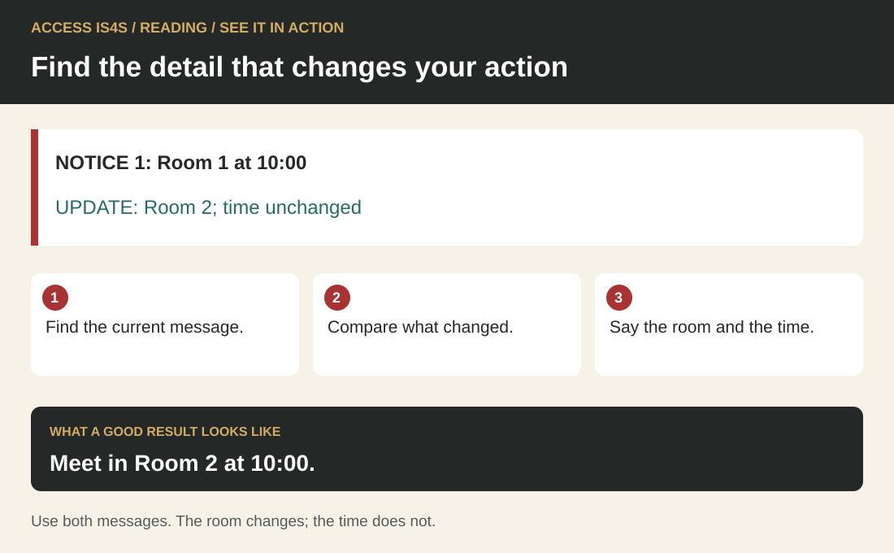

# Teaching Reading: make the search and the reasoning visible

Reading instruction begins with a reason to use a document. An adult may understand a paragraph yet miss the condition that decides whether a journey works. Another may understand the decision when it is spoken but need explicit support with words on the page. Those observations call for different teaching. Begin with a useful task, watch the learner's route through it, and teach the part that is getting in the way.

The learner chapter uses invented training notices, timetables, project briefs and borrowing conditions. Their familiar purposes create useful connections with work and community life in British Columbia without requiring personal disclosure. Invite learners to suggest other document types they encounter. An invitation to share experience is optional; it does not make anyone a representative of a Nation or community.

## See it in action · Reading

<!-- visual:quick-reading--practitioner -->
<figure class="teaching-figure diagram" data-visual="quick-reading--practitioner">

<figcaption>Visual guide Meet in Room 2 at 10:00. ACCESS IS4S. (2026). Original fictional teaching diagram. <a class="visual-original" href="../assets/diagrams/quick-reading.svg">Open full-size visual</a></figcaption>

Read the visual description

NOTICE 1: Room 1 at 10:00. UPDATE: Room 2; time unchanged. Find the current message. Compare what changed. Say the room and the time. Meet in Room 2 at 10:00. Use both messages. The room changes; the time does not.

</figure>
<!-- /visual:quick-reading--practitioner -->

This small fictional example shows the skill in use. NOTICE 1: Room 1 at 10:00. UPDATE: Room 2; time unchanged.

**Try it:** Find the current message. Compare what changed. Say the room and the time.

**Check your result:** Meet in Room 2 at 10:00. Use both messages. The room changes; the time does not.

## Keep all six components in view

<!-- visual:foundation-reading-map--practitioner-03 -->
<figure class="teaching-figure diagram" data-visual="foundation-reading-map--practitioner-03">

<figcaption>Visual guide Use the component numbers as an index, not a compulsory sequence. A missing date, unfamiliar word or changed question can send you back to another action. <a class="visual-original" href="../assets/diagrams/foundation-reading-map.svg">Open full-size visual</a></figcaption>

Read the visual description

An original task illustration occupies the left panel; six numbered actions appear on the right. Let the question and document guide your next move. Six connected components: Identify the reading task; Find the information; Connect related details; Understand and apply; Evaluate the document; Reflect on the document. Return to any action when you need to check meaning or evidence.

</figure>
<!-- /visual:foundation-reading-map--practitioner-03 -->

Teach six connected Reading actions: identifying the reading task; identifying information; connecting parts; understanding and applying information; evaluating documents; and reflecting on documents. Reading includes using documents in different forms. Tables, forms, maps, charts and drawings require deliberate instruction in headings, legends, relationships and conditions, not only practice reading paragraphs.

Move from a clear reading purpose to finding and connecting details. Practise judging claims and versions, then examine who the document serves and what a summary leaves out. Finish with a new document and an explanation of the reading choices. Use the named activities in the learner chapter; return to an earlier step when a new question requires it.

## Teach with documents that have a purpose

<!-- visual:foundation-reading-versions--practitioner-03 -->
<figure class="teaching-figure diagram" data-visual="foundation-reading-versions--practitioner-03">

<figcaption>Visual guide Use the matching audience and explicit replacement statement, then follow the check-in instruction. This shows Welcome Note version 2 before the later RD-12 update. <a class="visual-original" href="../assets/diagrams/foundation-reading-versions.svg">Open full-size visual</a></figcaption>

Read the visual description

Two document specimens show an earlier introductory-group draft with Room 3 and a version 2 notice that explicitly replaces it, names Room 2 and requires check-in first. A route below moves from the entrance to reception during 08:40–08:55, then to Room 2 after check-in.

</figure>
<!-- /visual:foundation-reading-versions--practitioner-03 -->

Use purposeful work with authentic documents. A real document has been created for an actual activity beyond the class. The learner cases are simulations: label them that way. Their advantage is that all learners receive the same information and nobody needs to expose an employment record, private correspondence or community document. Later, introduce a current, permission-cleared public document and ask what changes when the audience and consequences are real.

Before distributing it, identify the decision a reader must make and check that the document actually supplies the information. Prepare one locate question, one connection question and one question about a limitation. Let learners preview the title, publisher, date, headings and structure. Ask them to predict where they would search. After reading, return to the prediction: which feature helped, and which needed closer attention? This routine makes document design part of instruction.

## Build foundations without lowering the purpose

<!-- visual:reading-together--practitioner-03 -->
<figure class="teaching-figure scene" data-visual="reading-together--practitioner-03">

<figcaption>Teaching scene Make the reading purpose visible: compare the documents together and identify the detail that changes an action. Illustrative scene; use the precise case documents for the task. <a class="visual-original" href="../assets/illustrations/reading-together.png">Open full-size visual</a></figcaption>

Read the visual description

Two fictional Indigenous adults compare revised notices and a paper timetable in a community learning centre.

</figure>
<!-- /visual:reading-together--practitioner-03 -->

Distinguish alphabetics, fluency, vocabulary and comprehension. A diagnostic conversation may reveal difficulty decoding a word, understanding its meaning, keeping a place in a table, or combining two conditions. Do not treat all four as the same problem. Model word analysis when needed; practise a useful word in several sentences; offer repeated reading of a short meaningful passage; and check understanding through a decision rather than copying.

RD-03 offers words such as *optional*, *replaces* and *applies*. Have learners underline nearby clues, try an explanation and test it in a second example. A bilingual glossary or private first-language note can support meaning. Avoid compulsory reading aloud in front of the group. A learner can rehearse privately, read with a partner, or ask for instructor support. When text-to-speech supplies access, record what it supported so that the evidence accurately describes the reading task attempted.

## A worked teaching routine

<!-- visual:foundation-reading-connection--practitioner-03 -->
<figure class="teaching-figure diagram" data-visual="foundation-reading-connection--practitioner-03">

<figcaption>Visual guide Arriving before departure is not enough: this timetable also requires a five-minute connection. Read the condition with the row. <a class="visual-original" href="../assets/diagrams/foundation-reading-connection.svg">Open full-size visual</a></figcaption>

Read the visual description

A proportional timetable shows B1 arriving at Market at 08:25. The required connection allowance is five minutes. B2 leaves at 08:28, giving only three minutes; B3 leaves at 08:32, giving seven. The earliest usable departure is 08:30. B1 plus B3 reaches Northside at 08:47; five minutes to reception gives 08:52, before the 08:55 deadline.

</figure>
<!-- /visual:foundation-reading-connection--practitioner-03 -->

For RD-05, display the fictional connection rule and timetable. Say: “The question asks whether B1 connects with B2. I need a condition as well as two times.” Mark the requirement for at least five minutes. B1 arrives at 08:25 and B2 leaves at 08:28: three minutes is insufficient. B3 leaves at 08:32, giving seven minutes. Point to both the paragraph and the row; a correct number alone does not show that the learner found the rule.

Next invite a pair to explain why merely arriving before departure is insufficient. Give a new pair of times while retaining the rule, then change the rule while retaining the times. This separates understanding from memorizing the first answer. Finally ask learners to identify what would need checking for a real journey. The classroom allowance is invented and must not become advice about an actual service.

Explain a systematic process, model it aloud, work collaboratively, guide another attempt and then release responsibility. A useful question routine is: identify requested information, locate a match, determine processing, and reject competing information. Skimming gives an overview; scanning locates a detail; close reading checks its conditions. Teach when to switch between them.

## Assess the route, then choose a next step

Collect a marked document and a short spoken or written explanation. Look for accurate location, connections, attention to limits and a justified decision. “Found the right row but omitted the paragraph's allowance” is useful feedback. “Needs better comprehension” is too broad to guide the next lesson. Use a second task after focused instruction to see whether the change holds.

Adjust complexity through document length, unfamiliar vocabulary, competing details, number of sources and depth of inference. Increase one demand at a time. A paper version can show whether navigation is masking reading; a simpler response mode can show whether writing is masking comprehension. Record supports and distinguish **Not observed** from an attempted performance that is **Not yet demonstrated**. Classroom feedback categories are not official proficiency ratings.

## Short routines and resource choices

Select a short reading routine to match the learning need. RD-02/RD-09 compare document features and purposes; RD-14/RD-17 ask learners to explain how they used conditions and found information; RD-06/RD-16 compare documented choices. Allow an initial attempt, teach the needed strategy and provide another opportunity with changed information.

Preview any selected document for adult relevance, accessibility and fit with the reading need. Keep technical instruction with the appropriate current provider. A historical trade document can teach version awareness without establishing today's requirements.

## Classroom exercise: choose the usable collection notice

Give each learner the following two fictional notices. Keep them visible during the task; the aim is using written information, not recalling a spoken message.

> **Notice A — version 1, replaced.** Collect the training folder at the main desk on Practice Tuesday, 09:00–09:20. Bring the collection card.
>
> **Notice B — version 2, current.** The folder collection described in version 1 is now on Practice Wednesday, 10:00–10:20, at the side desk. Bring the collection card. If you cannot attend that window, ask the coordinator for another arrangement; no alternative time is confirmed in this notice.

Model one step: identify the words that establish which notice applies. Then ask learners to mark the current day, window, place and required item. Ask whether arrival at 10:25 meets the stated window and whether the notice guarantees an afternoon collection. Have each learner point to the words supporting a decision before comparing answers with a partner.

**Answer guidance.** Version 2 applies because it explicitly changes the collection in version 1. The current arrangement is Practice Wednesday, 10:00–10:20, side desk, with the collection card. A 10:25 arrival is outside the window. An afternoon collection is not established; the learner should ask the coordinator. A correct day with the old desk is an incomplete version check.

If vocabulary is the barrier, teach *replaced*, *current*, *window* and *confirmed* in these sentences, then have the learner reread the relevant passage. If navigation is the barrier, model moving between the version label and the detail that changed. Record the support and give another attempt.

For a changed task, supply: **“Correction to version 2: the day and desk stay the same; collection is now 11:00–11:20.”** Ask what changes and what remains. The answer is the new window only; the collection card is still required and an afternoon alternative remains unconfirmed. A learner who explains that connection has shown more than copying the nearest time.

<!-- teaching:reading-entry-bridge-practitioner -->
## Build a word, read a phrase, use its meaning

Practise privately, with a partner or through an agreed accessible format. No one needs to read aloud to the group. Keep track of whether you recognized the printed word yourself, used audio access or received help with its meaning. These are useful but different observations.

### Start with a small observation

Look at **return, returned, check, checked, available**. Identify a familiar word, use it in a classroom sentence and read a short phrase. If these words are already familiar, move to the notice practice. If a word becomes clear after someone says it, compare the spoken word with its letters and practise it in a useful phrase.

### See a useful word part

Compare **check → checked**. Point to the shared letters. Adding **-ed** here shows a completed action. In this word the ending sounds like /t/; the spelling still records **-ed**. Compare **return → returned**, where the ending sounds like /d/. The same spelling can have different sounds; use the whole word to check its pronunciation. Read “the helper checked the kit” and explain which action is complete.

Break **unavailable** into **un + available**: in this notice, **un-** reverses the meaning. Say the base word, read the whole word, then test its meaning in “The kit is unavailable today.” A word part is a clue; the sentence confirms whether that meaning fits.

Try with support: choose from **checked / check / unavailable / available**. Complete “Please ___ the code before the loan” and “The kit is ___ because it is already lent.” Explain your choice. Then compare “return pending” with “returned and checked.” Identify which record still needs an action.

### Read a short passage in meaningful phrases

> The practice desk opens at ten. / A helper checks the kit code / before handing over a folder. / The learner checks the return time. / If the folder is unavailable, / ask about another suitable resource. / Do not assume that a reserved item is free to take. / A learner can ask for a printed reminder / without explaining private reasons. / Keep the agreed return point / with the practice record.

Listen to one sentence read by your instructor if helpful, then explain its meaning. Read it together or reread a short chosen part, using the slashes as optional phrase guides. Answer: What happens before a folder is handed over? What should happen if it is unavailable? Return to the words that support the answers. Fluency here means readable phrasing that supports meaning; faster reading is not the goal.

### Fresh exit passage

Remove the model passage while using this new text:

> A learning pack is ready for collection at two. The helper must check its code before recording the loan. The pack includes a return slip. If a requested pack is unavailable, ask the helper to check another option. A reserved pack belongs to an agreed booking. Do not remove it without confirmation.

Identify **check**, **unavailable** and **reserved**. Explain the collection condition and what to do if the requested pack is unavailable. Reread after feedback if useful. Keep word help, phrasing help and comprehension help separate in your note.

**Check after your attempt:** collection is at two, subject to the helper's code check before the loan is recorded; ask the helper to check another option if unavailable; reserved is not unrestricted availability. If a word needs more practice, name it and ask for a useful example. When you can locate the condition with your agreed supports, continue to RD-03 and connect information from a short paragraph and table. You can agree more focused word-reading practice without repeating a whole long case.
<!-- /teaching:reading-entry-bridge-practitioner -->

<!-- teaching:reading-learner-checks-practitioner -->
## Reading · fresh document checks

Use the form selected by your instructor. Read the supplied documents and show which words, rows or conditions support your answers. You may mark the document and explain through an agreed communication mode. Writing polish is not the focus. Ask for the agreed access tools before starting. All information is fictional; do not visit or contact a real service.

### Form A · Pick up a practice kit

#### A1 · Earlier notice, issued Practice Monday

The introductory learning group can collect its reserved practice kits at Counter East on Practice Friday, 13:00–13:30. Bring the kit code and your learning ID. This is a classroom collection arrangement.

#### A2 · Correction, issued Practice Tuesday

**For the same introductory learning group and Practice Friday collection:** Counter West replaces Counter East. The collection window remains 13:00–13:30. Bring the kit code and learning ID as previously stated. A helper must check the current counter record before handing over a kit. This correction replaces A1's location only. A separate evening group uses Counter East at 17:00; that arrangement does not apply to this group. Ask the course coordinator when information cannot be confirmed.

#### A3 · Counter record for the exercise

| Kit code | Resource | Status | Collection condition |
|---|---|---|---|
| P14 | Large-print process cards | Reserved for the introductory group | Helper checks code and learning ID. |
| P18 | Standard process cards | In use | No return time has been supplied. |
| N22 | Number practice kit | Available | Helper checks the current record and agrees a loan. |

“Reserved” means set aside for the named group. “Available” means a loan can be discussed now, not that the item has already been booked. “In use” means currently lent. A request for a particular format does not require a learner to explain private reasons. The counter record says nothing about transport or a charge.

#### CK-RD-A01 · Find the current instruction

Where and when should the introductory learner collect P14? What must they bring, and what must the helper do? Mark the source for the location, unchanged time and collection condition.

#### CK-RD-A02 · Connect the records

A peer says, “I will go to Counter East at 17:00 because the correction mentions it.” Explain the problem using the audience and replacement wording. Then explain whether P14 and P18 can both be promised for collection at 13:00.

#### CK-RD-A03 · Check a summary

A proposed summary says, “All kits are ready. Bring identity documents to Counter West any time Friday. Transport is included.” Identify four unsupported or contradicted claims. For one claim, distinguish “the documents say something different” from “the documents do not say.”

#### CK-RD-A04 · Explain your next step

You receive an undated cropped image saying only “Counter East.” Explain what it cannot establish, where you would seek confirmation and one part of your reading process that helped you. Do not invent the coordinator's answer.

My evidence notes: write the task ID, answer, source and any unresolved question. An additional sheet or recorded oral response can be used.      

### Form B · Return a practice resource

#### B1 · Earlier notice, issued Practice Wednesday

The afternoon learning group returns borrowed folders on Practice Monday, 11:15–11:45, at the Materials Desk. Bring the folder code and your learning ID. Do not write a personal phone number on a folder.

#### B2 · Correction, issued Practice Thursday

**For the same afternoon learning group and Practice Monday returns:** use the Library Desk instead of the Materials Desk. The 11:15–11:45 window and code/learning-ID requirement stay the same. The desk helper checks the folder against the loan record and records its return; placing it on a desk alone does not confirm a return. This correction replaces B1's location only. The evening group's return to the Materials Desk at 18:00 is a separate arrangement. Ask the course coordinator about information that cannot be confirmed.

#### B3 · Loan record for the exercise

| Folder code | Record status | Required next step |
|---|---|---|
| F32 | Loaned to afternoon group; return due Practice Monday | Present to helper for return check. |
| F35 | Returned and checked | No second return is required. |
| F39 | Return reported, check pending | Helper must confirm against the loan record. |

“Check pending” means a necessary check has not yet been confirmed. It is different from a completed return. No penalty, charge or delivery service is specified. Learners can ask privately for an accessible way to identify the folder code.

#### CK-RD-B01 · Find the current instruction

Where and when should the afternoon learner return F32? What must they bring, and what must the helper do? Mark the source for the location, unchanged time and return condition.

#### CK-RD-B02 · Connect the records

A peer says, “I will go to the Materials Desk at 18:00 because the correction mentions it.” Explain the problem using the audience and replacement wording. Then explain whether F35 and F39 can both be recorded as checked returns.

#### CK-RD-B03 · Check a summary

A proposed summary says, “Every folder is checked in. Leave F32 at the Library Desk any time Monday. Bring your personal phone number; late returns cost $5.” Identify four unsupported or contradicted claims. For one claim, distinguish “the documents say something different” from “the documents do not say.”

#### CK-RD-B04 · Explain your next step

You receive an undated cropped image saying only “Materials Desk.” Explain what it cannot establish, where you would seek confirmation and one part of your reading process that helped you. Do not invent the coordinator's answer.

My evidence notes: write the task ID, answer, source and any unresolved question. An additional sheet or recorded oral response can be used.      

<!-- /teaching:reading-learner-checks-practitioner -->

<!-- teaching:reading-practitioner-notes-practitioner -->
## Reading · delivery, keys and criterion anchors

Use one fresh form from [Reading checks](../teaching/foundations/reading-learner-checks.md), keeping this key separate. Both forms ask the learner to connect a correction, a table and a condition, reject misleading details and identify a confirmation route. They sample purpose, information, connections, application, evaluation and reflection in one narrow context. They do not test every reading demand or establish a proficiency level.

### Route card

| Starting observation | Teaching decision | Next evidence |
|---|---|---|
| Learner understands an orally presented short notice but cannot reliably identify its printed words | Offer the [Reading bridge](../teaching/foundations/reading-entry-bridge.md); observe word recognition separately from comprehension. | Bridge exit passage, then a supported core RD-03 vocabulary task. |
| Finds the correct word/row but misses a condition or audience | Model core RD-05 or RD-12, marking the paragraph and row together. | Fresh Form A or B, with the original highlighted example removed. |
| Connects sources accurately but overstates an unknown | Use core RD-08/RD-10 to distinguish contradicted from not established. | New form question 03 and 04 with source evidence. |
| Meets all selected criteria | Agree a current permission-cleared public notice with a different layout. | Locate, connection and limit questions prepared from that actual notice; retain source/date and conditions. |

Do not use an audio-access attempt to claim unaided decoding. Conversely, do not deny independent comprehension with agreed audio access merely because that tool was used: name the construct and conditions. Oral, signed or AAC explanations can show comprehension without requiring polished writing. No speed or public reading-aloud threshold applies.

### Form A key

**CK-RD-A01:** Counter West, Practice Friday, 13:00–13:30; kit code P14 and learning ID; helper checks the current record/code/ID before handover. A2 explicitly changes the location and preserves A1's time/requirements; A3 supplies P14's reservation condition. No identity documents are requested.

**CK-RD-A02:** The 17:00 East arrangement is for a separate evening group. It does not replace the introductory group's West instruction. P14 is reserved for this group subject to the helper check; P18 is in use with no return time. Do not promise P18 at 13:00. N22's availability is not a booking.

**CK-RD-A03:** “All kits are ready” conflicts with P18's in-use status; “identity documents” changes the stated kit-code/learning-ID requirement; “any time” conflicts with the window; “transport included” is not established. Accept a careful distinction that the supplied identification requirement does not authorize requesting extra documents. Four corrections must preserve the exact source limits.

**CK-RD-A04:** The crop lacks date/version, audience and surrounding correction; it cannot establish the current location. Consult the course coordinator/current complete notice. Reflection should name an actual move such as checking the audience or retaining the unchanged time, with evidence from the attempt.

### Form B key

**CK-RD-B01:** Library Desk, Practice Monday, 11:15–11:45; F32 code and learning ID; helper checks against the loan record and records the return. Leaving a folder on the desk is insufficient. B2 changes only location and preserves the earlier window/identifiers.

**CK-RD-B02:** The 18:00 Materials Desk arrangement applies to the evening group. F35 is already returned and checked; F39 remains pending. Both cannot honestly be recorded as checked. No extra return is required for F35.

**CK-RD-B03:** “Every folder checked in” conflicts with F32/F39; “leave ... any time” omits the helper check and contradicts the window; “personal phone number” is not a requirement and conflicts with the no-number-on-folder direction if put on it; the $5 charge is not established. Accept four well-explained flaws; do not require an invented actual fee or penalty.

**CK-RD-B04:** The crop does not establish date/version, audience or current location. Obtain the complete current instruction through the coordinator. Accept a specific explanation of audience checking, version comparison, row tracking or recognizing missing information.

### Criteria and common errors

| Criterion | Observable evidence | Error that needs another attempt |
|---|---|---|
| R1 Locate and connect | Gives current desk and unchanged day/window, pointing to replacement and preserved details. | Chooses the unrelated group's location/time, or assumes all times changed. |
| R2 Apply a condition | Distinguishes reserved/in-use or checked/pending and retains the helper check. | Treats a status label as unrestricted permission or completion. |
| R3 Evaluate a claim | Corrects four summary flaws and identifies at least one stated conflict versus an unknown. | Fills an unknown with a confident invented fact. |
| R4 Explain a route and limit | Identifies what a crop cannot prove, gives the supplied confirmation route and explains an actual reading strategy. | Guesses a new instruction or gives a generic self-rating without evidence. |

Record each criterion separately. Essential destination/window/condition errors are not compensated by several correct minor details. Form B question 03 has more than four detectable flaws; any four accurate, evidenced flaws satisfy the stated task.

### Calibration examples

**Not yet demonstrated, R1:** “Counter East, 17:00; it is the newest notice.” The learner found newer text but did not match its audience. Teach that connection before a fresh attempt.

**With support, R1:** After the observer asks, “Which group does the 17:00 sentence name?”, the learner identifies West and the unchanged window with evidence. Record that exact solving prompt.

**Independent under agreed conditions, R1:** Using enlarged text and a line guide, the learner selects West, retains Friday 13:00–13:30 and points to A2's matching-group/replacement wording without a solving prompt. The access tools do not erase independence of the reading decision.

### Printable observation record

| Learning ID / date / form / prior exposure | |
|---|---|
| Agreed response mode and access tools | |
| R1 evidence / status | |
| R2 evidence / status | |
| R3 evidence / status | |
| R4 evidence / status | |
| Exact task-solving prompts, if any | |
| Feedback: one useful action and one next focus | |
| Retry form/date; criterion still to observe | |

Use the four local statuses in the foundation README. Give the other form after instruction if unseen; record its different context and any changed support. Do not claim the two forms are psychometrically equivalent. No completed moderation or pilot is implied by the calibration examples.
<!-- /teaching:reading-practitioner-notes-practitioner -->
