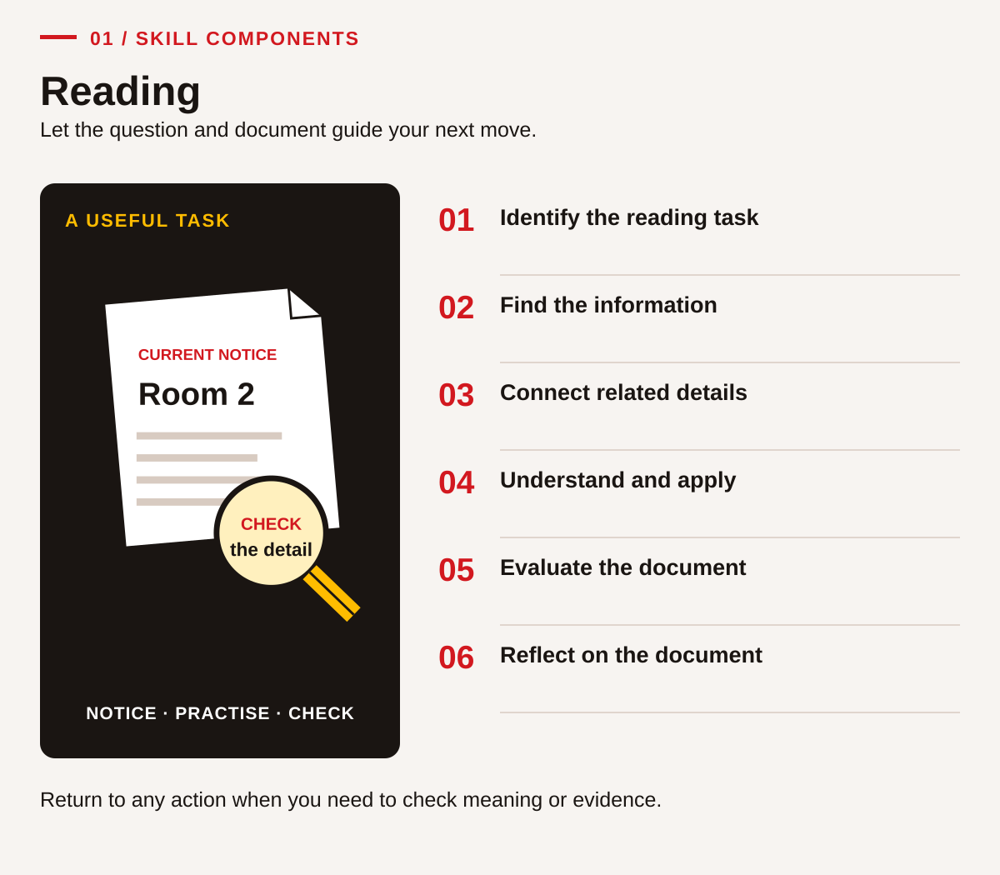
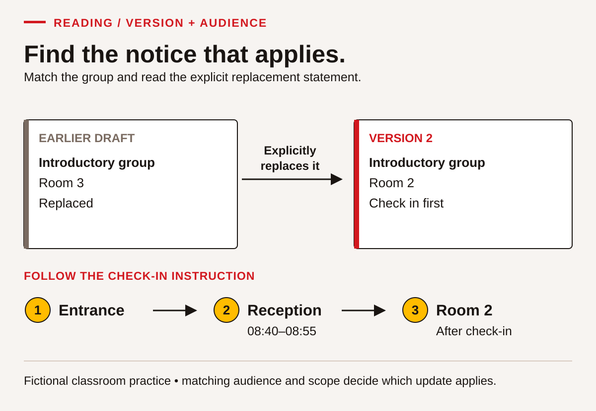
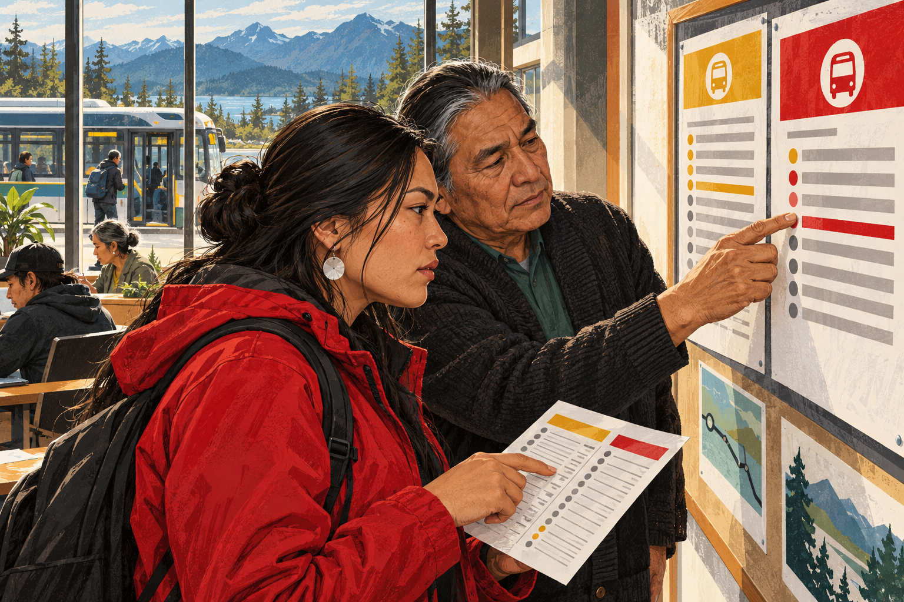
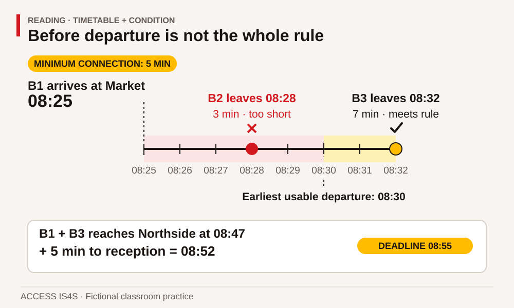

# Teaching Reading: make the search and the reasoning visible

Reading instruction begins with a reason to use a document. An adult may understand a paragraph yet miss the condition that decides whether a journey works. Another may understand the decision when it is spoken but need explicit support with words on the page. Those observations call for different teaching. Begin with a useful task, watch the learner's route through it, and teach the part that is getting in the way.

The learner chapter uses invented training notices, timetables, project briefs and borrowing conditions. Their familiar purposes create useful connections with work and community life in British Columbia without requiring personal disclosure. Invite learners to suggest other document types they encounter. An invitation to share experience is optional; it does not make anyone a representative of a Nation or community.

## Keep all six components in view

<!-- visual:foundation-reading-map--practitioner-03 -->
<figure class="teaching-figure diagram" data-visual="foundation-reading-map--practitioner-03">

<figcaption>Visual guide Use the component numbers as an index, not a compulsory sequence. A missing date, unfamiliar word or changed question can send you back to another action. <a class="visual-original" href="../assets/diagrams/foundation-reading-map.svg">Open full-size visual</a></figcaption>
</figure>
<!-- /visual:foundation-reading-map--practitioner-03 -->

SkillPlan identifies six Reading components: identifying the reading task; identifying information; connecting parts; understanding and applying information; evaluating documents; and reflecting on documents (2024, p. 45). The former Essential Skills category Document Use is integrated here and across other skills. Tables, forms, maps, charts and drawings require deliberate instruction in headings, legends, relationships and conditions, not only practice reading paragraphs (p. 46).

Use RD-01–RD-03 to establish purpose and vocabulary, RD-04–RD-09 for searching and connecting information, and RD-10–RD-12 for judging claims and versions. RD-13–RD-15 examine audience, conditions and the limitations of summaries. RD-16–RD-18 ask learners to transfer and explain their process. These are connected opportunities, not six separate tests. Numeracy becomes visible when a timetable requires elapsed time; Communication helps a learner explain a reading choice.

## Teach with documents that have a purpose

<!-- visual:foundation-reading-versions--practitioner-03 -->
<figure class="teaching-figure diagram" data-visual="foundation-reading-versions--practitioner-03">

<figcaption>Visual guide Use the matching audience and explicit replacement statement, then follow the check-in instruction. This shows Welcome Note version 2 before the later RD-12 update. <a class="visual-original" href="../assets/diagrams/foundation-reading-versions.svg">Open full-size visual</a></figcaption>
</figure>
<!-- /visual:foundation-reading-versions--practitioner-03 -->

The first source strategy is purposeful work with authentic documents (pp. 47–48). A real document has been created for an actual activity beyond the class. The learner cases are simulations: label them that way. Their advantage is that all learners receive the same information and nobody needs to expose an employment record, private correspondence or community document. Later, introduce a current, permission-cleared public document and ask what changes when the audience and consequences are real.

Before distributing it, identify the decision a reader must make and check that the document actually supplies the information. Prepare one locate question, one connection question and one question about a limitation. Let learners preview the title, publisher, date, headings and structure. Ask them to predict where they would search. After reading, return to the prediction: which feature helped, and which needed closer attention? This routine makes document design part of instruction.

## Build foundations without lowering the purpose

<!-- visual:reading-together--practitioner-03 -->
<figure class="teaching-figure scene" data-visual="reading-together--practitioner-03">

<figcaption>Teaching scene Make the reading purpose visible: compare the documents together and identify the detail that changes an action. Illustrative scene; use the precise case documents for the task. <a class="visual-original" href="../assets/illustrations/reading-together.png">Open full-size visual</a></figcaption>
</figure>
<!-- /visual:reading-together--practitioner-03 -->

The second strategy addresses alphabetics, fluency, vocabulary and comprehension (pp. 48–49). A diagnostic conversation may reveal difficulty decoding a word, understanding its meaning, keeping a place in a table, or combining two conditions. Do not treat all four as the same problem. Model word analysis when needed; practise a useful word in several sentences; offer repeated reading of a short meaningful passage; and check understanding through a decision rather than copying.

RD-03 offers words such as *optional*, *replaces* and *applies*. Have learners underline nearby clues, try an explanation and test it in a second example. A bilingual glossary or private first-language note can support meaning. Avoid compulsory reading aloud in front of the group. A learner can rehearse privately, read with a partner, or ask for instructor support. When text-to-speech supplies access, record what it supported so that the evidence accurately describes the reading task attempted.

## A worked teaching routine

<!-- visual:foundation-reading-connection--practitioner-03 -->
<figure class="teaching-figure diagram" data-visual="foundation-reading-connection--practitioner-03">

<figcaption>Visual guide Arriving before departure is not enough: this timetable also requires a five-minute connection. Read the condition with the row. <a class="visual-original" href="../assets/diagrams/foundation-reading-connection.svg">Open full-size visual</a></figcaption>
</figure>
<!-- /visual:foundation-reading-connection--practitioner-03 -->

For RD-05, display the fictional connection rule and timetable. Say: “The question asks whether B1 connects with B2. I need a condition as well as two times.” Mark the requirement for at least five minutes. B1 arrives at 08:25 and B2 leaves at 08:28: three minutes is insufficient. B3 leaves at 08:32, giving seven minutes. Point to both the paragraph and the row; a correct number alone does not show that the learner found the rule.

Next invite a pair to explain why merely arriving before departure is insufficient. Give a new pair of times while retaining the rule, then change the rule while retaining the times. This separates understanding from memorizing the first answer. Finally ask learners to identify what would need checking for a real journey. The classroom allowance is invented and must not become advice about an actual service.

This follows the third source strategy: explain a systematic process, model it aloud, work collaboratively, guide another attempt and then release responsibility (pp. 49–50). A useful question routine is: identify requested information, locate a match, determine processing, and reject competing information. Skimming gives an overview; scanning locates a detail; close reading checks its conditions. Teach when to switch between them.

## Assess the route, then choose a next step

Collect a marked document and a short spoken or written explanation. Look for accurate location, connections, attention to limits and a justified decision. “Found the right row but omitted the paragraph's allowance” is useful feedback. “Needs better comprehension” is too broad to guide the next lesson. Use a second task after focused instruction to see whether the change holds (pp. 50–51).

Adjust complexity through document length, unfamiliar vocabulary, competing details, number of sources and depth of inference. Increase one demand at a time. A paper version can show whether navigation is masking reading; a simpler response mode can show whether writing is masking comprehension. Record supports and distinguish **Not observed** from an attempted performance that is **Not yet demonstrated**. Classroom feedback categories are not official proficiency ratings. The source's level discussion is developmental, and the current federal learning-steps page also states that proficiency descriptions will be refined.

## Short routines and resource choices

Retain all three source grab-and-go patterns (p. 53): compare document features and purposes using RD-02/RD-09; answer task questions while explaining a reading route using RD-13/RD-14/RD-17; and compare documented options using RD-06/RD-18. Each can become a short opening or a longer lesson. Allow an initial attempt, teach the needed strategy, and provide another opportunity with changed information.

The source's Reading resource list on p. 52 is a set of leads, not a list independently verified here. Preview any selected item for adult relevance, accessibility, cost and fit with the specific reading need. Keep technical instruction with the appropriate current provider. A historical trade document can teach version awareness without establishing today's requirements.

**Sources and companion work:** [SkillPlan guide, pp. 45–53](../../asphalt-paving/sources/SFS-Get-Started-Guide_FINAL_MAR2024.pdf#page=45); [Reading learner chapter](../learner/01-reading.md); [answer guidance](../answers/01-reading.md); [current federal skill components and learning steps](https://www.canada.ca/en/services/jobs/training/initiatives/skills-success/learning-steps.html).
