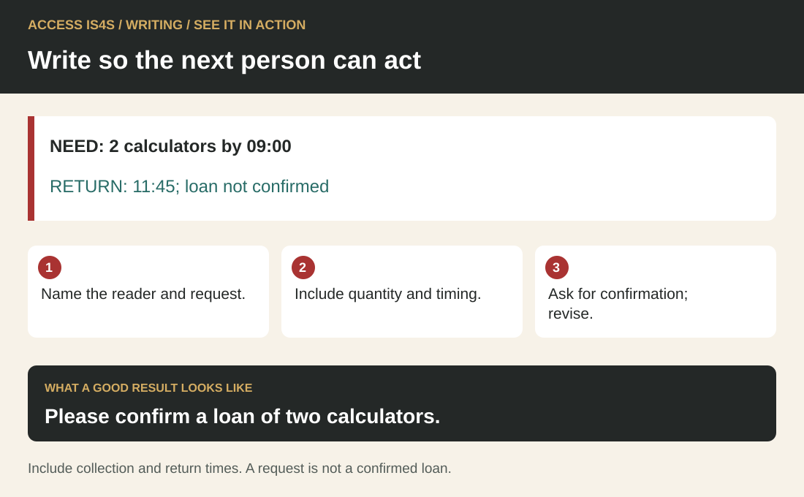
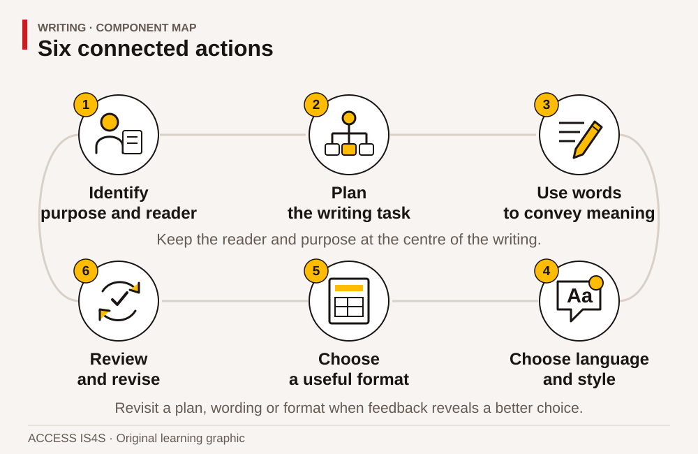
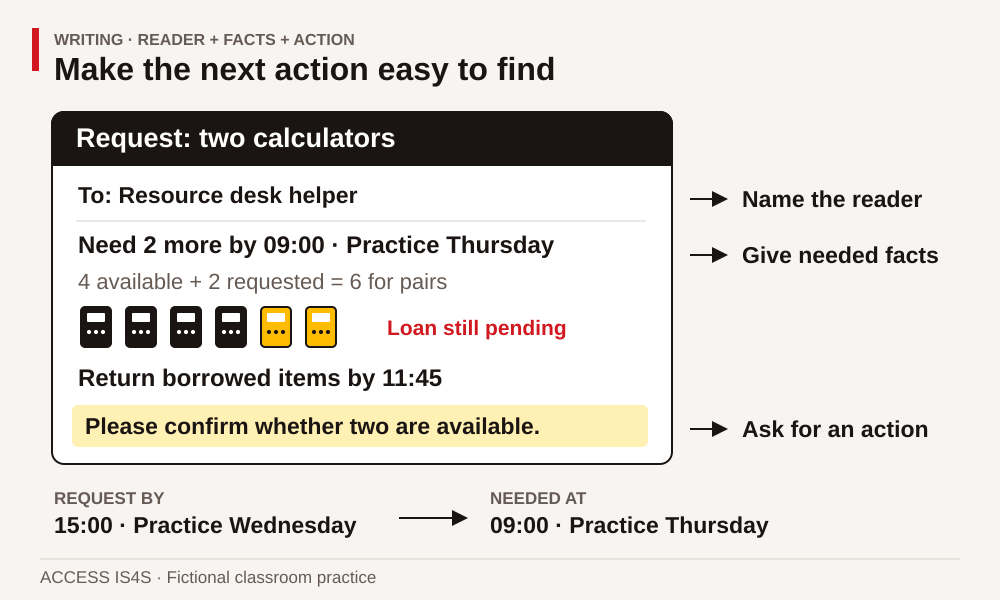
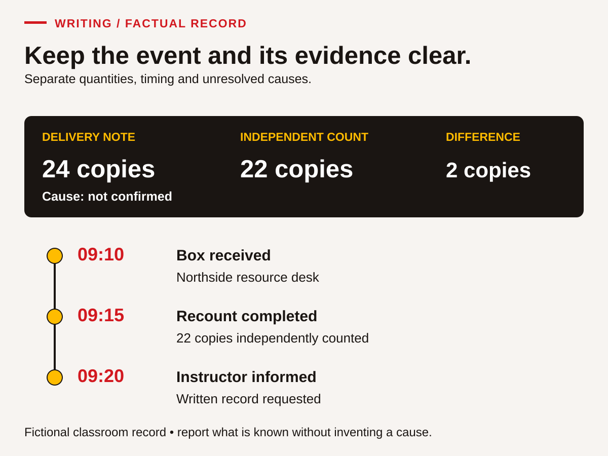

# Teaching Writing: help a reader understand and act

Writing instruction begins with a reader and a purpose. A short message that gives the right quantity, time and confirmation request can be more useful than a polished paragraph that promises something unapproved. Teach learners to select information, organize it, make meaning clear and revise against the source. Grammar and spelling matter because they support that work; they should not displace it.

The learner chapter uses fictional resource requests, materials records, classroom procedures and visitor notices. These purposes connect with training, work and community activity in British Columbia. Invite an alternative context when it serves the same outcome, without requiring private correspondence, family history or cultural knowledge. Learners retain authorship: support may help them produce and review text, but an instructor's rewrite is not evidence of the learner's decisions.

## See it in action · Writing

<!-- visual:quick-writing--practitioner -->
<figure class="teaching-figure diagram" data-visual="quick-writing--practitioner">

<figcaption>Visual guide Please confirm a loan of two calculators. ACCESS IS4S. (2026). Original fictional teaching diagram. <a class="visual-original" href="../assets/diagrams/quick-writing.svg">Open full-size visual</a></figcaption>

Read the visual description

NEED: 2 calculators by 09:00. RETURN: 11:45; loan not confirmed. Name the reader and request. Include quantity and timing. Ask for confirmation; revise. Please confirm a loan of two calculators. Include collection and return times. A request is not a confirmed loan.

</figure>
<!-- /visual:quick-writing--practitioner -->

This small fictional example shows the skill in use. NEED: 2 calculators by 09:00. RETURN: 11:45; loan not confirmed.

**Try it:** Name the reader and request. Include quantity and timing. Ask for confirmation; revise.

**Check your result:** Please confirm a loan of two calculators. Include collection and return times. A request is not a confirmed loan.

## Keep the six components connected

<!-- visual:foundation-writing-map--practitioner-04 -->
<figure class="teaching-figure diagram" data-visual="foundation-writing-map--practitioner-04">

<figcaption>Visual guide Writing moves between planning, wording, format and review. The learner controls the wording and the revisions, using any agreed access tools. <a class="visual-original" href="../assets/diagrams/foundation-writing-map.svg">Open full-size visual</a></figcaption>

Read the visual description

An original task illustration occupies the left panel; six numbered actions appear on the right. Keep the reader and purpose at the centre. Six connected components: Identify purpose and reader; Plan the writing task; Use words to convey meaning; Choose language and style; Choose a useful format; Review and revise. Revisit a plan, wording or format when feedback reveals a better choice.

</figure>
<!-- /visual:foundation-writing-map--practitioner-04 -->

Start with the reader, purpose and facts. Plan and draft a useful message, then check clarity, tone and format. Practise with forms, handovers, procedures, tables and notices. Have another reader try the document, revise what needs work and repeat with a new task.

Writing includes completing forms, arranging a table and preparing a schedule. Teach how a label controls an entry and how a blank field differs from a known zero or an unavailable fact. Reading supplies evidence; Numeracy checks quantities; Digital may support composing and saving. Assess these additional demands separately when they obscure the writing decision you want to observe.

## Teach grammar inside meaningful writing

Integrate grammar with purposeful work. Begin with a draft and identify a small number of features that affect meaning. A pronoun with no clear referent, a missing sentence boundary or an incorrect quantity is a useful teaching point. Model the repair, explain the misunderstanding it prevents and ask the learner to apply the same idea elsewhere.

WR-05 offers an ambiguous calculator request. Ask the reader to underline words that leave them guessing: “they,” “them,” “before” or “later.” Replace these selectively with the item, actor or time. Do not correct every surface feature at once. Agree a focused editing target and use a brief checklist. Spellcheck and other tools can help locate a possible issue, but the learner must decide whether a suggested change preserves meaning. Respect different language backgrounds and avoid treating a familiar dialect as evidence of weak reasoning.

## Make context and audience do real work

<!-- visual:writing-feedback--practitioner-04 -->
<figure class="teaching-figure scene" data-visual="writing-feedback--practitioner-04">

<figcaption>Teaching scene A reader’s response gives the writer useful evidence for revision. This illustration is a teaching scene, not a text specimen to transcribe. <a class="visual-original" href="../assets/illustrations/writing-feedback.png">Open full-size visual</a></figcaption>

Read the visual description

An adult writer revises a paper draft beside a laptop while another adult reader gives feedback.

</figure>
<!-- /visual:writing-feedback--practitioner-04 -->

Make the context and reader shape the writing decisions. Compare two messages about the same event for different readers. A resource helper needs a quantity and return arrangement; learners attending the session need to know what to bring. WR-06 makes this difference explicit. Ask which details can be omitted without losing the reader's ability to act.

Discuss register as a choice shaped by purpose, relationship and local practice. Clear, respectful language does not require unnecessary formality, gendered titles or elaborate vocabulary. Avoid presenting one email model as the only acceptable voice. Provide several valid versions and compare their usefulness. Peer feedback should answer a reader question—“Can I tell what you need?”—rather than turn classmates into unrestricted editors of each other's style.

## A worked teaching example: request the extra quantity

<!-- visual:foundation-writing-request--practitioner-04 -->
<figure class="teaching-figure diagram" data-visual="foundation-writing-request--practitioner-04">

<figcaption>Visual guide A useful request separates the reader, needed facts and action. “Please confirm” keeps a proposed loan distinct from a completed booking. <a class="visual-original" href="../assets/diagrams/foundation-writing-request.svg">Open full-size visual</a></figcaption>

Read the visual description

An annotated request asks the resource helper for two calculators by 09:00 on Practice Thursday. Four available plus two requested would make six for pairs. The loan is pending, borrowed items are to return by 11:45, and the request is due by 15:00 on Practice Wednesday. The callouts identify reader, needed facts and requested confirmation.

</figure>
<!-- /visual:foundation-writing-request--practitioner-04 -->

Use Case document A. Twelve learners can work in pairs, so the plan needs six calculators. Four are available. The writer must request **two additional calculators**, needed at 09:00 on Practice Thursday, with return by 11:45. The helper needs the request by 15:00 on Practice Wednesday and must still check availability. Model a planning note with reader, purpose, required facts and unresolved status.

Say: “If I write ‘We need six more,’ the reader may supply ten in total. If I write ‘The calculators are booked,’ I turn a request into a claim I cannot support.” Draft a subject naming two calculators and a short paragraph asking for confirmation. Have a learner play the reader and identify the item, extra quantity, required time and return plan. If any answer is uncertain, revise that sentence.

Then use WR-04 for the learner's own message. Keep the model available as a structure, while asking for independent wording and information choices. Use WR-14 later to check a different draft against its source. The point is a repeatable planning and review process, not memorizing the first request.

## Teach a process that can be reused

<!-- visual:foundation-writing-record--practitioner-04 -->
<figure class="teaching-figure diagram" data-visual="foundation-writing-record--practitioner-04">

<figcaption>Visual guide Record the quantities and sequence before interpreting the cause. Receipt, recount and notification are different events. <a class="visual-original" href="../assets/diagrams/foundation-writing-record.svg">Open full-size visual</a></figcaption>

Read the visual description

A factual record compares a delivery note of twenty-four copies with an independent count of twenty-two, a difference of two with no confirmed cause. The timeline records receipt at 09:10, recount at 09:15 and informing the instructor at 09:20.

</figure>
<!-- /visual:foundation-writing-record--practitioner-04 -->

Make the writing process explicit: establish purpose, gather information, plan, draft, review and revise. These stages may loop. A reader's question can reveal missing information and send the writer back to the source. Model that return openly rather than implying that experienced writers produce finished text immediately.

Use a template initially, then gradually reduce it. A form can support WR-07, while WR-09 asks learners to select and organize the same event for a handover. WR-10 uses an ordinary classroom procedure; keep it low risk and do not ask a novice to invent a technical operating procedure. Have another learner follow the written sequence with safe materials, identify ambiguity and return the draft to its author. Oral explanation can reveal the intended meaning, but the final written text must carry that meaning itself.

## Assess meaning, authorship and revision

Use samples, clear criteria and descriptive feedback. A practical rubric asks whether the message fulfils its purpose, uses accurate evidence, suits its reader, follows a usable format and has been reviewed. Discuss sample responses with another instructor to improve consistency. Holistic judgement can summarize effectiveness, while a short checklist pinpoints the next teaching step.

Adjust complexity through audience, amount of information, format, inference, length and consequences. Record typing, handwriting, speech-to-text or scribing support accurately. A scribed text can show writing decisions when the learner controls wording and revisions; a conversation without a learner-authored text cannot establish the full writing outcome. Separate **Not observed** from **Not yet demonstrated**, and offer a fresh attempt after instruction. Do not convert a short classroom rubric into an official proficiency level.

Use WR-04/WR-13 to model and revise email tone, WR-07–WR-09 for a factual event record, and WR-10 to write and explain a procedure. Let learners test whether another reader can use the result. Keep the event fictional when personal information is unnecessary.

## Classroom exercise: request the missing clipboards

Use this complete fictional brief: **16 participants will work in pairs. Five clipboards are available. The resource helper can check whether more can be lent but has not confirmed a loan. The session starts at 13:00 on Practice Thursday. Clipboards can be returned by 15:30 that day. A reply is needed by 12:00 on Practice Wednesday.**

Ask each learner to identify the reader, the requested action, the quantity and the unresolved fact. Provide these planning labels: **reader; extra quantity; needed by; return; reply deadline**. Then ask for a subject line and a short message. A partner acts as the helper and identifies the quantity and deadlines from the draft; the writer decides what to revise.

**Worked answer.** Sixteen participants working in pairs need eight clipboards. Five are available, leaving three additional clipboards to request. One useful message is: “Subject: Request for three clipboards for Thursday practice. Could we borrow three clipboards for our classroom session at 13:00 on Practice Thursday? We have five and need eight for pair work. We can return the borrowed clipboards by 15:30 that day. Please confirm availability by 12:00 on Practice Wednesday. Thank you.” Other wording is valid if the facts, request and pending status remain clear.

Use the draft “Please send eight more; they are booked for Thursday” for focused editing. Ask which two claims fail the brief. **Answer:** eight more is the wrong additional quantity, and the booking is unconfirmed. Teach quantity wording and the difference between requesting and confirming before attending to surface edits.

For a second attempt, the participant count changes to **20** while the five available clipboards remain unchanged. The writer now requests **five additional clipboards**. Look for accurate selection, clear reader action, suitable format and a checked revision. A scribe or speech-to-text tool may support production when the learner controls the wording and corrections; record the actual arrangement.

<!-- teaching:writing-entry-bridge-practitioner -->
## Make the actor, action and time clear

You can think through a sentence aloud, sign it, type it or use another authoring method. Keep control of its words and review the result. Begin with a clear sentence, then use it in a useful whole message.

### Start with one sentence

Write or dictate a sentence for this task: “Tell a helper that four blank sheets are needed before two o'clock.” Ask a reader to identify the item, quantity and time. If all are clear, move to the writing case. Otherwise, choose one feature below to practise first.

### Name who does what

Read this example: **The helper / checks / the folder code / before recording the loan.** Mark actor, action, object and condition. Compare “They do it first.” In that version, the reader must guess both actor and action.

Guided task: expand “They need them tomorrow” using these facts: the classroom coordinator needs **five blank record sheets** by **09:30 Practice Friday**. Choose a complete sentence. Check which words prevent guessing. A valid sentence is “The classroom coordinator needs five blank record sheets by 09:30 Practice Friday.” Other word orders work.

### Put a boundary between complete ideas

Consider: “The file is saved the location still needs checking.” Say each idea separately: **The file is saved. The location still needs checking.** Each has an actor/topic and an action/state. A full stop makes the boundary visible. Another valid choice is “The file is saved, but its location still needs checking.” Notice what **but** connects: one completed action and one pending check.

Guided repairs:

1. “The helper counted eight sheets the note lists ten.”
2. “I wrote the heading it still needs a date.”
3. “Please check the code before the loan is recorded.”

Check: the first two need boundaries or suitable connecting words; the third is already usable and need not be changed. A long sentence is not automatically wrong. Keep wording that carries the meaning clearly.

### Put the reader's action where it can be found

Given “Please confirm. We may need a second box. The count is not complete,” identify what must be confirmed and what remains unknown. The agreed confirmation time is 11:00. Here is a clearer request: **Please confirm the completed count by 11:00 before deciding whether another box is needed.** Compare the two versions. A clearer sentence must not turn an uncertain need into a confirmed order.

### Fresh exit task

Use only these new facts: **The practice instructor needs three large-print labels by 14:00 Practice Monday. Two labels are prepared. The remaining label has not been checked. Ask the materials helper to confirm when it will be ready.** Write two or three sentences for the helper. Keep prepared, checked and ready distinct; do not claim the whole set is ready. Underline the requested action and mark sentence endings.

Ask a reader to say how many labels are needed and what action they would take. Revise if their reading differs, or explain why the text works. A possible complete response is: “The practice instructor needs three large-print labels by 14:00 Practice Monday. Two are prepared; the remaining label has not been checked. Please confirm when it will be ready.” Your wording can differ while preserving these facts. Record any wording supplied by another person.

Continue to WR-05 for several ambiguities, or WR-07 for a factual record. For the fresh handover checks, remove these models and use different supplied information. Ask for further sentence, spelling or paragraph practice when that would help you communicate your meaning.
<!-- /teaching:writing-entry-bridge-practitioner -->

<!-- teaching:writing-learner-checks-practitioner -->
## Writing · fresh factual handovers

Use the selected form. Produce text that you control, using handwriting, typing, speech-to-text or a scribe under your direction. The reader needs a useful record and a clear next action. No message will be sent. All roles, quantities and events are fictional. Keep the first draft and review notes; a correct first draft does not need an invented error.

### Form A · Display posters

#### Source brief

At 08:45 on Practice Tuesday, a helper received a flat package at the Riverside learning-room desk. Its delivery note listed **12 introductory display posters**. The first count found **9 posters**. A second helper independently counted **9** at **08:50**. The label says **Poster package 1 of 1**. No order number or supplier contact is supplied.

At **08:55**, the helper informed the instructor. The nine posters and delivery note are together in the labelled **Display materials tray**. The instructor asks for a factual handover to the **resource coordinator**, who will check the order and tell the instructor the next step before **12:00 Practice Tuesday**. The coordinator has not contacted the supplier. No cause, replacement, refund or delivery promise is confirmed.

The posters are for a later classroom display. The instructor will decide whether existing display materials can be used. The helper does not decide that arrangement. A personal phone number written on the outer packaging is not relevant to the handover and must not be copied. The desk's blue pen and a visitor's comment that “deliveries are always wrong” are not evidence about this order.

#### CK-WR-A01 · Plan for the reader

Make a brief plan naming the reader, purpose, necessary facts and requested next action. Identify two details you will leave out and why. Distinguish completed actions from the decision still pending.

#### CK-WR-A02 · Write the handover

Write about 80–130 words, with a useful heading and a separate **Follow-up needed** line. Include the quantities, independent check, sequence, location of the materials and record, unresolved cause and coordinator's next step/deadline. Use your own wording. Do not add a contact address or promise a solution.

#### CK-WR-A03 · Review meaning

Give the draft to a reader. Ask them to identify the discrepancy, what is already done, where the materials are and who must do what next. Check their interpretation against the brief. Revise a misleading or unclear detail, or record why the tested wording already works. Also check one sentence boundary and one pronoun/reference. Keep the reader's actual response and your decision.

My plan and draft — use another sheet or an accessible document if helpful.        

### Form B · Orientation cards

#### Source brief

At **14:05 on Practice Thursday**, a helper received a box at the Harbour learning-room desk. The packing record listed **30 orientation cards**, but the first count found **26**. Another helper independently counted **26** at **14:10**. The label says **Orientation cards, box 1 of 1**. No order number or supplier contact is supplied.

At **14:15**, the instructor was informed. The 26 cards and packing record are together in the labelled **Orientation materials tray**. The **materials coordinator** needs a factual handover so they can check the order and tell the instructor the next step before **16:00 Practice Thursday**. The coordinator has not contacted the supplier. No explanation, replacement, refund or delivery promise is confirmed.

The cards are for a later classroom session. The instructor will decide whether to adapt that session after checking other resources. The helper cannot announce that decision. A personal address written on the box is unnecessary for the handover and must not be copied. The colour of the box and a colleague's remark that “someone must have taken them” do not establish the cause of the discrepancy.

#### CK-WR-B01 · Plan for the reader

Make a brief plan naming the reader, purpose, necessary facts and requested next action. Identify two details you will leave out and why. Distinguish completed actions from the decision still pending.

#### CK-WR-B02 · Write the handover

Write about 80–130 words, with a useful heading and a separate **Follow-up needed** line. Include the quantities, independent check, sequence, location of the materials and record, unresolved cause and coordinator's next step/deadline. Use your own wording. Do not add a contact address or promise a solution.

#### CK-WR-B03 · Review meaning

Give the draft to a reader. Ask them to identify the discrepancy, what is already done, where the materials are and who must do what next. Check their interpretation against the brief. Revise a misleading or unclear detail, or record why the tested wording already works. Also check one sentence boundary and one pronoun/reference. Keep the reader's actual response and your decision.

My plan and draft — use another sheet or an accessible document if helpful.        

<!-- /teaching:writing-learner-checks-practitioner -->

<!-- teaching:writing-practitioner-notes-practitioner -->
## Writing · routes, keys and observation

Keep these notes separate from [learner forms](../teaching/foundations/writing-learner-checks.md). Both forms sample purposeful selection, authored factual text, reader-suitable format and review. Agree authoring tools and time before the attempt. The suggested word range supports concision; do not reject a slightly shorter accurate record or reward unnecessary filler. No writing-speed criterion applies.

### Route card

| Starting evidence | Teaching route | Retry or extension |
|---|---|---|
| Learner can explain a message but cannot identify actor/action or create a clear sentence | Use the [Writing bridge](../teaching/foundations/writing-entry-bridge.md). Model one repair, then let the learner author the rest. | Bridge exit, then core WR-05 with a supported plan. |
| Sentences work but reader, quantities or pending status are unclear | Core WR-01–04 and WR-07–09: plan, draft and check against a source. | Unseen Form A or B with a blank plan. |
| Draft is accurate but review depends on someone rewriting it | Core WR-15: reader interpretation, author decision and factual check. | Form question 03; record who controls the actual revisions. |
| Selected criteria are independent under agreed conditions | Change audience to the instructor or to visitors, supplying their information need. | New document that omits internal detail appropriately; separate actual transfer evidence. |

### Key and models

**CK-WR-A01:** reader resource coordinator; purpose preserve the discrepancy and request an order check/next-step report before Tuesday noon. Include 12 listed, 9 counted twice, 08:45 receipt, 08:50 recount, 08:55 instructor notification, tray/record location, pending cause and next action. Exclude personal phone, pen colour and unsupported repeated-delivery claim. Do not promise substitute materials.

**CK-WR-A02 model:**

> **Display poster discrepancy — Practice Tuesday**
>
> At 08:45, a package labelled “Poster package 1 of 1” arrived at the Riverside learning-room desk. The delivery note listed 12 introductory display posters. The first count found 9, and a second helper independently confirmed 9 at 08:50. The instructor was informed at 08:55. The nine posters and delivery note are together in the Display materials tray. The cause is unconfirmed; no replacement is confirmed. An order number has not been provided.
>
> **Follow-up needed:** Resource coordinator to check the order and tell the instructor the next step before 12:00 Practice Tuesday.

**CK-WR-B01:** reader materials coordinator; preserve 30 listed versus 26 counted twice, receipt 14:05, recount 14:10, instructor told 14:15, Orientation materials tray, check/report by Thursday 16:00. Exclude personal address, box colour and unproven removal allegation. The instructor's later-session decision remains pending.

**CK-WR-B02 model:**

> **Orientation card discrepancy — Practice Thursday**
>
> At 14:05, a box labelled “Orientation cards, box 1 of 1” arrived at the Harbour learning-room desk. The packing record listed 30 cards, but the first count found 26. Another helper independently confirmed 26 at 14:10. The instructor was informed at 14:15. The cards and packing record are in the Orientation materials tray. The cause is not confirmed, and no replacement or refund is confirmed. An order number has not been provided.
>
> **Follow-up needed:** Materials coordinator to check the order and tell the instructor the next step before 16:00 Practice Thursday.

**CK-WR-A03/CK-WR-B03:** Observe an actual reader response and the author's check, not a copied statement that feedback occurred. A useful edit may replace “they will sort it” with the coordinator's role and deadline. If the text already carries the required meaning, a documented verification is valid. The writer remains responsible for wording, even when using a scribe.

### Criterion anchors

| Criterion | Meets the task | Common error / next instruction |
|---|---|---|
| W1 Purpose and selection | Names the correct reader/next action and preserves necessary facts while omitting private/irrelevant content. | Writes for visitors rather than coordinator; teach audience choice. |
| W2 Accurate authored meaning | Keeps listed and counted quantities, times, pending cause and deadline distinct. | Claims theft, confirmed replacement or all items received; return to source categories. |
| W3 Usable sentences and format | Heading, readable account and follow-up line; actor, action and references can be understood. | “They got them and will fix it” leaves actor/item/action unclear; rehearse one sentence repair. |
| W4 Review under author control | Uses reader interpretation and a source/language check; changes or retains wording with a reason. | Accepts a partner rewrite without reviewing meaning, or invents a revision. |

A minor surface spelling error does not automatically defeat W3 when meaning remains clear. Correct quantities alone do not establish W1 or W4. Decide and record criteria individually; these models are not the only acceptable voice.

**Calibration — W2:** “The supplier took three posters” is **Not yet demonstrated**, because cause is invented. After “Which sentence confirms the cause?”, a learner changes it to “The cause has not been confirmed”: W2 may be **Demonstrated with support**, with that prompt recorded. A learner independently compares the two quantities and preserves uncertainty using agreed speech-to-text can meet W2 **independently under those conditions**. An absent written product is **Not observed** for authored-text criteria, even if a discussion was strong.

### Printable record

| Learning ID / date / form / prior exposure | |
|---|---|
| Agreed authoring/access tools; who entered the words | |
| W1 evidence and local status | |
| W2 evidence and local status | |
| W3 evidence and local status | |
| W4 evidence and local status | |
| Exact solving prompts or supplied wording | |
| Reader's actual interpretation / writer's decision | |
| Next teaching focus and unseen retry form | |

Compare two anonymized or consented samples against these criteria with another practitioner before relying on consistent judgments. Record disagreements and clarify anchors; no completed moderation is claimed here.
<!-- /teaching:writing-practitioner-notes-practitioner -->
