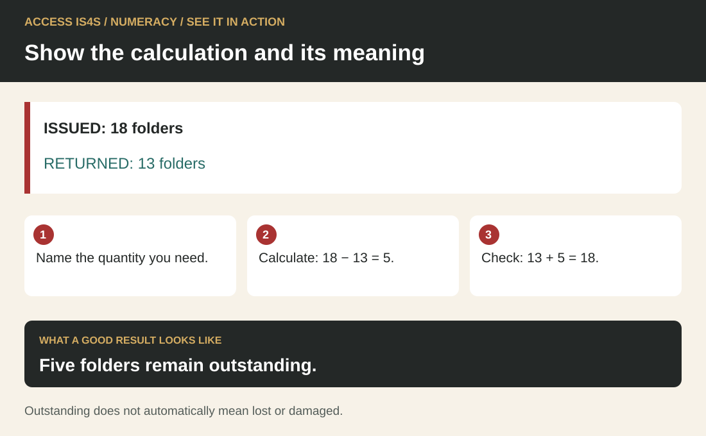

# Teaching Numeracy: connect the question, the quantities and the decision

Numeracy develops through useful questions and visible reasoning. A learner may calculate accurately but choose the wrong quantity; another may understand the relationship and need help recording it. Start by finding out what the learner already does with numbers, then distinguish reading the problem, choosing a method, calculating and interpreting. The teaching response should address the point of difficulty rather than repeat the whole task unchanged.

The learner chapter offers fictional supply orders, journey planning and an information-board layout. These connect with training, employment and community tasks in British Columbia while keeping personal finances and private circumstances outside the exercise. Learners may bring another non-sensitive context if they wish. Recognize experience in estimating, sharing quantities, planning time and checking materials without assuming that every learner has the same experience.

## See it in action · Numeracy

<!-- visual:quick-numeracy--practitioner -->
<figure class="teaching-figure diagram" data-visual="quick-numeracy--practitioner">

<figcaption>Visual guide Five folders remain outstanding. ACCESS IS4S. (2026). Original fictional teaching diagram. <a class="visual-original" href="../assets/diagrams/quick-numeracy.svg">Open full-size visual</a></figcaption>

Read the visual description

ISSUED: 18 folders. RETURNED: 13 folders. Name the quantity you need. Calculate: 18 − 13 = 5. Check: 13 + 5 = 18. Five folders remain outstanding. Outstanding does not automatically mean lost or damaged.

</figure>
<!-- /visual:quick-numeracy--practitioner -->

This small fictional example shows the skill in use. ISSUED: 18 folders. RETURNED: 13 folders.

**Try it:** Name the quantity you need. Calculate: 18 − 13 = 5. Check: 13 + 5 = 18.

**Check your result:** Five folders remain outstanding. Outstanding does not automatically mean lost or damaged.

## Use the complete numeracy cycle

<!-- visual:foundation-numeracy-map--practitioner-05 -->
<figure class="teaching-figure diagram" data-visual="foundation-numeracy-map--practitioner-05">

<figcaption>Visual guide Six connected numeracy actions. Follow the numbered route, and return to the question or inputs when a result needs checking. The icons condense the six component descriptions in the table. <a class="visual-original" href="../assets/diagrams/foundation-numeracy-map.svg">Open full-size visual</a></figcaption>

Read the visual description

An original task illustration occupies the left panel; six numbered actions appear on the right. From a useful question to a checked result Six connected components: Identify the task; Find the information; Connect the facts; Calculate or measure; Interpret and evaluate; Share the result. Recheck the question or inputs. A useful result answers the original question.

</figure>
<!-- /visual:foundation-numeracy-map--practitioner-05 -->

The six components are identifying the task; identifying mathematical information; connecting information; applying operations and tools; interpreting and evaluating; and sharing results and implications. Keep all six visible. A worksheet that ends at a calculator answer leaves interpretation and communication unobserved. Ask what the answer means, whether it is plausible and what another person needs to know before using it.

Practise with quantities, stock, whole packs and budgets before moving to time and fares. Then compare units, area, perimeter, fit and data displays. In every task, ask the learner to show the calculation, check whether the result makes sense and explain what someone should do with it.

## Attend to confidence and the learning conditions

Attend to attitudes and emotions around mathematics. Invite a private statement of what would make practice easier. Do not ask for public accounts of school failure or turn confidence into a score. Predictable routines, time to think, worked examples, useful tools and specific feedback can make a task more approachable. Offer counters, sketches, enlarged tables or spoken explanation while preserving the adult purpose.

Avoid praising speed as evidence of understanding. Ask a learner who answers quickly to explain the units and check a condition. Give another learner time to draw the relationship. Both may demonstrate strong reasoning. If a learner says “I cannot do maths,” respond with an observable starting point: “You identified what the cupboard already contains. Let us connect that to the amount needed.” This locates something teachable without making an unsupported promise about progress.

## Make context support the mathematics

<!-- visual:foundation-numeracy-board-fit--practitioner-05 -->
<figure class="teaching-figure diagram" data-visual="foundation-numeracy-board-fit--practitioner-05">

<figcaption>Visual guide Worked visual check — 25 mm margins leave 550 × 350 mm. Two columns and two rows fit with 20 mm gaps. Three columns need 580 mm and three rows need 370 mm, so each exceeds the clear space. Use the labels, not the displayed size. <a class="visual-original" href="../assets/diagrams/foundation-numeracy-board-fit.svg">Open full-size visual</a></figcaption>

Read the visual description

Fictional board 600 by 400 millimetres with 25-millimetre margins has a clear rectangle 550 by 350. Four fixed-orientation cards, each180 by110, fit as two across and two down with20-millimetre gaps. Three across needs580, exceeding550. Three down needs370, exceeding350. The four-card group measures380 by240 millimetres.

</figure>
<!-- /visual:foundation-numeracy-board-fit--practitioner-05 -->

Use meaningful contexts and explicitly teach missing foundations. Before introducing a formula, establish what is being counted or measured. Write units beside quantities. Ask for an estimate before exact calculation and a second check afterwards. A calculator is appropriate when it supports the intended task; show how to detect a mistaken input or an implausible result.

Context can also overload a learner. Separate a long paragraph into a quantity table while retaining its conditions. Practise one foundational relationship, then return to the full decision. Do not replace every task with isolated arithmetic: the return to context shows whether the learner can choose and use the method. When changing a scenario, distinguish invented assumptions from real workplace specifications. These lessons do not establish material tolerances, equipment capacities or operating instructions.

## A worked teaching example: whole packs

<!-- visual:foundation-numeracy-whole-packs--practitioner-05 -->
<figure class="teaching-figure diagram" data-visual="foundation-numeracy-whole-packs--practitioner-05">

<figcaption>Visual guide Worked visual check — version 1 needs three whole packs of each item. Goods of $58.65 attract $8.50 delivery, making the order $67.15: $2.15 above the $65 budget. All values are fictional. <a class="visual-original" href="../assets/diagrams/foundation-numeracy-whole-packs.svg">Open full-size visual</a></figcaption>

Read the visual description

A worked whole-pack order needs twenty folders including spares, has seven, and needs thirteen more. Three packs of five bring stock to twenty-two. Folders cost $26.25, pens $19.80 and labels $12.60, making goods $58.65. Because goods are below $60, delivery adds $8.50. The delivered cost is $67.15, or $2.15 over the $65 budget. A scaled budget bar shows the comparison.

</figure>
<!-- /visual:foundation-numeracy-whole-packs--practitioner-05 -->

Use the pen order in NU-03. Eighteen learners need two pens each, and the group wants four spares. The target is `18 × 2 + 4 = 40 pens`. Nine usable pens are already available, so the additional requirement is `40 − 9 = 31 pens`. Each pack contains 12 pens. Two packs provide only 24, while three provide 36; therefore the order needs three whole packs.

Continue beyond the purchase count. At $6.60 per pack, the pens cost `3 × $6.60 = $19.80`. Existing stock plus the purchase gives `9 + 36 = 45 pens`, leaving five beyond the target. Check by estimation: three packs at about $7 should cost about $21, close to $19.80. Ask why rounding 31 ÷ 12 down would fail. The answer is tied to complete packs and sufficient supply, not a universal instruction to round every result upward.

Model the calculation once, then give pairs the folder or label row. One person explains the relationship; the other checks quantities and units. Swap roles before using NU-04 to combine the order and delivery condition. A correct line item does not yet answer whether the whole purchase fits the budget.

## Structure collaboration so everyone reasons

Use collaboration to compare mathematical reasoning. Give partners a purposeful difference in responsibility: proposer and checker, estimator and calculator, or diagram-maker and explainer. Rotate roles. Ask for two methods where they illuminate the same relationship, such as a timeline and subtraction for elapsed time. Invite disagreement about a method using the quantities and assumptions, not a judgement about the person.

A group answer alone cannot show each learner's numeracy. After discussion, ask everyone to solve a small variation or explain one decision. Offer a private instructor conversation when public explanation is a barrier. Link the handover in NU-18 to Communication and Writing, but assess those demands separately if they obscure the mathematical evidence.

## Assessment, complexity and next practice

Use diagnosis, observation, work samples and a retry after feedback. Record whether difficulty arose in locating data, translating the situation, choosing operations, calculating or interpreting. Increase complexity through more steps, less obvious information, different representations or additional conditions. Avoid increasing all of these at once. Digital navigation and reading demands can conceal numerical understanding; provide another route when the aim is numeracy.

Plan practice in measurement, volume and mass, and interpreting data displays. NU-14 supports unit-system reading and NU-15 combines charting with a fraction and percentage. For physical measurement, use a ruler or instructor-handled tape on a safe classroom object. Locate zero, identify the smallest marked fraction and compare two readings; never measure a resized illustration as if it were full scale.

For a volume-to-mass teaching model, use this fictional calculation: a rectangular box has inside dimensions `0.5 m × 0.4 m × 0.2 m`. Its volume is `0.04 m³`. Assume an invented practice material has a mass of `500 kg per m³`; the stated relationship gives `0.04 m³ × 500 kg/m³ = 20 kg`. Check: the box holds one twenty-fifth of a cubic metre, so its contents have one twenty-fifth of 500 kg. Ask learners to explain why adding the three lengths would not find volume, then halve the depth: volume becomes `0.02 m³` and mass `10 kg`. These are calculation assumptions, not asphalt properties, handling advice or equipment limits.

## Classroom exercise: compare two practice storage boxes

All dimensions and material values in this exercise are invented. They teach calculation and checking; they are not loading, lifting or equipment advice. Supply the table and ask learners to estimate which box holds more before calculating.

| Box | Inside length | Inside width | Inside depth |
|---|---|---|---|
| A | 0.6 m | 0.4 m | 0.25 m |
| B | 0.5 m | 0.4 m | 0.3 m |

Both boxes are rectangular. For this exercise only, the practice fill has a stated mass of **200 kg for each cubic metre**. Ask for each volume, its corresponding fill mass, a comparison and one check. Model why three perpendicular dimensions are multiplied. Have partners compare methods, then require each learner to explain a calculation separately.

**Answer guidance.** Box A: `0.6 × 0.4 × 0.25 = 0.06 m³`. Box B: `0.5 × 0.4 × 0.3 = 0.06 m³`. Each has the same volume despite different shapes. At the supplied relationship, `0.06 m³ × 200 kg/m³ = 12 kg` of practice fill. Six hundredths of a cubic metre gives six hundredths of 200 kg, confirming 12 kg. Adding lengths produces a length, not volume; leaving out depth gives area.

Now ask what happens if Box A is filled to **half its depth**, leaving all other assumptions unchanged. The fill depth becomes **0.125 m**, volume **0.03 m³**, and fill mass **6 kg**. Ask learners to check the halving relationship before repeating multiplication. No empty-box mass has been supplied, so the total mass of box and contents cannot be determined.

Use a labelled sketch and a quantity table when text obscures the relationship. Increase the challenge by asking learners to describe a different rectangular box with the same volume. Accept any positive dimensions whose product is `0.06 m³`, with consistent units and a checked explanation. Keep the original task, working, units, interpretation and support record together.

<!-- teaching:numeracy-entry-bridge-practitioner -->
## Build equal parts, regrouping and unit conversions

Use a calculator if agreed, but first show what the numbers represent. Paper strips, tactile divisions or a drawing can make equal parts visible. Every fraction strip in a comparison must represent the same whole. Drawings support reasoning; they are not calibrated measuring tools.

### Begin with a small check

Show one-half and one-quarter of the same whole and explain which is larger. Then decide whether 2/4 and 1/2 can describe the same amount. If this is unclear, fold or mark a strip into equal parts before introducing written operations. If it is already clear, begin with equivalent denominators. Record the step you want to practise, rather than a general label about your maths ability.

### Connect equivalent fractions

Work through **3/8 + 5/16**. Each eighth can be split into two equal sixteenths, so 3/8 = 6/16. Now the parts have the same size: 6/16 + 5/16 = **11/16**. Keep the denominator 16 because it names the size of each counted part. Adding denominators would change that part size incorrectly.

Guided attempt: **1/4 + 3/8**. Find how many eighths equal a quarter. Record 2/8 + 3/8 = 5/8 and check on equal whole strips. Next try **1½ + 2¾**: 1½ = 1 2/4; sum 3 5/4 = 4¼. Discuss why five quarters include a whole and one quarter.

### Regroup one whole before subtracting

<!-- visual:edition3-fractions-regrouping--practitioner-05-numeracy -->
<figure class="teaching-figure diagram" data-visual="edition3-fractions-regrouping--practitioner-05-numeracy">

<figcaption>Visual guide Equivalent parts make addition and regrouping visible. <a class="visual-original" href="../assets/diagrams/edition3-fractions-regrouping.svg">Open full-size visual</a></figcaption>

Read the visual description

Three eighths is six sixteenths. Adding five sixteenths gives eleven sixteenths. Four and one eighth is four and two sixteenths, or three and eighteen sixteenths. Subtracting two and three sixteenths leaves one and fifteen sixteenths. Adding the difference to the subtracted quantity returns four and one eighth.

</figure>
<!-- /visual:edition3-fractions-regrouping--practitioner-05-numeracy -->

Work through **4⅛ − 2 3/16**. First express the smaller parts alike: 4⅛ = 4 2/16. Two sixteenths cannot supply three sixteenths without regrouping. Exchange one of the four wholes for 16/16: **4 2/16 = 3 18/16**. The value has not changed. Subtract 2 3/16 to get **1 15/16**. Check by adding: 1 15/16 + 2 3/16 = 3 18/16 = 4 2/16 = 4⅛.

Guided attempt: **3¼ − 1⅝**. Convert 3¼ to 3 2/8, then regroup as 2 10/8. Subtract 1 5/8 to get 1 5/8. Explain the exchanged whole before checking with addition. If needed, physically exchange one whole strip for eight eighths.

### Convert a unit without changing the quantity

**1 m = 1,000 mm** means each metre contains a thousand millimetres. For example, 0.45 m × 1,000 = 450 mm. Reverse it: 450 mm ÷ 1,000 = 0.45 m. Notice that the numerical value grows when the unit becomes smaller; the described length stays the same. For a nominal classroom input, this does not establish a real measured object's precision.

Guided attempt: 0.32 m to millimetres. The answer is 320 mm. Check whether 32 mm or 3,200 mm could describe the same length, using the known metre relationship to explain the disagreement.

### Reconnect the arithmetic to a task

<!-- visual:edition3-quantity-check--practitioner-05-numeracy -->
<figure class="teaching-figure diagram" data-visual="edition3-quantity-check--practitioner-05-numeracy">

<figcaption>Visual guide Follow a quantity from the target through stock, whole packs, cost and a final check. <a class="visual-original" href="../assets/diagrams/edition3-quantity-check.svg">Open full-size visual</a></figcaption>

Read the visual description

The worked example needs nineteen labels: eight kits times two labels plus three spares. Six labels are available, so thirteen more are needed. Packs contain five labels, so buy three whole packs. Three packs at two dollars and twenty cents cost six dollars and sixty cents. Final stock is twenty-one, two beyond the target. A separate blank record has space for the same five calculation stages using a new agreed example.

</figure>
<!-- /visual:edition3-quantity-check--practitioner-05-numeracy -->

Eight practice kits need two labels each, plus three spare labels. Six labels are available. Packs contain five labels and cost $2.20 each, with no other charge in this small example. Follow the record: 8 × 2 + 3 = target 19; 19 − 6 = 13 needed; 13 ÷ 5 = 2.6 packs, so 3 whole packs supply 15. Cost 3 × $2.20 = $6.60. Final available 6 + 15 = 21, two beyond the target. Explain why a pack count is different from a piece count and why rounding down would leave a shortage.

### Fresh exit tasks

1. Add **1⅜ + 2¼**. Show equal-sized parts and explain any whole made.
2. Subtract **4½ − 2¾**. Show the exchanged whole and check by addition.
3. Convert **0.58 m** to millimetres and reverse-check it.
4. Five practice kits need three labels each plus two spares. Four labels are available; packs contain six and cost $3 each with no other charge. Find whole packs, cost and final surplus beyond the target.

**Feedback:** 1) 3⅝; 2) 1¾, since 4½ = 3 6/4 and 3 6/4 − 2 3/4 = 1 3/4; 3) 580 mm; 4) target 17, shortage 13, 3 packs supply 18, cost $9, final 22, five beyond target. These exit answers are for review after the attempt. A fresh check uses different inputs with the completed example removed.

Continue to the relevant quantity, fraction or unit task when you have a method you can explain with your agreed tools. A partly completed table can support working memory without supplying which operation to choose. Keep calculations and an actual tool-measurement opportunity separate in the learning record.
<!-- /teaching:numeracy-entry-bridge-practitioner -->

<!-- teaching:numeracy-learner-checks-practitioner -->
## Numeracy · fresh quantities, fractions and units

Use the selected form. Show how you chose the quantities, your working, units and a second check. An agreed calculator, fraction strips or accessible number tool may be used. These are nominal classroom values, not dimensions to measure on the page or live purchasing instructions. Prices include all charges except the delivery rule explicitly stated. No purchase is authorized.

### Form A · Practice information packs

Fourteen learners each need **one folder and three cards**. Add **two spare folders and six spare cards** to those learner quantities. Existing usable stock is **five folders and eleven cards**. The supplier sells whole packs only.

| Item | Pieces per pack | Price per pack |
|---|---:|---:|
| Folders | 4 | $6.40 |
| Cards | 12 | $3.60 |

Goods costing **at least $35.00** have no delivery charge. Below that threshold, delivery is **$4.50**. The budget is **$37.00 including delivery**. No other supplier, discount or pickup option is supplied.

#### CK-NU-A01 · Connect the quantities

For each item, record the learner requirement, spares, total target, existing stock, additional pieces needed, whole packs and pieces available after purchase. Explain your rounding direction. Distinguish planned spares from any additional surplus created by buying whole packs.

#### CK-NU-A02 · Decide from the full cost

Estimate the goods cost, calculate exact line costs and apply the delivery rule. Report the complete cost and its difference from the budget. State whether the order fits and what decision still belongs to the coordinator. Check one result using a different operation, grouping or estimate; identify what your check can detect.

#### CK-NU-A03 · Work with fractional lengths

Two nominal paper strips are **1¾ in** and **2⅞ in** long. Find their combined length. A separate strip is **4¼ in** long and has a marked section **1⅝ in** long; find the remaining length. Show equivalent fractions and any regrouping. Check one answer by reversing the operation. These are calculation inputs, not instructions to cut material.

#### CK-NU-A04 · Keep the quantity and unit together

A nominal display strip is **0.64 m** long. Use **1 m = 1,000 mm** to express it in millimetres. Explain why this conversion does not tell you an actual measured strip's precision. Give a short numerical handover containing the order result, a condition and a method another person could check.

### Form B · Practice orientation packs

Eleven learners each need **one folder and two cards**. Add **three spare folders and six spare cards**. Existing usable stock is **three folders and five cards**. Whole packs only are available.

| Item | Pieces per pack | Price per pack |
|---|---:|---:|
| Folders | 4 | $6.80 |
| Cards | 10 | $5.50 |

Goods costing **at least $40.00** have no delivery charge. Below that threshold, delivery is **$4.20**. The budget is **$42.00 including delivery**. No other supplier, discount or pickup option is supplied.

#### CK-NU-B01 · Connect the quantities

For each item, record the learner requirement, spares, total target, existing stock, additional pieces needed, whole packs and pieces available after purchase. Explain your rounding direction. Distinguish planned spares from any additional surplus created by buying whole packs.

#### CK-NU-B02 · Decide from the full cost

Estimate the goods cost, calculate exact line costs and apply the delivery rule. Report the complete cost and its difference from the budget. State whether the order fits and what decision still belongs to the coordinator. Check one result using a different operation, grouping or estimate; identify what your check can detect.

#### CK-NU-B03 · Work with fractional lengths

Two nominal paper strips are **2½ in** and **1⅞ in** long. Find their combined length. A separate strip is **5¼ in** long and has a marked section **2⅞ in** long; find the remaining length. Show equivalent fractions and any regrouping. Check one answer by reversing the operation. These are calculation inputs, not instructions to cut material.

#### CK-NU-B04 · Keep the quantity and unit together

A nominal display strip is **0.72 m** long. Use **1 m = 1,000 mm** to express it in millimetres. Explain why this conversion does not tell you an actual measured strip's precision. Give a short numerical handover containing the order result, a condition and a method another person could check.

### Working pages for either form

| Item | Learner need | Spares | Target | Stock | More needed | Whole packs | Final pieces |
|---|---|---|---|---|---|---|---|
| Folders | | | | | | | |
| Cards | | | | | | | |

| Cost or check | My working, unit and explanation |
|---|---|
| Estimate | |
| Folder cost | |
| Card cost | |
| Goods / delivery / total | |
| Budget difference and decision | |
| Independent check | |

Fraction working, unit conversion and numerical handover. Use an additional sheet or accessible record if needed.       

<!-- /teaching:numeracy-learner-checks-practitioner -->

<!-- teaching:numeracy-practitioner-notes-practitioner -->
## Numeracy · routes, solutions and criterion anchors

Use one fresh form from [Numeracy checks](../teaching/foundations/numeracy-learner-checks.md). The forms sample quantities, whole-pack decisions, money conditions, common denominators/regrouping, units and interpretation. They do not test actual physical measurement. Agree the tools and selected criteria before the attempt. A learner who needs fraction teaching can complete the order task first and leave the fraction criterion unobserved until taught.

### Route card

| Starting evidence | Teaching decision | New attempt |
|---|---|---|
| Identifies numbers but omits the unit or confuses stock with target | Work with counters and a target/stock/missing table in the bridge's final task. | New quantities in check question 01. |
| Adds denominators, treats eighths as quarters or cannot regroup a whole | Teach the [fraction bridge](../teaching/foundations/numeracy-entry-bridge.md) using equal whole strips. | Bridge exit, then question 03 with unseen values. |
| Chooses correct operations but loses delivery or rounding conditions | Practise NU-03–04 or NU-17 with the condition marked. | Question 02 without pre-highlighted conditions. |
| Multiplies or divides by an unlabelled conversion factor | Teach the bridge's unit relationship and reverse check. | Question 04; no claim about actual tool use. |
| Meets the selected criteria | Supply a new quantity document with a different unit or threshold, changing one demand at a time. | Record what transferred and which support remained. |

### Form A solutions

**CK-NU-A01:** folders: 14 learner + 2 spare = target 16; stock 5; shortage 11; 3 packs supply 12; final 17, one beyond target. Cards: 14 × 3 = 42 learner + 6 spare = target 48; stock 11; shortage 37; 4 packs supply 48; final 59, eleven beyond target. Round pack counts upward because the order must cover the target and partial packs are unavailable. The final unused pieces after learner allocations are 3 folders (2 planned + 1 extra) and 17 cards (6 planned + 11 extra).

**CK-NU-A02:** folders 3 × $6.40 = $19.20; cards 4 × $3.60 = $14.40; goods $33.60. That is below $35, so delivery $4.50 gives **$38.10**, **$1.10 over** $37. Report the shortfall and seek the coordinator's decision; do not invent pickup or omit spares. An estimate around $34 goods plus $4.50 delivery is reasonable. A reverse budget check is $37 + $1.10 = $38.10; it checks the difference but not all source entries.

**CK-NU-A03:** 1¾ = 1 6/8; 1 6/8 + 2 7/8 = 3 13/8 = **4⅝ in**. For subtraction, 4¼ = 4 2/8 = 3 10/8; subtract 1 5/8 to get **2⅝ in**. Reverse: 2⅝ + 1⅝ = 4¼. Accept exact decimal or diagram methods if the requested equivalent fractions/regrouping are also explained.

**CK-NU-A04:** 0.64 × 1,000 = **640 mm**. The case supplies a nominal value, not a tool reading or measured precision. A valid handover states whole packs, delivered $38.10, $1.10 gap, delivery condition and a check; a correctly calculated unaffordable order is a useful result, not failure to calculate.

### Form B solutions

**CK-NU-B01:** folders: 11 + 3 = target 14; stock 3; shortage 11; 3 packs supply 12; final 15, one beyond target. Cards: 11 × 2 + 6 = target 28; stock 5; shortage 23; 3 packs supply 30; final 35, seven beyond target. Unused after learner allocations: 4 folders (3 planned + 1 extra), 13 cards (6 planned + 7 extra).

**CK-NU-B02:** folders 3 × $6.80 = $20.40; cards 3 × $5.50 = $16.50; goods **$36.90**, below $40. Add $4.20 delivery: **$41.10**, leaving **$0.90** from $42. The order fits; calculation does not authorize purchasing. A useful check groups $20 + $16 + $0.40 + $0.50 = $36.90 and verifies $41.10 + $0.90 = $42.

**CK-NU-B03:** 2½ = 2 4/8; add 1 7/8: 3 11/8 = **4⅜ in**. 5¼ = 5 2/8 = 4 10/8; subtract 2 7/8: **2⅜ in**. Reverse: 2⅜ + 2⅞ = 5¼.

**CK-NU-B04:** 0.72 × 1,000 = **720 mm**; same nominal/measurement distinction. Handover includes $41.10 delivered, $0.90 remaining, threshold condition, whole-pack counts and a check.

### Criteria and diagnostic errors

| Criterion | Evidence that meets it | If unmet, investigate |
|---|---|---|
| N1 Select and connect quantities | Target includes spares; subtracts stock; whole packs cover each shortage; labels final surplus. | Target versus allocation, count versus pack, or rounding direction. |
| N2 Calculate and interpret full cost | Accurate lines, threshold and delivery; correct budget consequence; a second check with its scope stated. | Missing condition, decimal input, or comparison with subtotal only. |
| N3 Use fractional relationships | Equivalent denominators, correct sum and regrouped difference, length unit and inverse check. | Unequal parts, denominator addition, or whole-to-eighth conversion. |
| N4 Convert and communicate | Correct metric conversion; distinguishes nominal from measured; useful handover retains condition and method. | Wrong factor/direction, absent unit, or unsupported precision claim. |

Record N1–N4 separately. One money slip does not erase a valid fraction explanation. If exact answers are incorrect but the correct relation is visible, record that distinction and teach the specific error; the whole criterion may still need another attempt.

**Calibration, N2:** A learner reports A goods $33.60 “so it fits $37,” ignoring delivery: **Not yet demonstrated**. After “Which rule determines delivery?”, they compute $38.10 and the gap: **Demonstrated with support**, naming that prompt. A learner uses an agreed calculator, selects the rule and independently reports the delivered total, gap and check: **Demonstrated independently under these conditions**. No attempt or no opportunity is **Not observed**.

### Printable record

| Learning ID / form / date / prior exposure | |
|---|---|
| Agreed tools and selected criteria | |
| N1 evidence / status | |
| N2 evidence / status | |
| N3 evidence / status | |
| N4 evidence / status | |
| Exact help; input/operation/interpretation affected | |
| Feedback and a new retry item | |

Do not treat these forms as validated equivalent tests. Compare actual responses and prompts during practitioner moderation. Increase one demand at a time; preserve the learner's access tools when the intended outcome permits them.
<!-- /teaching:numeracy-practitioner-notes-practitioner -->
