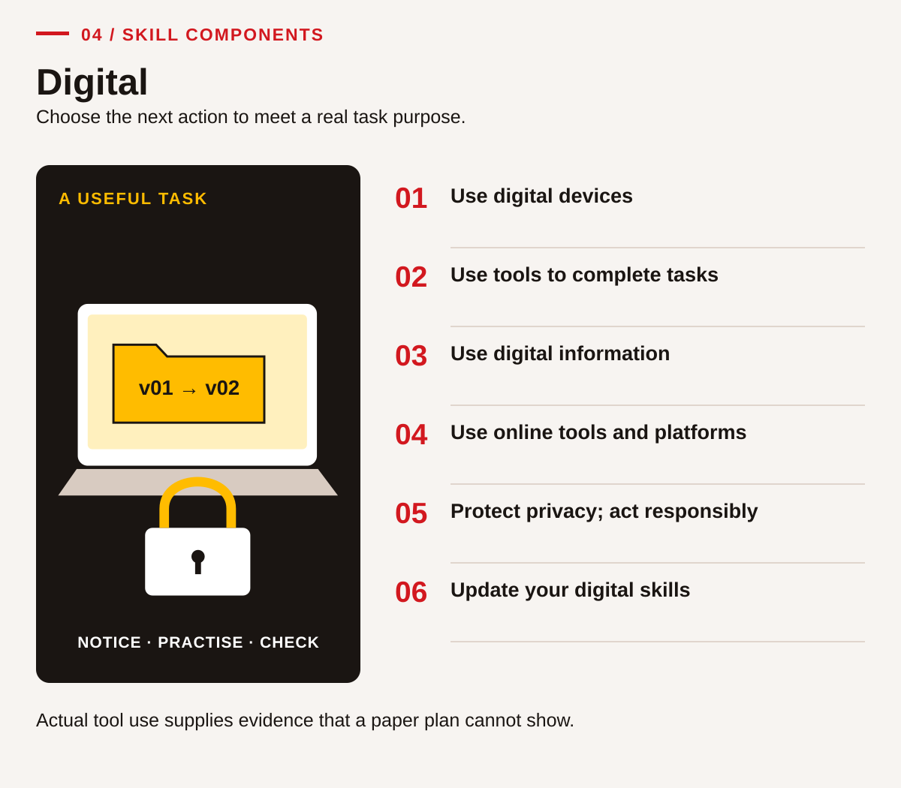
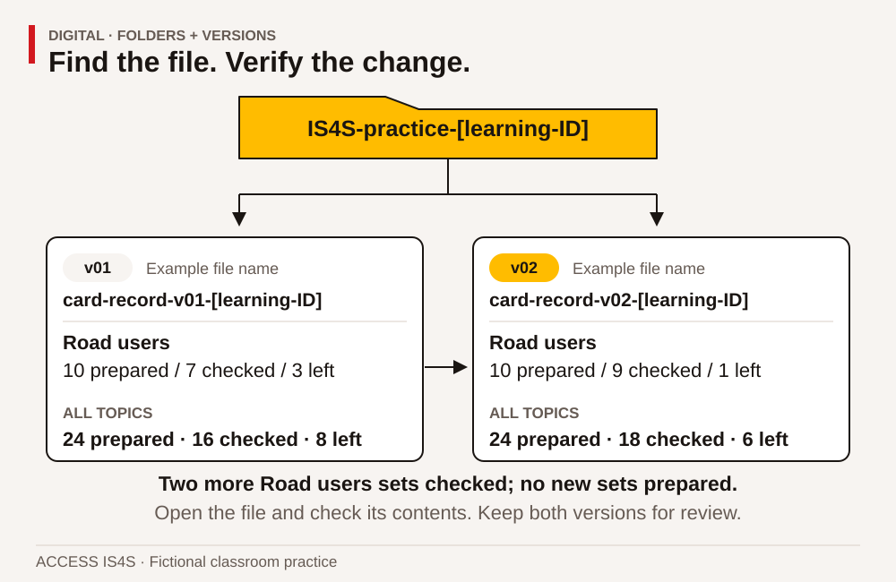

# Teaching Digital: make useful work that can be found, checked and protected

Digital teaching is strongest when a learner has a reason to use a tool and enough control to learn from the attempt. A person may be comfortable messaging on a phone and unfamiliar with folders, spreadsheets or a shared computer. Begin with that specific experience. Neither age nor confidence predicts what someone can demonstrate. Ask what the learner wants to accomplish and observe a small, relevant action.

The learner chapter uses fictional classroom equipment-card records and training notices. It offers a practical route from device access to a retrievable file, source evaluation, careful sharing and learning another method. These tasks support work and community participation in British Columbia without requiring a personal account, public post or disclosure of passwords. Arrange a designated practice location and confirm the permissions on shared equipment before class.

## Cover the six components through purposeful actions

<!-- visual:foundation-digital-map--practitioner-06 -->
<figure class="teaching-figure diagram" data-visual="foundation-digital-map--practitioner-06">

<figcaption>Visual guide Purpose guides the device, tool, information and sharing choices. Observe each learner using the tool; a described process alone is different evidence. <a class="visual-original" href="../assets/diagrams/foundation-digital-map.svg">Open full-size visual</a></figcaption>
</figure>
<!-- /visual:foundation-digital-map--practitioner-06 -->

The source identifies using devices, common tools, digital information, online platforms, safe and responsible practices, and updating digital skills (SkillPlan, 2024, p. 71). DG-01–DG-03 establish device and file control. DG-04–DG-06 build a useful record. DG-07–DG-09 examine digital information; DG-10–DG-12 address public online sources and navigation. DG-13–DG-15 develop protection and sharing decisions. DG-16–DG-18 ask learners to test a new method and plan transfer.

Document Use appears in tables, menus, forms, search results and file structures. Reading supports source evaluation, Numeracy supports formulas, and Problem Solving supports troubleshooting. Name these connections, then keep the evidence precise. A learner who explains a paper screenshot has demonstrated useful reasoning but has not yet demonstrated control of the application.

## Start with an individual needs assessment

The first strategy is a practical needs assessment (pp. 72–73). Invite learners to name familiar tools and observe a short task such as opening, editing, saving and reopening a practice file. Ask what happened when the learner last needed help, without requiring access to personal material. Identify device availability, connectivity, access methods and the tasks needed for the person's goals.

Use this information to choose a starting point. One learner may need pointer practice; another may need file versions; another may be ready to compare online evidence. Do not make the whole group repeat an introductory sequence merely because one person needs it. Provide a common purpose with different supports and opportunities to extend. Learners using voice control, keyboard navigation or other accessible interfaces should demonstrate equivalent actions rather than imitate a mouse-based route.

## Build confidence through supported control

The second strategy develops confidence with timely support (p. 73). Demonstrate a short action, explain its purpose and let the learner take control. Resist completing the task while the learner watches. Ask permission before taking over a device, then return control and ask for a repeat. Keep a brief help card available, including how to undo a change or ask for assistance.

DG-02 makes an access adjustment a purposeful experiment: predict its effect, try it, judge usefulness and restore it when appropriate. DG-03 makes saving visible by closing and reopening the file. These checks are more informative than “Did you understand?” Pair learners carefully and rotate device control. A confident partner can coach, but the record must show whose actions were observed.

## Teach the technical action and the reason together

The third strategy uses problems that join technical procedures with contextual decisions (p. 74). For a card-count record, selecting a spreadsheet is sensible because counts will change and totals must be recalculated. For a short visitor explanation, a text document may be sufficient. DG-04 asks for reasons and limitations rather than one universally correct application.

Use small iterations: create a draft, test it, receive a change and check the result. Teach file names, versions, meaningful headings and access boundaries as parts of making useful work. When an unexpected menu or error appears, model reading the message, describing what happened and trying a reversible step. Searching for help is productive when the learner can state the application, action and problem without exposing private information.

## A worked teaching example: check the changed record

<!-- visual:foundation-digital-versions--practitioner-06 -->
<figure class="teaching-figure diagram" data-visual="foundation-digital-versions--practitioner-06">

<figcaption>Visual guide A clear name helps retrieval; the changed values establish which record you opened. The second-version name shown is an example. <a class="visual-original" href="../assets/diagrams/foundation-digital-versions.svg">Open full-size visual</a></figcaption>
</figure>
<!-- /visual:foundation-digital-versions--practitioner-06 -->

In DG-05 the fictional card record contains 24 prepared sets and 16 checked sets, leaving eight. Demonstrate `prepared − checked = remaining` using the first row: `8 − 5 = 3 sets`. Explain that a formula performs a relationship; it does not establish whether the entries are correct. Check each row against the supplied case, then compare the totals.

For DG-06, two additional Road users sets are checked. Its checked count changes from seven to nine while prepared sets remain ten. The row now has one remaining set. Total checked becomes 18 and total remaining becomes six; `24 − 18 = 6` confirms the relationship. Ask the learner to predict the change before editing and explain why prepared sets stay unchanged. Save the second version and reopen it.

Collect the editable file, a brief change note and an observed explanation. A screenshot may show the result but cannot establish that the learner can edit, retrieve or inspect a formula. If formulas are not the intended target, a clearly documented alternative calculation can support the task; record exactly what was used.

## Teach protection without collecting secrets

<!-- visual:foundation-digital-privacy--practitioner-06 -->
<figure class="teaching-figure diagram" data-visual="foundation-digital-privacy--practitioner-06">

<figcaption>Visual guide Share the information needed for the review. This diagram uses dummy data; an online permission decision must be demonstrated in an approved tool. <a class="visual-original" href="../assets/diagrams/foundation-digital-privacy.svg">Open full-size visual</a></figcaption>
</figure>
<!-- /visual:foundation-digital-privacy--practitioner-06 -->

Use the suspicious-message case and practice sharing decisions in DG-13–DG-15. Ask what the requester needs, what remains uncertain and how to verify through a known channel. Discuss unique passwords, suitable password management and multifactor authentication using fictional examples and the program's current guidance. Never ask learners to reveal a password, recovery code or private account screen. Explain that a public link may expose more than the immediate recipient needs.

The source's password activity on p. 77 contains instructional tips copied from a numeracy activity. Do not reproduce them. Keep the intended safety practice but use current, relevant guidance. The same page's other two grab-and-go patterns—comparing tools and evaluating websites—are supported by DG-04 and DG-07–DG-12. Preview selected websites for accessibility and suitability before class.

## Gather evidence and plan continued learning

Assessment should combine observed performance, a usable product, reflection and feedback (p. 75). Self-report helps select teaching but cannot replace performance. Adjust complexity through number of tools, unfamiliarity, steps, information ambiguity and troubleshooting. If connectivity prevents online work, mark that component **Not observed** and arrange a later opportunity; do not count a paper substitute as online performance.

Finish with DG-16–DG-18: retain one effective learning strategy and test it on a second method. The source's resource list on p. 76 contains further leads, whose current availability and suitability require checking. Its developmental proficiency descriptions should not become a score assigned from a single session.

**Sources and companion work:** [SkillPlan guide, pp. 71–77](../../asphalt-paving/sources/SFS-Get-Started-Guide_FINAL_MAR2024.pdf#page=71); [Digital learner chapter](../learner/04-digital.md); [answer guidance](../answers/04-digital.md).
