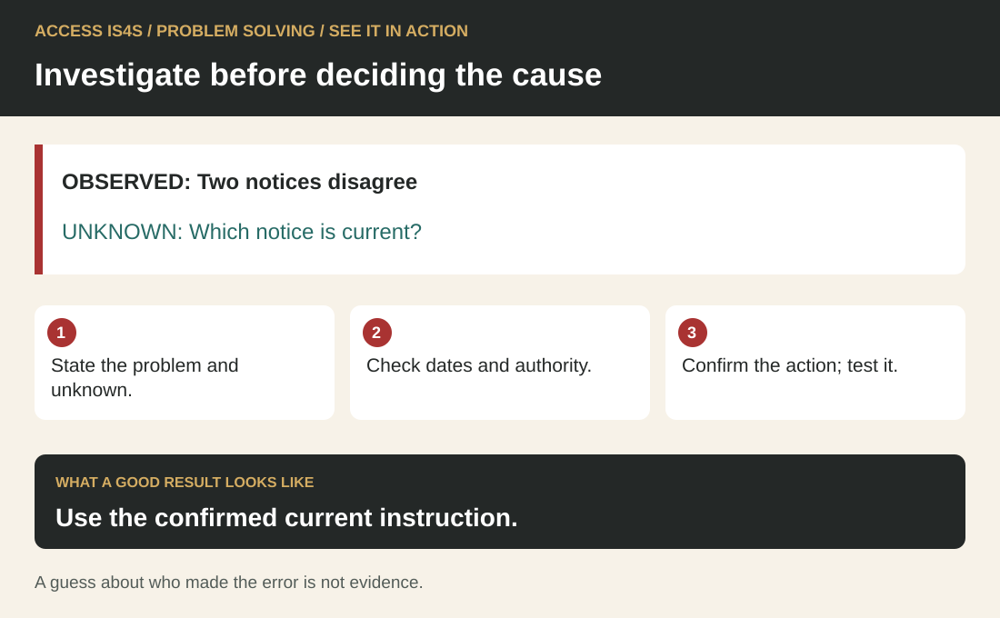
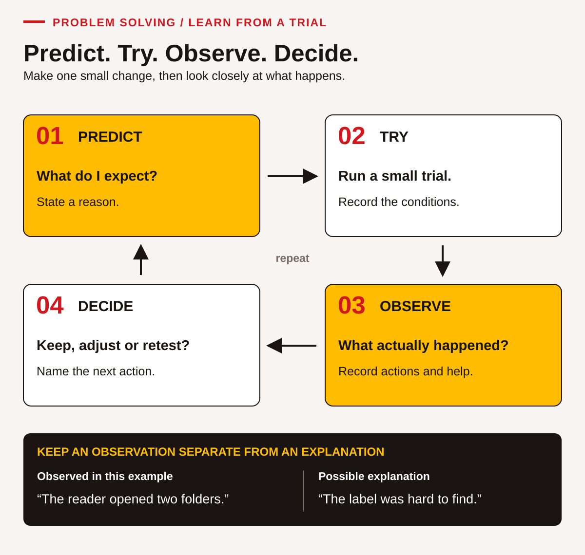

# Teaching Problem Solving: investigate before committing to an answer

Problem solving is a process of making a justified decision under stated conditions. Learners need practice defining an issue, gathering information, exploring possible explanations, comparing responses, acting and checking the result. A correct suggestion made quickly does not reveal all of that reasoning. Ask learners to show what they know, what they are assuming and what would change their recommendation.

The learner chapter uses fictional device scheduling, repeated card-label corrections and a display request with unresolved permission. These cases connect with B.C. training and community tasks without making people or communities into problems. Frame the issue as a situation to understand. Replace judgemental explanations such as “people do not care” with observations and questions that can be investigated.

## See it in action · Problem solving

<!-- visual:quick-problem-solving--practitioner -->
<figure class="teaching-figure diagram" data-visual="quick-problem-solving--practitioner">

<figcaption>Visual guide Use the confirmed current instruction. ACCESS IS4S. (2026). Original fictional teaching diagram. <a class="visual-original" href="../assets/diagrams/quick-problem-solving.svg">Open full-size visual</a></figcaption>

Read the visual description

OBSERVED: Two notices disagree. UNKNOWN: Which notice is current?. State the problem and unknown. Check dates and authority. Confirm the action; test it. Use the confirmed current instruction. A guess about who made the error is not evidence.

</figure>
<!-- /visual:quick-problem-solving--practitioner -->

This small fictional example shows the skill in use. OBSERVED: Two notices disagree. UNKNOWN: Which notice is current?.

**Try it:** State the problem and unknown. Check dates and authority. Confirm the action; test it.

**Check your result:** Use the confirmed current instruction. A guess about who made the error is not evidence.

## Use the complete six-part cycle

<!-- visual:middle-problem-solving-components--practitioner-07 -->
<figure class="teaching-figure diagram" data-visual="middle-problem-solving-components--practitioner-07">

<figcaption>Visual guide All six Problem Solving components contribute to a reasoned decision. New evidence can send you back to an earlier action; returning to check a fact is useful progress. <a class="visual-original" href="../assets/diagrams/middle-problem-solving-components.svg">Open full-size visual</a></figcaption>

Read the visual description

An original task illustration occupies the left panel; six numbered actions appear on the right. A decision can improve as the evidence changes. Six connected components: Identify the issue; Gather information; Analyze the issue; Develop multiple routes; Address the issue; Evaluate effectiveness. Keep a record: issue · facts · unknowns · options · action · results. Return when new evidence changes the decision.

</figure>
<!-- /visual:middle-problem-solving-components--practitioner-07 -->

Name the problem and the people affected. Gather facts, separate them from assumptions and compare possible explanations. Generate more than one option, test a workable choice and make an action plan. Check what happened before deciding whether to keep, change or transfer the approach.

These stages can loop. New information may change the problem statement; an unsuccessful trial may require another explanation. Reading and Document Use support briefs, evidence tables and cause maps. Numeracy can compare time, cost and proportions. Collaboration contributes other perspectives, while Adaptability helps a learner revise an idea without treating revision as defeat.

## Use guided problems with enough information to reason

Use guided problems to make the reasoning visible. Choose a case with a clear purpose, meaningful constraints and more than one possible response. Give learners time to formulate the issue before proposing a solution. Ask “What must be true of any acceptable response?” and distinguish a requirement from a preference.

PS-02 makes this distinction concrete: every learner needs an actual tool turn, the extra budget cannot exceed $50, and individual availability must be respected. Finishing everybody by 10:00 is preferred. If learners treat every preference as compulsory, they may reject a workable response. If they treat a requirement as optional, a convenient plan may fail the task. Discuss these differences using the supplied brief rather than the instructor's unstated expectations.

Scaffold the first attempt with a simple issue statement and an information table. Reduce support on a new case. Do not withhold essential prerequisites or reward guessing facts that were never supplied. “Ask the responsible person” can be a sound next action when a decision depends on missing authority or information.

## Teach systematic inquiry and cause analysis

Teach repeatable methods, including cause-and-effect mapping and successive why questions. Model gathering evidence before settling on a cause. In PS-07–PS-08, learners distinguish known observations from untested possibilities about repeated label corrections. A fishbone-style map can organize possible contributors such as file names, instructions, display and checking processes.

The Five Whys approach is a prompt for deeper inquiry, not a rule that exactly five questions reveal one true cause. Several conditions can contribute, and an explanation still needs evidence. Ask what observation would support or weaken a proposed link. Include system conditions, not only individual actions. Do not use classroom cause analysis to diagnose a person or replace a required investigation of a real incident.

## A worked teaching example: two feasible routes

<!-- visual:middle-problem-solving-routes--practitioner-07 -->
<figure class="teaching-figure diagram" data-visual="middle-problem-solving-routes--practitioner-07">

<figcaption>Visual guide Two routes meet the required individual turns, availability and budget. The shorter route costs $40; the longer route requires the three early departures to go first. Group segments share the same time scale. <a class="visual-original" href="../assets/diagrams/middle-problem-solving-routes.svg">Open full-size visual</a></figcaption>

Read the visual description

Two proportional schedules compare tool turns for ten learners. Borrowing two devices makes five available: two groups of five take twenty-five minutes each plus a five-minute change, ending at 09:55 for $40, with confirmation by 08:30. Using three available devices makes groups of three, three, three and one, taking 115 minutes to 10:55 for no extra cost. The first three finish at 09:25. The maximum extra cost is $50; a later $60 room and paper-only work fail named constraints.

</figure>
<!-- /visual:middle-problem-solving-routes--practitioner-07 -->

Use Case A and PS-11. Each digital turn lasts 25 minutes, and a five-minute reset is needed between groups. With five devices, ten learners require two groups: `25 + 5 + 25 = 55 minutes`. Two loan devices restore five available devices for $40, within the $50 budget, provided the reservation is confirmed by 08:30. Starting at 09:00, this route ends at 09:55.

With the three remaining devices, four groups are needed: three learners, three, three and one. The duration is `4 × 25 + 3 × 5 = 115 minutes`, ending at 10:55. This can respect everyone's availability if the three learners leaving at 10:00 receive early turns. It costs nothing extra but does not meet the preferred early finish. Both routes can be justified under the supplied conditions.

Ask learners to explain why the $60 later room and a paper-only substitute fail stated requirements. Then invite them to defend either feasible route while naming a drawback. PS-12 asks a partner to challenge the choice respectfully. A revised recommendation may demonstrate stronger reasoning than defending the first idea. This is a classroom scheduling example, not authority to book equipment or spend program funds.

## Use discussion to examine assumptions

Use group reasoning, different perspectives and role-play to examine assumptions. Ask individuals to draft an initial view before group discussion so that one voice does not determine the options. Give an observer the task of noticing evidence, assumptions and questions. Rotate facilitator and challenger roles, and require a reason rather than a personal judgement.

PS-09 challenges a claim that a new folder proves earlier carelessness. The record supports possible process improvements; it does not establish motivation. PS-15 adds a permission question: an attractive display idea does not authorize use of knowledge or imagery. Learners should identify whose decision is needed and a useful alternative while permission remains unresolved. Respecting that boundary is part of solving the actual problem.

## Evaluate outcomes without overstating causation

<!-- visual:middle-problem-solving-trial--practitioner-07 -->
<figure class="teaching-figure diagram" data-visual="middle-problem-solving-trial--practitioner-07">

<figcaption>Visual guide The recorded correction proportion fell from 9/30 (30%) to 1/20 (5%): 25 percentage points. The small before-and-after record supports another check, not a claim that one change alone caused the result. <a class="visual-original" href="../assets/diagrams/middle-problem-solving-trial.svg">Open full-size visual</a></figcaption>

Read the visual description

Dot arrays show nine of thirty sets needing correction before the change, or thirty percent, compared with one of twenty afterward, or five percent. The observed difference is twenty-five percentage points. The current folder and a version-check card were introduced, but different sessions, potentially different learners and no same-time comparison group limit causal claims.

</figure>
<!-- /visual:middle-problem-solving-trial--practitioner-07 -->

Assessment should examine process, evidence, action and reflection. Use a rubric that accepts different justified responses. Record how much support was needed and whether the learner can repeat the process on a changed case. Increase complexity through ambiguity, number of constraints, competing perspectives or less direct consequences rather than simply making the text longer.

PS-17 compares nine corrections among 30 sets with one among 20: 30% before and 5% after, a difference of 25 percentage points. The lower recorded proportion is promising, but the small, uncontrolled record cannot prove that one change caused the improvement. Ask for a limitation and the next observation. PS-16 likewise prevents attendance from being mistaken for proof that every learner used a device.

Use short routines for a complete problem cycle, questions about alternatives, and measurable effects on the people using a process. The cases and PS-01–PS-18 provide planning and evaluation practice. Use communication evidence without scoring eye contact or stillness; judge the reasoning and relevant action under the recorded conditions.

## Observe an implemented change

<!-- visual:edition3-prediction-trial-cycle--practitioner-07-problem-solving -->
<figure class="teaching-figure diagram" data-visual="edition3-prediction-trial-cycle--practitioner-07-problem-solving">

<figcaption>Visual guide A prediction becomes useful evidence through a small trial, clear observations and a next decision. <a class="visual-original" href="../assets/diagrams/edition3-prediction-trial-cycle.svg">Open full-size visual</a></figcaption>

Read the visual description

A four-step cycle begins with a prediction and reason, continues with a small trial under recorded conditions, then records observable actions and help needed before deciding whether to keep, adjust or retest. An example distinguishes an observation, the reader opened two folders, from a possible explanation, the label was hard to find.

</figure>
<!-- /visual:edition3-prediction-trial-cycle--practitioner-07-problem-solving -->

Connect PS planning to the learner's own kit prototype in CI-10–CI-15 or the fresh current-card trial. Before the test, record the issue, options, chosen action, prediction and criterion. Observe what the learner implements, what a willing user actually selects or does, and which support each person receives. Afterward, ask the learner to compare the result with the criterion, retain or revise a feature for a reason, and choose a next check.

Keep planning, implementation and evaluation evidence separate. Credit an unsuccessful prototype trial when the learner accurately observes the result and makes a reasoned next decision. Do not replace the observed result with the model answer, claim causation from a small uncontrolled comparison or award every skill from a finished group object. A supported walkthrough remains useful evidence with the support named; an unavailable user opportunity remains unobserved until arranged.

<!-- teaching:problem-solving-entry-bridge-practitioner -->
## Turn a concern into a testable next step

A useful decision begins with a situation you can describe. It need not begin with blame or an instant answer. This short practice separates what is known, what is possible and what can be tried within the classroom.

### Start with a small observation

Read this fictional note: **“A learner opened two practice folders before finding the instructions. Both folders had the label ‘Practice’. We do not know which folder the learner was told to use.”** Identify one observation, one unknown and one possible explanation. If you can already distinguish them, move to comparing options. Otherwise, work through the examples below.

### Keep the evidence and explanation separate

Example: “Two folders were opened” is an observation supplied by the case. “The labels did not distinguish the folders” is supported by the two identical labels. “The learner did not care” is not established. “Were the intended instructions clear?” is a question, not a known fault.

Try with support: sort **both labels say Practice**, **the wrong folder was opened on purpose**, **the spoken instruction may have been unclear**, and **we need to know which folder was requested** into fact, unsupported claim, possible explanation and missing information. Discuss why a plausible explanation still needs checking.

### Compare two ways to help

Use this goal: a new user should identify the requested folder without the designer choosing it for them. Two possibilities are a distinct name on each folder or a separate index showing which folder contains which material. Explain how each works, one effort or limitation, and what you would observe in a trial. Both could work; do not choose purely because another person prefers one.

Example prediction: “With distinct topic names, the user may select the requested folder by matching its name.” A checkable criterion is “The user selects the named folder and explains the label used.” No timing or emotional reaction is required.

### Try a change and inspect its result

Make two dummy folders or folded paper covers named **Schedule** and **Supplies**. Ask a willing partner to find Supplies, using an agreed accessible way to read the labels. Record the actual choice and any help. If the partner asks what Supplies means, keep that question: the wording may need teaching or revision. Do not rewrite the result as independent success because the final choice was correct after help.

Ask what to retain, what to change and what another trial could show. A single successful selection does not establish that every future user will understand the arrangement. Record the conditions under which this person used it.

### Fresh exit practice

Read a different small case: **“Two paper trays are labelled ‘In’ and ‘Out’. A helper does not know which holds checked cards. The coordinator confirms that the tray currently called Out contains checked cards; the other holds cards awaiting a check. Both piles must remain separate.”**

State the issue, propose two clearer labelling or checking options, choose one, label two paper areas and ask a willing partner where a checked card belongs. Record the choice, help and next decision. Possible labels are **Awaiting check / Checked**, or another equally clear arrangement. Do not change the coordinator's assigned status of the piles. The user test can reveal a need to clarify the word checked.

Keep your stated purpose, two options, actual change and honest result in the record. A useful next task is the fresh card-register case, where version information creates a further constraint. Do not claim an observed trial if only the plan was completed.
<!-- /teaching:problem-solving-entry-bridge-practitioner -->

<!-- teaching:problem-solving-learner-checks-practitioner -->
## Problem solving · choose a change, try it and examine the result

Use the form selected by the instructor. These are classroom materials problems. You may make labels, trays or paper arrangements; you may not change the source cards, remove their version information or claim a practice document authorizes a real procedure. Use no personal data. Work on a problem statement and options yourself before discussing them with a partner.

The complete task can use ordinary paper, removable labels and two or three marked spaces on a desk. No computer, purchase or real workplace change is required. If a willing test user is unavailable, arrange an instructor-supported walkthrough and label its support accurately. Do not invent an independent user result.

### Form A · Find the current practice pair

A learning room keeps loose practice cards in one mixed pile. A new user must find the **current Sheet and Check card for a named kit**. Both cards must match the current register. The instructor reports that older cards have sometimes been selected, but supplies no count or proven cause. The user needs a clear arrangement that can be reset after a kit changes.

#### Current register A

| Kit | Current version | Required pair |
|---|---:|---|
| R · Reading practice | 2 | Sheet and Check |
| N · Number practice | 3 | Sheet and Check |
| C · Conversation practice | 1 | Sheet and Check |

Copy each cell below onto a separate dummy card. The words and codes are the entire card content for this task.

| Card | Card |
|---|---|
| R — Sheet — version 2 | R — Check — version 2 |
| R — Sheet — version 1 | R — Check — version 1 |
| N — Sheet — version 3 | N — Check — version 3 |
| N — Sheet — version 2 | N — Check — version 2 |
| C — Sheet — version 1 | C — Check — version 1 |

Keep all ten cards; older cards must be retained in a clearly separate practice area rather than destroyed. Any design must work without colour, use the register as the authority, and let a user find the correct pair without the designer choosing it for them. The user may use agreed reading/access supports, recorded in the test.

#### CK-PS-A01 · Define and investigate

State the desired result, observed or reported issue, two constraints and an important unknown. Distinguish the instructor's report from something you have observed yourself. Inspect the cards/register. Identify two possible explanations for wrong selection and what observation could help investigate each.

#### CK-PS-A02 · Compare and predict

Propose at least two distinct organizing or checking methods. Explain how each could help and one drawback. Choose a first change and state your reason. Before building, predict what a user will be able to do. Set a checkable success criterion: selecting both current cards for the requested kit, with any support visible. Do not require speed unless you separately agree a meaningful purpose for measuring time.

#### CK-PS-A03 · Put the decision into use

Build your chosen arrangement using all supplied cards and the current register. Ask a willing user: **“Find the current Sheet and Check pair for kit R, then show how you checked the version.”** Give them the register and agreed access supports. Observe without choosing the cards for them. Record their actual selection, verification action, questions and any help you supplied. If you intervene, record the point and reason. The trial still provides useful information.

#### CK-PS-A04 · Evaluate, revise and retry

Compare the observation with your criterion. Retain what worked and revise one feature if evidence suggests a need; if the arrangement already works, document the evidence and choose an additional check. Test kit N with a willing user or supported walkthrough. Record the current pair selected and how it was checked. Explain one limitation: a different kit, prior exposure, a different user or changed support may affect the comparison. State a useful next action without claiming your design alone caused all differences.

### Form B · Find the approved practice pair

A classroom desk keeps practice cards in one mixed pile. A user must find the **approved Brief and Review card for a named kit**, using the current register. A helper reports that draft cards have sometimes been mistaken for approved ones, but provides no count or proven explanation. A later version number is not automatically the approved version.

#### Current register B

| Kit | Approved version | Required pair |
|---|---:|---|
| H · Handover practice | 1 | Brief and Review |
| T · Time practice | 4 | Brief and Review |
| W · Writing practice | 2 | Brief and Review |

Copy each cell onto a separate dummy card.

| Card | Card |
|---|---|
| H — Brief — version 1 | H — Review — version 1 |
| H — Brief — version 2, draft | H — Review — version 2, draft |
| T — Brief — version 4 | T — Review — version 4 |
| T — Brief — version 3 | T — Review — version 3 |
| W — Brief — version 2 | W — Review — version 2 |

Retain all ten cards in your arrangement, separating unapproved/older cards clearly. Work without colour-only cues, keep source wording/version labels intact and give the user the register. Use no personal information. The designer must not choose the answer for the user.

#### CK-PS-B01 · Define and investigate

State the desired result, reported issue, two constraints and an unknown. Distinguish report from observation. Identify two possible explanations for wrong selection and an observation that could investigate each.

#### CK-PS-B02 · Compare and predict

Develop two distinct approaches, with a possible benefit and drawback for each. Select one with a reason. Predict the result before building and specify the criterion: both approved cards for the requested kit, with the actual verification method and support recorded.

#### CK-PS-B03 · Put the decision into use

Build the arrangement. Ask a willing user: **“Find the approved Brief and Review pair for kit H, then show how you checked its approval.”** Give the register and agreed access supports. Record actual selections, checks, questions and any help. Do not silently replace a draft card or supply a correct result in the observation record.

#### CK-PS-B04 · Evaluate, revise and retry

Compare the observation with the criterion. Make an evidenced improvement or document why the arrangement should be retained. Test kit T, observing the selection and approval check. State what happened and one limit on the comparison, including changed kit/user/support or practice effects. Choose a next action rather than promising universal success.

### My trial record

| Stage | My evidence |
|---|---|
| Issue, required outcome, constraints and unknown | |
| Two options, drawbacks and selected reason | |
| Prediction and criterion written before trial | |
| Action I actually implemented | |
| Trial 1: exact cards selected and check performed | |
| Support to me / support I gave the user | |
| What I retained or revised, and why | |
| Trial 2: exact cards, check and support | |
| Limited conclusion and next action | |

Sketch the first and revised arrangements, or attach an accessible description. Mark predicted features separately from tested ones.     

### Reuse an idea-development trial

You can also use the kit prototype work in **CI-10–CI-15** as an enacted problem-solving cycle. Keep your own issue statement, two options, choice/prediction and implemented change. Add the actual reader-test record, support, comparison with your criterion and next decision. Cite the precise action that supports each skill; a finished kit alone does not demonstrate the reasoning or the trial. Supplied case results remain examples, separate from observations you collect.
<!-- /teaching:problem-solving-learner-checks-practitioner -->

<!-- teaching:problem-solving-practitioner-notes-practitioner -->
## Problem solving · an observed classroom cycle

The [fresh learner forms](../teaching/foundations/problem-solving-learner-checks.md) require a decision, actual low-risk implementation and observation. They extend valid planning and supplied-data evaluation with evidence from a learner's own small trial. They do not require the solution to succeed on its first attempt or prove a causal effect.

### Prepare and route

Provide paper, removable labels, the selected register and all ten dummy cards. Check card completeness before use. A tray can be a labelled area on a desk. Arrange a willing user and an observer; do not assume all pairs can be observed simultaneously. Demonstrate the trial process using different content if the learner needs instruction, then use an unseen form for the check.

| Starting evidence | Teaching route | Next opportunity |
|---|---|---|
| Jumps to a solution before describing the issue | Use the [problem-solving bridge](../teaching/foundations/problem-solving-entry-bridge.md): observation, unknown, option. | Form task 01 with a new register. |
| Proposes only one method or ignores a constraint | Use PS-02/PS-10 to distinguish requirements and varied routes. | Task 02 with a blank options record. |
| Can plan but has not tested a change | Model how to give a user task and record support without taking over. | Task 03; plan and enacted action recorded separately. |
| Treats one successful trial as proof for everyone | Use PS-17's comparison limits and a specific observed result. | Task 04 with another kit and explicit comparison limits. |
| Meets the selected criteria | Use an unfamiliar kit-content change or transfer the process to a different ordinary information task. | New evidence, not a relabelled copy of the first record. |

### Form-specific key

**CK-PS-A01/CK-PS-B01:** a useful statement concerns reliable selection of the current/approved matching pair, not a claim about careless users. The reported past selection problem is not learner-observed baseline data. Constraints include retaining all cards, preserving source text/version, using the register and avoiding colour-only cues. Plausible contributors include mixed stacks, unclear current/archive separation, weak version checking or an instruction that does not direct the user to the register. They remain hypotheses until evidence supports them.

**CK-PS-A02/CK-PS-B02:** accept labelled current/archive spaces, kit folders with visible current-version lists, or a pairing/checking guide. Different colour versions of the same arrangement are not meaningfully distinct methods and cannot be the only cue. Compare actual mechanisms and effort; one choice need not be universally best. The prediction should precede the build/trial and name what will be observed.

**CK-PS-A03:** correct target is **R Sheet v2 + R Check v2**, verified against register A. **CK-PS-A04:** second target is **N Sheet v3 + N Check v3**. C's current pair is v1 if used in an additional check.

**CK-PS-B03:** correct target is **H Brief v1 + H Review v1**. The v2 draft pair is not approved merely because its number is higher. **CK-PS-B04:** second target is **T Brief v4 + T Review v4**. W's approved pair is v2 if used later.

The key supplies expected selections, not invented results. A user's actual error or question must remain in the record. If the designer says which card to take, the user test was prompted; it can inform revision but cannot be described as unprompted use. A willing user can stop. A supported walkthrough is acceptable learning evidence with its conditions named.

### Criterion anchors

| Criterion | Meets the selected action | Common issue / feedback |
|---|---|---|
| P1 Define and investigate | Outcome, constraints, report/observation distinction, unknown and plausible explanations are visible. | States a cause as proven; ask which record establishes it. |
| P2 Compare and decide | Two distinct options, drawbacks, reasoned choice and pre-trial prediction/criterion. | Selects on appearance alone or writes prediction after seeing the result. |
| P3 Implement within scope | Learner builds/changes a usable arrangement while retaining cards/register and required boundaries. | Only a plan exists, or someone else implements it; arrange another turn. |
| P4 Observe and evaluate | Actual selection/check/support recorded; compares with criterion, retains/revises for evidence and states a limitation/next step. | Copies the expected answer as an observed result, or claims universal success. |

**Calibration, P4:** “It worked for everyone” after one prompted walkthrough is **Not yet demonstrated**. After the observer asks “What did this user do before you helped?”, the learner records the wrong first card, the prompt and corrected choice, then proposes a new check: **Demonstrated with support** if the criterion is met. An independently written accurate record of an unsuccessful test, a reasoned revision and a limited conclusion can meet P4 **independently**. Success of the prototype and quality of the learner's evaluation are different findings. No user opportunity is **Not observed** for the trial, not proof of weak reasoning.

### Cross-map an existing prototype trial

| Problem-solving evidence | Existing creativity work that can contribute | Additional record needed |
|---|---|---|
| Define/gather/analyze | CI-01–04, design question and observations | Learner separates report, observation, hypothesis and unknown. |
| Compare routes | CI-05/08, alternatives and criteria | Individual reason for selecting a trial. |
| Address the issue through action | CI-09–10/14, actual prototype and revision | Identify what the learner implemented and the scope/permissions. |
| Evaluate and choose next step | CI-11–15, actual test and retest | Prediction, criterion, observed result, support and bounded interpretation. |

Do not credit all skills from the final artifact. A group prototype still needs each person's actions and reasoning. Preserve the difference between the provided fictional test record and a learner's own observed trial. No larger causal study or industrial change is implied.

### Printable observation record

| Learning ID / form / date / prior exposure | |
|---|---|
| User/observer practice role labels; agreed access/support | |
| P1 evidence / status | |
| P2 evidence / status | |
| P3 actual action / status | |
| P4 observed result and reasoning / status | |
| Help supplied to designer | |
| Help supplied to test user | |
| Feedback / missing opportunity / next trial | |

Compare records with another practitioner using the stated criteria. Disagreement about prototype preference should not change whether an accurate, independent evaluation was observed. Record moderation or pilot findings only after those processes occur.
<!-- /teaching:problem-solving-practitioner-notes-practitioner -->
