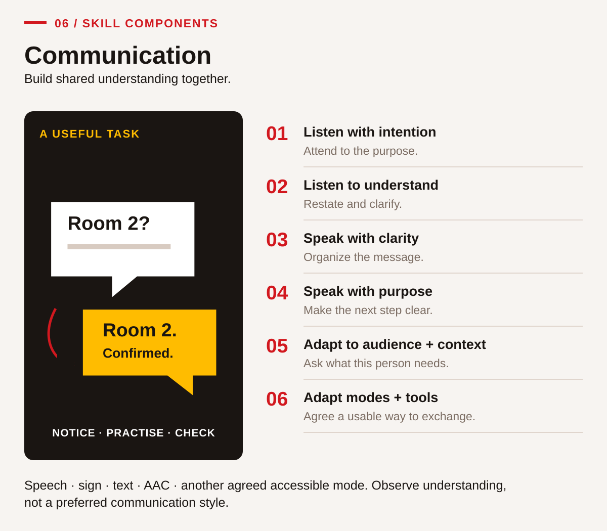
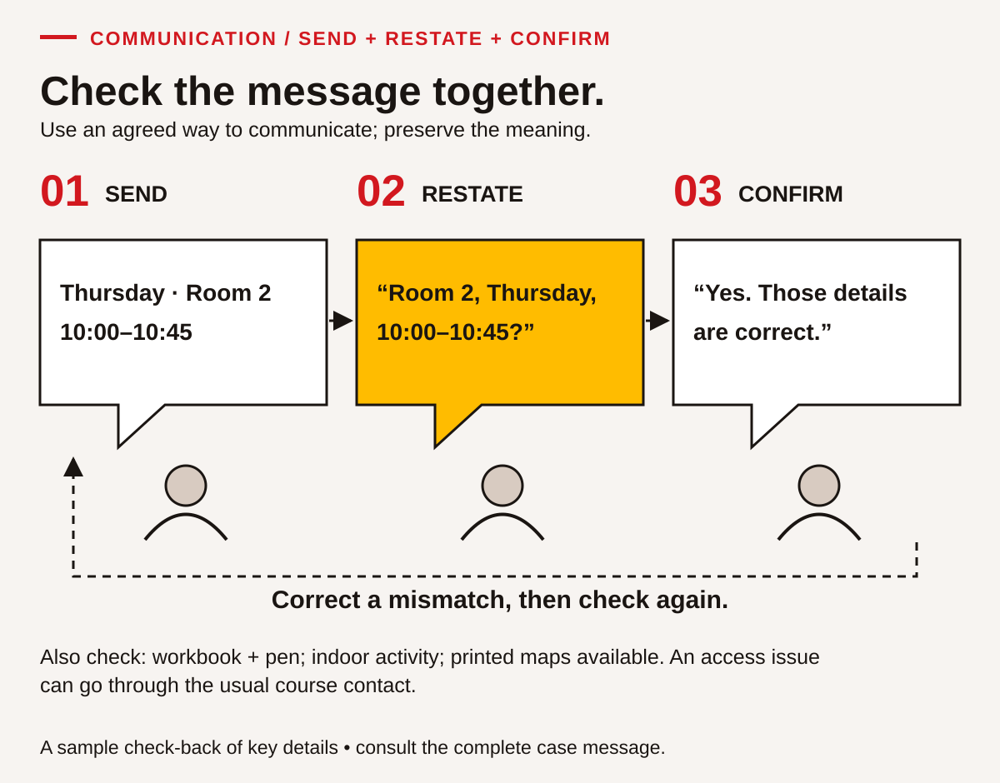
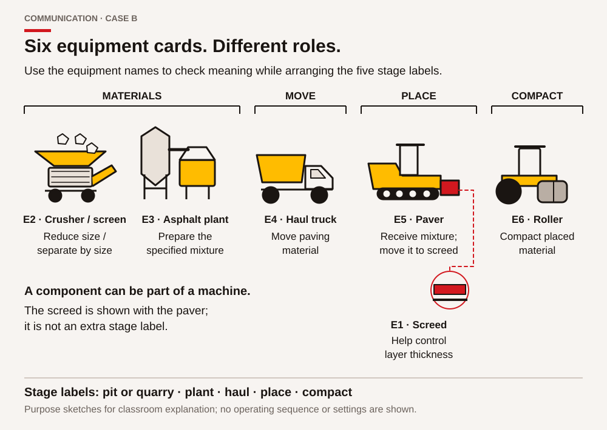

# Teaching Communication: build a shared understanding and check it

Communication instruction needs both a sender and a receiver with a reason to exchange information. A fluent presentation may leave the audience unsure what to do. A brief clarification can prevent an important misunderstanding. Teach learners to identify the purpose, receive the message, organize a response and confirm meaning. Observe what the interaction achieves rather than how closely a learner matches one preferred speaking style.

The learner chapter uses fictional classroom changes, a misunderstood card task and a visitor explanation. These settings support practice relevant to B.C. training, work and community life without requiring disclosure of personal experiences. In an ACCESS IS4S classroom, ask about the communication needs of the person and task. Do not assign preferences from identity or ask a learner to speak for a Nation or community.

## Include all six components and accessible modes

<!-- visual:middle-communication-components--practitioner-08 -->
<figure class="teaching-figure diagram" data-visual="middle-communication-components--practitioner-08">

<figcaption>Visual guide The six Communication components work together around a shared purpose. Agree accessible ways to send, receive and check meaning; the map does not prescribe a fixed order. <a class="visual-original" href="../assets/diagrams/middle-communication-components.svg">Open full-size visual</a></figcaption>

Read the visual description

An original task illustration occupies the left panel; six numbered actions appear on the right. Build shared understanding together. Six connected components: Listen with intention; Listen to understand; Speak with clarity; Speak with purpose; Adapt to audience + context; Adapt modes + tools. Speech · sign · text · AAC · another agreed accessible mode. Observe understanding, not a preferred communication style.

</figure>
<!-- /visual:middle-communication-components--practitioner-08 -->

Teach listening with intention, listening to understand, speaking clearly, speaking with purpose, adapting to audience and context, and adapting to different modes and tools. The learner chapter provides three activities for each: CM-01–CM-03, CM-04–CM-06, CM-07–CM-09, CM-10–CM-12, CM-13–CM-15 and CM-16–CM-18 respectively. Use this sequence flexibly, returning to a component when a later task reveals a need.

The component names use speaking and listening, while the purpose can be supported through speech, sign, text, augmentative and alternative communication or another agreed mode. Record the mode and support accurately. Give every learner turns sending, receiving and clarifying. Document Use appears when a diagram, schedule or reference card carries part of the message; Reading helps inspect it, while Collaboration supports shared turn-taking and repair.

## Teach intercultural reflection without stereotypes

Develop intercultural understanding through careful observation and respectful questions. Begin with the difference between an observation and an interpretation. “The learner paused and looked at the map” is observable. “The learner was uninterested” is an interpretation requiring more information. Invite several possible explanations, then a respectful question about what would help the exchange.

CM-14 provides this practice; CM-15 replaces stereotype-based questions with choices relevant to the current task. A useful question is, “Would key points in writing or a spoken review help you check this map?” The answer may vary by task. Cultural knowledge is not automatically available for classroom use. Arrange appropriate relationships and permission when a real project calls for a particular community perspective; use the supplied fictional cases for these exercises.

Use the Describe–Analyze–Evaluate routine in CM-14. Describe the event without judgement, analyse possible meanings, and evaluate a response by its usefulness and evidence. Avoid treating one interpretation as a universal cultural rule. Learners may reflect privately or use a fictional example rather than recount a difficult personal interaction.

## Make listening an explicit, teachable action

Teach active listening explicitly. Model preparation, attention to purpose, paraphrasing, clarification and confirmation. Show that an accurate paraphrase preserves the message's limits. A listener should not add an attractive promise merely because it would make the plan easier. A sender shares responsibility by checking the paraphrase and correcting omissions.

Use CM-01 to identify the information needed before receiving a message. CM-02 addresses barriers such as overlapping talk or inaccessible text. CM-03 looks for a useful response. Attention may include looking at a diagram, taking notes, using a device or pausing. Do not grade eye contact, stillness, accent or one response pace. Those features cannot establish comprehension and may reflect different access needs or communication practices.

## A worked teaching example: preserve a room change

<!-- visual:middle-communication-check-back--practitioner-08 -->
<figure class="teaching-figure diagram" data-visual="middle-communication-check-back--practitioner-08">

<figcaption>Visual guide A check-back makes the listener’s understanding visible. Restate the room, day and time, then confirm or correct them and check the remaining details in the full message. <a class="visual-original" href="../assets/diagrams/middle-communication-check-back.svg">Open full-size visual</a></figcaption>

Read the visual description

Three speech bubbles demonstrate sending Thursday, Room 2, 10:00–10:45; restating those details; and confirming their accuracy. A dashed return path asks partners to correct a mismatch and check again. The accompanying reminder includes workbook and pen, indoor activity, printed maps and the usual route for access questions.

</figure>
<!-- /visual:middle-communication-check-back--practitioner-08 -->

Use Case A. The current message places Thursday's indoor classroom session in Room 2, from 10:00 to 10:45, and asks learners to bring a workbook and pen. Printed process maps will be available. Model a concise check-back: “The indoor session is now in Room 2, starting at ten and ending at ten forty-five. I bring my workbook and a pen; maps are supplied. Is that correct?”

Have the sender compare the paraphrase with the source rather than automatically agreeing. Then model an unanswered question: “Will transport be provided?” The message contains no transport arrangement. A useful response identifies that limit and asks the responsible course contact; it does not invent a bus. This distinction matters because helpful intentions can still produce inaccurate instructions.

In CM-06, a partner repeats the old Room 1 location and an 11:00 finish. Practise describing the discrepancy and checking the current message together. The outcome is an agreed version or an explicit question for the instructor, not a judgement about the person who repeated the old information. Repeat with another comparable message so that successful recall of the first script is not mistaken for transferable listening.

## Use simulations with feedback and another attempt

<!-- visual:middle-communication-equipment--practitioner-08 -->
<figure class="teaching-figure diagram" data-visual="middle-communication-equipment--practitioner-08">

<figcaption>Visual guide Six equipment-purpose cards support terminology checking. The screed is a paver component, so six equipment cards are different from the five stage labels in the pair task. Illustrations explain purpose only. <a class="visual-original" href="../assets/diagrams/middle-communication-equipment.svg">Open full-size visual</a></figcaption>

Read the visual description

Six original equipment silhouettes show E2 crusher and screen reducing and separating material by size; E3 asphalt plant preparing the specified mixture; E4 haul truck moving paving material; E5 paver receiving mixture and moving it to the screed; E1 screed helping control layer thickness; and E6 roller compacting placed material. The broad flow is pit or quarry, plant, haul, place and compact. The screed is shown with the paver, not as an additional broad stage.

</figure>
<!-- /visual:middle-communication-equipment--practitioner-08 -->

Use role-play and simulations with a clear purpose. Keep roles simple and the purpose clear. Demonstrate one exchange, allow rehearsal, observe a short attempt, give one useful piece of feedback and repeat with roles reversed. Let learners pause or choose an instructor partnership. They should not imitate another person's disability or perform a cultural stereotype.

CM-07–CM-09 develop plain explanations and clear references; CM-10–CM-12 distinguish a request, clarification and handover. CM-13 changes the audience while retaining the technical meaning of the introductory map. CM-16–CM-18 change the mode and require a question-and-response check. A connected call or delivered message is not proof that the recipient understood it. Ask what information was confirmed and what remained pending.

## Assess understanding without introducing an unrelated barrier

Use direct observation and suitable tasks; distinguish listening from the writing demands of a response. A short paraphrase, selected response, relevant action or clarification can show understanding without an extended written summary. If learners studied the printed script first, record that preparation. Use a new comparable message when the aim is to observe reception of unfamiliar information.

Live observation is sufficient; recordings require an agreed purpose and consent. Keep evidence specific: “Asked which version applied and repeated the confirmed room and time.” Increase complexity through more details, an unfamiliar audience, ambiguity or a changed channel. Keep access supports available and distinguish an unobserved component from an unsuccessful attempt. Classroom feedback categories do not establish official Communication proficiency levels.

Choose a routine that matches the observation: CM-14 develops Describe–Analyze–Evaluate; CM-01–CM-06 develop listening actions; CM-04/CM-08 develop instructions and check-backs. Finish with a specific next practice, such as shortening a paraphrase while preserving its conditions, then observe that change in another exchange.

## Classroom exercise: relay a changed collection arrangement

Use the following fictional sender card. For a listening attempt, give it to the sender only at first; agree spoken, signed, AAC or other accessible delivery with the participants. A learner who studies the card beforehand can still practise, but record that preparation.

> **Sender card.** “Tomorrow's classroom folder collection has moved to Room 6. It runs from 11:15 to 11:35. Bring your collection card. The coordinator has not confirmed delivery for anyone who cannot attend. Please tell me what you will do and ask about anything that is unclear.”

The listener gives a concise check-back. The sender checks it against the card and corrects any changed or missing meaning. Reverse roles using this second card: **“Collection is on Practice Friday in Room 3, 14:00–14:20. Bring the workbook. There is no confirmed online collection option.”** Allow time for the agreed mode; do not turn a short-message exercise into a speed test.

**Answer guidance.** The first check-back must preserve the next-day timing (“tomorrow”), Room 6, 11:15–11:35, the collection card, and the lack of a confirmed alternative delivery. “I can collect at 11:40” does not match the window. “You will deliver it if I cannot come” adds an unsupported promise. A useful clarification is, “Who should I contact if I cannot attend?” The sender can identify the coordinator without inventing what arrangement will be offered. The second check-back preserves Practice Friday, Room 3, 14:00–14:20, the workbook and the unconfirmed online option.

Record the message version, mode, preparation, essential details preserved, clarification and sender response. A listener who asks for repetition may be using an effective strategy. A sender who notices a misunderstanding and repairs it supplies Communication evidence too. If a written response is slow but the check-back is accurate, do not confuse writing speed with understanding.

For reflection, ask partners to describe one action that improved accuracy. Avoid conclusions about eye contact, accent or willingness to speak in front of the whole class. Give a later message with different facts before describing unfamiliar-message reception as observed.

<!-- teaching:cm-route-practitioner -->
## Communication route card

**Core route.** Begin with a purpose and usable mode. Practise a check-back, clarification and contradiction repair with CM-01/02/04/05/06. Use CM-08/11/12 for an instruction, call and handover; then CM-14/15/16/18 for assumptions, audience choices and a changed-mode exchange. Take both sender and receiver turns in CK-CM. Keep the source/version, essential details confirmed and the actual question/response.

**Support route.** Use a familiar chapter source first, a key-detail organizer with headings but no completed answers, a learner-controlled communication tool, agreed interpretation or an instructor counterpart. Rehearse “What is the current room/time?” or another learner-chosen clarification. If an instructor supplies a phrase or points to the missed answer, record that support on the relevant criterion. Reduce unrelated writing; let the receiver show meaning through a check-back, selected details or an appropriate action. No speed or eye-contact target is added.

**Retry route.** Choose the missed action, receive feedback and try it again with the familiar source. If the next goal is unfamiliar reception, use held CK-CM Card C only when it is genuinely unseen by the receiver. Record prior exposure honestly; otherwise arrange another checked message. Compare the essential details and how the uncertainty was resolved, not how confident the learner looked.

**Chapter coverage map:** preparation CM-01/02/05/07/10/13/14/15; guided/observed practice CM-03/04/06/08/09/11/12/16/17/18. Combine activities only when their distinct actions remain visible. A single receiver turn does not supply the sender evidence.

**Next-attempt agreement:** criterion ___; message/version ___; sender/receiver role ___; mode/language ___; access and task support ___; observer/date ___; evidence still missing ___.
<!-- /teaching:cm-route-practitioner -->

<!-- teaching:cm-case-practitioner -->
## CK-CM · Send, receive and check a fresh classroom change

These four original cases give you another opportunity to use a skill after the chapter practice. **All people, rooms, events and organizations in these cards are fictional.** You can use these cases without sharing personal, family, community or cultural knowledge. They are classroom tasks, not instructions for operating equipment or following an actual workplace procedure.

Your instructor will give you the relevant card when your turn begins. Keep a sender's information separate from the receiver's card until after the exchange. If you have already read the information, say so: the activity remains useful practice, but that attempt cannot show how you receive an unfamiliar message. No one needs to conceal prior practice.

Agree your language, communication mode, tools, access supports and response time before beginning. Speech, sign, text, AAC, a learner-directed scribe and agreed interpretation can be appropriate. The person observing needs a reliable way to understand the meaning of your contribution. Receiving a message in writing shows reception through that mode; it does not automatically show auditory listening. You may decline audio/video recording and use live observation. Ask for a pause or another opportunity if the conditions are not usable. There is no requirement to look cheerful, make eye contact or disclose why you need an arrangement.

**Purpose:** make the practical change clear, receive the other person's meaning and resolve a relevant question. Each person has a sender turn and a receiver turn. Your instructor distributes Card A only to the first sender and Card B only to the second sender. Do not show your source card before your partner has received and checked the message. Sending an agreed written message is allowed; copying the entire source into a receiver's worksheet is a different task and must be recorded as such.

### CK-CM receiver card · Use before either exchange

You are planning to attend a fictional classroom session. An earlier note may be out of date. Ask the sender to explain the current arrangements. Choose how you want to receive the message and how to request repetition or a pause. Find out the activity, current room, start and finish times, and what you need to bring or do. Check your understanding with the sender. Ask one useful question; if the source does not answer it, agree who should check rather than inventing an answer.

You may take notes, select or arrange written details, use your communication tool, or give a spoken check-back. Do not try to memorize the message without access supports you would normally use. After checking, identify the information you can act on and anything still unresolved.

### CK-CM sender card A · Give only to the first sender

> **Fictional Tuesday update · Current notice A2**
>
> The classroom label-making session is now in **Room Cedar**, from **14:10 to 14:45**. The earlier notice A1 said Room Birch and a 14:00 start. The finish time has not changed.
>
> Bring the **practice folder** supplied in class. The activity uses fictional labels and the classroom provides pens and blank cards. No personal documents are needed. It is an indoor paper activity.
>
> **Jo, the classroom coordinator**, can check questions that this notice does not answer. The notice gives no parking, travel, food or childcare information.

Explain the current arrangements to your partner, who has not received this notice. State why you are contacting them. Agree a usable mode, invite a check-back and resolve any discrepancy against the notice. Answer only from the supplied information. If something is unknown, identify it and the relevant next contact. A diagram or key-point card can help, but colour or pointing must not carry the only meaning.

### CK-CM sender card B · Give only to the second sender

> **Fictional Thursday update · Current notice B3**
>
> The classroom map-reading session is now in **Room Spruce**, from **09:35 to 10:05**. The earlier notice B2 said Room Pine and a 09:30 start. The finish time has not changed.
>
> Bring **one blank practice card** from your classroom pack. The classroom provides the maps and pencils. You do not need a phone or a personal address. The activity uses a fictional neighbourhood map indoors.
>
> **Rae, the classroom coordinator**, can check questions that this notice does not answer. The notice gives no information about transport, refreshments or building access outside class time.

Deliver the update to your partner and complete the same two-way check. This is a new source for the person who received Card A as sender; do not assume that the earlier room or time applies.

### CK-CM retry card C · Hold until a later attempt

> **Fictional Friday update · Current notice C2**
>
> The classroom display-review session is now in **Room Alder**, from **11:20 to 11:50**. The earlier notice C1 said Room Maple and an 11:10 start. The finish time has not changed.
>
> Bring the **draft display title card** made in class. The classroom supplies the practice display and removable labels. Personal photographs are not needed. This is an indoor classroom review.
>
> **Lee, the classroom coordinator**, can check questions not answered here. The notice does not identify an actual street address, travel service or meal arrangement.

Use the receiver card again. Record whether this information was new to the receiver. If it was already seen, use it as a supported retry or rehearsal, not an unfamiliar reception check. A later new-message check needs another checked source and corresponding key.

### CK-CM evidence note

Keep the current source identifier, the mode used, one actual check-back or clarification, any remaining unknown, and the support supplied. Identify a phrase or action you would retain or improve. Your partner's correct answer alone does not show which message you sent; the observer needs evidence of each person's turn.
<!-- /teaching:cm-case-practitioner -->

<!-- teaching:cm-key-practitioner -->
## CK-CM · Expected content and criterion anchors

For each message, **essential details** are the activity/purpose, current room, start and finish times, and required learner action. The old room/time explain the correction. Materials supplied and indoor status are useful supporting details. Several correct minor details cannot compensate for an unresolved wrong room or time.

| Source | Essential information | Appropriate unresolved-question route |
|---|---|---|
| A2 | Label-making; Room Cedar; 14:10–14:45; bring classroom practice folder. | Jo, fictional classroom coordinator; parking/travel/food/childcare are not supplied. |
| B3 | Map-reading; Room Spruce; 09:35–10:05; bring one blank practice card. | Rae, fictional classroom coordinator; transport/refreshments/out-of-hours access are not supplied. |
| C2 retry | Display-review; Room Alder; 11:20–11:50; bring draft display title card. | Lee, fictional classroom coordinator; actual address/travel/meals are not supplied. |

Accept a receiver checking details over several turns rather than in one flawless speech. A sender can reread the source. The relevant question may concern a supplied fact or a genuine unknown; do not insist on an unknown if the exchange already produced a useful clarification. Neither role may invent an arrangement or make a real-world promise.

| Criterion and component | Observable anchor | Limit or support to record |
|---|---|---|
| CK-CM.1 · Listen with intention | Receiver establishes a usable mode/turn method and seeks the information needed to attend. | Quietness, eye contact and stillness are not evidence requirements. |
| CK-CM.2 · Listen to understand | Receiver checks the essential details, identifies a discrepancy or missing point, and reaches a confirmed or explicitly unresolved understanding. | Count minor details separately; record which essential detail remains wrong. Identify auditory, signed, written or other reception actually observed. |
| CK-CM.3 · Speak with clarity | Sender organizes current details in understandable groups and makes a reference clear without relying solely on pointing/colour. | An accent or AAC pace is not an error. Extended written grammar is not the reception criterion. |
| CK-CM.4 · Speak with purpose | Sender identifies the update and needed action; either role handles a genuine unknown through the named contact. | “Coordinator will provide transport” is unsupported; “ask Jo to check” preserves the limit. |
| CK-CM.5 · Adapt to audience and contexts | Learner asks what will help this recipient and uses the answer in the exchange. | Do not infer preference from identity or require a disclosure. If no adaptation opportunity occurred, record it. |
| CK-CM.6 · Adapt to other people's modes and tools | Learner uses the agreed channel, leaves a workable response turn and checks meaning after a mode change if one occurs. | A functioning device alone does not establish understanding. Record any channel interruption and recovery. |

**Fictional moderation example, essential details.** A receiver says “Cedar at 14:00,” then checks their note and asks “Did you say 14:10?” The sender confirms. No one supplied the correction first. This can support independent CK-CM.2 under the stated conditions. A second receiver correctly names folder, pens, cards and indoors but retains Room Birch after an accessible check: the four supporting facts do not meet CK-CM.2. A third receives the prompt “Look at the new room in line one” and then corrects the room: record that assistance against the affected criterion. If captions failed and the exchange stopped, reschedule the unobserved part; do not invent a judgement about reception ability.

For the original **CM-04**, essential details in Case A are the current Room 2, 10:00–10:45, the classroom card activity and the relevant bring/do instructions. The requirement to find four relevant details should be applied alongside these action-critical facts, not as a substitute for accuracy. Record a correction and the help involved. These local anchors clarify teaching use; they do not create an official pass mark.
<!-- /teaching:cm-key-practitioner -->
