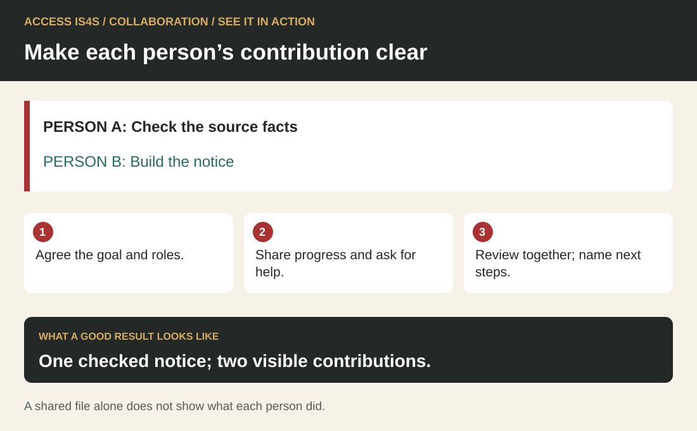
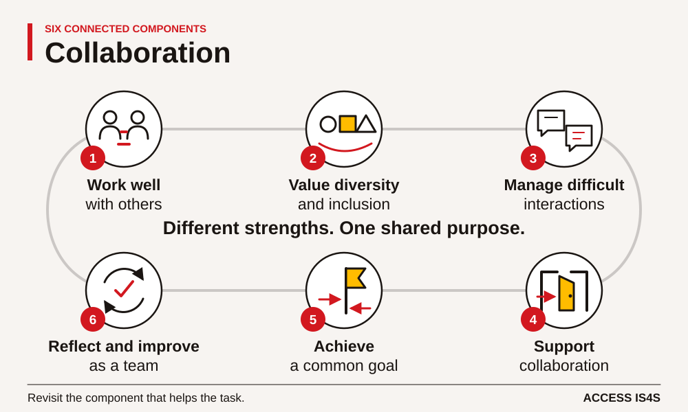
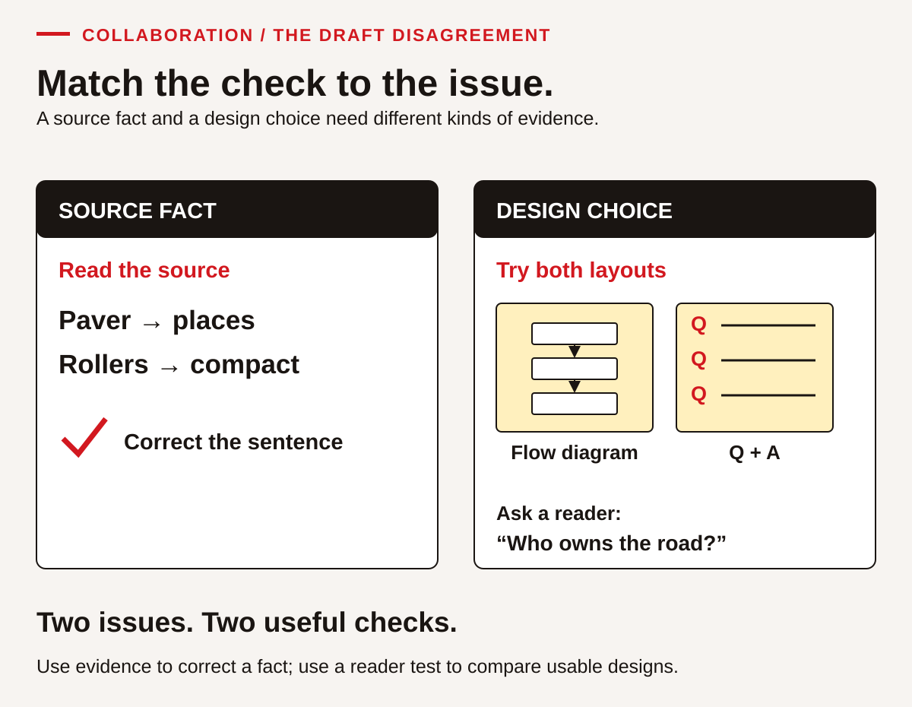
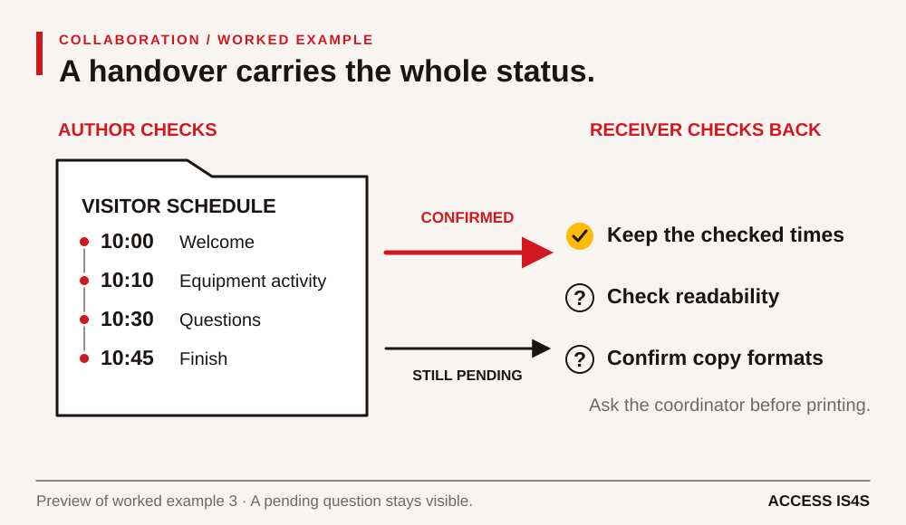

# Teaching Collaboration: make participation and coordination observable

A group can produce excellent work while one person makes every decision. It can also share responsibility thoughtfully and still need help correcting a factual error. Teaching Collaboration means attending to both the shared result and the interactions that produced it. Give learners a worthwhile common purpose, teach the practices that support it, and make each person's contribution visible without ranking personalities.

The learner chapter asks a team to prepare a fictional visitor information pack about introductory asphalt learning. The case supplies the facts, timetable and changes. It does not ask learners to simulate a Nation's governance or share community knowledge. In an ACCESS IS4S classroom, relationships matter, and participation must allow different communication modes, time to think and the choice to keep personal information private.

## See it in action · Collaboration

<!-- visual:quick-collaboration--practitioner -->
<figure class="teaching-figure diagram" data-visual="quick-collaboration--practitioner">

<figcaption>Visual guide One checked notice; two visible contributions. ACCESS IS4S. (2026). Original fictional teaching diagram. <a class="visual-original" href="../assets/diagrams/quick-collaboration.svg">Open full-size visual</a></figcaption>

Read the visual description

PERSON A: Check the source facts. PERSON B: Build the notice. Agree the goal and roles. Share progress and ask for help. Review together; name next steps. One checked notice; two visible contributions. A shared file alone does not show what each person did.

</figure>
<!-- /visual:quick-collaboration--practitioner -->

This small fictional example shows the skill in use. PERSON A: Check the source facts. PERSON B: Build the notice.

**Try it:** Agree the goal and roles. Share progress and ask for help. Review together; name next steps.

**Check your result:** One checked notice; two visible contributions. A shared file alone does not show what each person did.

## Teach all six components

<!-- visual:social-collaboration-six-components--practitioner-09 -->
<figure class="teaching-figure diagram" data-visual="social-collaboration-six-components--practitioner-09">

<figcaption>Visual guide Six connected components of collaboration. Short labels summarize the six skill components; numbers match the chapter list. Use the connections in the order the task needs. <a class="visual-original" href="../assets/diagrams/social-collaboration-six-components.svg">Open full-size visual</a></figcaption>

Read the visual description

An original task illustration occupies the left panel; six numbered actions appear on the right. Different strengths. One shared purpose. Six connected components: Work well with others; Value diversity and inclusion; Manage difficult interactions; Support collaboration; Achieve a common goal; Reflect and improve as a team. Revisit the component that helps the task.

</figure>
<!-- /visual:social-collaboration-six-components--practitioner-09 -->

Teach working well with others; valuing diversity and inclusion; managing difficult interactions; facilitating a collaborative environment; achieving a common goal; and reflecting to improve teamwork. Use them to notice actions rather than to assign a permanent description of a learner.

Agree the shared purpose, roles and a way to contribute. Practise including another perspective, handing over useful information and dealing with a task disagreement. Build and test a shared product, then improve one part of the team’s process. Assess the accuracy of the product separately from how each person worked with others.

## Begin with relationships and clear agreements

Build relationships and trust through clear, usable agreements. Use introductions that let people choose what to share. Invite each learner to name a useful contribution or a way they prefer to receive instructions. Avoid assigning roles by confidence, gender, age, cultural identity or previous job title. The quiet learner may be an excellent facilitator when given a clear structure; the confident speaker also needs practice listening.

CL-02 asks for observable working agreements. Help a team replace “be respectful” with “ask before replacing another person's wording” or “offer a printed copy before reviewing the shared screen.” Ask how someone can request a pause, challenge a claim or contribute through writing. Agreements should support participation rather than require disclosure. Check them during the work: an agreement has little value if nobody can use it when decisions become hurried.

## Explicitly teach the interaction

Make collaboration skills an explicit instructional target. Merely putting learners into groups does not teach a handover, a source-based disagreement or a useful invitation. Model one practice, let pairs try it, provide descriptive feedback and repeat with roles exchanged. Show the difference between describing an observable issue and making a judgement about someone.

For a handover, model three parts: what is finished, what is uncertain and what needs checking. The receiver restates the message before continuing. CL-03 and CL-10 offer practice, while CL-11 tests whether another person can use the output accurately. This connects Communication with the document-use demands of task boards, source briefs and draft versions. A spoken handover and a written board can complement one another.

## A worked teaching example: fact, preference or process?

<!-- visual:social-collaboration-two-checks--practitioner-09 -->
<figure class="teaching-figure diagram" data-visual="social-collaboration-two-checks--practitioner-09">

<figcaption>Visual guide Worked-example preview: check the equipment sentence against its source; test the two layouts with a reader. Different issues need different evidence. <a class="visual-original" href="../assets/diagrams/social-collaboration-two-checks.svg">Open full-size visual</a></figcaption>

Read the visual description

Two side-by-side checks distinguish a source fact from a design choice. The equipment statement is checked against the source: a paver places and rollers compact. A flow diagram and question-and-answer layout are both tested with a reader asking who owns the road. Different issues require different evidence.

</figure>
<!-- /visual:social-collaboration-two-checks--practitioner-09 -->

Use Case document 2 and CL-07. The draft says a roller places asphalt. The supplied introductory card assigns placement to the paver and compaction to rollers. Say: “This is a factual question with evidence available. Voting would tell us what the group prefers, not whether the sentence matches the source.” Model a correction that identifies the wording and evidence without labelling its author.

The same case includes a preference for a flow diagram versus question-and-answer boxes. Neither layout has been tested. Ask learners to set a criterion: can a visitor quickly find who owns the fictional road? Sketch both versions and ask a reader to use them. Record what the reader finds, then decide. The absence of an agreed correction process is a third issue; it needs a team agreement about checking and approving changes.

Have pairs rehearse this distinction in CL-08, with an observer recording one exact phrase that helped. Stop role-play if it becomes personal or discriminatory. CL-09 explicitly distinguishes ordinary task disagreement, conflicting sources and harmful behaviour needing instructor support. Demonstrating collaboration never requires tolerating harm or inventing a workplace reporting procedure.

## Structure group work so everyone can act

<!-- visual:social-collaboration-handover--practitioner-09 -->
<figure class="teaching-figure diagram" data-visual="social-collaboration-handover--practitioner-09">

<figcaption>Visual guide Worked-example preview: pass along the checked schedule and the unresolved format question. The receiver checks back before printing. <a class="visual-original" href="../assets/diagrams/social-collaboration-handover.svg">Open full-size visual</a></figcaption>

Read the visual description

A checked visitor schedule lists welcome at 10:00, an equipment activity at 10:10, questions at 10:30 and finish at 10:45. The receiving partner retains those confirmed times while readability and copy formats remain pending. The team asks the coordinator before printing.

</figure>
<!-- /visual:social-collaboration-handover--practitioner-09 -->

Use purposeful small-group activity, varied roles and active monitoring. Teams of two to four are manageable for this pack, but select grouping to fit the room and access needs. Provide each learner with the source. Rotate coordinator, source checker, drafter and reader-test roles; a person operating the keyboard should not automatically control decisions.

CL-12 gives a bounded five-minute facilitation turn. Observe whether the facilitator states a purpose, invites contributions, checks a dependency and confirms next actions. A written contribution or supported communication route counts. CL-13 adds a change in device access and requested formats. Ask everyone to identify one changed and one unchanged condition before the team revises its board. This makes Adaptability visible without quietly losing a member's role.

Do not stand back until a team fails. Monitor early and offer the smallest useful prompt. If one person has no access to the shared document, repair access before judging contribution. If a team is progressing, ask a question that deepens checking rather than taking over its decision.

## Assess contribution, product and improvement separately

Combine observation, meaningful tasks, reflection and formative feedback. Keep a brief evidence record: action, context, support and effect. “Invited a written response and used it to correct the schedule” is observable. “A natural team player” is not an instructional finding. Include self- and peer feedback, but teach contributors to describe events rather than award popularity scores.

Increase complexity through dependencies, changing resources, multiple perspectives or less obvious solutions. Keep participation conditions fair. Use CL-15 to distinguish product evidence from interaction evidence, then CL-16 to test one improvement. CL-18 brings the six components together. An unobserved role needs another opportunity; it should not be recorded as a failed performance.

Use the visitor pack for a low-stakes shared task and reflection; CL-02/CL-17 for agreements and transfer; and CL-07–CL-09 for difficult interactions. Give necessary prerequisites and safe materials even when an initial attempt is used diagnostically. The rule-comparison exercise below provides two complete fictional workplace briefs for a further discussion.

## Classroom exercise: compare rules and make a shared plan

Give pairs these two complete fictional workplace briefs. They are practice documents, not actual employer policies or universal legal requirements.

> **Brief A — practice resource desk.** Check the requested item and quantity against the order card. Record borrowed items before handover. Keep the walkway clear. Ask the desk coordinator about a discrepancy. Return the desk keys to the labelled drawer at the end of the shift.
>
> **Brief B — practice print room.** Check the requested item and quantity against the order card. Record completed copies before handover. Keep the walkway clear. Ask the print coordinator about a discrepancy. Put unused practice paper in the blue tray at the end of the shift.

Ask each person to identify a rule shared by both briefs and a rule specific to one. Then create a three-step handover for **three practice packs, each containing one order card and two blank sheets**. There are **three order cards and seven blank sheets** available. Assign a preparer, checker and handover role; in a pair, rotate the checking and handover turns so both people can contribute.

**Answer guidance.** Checking item/quantity and keeping the walkway clear appear in both briefs. Their records and discrepancy contacts serve similar purposes but name different outputs and roles. Key return belongs to A; the blue tray belongs to B. Two fictional briefs do not establish rules for every workplace. The packs require three order cards and six blank sheets, leaving one blank sheet. A usable handover checks those contents, records the completed quantity and identifies the intended recipient or asks if that detail is missing.

Introduce this disagreement: one partner wants to divide all seven blank sheets equally and describe the packs as identical. Ask for a response that checks the brief, considers the other person's reason and reaches an accurate plan. “Each pack needs two; we can record one spare separately” is supported. Calling another person careless is not a useful resolution. If the team suggests a different pack design, it must first seek confirmation of the changed requirement.

Observe an invitation to contribute, actual use or reasoned discussion of the contribution, a checked handover and each person's explanation. After a reader test, accept either a justified improvement or a decision to retain an already accurate plan. Keep the shared product separate from evidence of individual interaction.

<!-- teaching:cl-route-practitioner -->
## Collaboration route card

**Practise in four steps**

1. Agree the shared goal, each person’s role and a way for everyone to contribute.
2. Build a task board, complete your part and hand over the information another person needs.
3. Take a turn inviting contributions and resolving a task question. Ask for support when needed.
4. Test the shared product and one improvement to the team’s process. Record your own contribution.

**Support route.** Begin in a pair with the instructor as a practice partner. Use a task board with empty fields for responsibility, handover and check. A facilitation prompt card may say “purpose → invite → hear → dependency → next action → check back.” Record the scaffold and any live prompt separately. A learner can direct a scribe or use a written invitation. Do not assign all decisions permanently to the quickest speaker or keyboard user. Offer private practice and a different partner when needed.

**Retry route.** Select one observable interaction: wait for the written contribution, restate the handover, name a source discrepancy, or check the next-action summary. Try it with CK-CL Version 2 or another familiar small task. Keep the actual interaction and product result separate. A correct reader test can justify keeping the product; it does not require a manufactured revision. An absent disagreement is Not observed rather than proof of either conflict skill or failure.

**What the instructor observes.** Observe the contribution, handover and facilitation turn. A future plan does not show that the handover happened.

**Next-attempt agreement:** shared task ___; individual role/action ___; contribution mode ___; chosen process improvement ___; partners and observer ___; date/time ___; missing evidence ___.
<!-- /teaching:cl-route-practitioner -->

<!-- teaching:cl-case-practitioner -->
## CK-CL · Make a resource handover together

These four original cases give you another opportunity to use a skill after the chapter practice. **All people, rooms, events and organizations in these cards are fictional.** You can use these cases without sharing personal, family, community or cultural knowledge. They are classroom tasks, not instructions for operating equipment or following an actual workplace procedure.

Your instructor will give you the relevant card when your turn begins. Keep a sender's information separate from the receiver's card until after the exchange. If you have already read the information, say so: the activity remains useful practice, but that attempt cannot show how you receive an unfamiliar message. No one needs to conceal prior practice.

Agree your language, communication mode, tools, access supports and response time before beginning. Speech, sign, text, AAC, a learner-directed scribe and agreed interpretation can be appropriate. The person observing needs a reliable way to understand the meaning of your contribution. Receiving a message in writing shows reception through that mode; it does not automatically show auditory listening. You may decline audio/video recording and use live observation. Ask for a pause or another opportunity if the conditions are not usable. There is no requirement to look cheerful, make eye contact or disclose why you need an arrangement.

**Purpose:** three people prepare and test one accurate handover card. Work with the same source, contribute in an agreed mode and take turns facilitating. The group product and each person's collaboration are different kinds of evidence.

### CK-CL shared source · Northbank practice room

> **Fictional classroom brief · Version 1**
>
> The next group begins at **13:20**. Your three-person team will hand over the practice resources at a **13:10 check-in**.
>
> - **8 laminated maps** have been checked and are ready in **Bag A**.
> - **6 pencils** have been checked and are ready in **Box B**.
> - **2 clipboards** are at **Desk C**, waiting for the instructor's check. They are **not yet ready for handover**.
>
> The handover card must identify each resource, quantity, location and ready/pending status. It must state the check-in time and identify what still needs the instructor's decision. No learner is authorized to declare an unchecked clipboard ready.
>
> A receiver should be able to locate the ready resources and explain what to leave pending. The card can use headings, rows, symbols with text, or another agreed accessible layout. It is a practice document and must say so.

An earlier draft says: **“All 16 items are ready. Collect everything from Desk C.”** Check it against the source. Keep factual checking separate from a preference about how the corrected information should look.

### CK-CL role card 1 · Prepare and facilitate the first check-in

Your starting task is to organize the shared work. Invite each person's preferred contribution route and ask what they notice in the brief. At the first check-in, help the team agree the goal, who will do what and how corrections will be confirmed. Ask the others for reasons before the team chooses a layout. You may propose short labelled sections, but you are not required to insist on them or win a vote. Hand a clear next action to another member.

### CK-CL role card 2 · Check the source and facilitate the second check-in

Your starting task is to compare the draft with the source. Identify exact facts that need checking. At the second check-in, invite both other members' updates, explain a dependency or unresolved item and ask the group how to address it. You may propose a row for each resource, but listen to the other layout idea. A source fact cannot be decided by preference or majority vote. Confirm who will make the agreed change and who will check it.

### CK-CL role card 3 · Act for the receiver and facilitate the third check-in

Your starting task is to consider whether the next group can use the card. Ask where the ready maps and pencils are and how the pending clipboards are identified. At the third check-in, invite each person's review and help the team choose one way to improve the handover process. Test that process while handing the completed card to a reader. The process may involve a receiver restating pending work or a checker naming the source line. If the product is already accurate and usable, retain it with evidence from the test.

### CK-CL three check-ins and reader test

Each learner facilitates one check-in, provisionally five minutes with more time agreed when needed. During a check-in, the other members respond in their chosen modes and contribute an actual observation or proposal. Do not act out insults, discrimination or a personal conflict. A respectful disagreement about the draft or layout supplies enough practice. If no disagreement occurs, record that opportunity as absent; do not invent one in the evidence note.

A reader, who may be the instructor, uses only your finished card to answer:

1. Where are the maps and pencils, and which are ready?
2. What is still pending, and who can resolve that status?
3. When is the handover check-in?

Keep the reader's actual answers. Make a useful revision if the check reveals a need, or explain why the result supports keeping the current card. Each person identifies their own contribution. Then try the chosen handover improvement once and record what happened; planning a better interaction does not prove it happened.

### CK-CL later retry source · Hold until another attempt

For another short handover, use this **fictional Version 2 update**: one of the two clipboards at Desk C has now been checked and is ready; the second remains pending. The 8 maps, 6 pencils, their locations and the 13:10 check-in stay unchanged. Label the revision Version 2. Check that a receiver can distinguish the two clipboards' statuses without treating the whole location as ready. Use new role allocations where possible. This update is not authority to change any real equipment status.
<!-- /teaching:cl-case-practitioner -->

<!-- teaching:cl-key-practitioner -->
## CK-CL · Expected product and individual evidence

Version 1 must preserve **8 maps / Bag A / ready**, **6 pencils / Box B / ready**, **2 clipboards / Desk C / awaiting instructor check**, the **13:10 check-in**, and the fictional practice label. The next group's 13:20 start is useful context. There are 16 items altogether, but only 14 are ready; the incorrect draft confuses both status and location. A learner need not calculate totals to demonstrate the handover if each correct row is usable. No one can declare the two clipboards checked.

The Version 2 retry changes the clipboards to **1 ready and 1 pending**, both at Desk C; maps, pencils and check-in are unchanged. If totals are used, 15 items are ready and 1 pending. Check labels distinguish the two clipboard statuses. Layouts may differ; their usefulness is tested through the same reader questions.

| Criterion and component | Observable anchor | Limit or support to record |
|---|---|---|
| CK-CL.1 · Work well with other people | Learner agrees a role, contributes its work and gives/receives a clear handover. | A group signature does not show the individual action. |
| CK-CL.2 · Value diversity and inclusivity | Learner invites an available contribution route and actually considers the resulting idea or check. | “Any ideas?” alone shows an invitation, not that an unheard contribution influenced the decision. No cultural disclosure is required. |
| CK-CL.3 · Manage difficult interactions | Learner separates a factual discrepancy from a layout preference, hears another reason and proposes a relevant check. | Record Not observed if no disagreement opportunity occurred; do not stage harmful conduct. A boundary/support request can be appropriate. |
| CK-CL.4 · Facilitate collaboration | During the learner's turn: states purpose; invites both members; recognizes one dependency; summarizes next actions; checks a receiver's understanding. | Record each action separately in the mini-record below. Talking for five minutes is insufficient. |
| CK-CL.5 · Achieve a common goal | Learner coordinates their contribution and participates in verifying the shared product against the source and reader task. | Correct card quality does not establish everyone's contribution. |
| CK-CL.6 · Reflect and improve teamwork | Learner identifies an observed process issue or useful practice, tries the chosen improvement and compares the result. | A future plan alone is not an enacted improvement. A successful original product need not be changed. |

For **CK-CL.4 and the original CL-12**, use five separate observation lines: purpose; invitations and accessible routes; contribution received/responded to; dependency and assigned action; summary/check-back. On each, write the action or Not observed, the assistance and a next step. The invitation can be demonstrated even if another member declines; the declined contribution cannot be recorded as received or used. Allow processing time and an agreed alternative rather than treating a brief pause as refusal.

**Fictional moderation example, invitation and result.** A facilitator asks both members for a source check, waits for a written reply and uses “clipboards still pending” in the handover. This evidences more than issuing an invitation. Another asks “everyone okay?” and closes before a member can respond: record the invitation but not an accessible contribution/response. If the instructor then says “ask each person and wait for their answer,” the revised facilitation is supported on that action. If an interpreter or AAC tool conveys a learner-authored invitation, record the access condition without assuming someone else chose the action.

For **CL-14**, accept either a useful product revision **or a successful check with a reason to retain the product**. For example: “The reader found the five-stage order, Town of Willow Reach, 10:45 finish, two larger-print copies and the spoken review within 10:10–10:30; we retained the current card.” This is an evidence-based no-change outcome. “It looked good” without the reader evidence is insufficient.
<!-- /teaching:cl-key-practitioner -->
