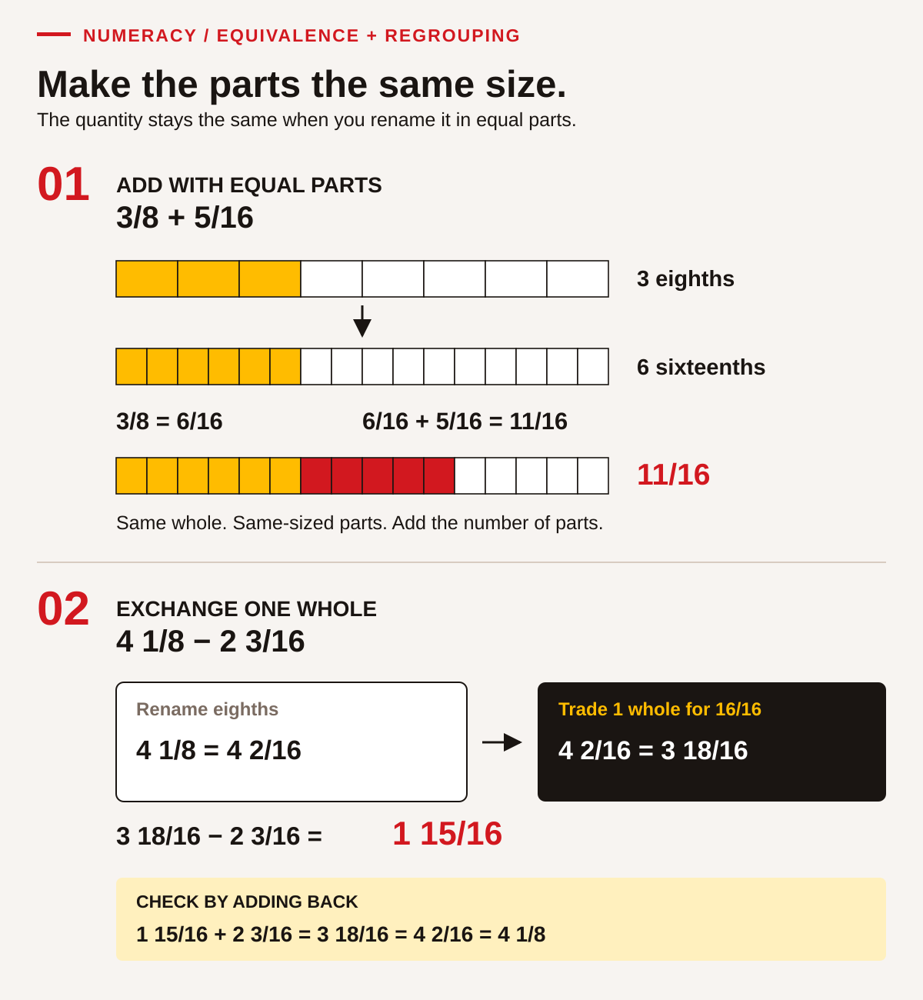
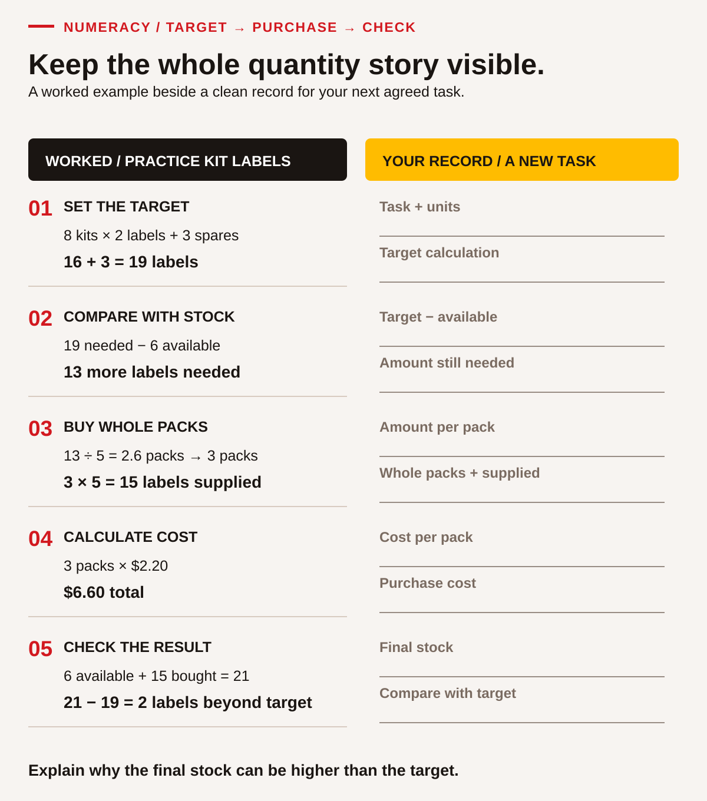

# Build equal parts, regrouping and unit conversions

Use a calculator if agreed, but first show what the numbers represent. Paper strips, tactile divisions or a drawing can make equal parts visible. Every fraction strip in a comparison must represent the same whole. Drawings support reasoning; they are not calibrated measuring tools.

## Begin with a small check

Show one-half and one-quarter of the same whole and explain which is larger. Then decide whether 2/4 and 1/2 can describe the same amount. If this is unclear, fold or mark a strip into equal parts before introducing written operations. If it is already clear, begin with equivalent denominators. Record the step you want to practise, rather than a general label about your maths ability.

## Connect equivalent fractions

Work through **3/8 + 5/16**. Each eighth can be split into two equal sixteenths, so 3/8 = 6/16. Now the parts have the same size: 6/16 + 5/16 = **11/16**. Keep the denominator 16 because it names the size of each counted part. Adding denominators would change that part size incorrectly.

Guided attempt: **1/4 + 3/8**. Find how many eighths equal a quarter. Record 2/8 + 3/8 = 5/8 and check on equal whole strips. Next try **1½ + 2¾**: 1½ = 1 2/4; sum 3 5/4 = 4¼. Discuss why five quarters include a whole and one quarter.

## Regroup one whole before subtracting

<!-- visual:edition3-fractions-regrouping--teaching-foundations-numeracy-entry-bridge -->
<figure class="teaching-figure diagram" data-visual="edition3-fractions-regrouping--teaching-foundations-numeracy-entry-bridge">

<figcaption>Visual guide Equivalent parts make addition and regrouping visible. <a class="visual-original" href="../../assets/diagrams/edition3-fractions-regrouping.svg">Open full-size visual</a></figcaption>

Read the visual description

Three eighths is six sixteenths. Adding five sixteenths gives eleven sixteenths. Four and one eighth is four and two sixteenths, or three and eighteen sixteenths. Subtracting two and three sixteenths leaves one and fifteen sixteenths. Adding the difference to the subtracted quantity returns four and one eighth.

</figure>
<!-- /visual:edition3-fractions-regrouping--teaching-foundations-numeracy-entry-bridge -->

Work through **4⅛ − 2 3/16**. First express the smaller parts alike: 4⅛ = 4 2/16. Two sixteenths cannot supply three sixteenths without regrouping. Exchange one of the four wholes for 16/16: **4 2/16 = 3 18/16**. The value has not changed. Subtract 2 3/16 to get **1 15/16**. Check by adding: 1 15/16 + 2 3/16 = 3 18/16 = 4 2/16 = 4⅛.

Guided attempt: **3¼ − 1⅝**. Convert 3¼ to 3 2/8, then regroup as 2 10/8. Subtract 1 5/8 to get 1 5/8. Explain the exchanged whole before checking with addition. If needed, physically exchange one whole strip for eight eighths.

## Convert a unit without changing the quantity

**1 m = 1,000 mm** means each metre contains a thousand millimetres. For example, 0.45 m × 1,000 = 450 mm. Reverse it: 450 mm ÷ 1,000 = 0.45 m. Notice that the numerical value grows when the unit becomes smaller; the described length stays the same. For a nominal classroom input, this does not establish a real measured object's precision.

Guided attempt: 0.32 m to millimetres. The answer is 320 mm. Check whether 32 mm or 3,200 mm could describe the same length, using the known metre relationship to explain the disagreement.

## Reconnect the arithmetic to a task

<!-- visual:edition3-quantity-check--teaching-foundations-numeracy-entry-bridge -->
<figure class="teaching-figure diagram" data-visual="edition3-quantity-check--teaching-foundations-numeracy-entry-bridge">

<figcaption>Visual guide Follow a quantity from the target through stock, whole packs, cost and a final check. <a class="visual-original" href="../../assets/diagrams/edition3-quantity-check.svg">Open full-size visual</a></figcaption>

Read the visual description

The worked example needs nineteen labels: eight kits times two labels plus three spares. Six labels are available, so thirteen more are needed. Packs contain five labels, so buy three whole packs. Three packs at two dollars and twenty cents cost six dollars and sixty cents. Final stock is twenty-one, two beyond the target. A separate blank record has space for the same five calculation stages using a new agreed example.

</figure>
<!-- /visual:edition3-quantity-check--teaching-foundations-numeracy-entry-bridge -->

Eight practice kits need two labels each, plus three spare labels. Six labels are available. Packs contain five labels and cost $2.20 each, with no other charge in this small example. Follow the record: 8 × 2 + 3 = target 19; 19 − 6 = 13 needed; 13 ÷ 5 = 2.6 packs, so 3 whole packs supply 15. Cost 3 × $2.20 = $6.60. Final available 6 + 15 = 21, two beyond the target. Explain why a pack count is different from a piece count and why rounding down would leave a shortage.

## Fresh exit tasks

1. Add **1⅜ + 2¼**. Show equal-sized parts and explain any whole made.
2. Subtract **4½ − 2¾**. Show the exchanged whole and check by addition.
3. Convert **0.58 m** to millimetres and reverse-check it.
4. Five practice kits need three labels each plus two spares. Four labels are available; packs contain six and cost $3 each with no other charge. Find whole packs, cost and final surplus beyond the target.

**Feedback:** 1) 3⅝; 2) 1¾, since 4½ = 3 6/4 and 3 6/4 − 2 3/4 = 1 3/4; 3) 580 mm; 4) target 17, shortage 13, 3 packs supply 18, cost $9, final 22, five beyond target. These exit answers are for review after the attempt. A fresh check uses different inputs with the completed example removed.

Continue to the relevant quantity, fraction or unit task when you have a method you can explain with your agreed tools. A partly completed table can support working memory without supplying which operation to choose. Keep calculations and an actual tool-measurement opportunity separate in the learning record.
